# Código consolidado da implementação Reg10k v0dtb
Este documento reúne os objetos-fonte usados pela implementação: código, configurações, esquemas, cenários, testes e documentação.
## Critérios de consolidação
- Ordem alfabética determinística por caminho relativo.
- Leitura e gravação em UTF-8.
- Exclusão de `.git/`, ambientes virtuais, caches, `node_modules/` e `saida/`.
- Exclusão de `site/index.html`, pois ele é gerado a partir de `catalogo/template.html`.
- Exclusão deste próprio consolidado para impedir auto-inclusão.
- Total de arquivos incluídos: **135**.

## Índice de arquivos
- `.github/workflows/ci.yml`
- `.gitignore`
- `alunos/__init__.py`
- `alunos/grupo_exemplo/__init__.py`
- `alunos/grupo_exemplo/controlador.py`
- `avaliacao/__init__.py`
- `avaliacao/espelho.py`
- `avaliacao/oraculo.py`
- `catalogo/__init__.py`
- `catalogo/__main__.py`
- `catalogo/executar.py`
- `catalogo/modelo.json`
- `catalogo/site.py`
- `catalogo/template.html`
- `catalogo/validar.py`
- `cenarios/esperado/DT01.json`
- `cenarios/esperado/DT02.json`
- `cenarios/esperado/DT03.json`
- `cenarios/esperado/DT04.json`
- `cenarios/esperado/DT05.json`
- `cenarios/esperado/DT06.json`
- `cenarios/esperado/DT07.json`
- `cenarios/esperado/DT08.json`
- `cenarios/esperado/DT09.json`
- `cenarios/esperado/DT10.json`
- `cenarios/esperado/DT11.json`
- `cenarios/esperado/DT12.json`
- `cenarios/esperado/F01.json`
- `cenarios/esperado/F02.json`
- `cenarios/esperado/F03.json`
- `cenarios/esperado/F04.json`
- `cenarios/esperado/F05.json`
- `cenarios/esperado/F06.json`
- `cenarios/esperado/FN01.json`
- `cenarios/esperado/FN02.json`
- `cenarios/esperado/FN03.json`
- `cenarios/esperado/FN04.json`
- `cenarios/esperado/FN05.json`
- `cenarios/esperado/FP01.json`
- `cenarios/esperado/FP02.json`
- `cenarios/esperado/FP03.json`
- `cenarios/esperado/N01.json`
- `cenarios/esperado/N02.json`
- `cenarios/esperado/N03.json`
- `cenarios/esperado/N04.json`
- `cenarios/esperado/N05.json`
- `cenarios/esperado/N06.json`
- `cenarios/roteiros/DT01.json`
- `cenarios/roteiros/DT02.json`
- `cenarios/roteiros/DT03.json`
- `cenarios/roteiros/DT04.json`
- `cenarios/roteiros/DT05.json`
- `cenarios/roteiros/DT06.json`
- `cenarios/roteiros/DT07.json`
- `cenarios/roteiros/DT08.json`
- `cenarios/roteiros/DT09.json`
- `cenarios/roteiros/DT10.json`
- `cenarios/roteiros/DT11.json`
- `cenarios/roteiros/DT12.json`
- `cenarios/roteiros/F01.json`
- `cenarios/roteiros/F02.json`
- `cenarios/roteiros/F03.json`
- `cenarios/roteiros/F04.json`
- `cenarios/roteiros/F05.json`
- `cenarios/roteiros/F06.json`
- `cenarios/roteiros/FN01.json`
- `cenarios/roteiros/FN02.json`
- `cenarios/roteiros/FN03.json`
- `cenarios/roteiros/FN04.json`
- `cenarios/roteiros/FN05.json`
- `cenarios/roteiros/FP01.json`
- `cenarios/roteiros/FP02.json`
- `cenarios/roteiros/FP03.json`
- `cenarios/roteiros/N01.json`
- `cenarios/roteiros/N02.json`
- `cenarios/roteiros/N03.json`
- `cenarios/roteiros/N04.json`
- `cenarios/roteiros/N05.json`
- `cenarios/roteiros/N06.json`
- `cenarios/sala.json`
- `docs/ambiente-simulacao-v02.md`
- `docs/ambiente-simulacao-v0dt.md`
- `docs/ambiente-simulacao-v0dta.md`
- `docs/ambiente-simulacao-v0dtb.md`
- `docs/plataforma/v1-business-drivers-plataforma-reg10k-v02.md`
- `docs/plataforma/v2v3-requisitos-plataforma-reg10k-v04.md`
- `docs/requisitos-v0dtb.md`
- `docs/resultado-estudo-comportamental-v0dtb.md`
- `docs/roteiro-alunos.md`
- `docs/uml/casos-de-uso.mmd`
- `docs/uml/classes.mmd`
- `docs/uml/componentes-v0dt.mmd`
- `docs/uml/componentes.mmd`
- `docs/uml/config.json`
- `docs/uml/espelho-v0dta.mmd`
- `docs/uml/estados-gemeo-remoto.mmd`
- `docs/uml/estados-luz.mmd`
- `docs/uml/estados-ocupacao.mmd`
- `docs/uml/sequencia-DT01.mmd`
- `docs/uml/sequencia-DT05.mmd`
- `docs/uml/sequencia-FN01.mmd`
- `docs/uml/sequencia-N01.mmd`
- `hub/__init__.py`
- `hub/comportamento.py`
- `hub/controlador.py`
- `hub/hub.py`
- `hub/registro.py`
- `hub/sincronizacao.py`
- `plataforma/__init__.py`
- `plataforma/canal.py`
- `plataforma/plataforma.py`
- `README.md`
- `requirements.txt`
- `schemas/catalogo.schema.json`
- `schemas/esperado.schema.json`
- `schemas/evento.schema.json`
- `schemas/metricas.schema.json`
- `schemas/roteiro.schema.json`
- `schemas/sala.schema.json`
- `sim/__init__.py`
- `sim/__main__.py`
- `sim/dispositivos.py`
- `sim/modelos.py`
- `sim/motor.py`
- `sim/mundo.py`
- `tests/conftest.py`
- `tests/dados/assinaturas-v0dt.json`
- `tests/test_catalogo.py`
- `tests/test_comportamento.py`
- `tests/test_espelho.py`
- `tests/test_gemeo.py`
- `tests/test_oraculo.py`
- `tests/test_schemas.py`
- `tools/consolidar_codigo.py`
- `tools/estudo_comportamental.py`

---

## Arquivo: `.github/workflows/ci.yml`

```yaml
name: catalogo

on:
  push:
  pull_request:
  workflow_dispatch:

jobs:
  catalogo:
    runs-on: ubuntu-latest
    steps:
      - uses: actions/checkout@v4
      - uses: actions/setup-python@v5
        with:
          python-version: "3.12"
          cache: pip
      - name: Dependências
        run: pip install -r requirements.txt
      - name: Testes
        run: python -m pytest -q
      - name: Catálogo completo (referência + alunos/, 30 sementes no modo realista e no canal realista)
        run: python -m catalogo --sementes 30
      - name: Validação dos JSON gerados
        run: python -m catalogo.validar
      - name: Publica a página e o catálogo
        if: always()
        uses: actions/upload-artifact@v4
        with:
          name: pagina-e-catalogo
          path: |
            site/index.html
            saida/catalogo.json
```

---

## Arquivo: `.gitignore`

```gitignore
__pycache__/
*.pyc
.pytest_cache/
saida/
.venv/
.DS_Store
```

---

## Arquivo: `alunos/__init__.py`

```python
"""Controladores dos grupos.

Para participar do catálogo, crie `alunos/<grupo>/__init__.py` exportando a
classe do controlador com o nome `Controlador`, como em `grupo_exemplo`.
"""
```

---

## Arquivo: `alunos/grupo_exemplo/__init__.py`

```python
"""Grupo de exemplo. Cada grupo expõe sua classe com o nome `Controlador`."""
from .controlador import ControladorConfirmaSP as Controlador

__all__ = ["Controlador"]
```

---

## Arquivo: `alunos/grupo_exemplo/controlador.py`

```python
"""Controlador de exemplo de um grupo (exercício E3 do plano §13.2).

Ideia: a passagem pela porta (SA) sozinha não acende a luz, porque o SA não
sabe a direção (RN09). A luz só acende quando o SP confirma presença. Isso
elimina os falsos positivos FP01 e FP03, ao custo de um pequeno atraso na
entrada (latência do PIR) e de não acender quando o PIR falha.

O controlador reaproveita a referência e altera só o gancho de decisão. Um
grupo pode, em vez disso, implementar a interface `Controlador` do zero.
"""
from __future__ import annotations

from hub.controlador import ControladorReferencia


class ControladorConfirmaSP(ControladorReferencia):
    nome = "grupo_exemplo"

    def _dispara_acendimento(self, causa: str, agora: int) -> bool:
        # A passagem só renova o contador de ausência; quem acende é o SP.
        return causa != "PASSAGEM_SA"
```

---

## Arquivo: `avaliacao/__init__.py`

```python

```

---

## Arquivo: `avaliacao/espelho.py`

```python
"""Cômodo espelho e amostras (plano v0dta §3 e §4).

O espelho é a sala desenhada só com o que o gêmeo sabe. Do lado real entram
a verdade (ocupantes com posição, lâmpada física); do lado do espelho, apenas
o que chegou ao DTReg10k-R (ou ao DTReg10k-L, na visão L). O espelho não tem
ocupantes: tem uma "mancha de presença", sem identidade, posição ou contagem
(RN09, RN34).

As amostras são retratos lado a lado em três instantes (início, meio, fim),
com os dados de cada lado. Saem em JSON e em SVG.
"""
from __future__ import annotations

from typing import Optional

from sim.modelos import ATUAL, LUZ_ACESA, PERCEPCAO, PLATAFORMA, VERDADE

ROTULOS = ("inicio", "meio", "fim")
NOMES_ROTULO = {"inicio": "Início", "meio": "Meio", "fim": "Fim"}
JANELA_SINAL_MS = 1500


def instantes(roteiro: dict) -> list[int]:
    if roteiro.get("amostras_ms"):
        return [int(t) for t in roteiro["amostras_ms"]][:3]
    dur = roteiro["duracao_ms"]
    acoes = sorted(a["t_ms"] for a in roteiro.get("acoes", []))
    ini = min((acoes[0] if acoes else 0) + 5000, dur // 4)
    return [ini, dur // 2, max(0, dur - 1000)]


def _ultimo(eventos: list[dict], t: int, filtro) -> Optional[dict]:
    achado = None
    for e in eventos:
        if e["t_ms"] > t:
            break
        if filtro(e):
            achado = e
    return achado


def _sinais(eventos: list[dict], t: int, camada: str, tipo_campo: str) -> dict:
    """SA recente e SP ativo segundo as evidências de uma camada."""
    sa = sp = False
    for e in eventos:
        if e["t_ms"] > t:
            break
        if e["camada"] != camada:
            continue
        tipo = e.get(tipo_campo)
        if tipo == "PASSAGEM" and t - e["t_ms"] <= JANELA_SINAL_MS:
            sa = True
        elif tipo == "MOVIMENTO":
            sp = True
        elif tipo == "FIM_MOVIMENTO":
            sp = False
    return {"sa_recente": sa, "sp_ativo": sp}


def amostras(an) -> list[dict]:
    ev = an.ev
    saida = []
    for rot, t in zip(ROTULOS, instantes(an.roteiro)):
        pos = _ultimo(ev, t, lambda e: e["camada"] == VERDADE and e["tipo"] == "POSICOES")
        presentes = _ultimo(ev, t, lambda e: e["camada"] == VERDADE and e["tipo"] == "OCUPANTES")
        est = _ultimo(ev, t, lambda e: e["camada"] == "ESTADO")
        res_l = _ultimo(ev, t, lambda e: e["camada"] == "ATUACAO" and e["tipo"] == "RESULTADO")
        rem = _ultimo(ev, t, lambda e: e["camada"] == PLATAFORMA and e["tipo"] == "ESTADO_REMOTO")
        res_r = _ultimo(ev, t, lambda e: e["camada"] == PLATAFORMA and e["tipo"] == "RESULTADO_RECEBIDO")
        cfg = _ultimo(ev, t, lambda e: e["camada"] == PLATAFORMA and e["tipo"] == "CONFIG_VERSAO")
        app = _ultimo(ev, t, lambda e: e["camada"] == PLATAFORMA and e["tipo"] == "APP_RESULTADO")
        hub = an.hub_ligado.em(t)
        saida.append({
            "rotulo": rot, "t_ms": t,
            "real": {
                "presentes": (presentes or {}).get("presentes", []),
                "luz_fisica": bool(an.luz.em(t)),
                "posicoes": (pos or {}).get("ocupantes", {}),
            },
            "L": {
                "hub_ligado": hub,
                "ocupacao": est["ocupacao"] if est and hub else None,
                "luz": est["luz"] if est and hub else None,
                "precedencia": est["precedencia"] if est and hub else None,
                "alertas": est["alertas"] if est and hub else [],
                "nivel_ultima_atuacao": (res_l or {}).get("nivel"),
                **_sinais(ev, t, PERCEPCAO, "tipo"),
                "classe": an.classe_espelho(t, "L"),
            },
            "R": {
                "ocupacao": (rem or {}).get("ocupacao"),
                "luz": (rem or {}).get("luz"),
                "atualidade": (rem or {}).get("atualidade", "SEM_EVIDENCIA"),
                "conexao": (rem or {}).get("conexao", "DESCONECTADO"),
                "idade_ms": None if not rem or rem.get("recepcao_ms") is None else t - rem["recepcao_ms"],
                "nivel_ultima_atuacao": (res_r or {}).get("nivel"),
                "config": None if not cfg else {"versao": cfg["versao"], "estado": cfg["estado"]},
                "ultimo_app": None if not app else {"chave": app["chave"], "nivel": app["nivel"], "final": app["final"]},
                **_sinais(ev, t, PLATAFORMA, "evidencia"),
                "classe": an.classe_espelho(t, "R"),
            },
        })
    return saida


# ---------------------------------------------------------------------- SVG
_COR_CLASSE = {"FIEL": "#1a7f4b", "PERCEPCAO": "#7c3aed", "SINCRONIZACAO": "#c2410c", "NAO_AFIRMA": "#64748b"}
_TXT_CLASSE = {"FIEL": "espelho fiel", "PERCEPCAO": "erro de percepção (sensores/controlador)",
               "SINCRONIZACAO": "erro de sincronização (canal/plataforma)", "NAO_AFIRMA": "espelho não afirma (desatualizado)"}


def _esc(s) -> str:
    return str(s if s is not None else "—").replace("&", "&amp;").replace("<", "&lt;").replace(">", "&gt;")


def _planta(sala: dict, x0: float, y0: float, px: float, acesa: bool, hachura: bool = False) -> list[str]:
    W, H = sala["largura_m"], sala["profundidade_m"]
    X = lambda x: x0 + x * px
    Y = lambda y: y0 + (H - y) * px
    porta, z, lamp = sala["porta"], sala["zonas_cegas"][0], sala["lampada"]
    out = [f'<rect x="{X(0)}" y="{Y(H)}" width="{W * px}" height="{H * px}" fill="{"#fdf6dc" if acesa else "#2c3240"}"/>']
    if acesa:
        out.append(f'<circle cx="{X(lamp["x"])}" cy="{Y(lamp["y"])}" r="{1.9 * px}" fill="#ffe680" opacity=".45"/>')
    out.append(f'<rect x="{X(z["x0"])}" y="{Y(z["y1"])}" width="{(z["x1"] - z["x0"]) * px}" height="{(z["y1"] - z["y0"]) * px}" '
               f'fill="url(#hz)" opacity=".5"/>')
    out.append(f'<path d="M{X(porta["x_inicio"])},{Y(0)} L{X(0)},{Y(0)} L{X(0)},{Y(H)} L{X(W)},{Y(H)} L{X(W)},{Y(0)} '
               f'L{X(porta["x_fim"])},{Y(0)}" stroke="#334155" stroke-width="5" fill="none"/>')
    out.append(f'<circle cx="{X(lamp["x"])}" cy="{Y(lamp["y"])}" r="9" fill="{"#facc15" if acesa else "#475569"}" stroke="#0f172a" stroke-width="1.5"/>')
    if hachura:
        out.append(f'<rect x="{X(0)}" y="{Y(H)}" width="{W * px}" height="{H * px}" fill="url(#hd)"/>')
    return out


def svg_amostra(sala: dict, a: dict, titulo: str, visao: str = "R") -> str:
    px, W, H = 56, sala["largura_m"], sala["profundidade_m"]
    larg = W * px
    xr, xe, y0 = 20, 20 + larg + 60, 52
    X = lambda x0, x: x0 + x * px
    Y = lambda y: y0 + (H - y) * px
    real, m = a["real"], a[visao]
    tipos = {x["id"]: x["tipo"] for x in sala["ocupantes"]}
    nomes = {x["id"]: x.get("nome", x["id"]) for x in sala["ocupantes"]}
    o = [f'<svg xmlns="http://www.w3.org/2000/svg" width="{2 * larg + 100}" height="{y0 + H * px + 150}" '
         f'font-family="Arial, Helvetica, sans-serif" font-size="12">',
         '<defs><pattern id="hz" width="6" height="6" patternUnits="userSpaceOnUse" patternTransform="rotate(45)">'
         '<line x1="0" y1="0" x2="0" y2="6" stroke="#94a3b8" stroke-width="2"/></pattern>'
         '<pattern id="hd" width="8" height="8" patternUnits="userSpaceOnUse" patternTransform="rotate(45)">'
         '<line x1="0" y1="0" x2="0" y2="8" stroke="#e2e8f0" stroke-width="2.5" opacity=".7"/></pattern></defs>',
         '<rect width="100%" height="100%" fill="#ffffff"/>',
         f'<text x="20" y="20" font-size="14" font-weight="700">{_esc(titulo)}</text>',
         f'<text x="{xr}" y="{y0 - 10}" font-weight="700">Sala real (verdade)</text>',
         f'<text x="{xe}" y="{y0 - 10}" font-weight="700">Cômodo espelho — {"plataforma (DTReg10k-R)" if visao == "R" else "hub (DTReg10k-L)"}</text>']
    # lado real
    o += _planta(sala, xr, y0, px, real["luz_fisica"])
    for oid, p in (real.get("posicoes") or {}).items():
        if not p:
            continue
        cao = tipos.get(oid) == "CACHORRO"
        o.append(f'<circle cx="{X(xr, p[0])}" cy="{Y(p[1])}" r="{9 if cao else 11}" fill="{"#9a5b13" if cao else "#2563eb"}" stroke="#fff" stroke-width="2"/>'
                 f'<text x="{X(xr, p[0])}" y="{Y(p[1]) + 4}" text-anchor="middle" font-size="10" font-weight="700" fill="#fff">{"R" if cao else "M"}</text>')
    # lado espelho
    if visao == "R":
        afirma = m.get("atualidade") == ATUAL
    else:
        afirma = bool(m.get("hub_ligado"))
    acesa_e = (m.get("luz") in LUZ_ACESA)
    o += _planta(sala, xe, y0, px, acesa_e, hachura=not afirma)
    ocup = m.get("ocupacao")
    cx, cy = X(xe, W / 2), Y(H / 2 - 0.7)
    if ocup == "OCUPADA":
        o.append(f'<ellipse cx="{cx}" cy="{cy}" rx="{1.7 * px}" ry="{1.2 * px}" fill="#22a06b" opacity=".38"/>'
                 f'<text x="{cx}" y="{cy + 4}" text-anchor="middle" font-weight="700" fill="#065f46">presença</text>')
    elif ocup == "DESCONHECIDA":
        o.append(f'<text x="{cx}" y="{cy + 10}" text-anchor="middle" font-size="34" font-weight="700" fill="#f5a524">?</text>')
    porta = sala["porta"]
    if m.get("sa_recente"):
        o.append(f'<line x1="{X(xe, porta["x_inicio"])}" y1="{Y(0)}" x2="{X(xe, porta["x_fim"])}" y2="{Y(0)}" stroke="#ef4444" stroke-width="6"/>')
    sp = sala["dispositivos"]["SP-01"]
    o.append(f'<circle cx="{X(xe, sp["x"]) - 9}" cy="{Y(sp["y"]) + 9}" r="7" fill="{"#06b6d4" if m.get("sp_ativo") else "#0e7490"}" '
             f'stroke="{"#fff" if m.get("sp_ativo") else "none"}" stroke-width="2"/>')
    # dados
    yt = y0 + H * px + 22
    linhas_r = [f"Na sala: {', '.join(nomes.get(i, i) for i in real['presentes']) or 'ninguém'}", f"Lâmpada: {'acesa' if real['luz_fisica'] else 'apagada'}"]
    if visao == "R":
        idade = m.get("idade_ms")
        linhas_e = [f"Ocupação: {_esc(ocup)} · luz: {_esc(m.get('luz'))}",
                    f"{_esc(m.get('atualidade'))} · {_esc(m.get('conexao'))}" + (f" · idade {idade / 1000:.0f} s" if idade is not None else ""),
                    f"Última atuação recebida: {_esc(m.get('nivel_ultima_atuacao'))}"]
        if m.get("config"):
            linhas_e.append(f"Configuração v{m['config']['versao']}: {m['config']['estado']}")
        if m.get("ultimo_app"):
            linhas_e.append(f"App: {m['ultimo_app']['chave']} → {m['ultimo_app']['nivel']}")
    else:
        linhas_e = [f"Ocupação: {_esc(ocup)} · luz: {_esc(m.get('luz'))}",
                    "hub ligado" if m.get("hub_ligado") else "hub desligado",
                    f"Última atuação: {_esc(m.get('nivel_ultima_atuacao'))}"]
    for i, l in enumerate(linhas_r):
        o.append(f'<text x="{xr}" y="{yt + 16 * i}">{_esc(l)}</text>')
    for i, l in enumerate(linhas_e):
        o.append(f'<text x="{xe}" y="{yt + 16 * i}">{_esc(l)}</text>')
    c = m["classe"]
    yb = yt + 16 * max(len(linhas_r), len(linhas_e)) + 10
    o.append(f'<rect x="{xr}" y="{yb}" width="{2 * larg + 60}" height="24" rx="5" fill="{_COR_CLASSE[c]}"/>'
             f'<text x="{xr + 10}" y="{yb + 16}" fill="#fff" font-weight="700">{_esc(_TXT_CLASSE[c])}</text>')
    o.append("</svg>")
    return "\n".join(o)


def salvar_amostras(pasta, sala: dict, roteiro: dict, controlador: str, lista: list[dict]) -> None:
    import json
    pasta.mkdir(parents=True, exist_ok=True)
    (pasta / "amostras.json").write_text(json.dumps(lista, ensure_ascii=False, indent=2), encoding="utf-8")
    for a in lista:
        t = a["t_ms"] / 1000
        titulo = f"{roteiro['id']} — {NOMES_ROTULO[a['rotulo']]} (t = {int(t // 60)}:{t % 60:04.1f}) · {controlador}"
        (pasta / f"{a['rotulo']}.svg").write_text(svg_amostra(sala, a, titulo), encoding="utf-8")
```

---

## Arquivo: `avaliacao/oraculo.py`

```python
"""Oráculo: métricas, invariantes e asserções (plano §10).

O oráculo é o único componente que lê a camada VERDADE junto com as demais.
Ele compara o que aconteceu (verdade) com o que o controlador decidiu e com o
que a lâmpada de fato fez.

v0dt: compara também três pontos de vista no mesmo instante — a verdade, o
DTReg10k-L (camada ESTADO) e o DTReg10k-R (camada PLATAFORMA) — e verifica as
invariantes OR-07 a OR-12 (plano v0dt §9).
"""
from __future__ import annotations

import math
from bisect import bisect_right
from typing import Any, Optional

from sim.modelos import (
    ACENDER, APAGADA_MANUAL, APAGAR, ATUACAO, ATUAL, AUTOMATICA, DECISAO, DESCONHECIDA,
    EFEITO_OBSERVADO, ESTADO, EXECUCAO_RELATADA, DESCONHECIDO, LUZ_ACESA, OCUPADA, PERCEPCAO, PLATAFORMA,
    REDE, SISTEMA, SUBSTITUIDA, VAZIA, VERDADE,
)

NIVEIS_VALIDOS = {EFEITO_OBSERVADO, EXECUCAO_RELATADA, DESCONHECIDO, SUBSTITUIDA}
INVARIANTES = tuple(f"OR-{i:02d}" for i in range(1, 13))
PRAZO_ATUALIDADE_MS = 5_000   # PS11: divergência L × R tolerada até a sincronização
# v0dta: classes de fidelidade do espelho (plano v0dta §5)
FIEL = "FIEL"
PERCEPCAO_ERRO = "PERCEPCAO"
SINCRONIZACAO = "SINCRONIZACAO"
NAO_AFIRMA = "NAO_AFIRMA"
CLASSES_ESPELHO = (FIEL, PERCEPCAO_ERRO, SINCRONIZACAO, NAO_AFIRMA)
FALHAS_DE_REDE = {"CANAL_DESCONECTA", "PLATAFORMA_FORA", "CANAL_LATENCIA", "CANAL_DUPLICA", "CANAL_PERDE"}
TIPOS_DETECCAO = {"PASSAGEM", "MOVIMENTO", "FIM_MOVIMENTO"}


# --------------------------------------------------------------------- séries
class Serie:
    """Série em degraus: valor vale a partir de t até a próxima mudança."""

    def __init__(self, inicial: Any):
        self.ts: list[int] = [0]
        self.vs: list[Any] = [inicial]

    def mudar(self, t: int, v: Any) -> None:
        if t == self.ts[-1]:
            self.vs[-1] = v
        elif v != self.vs[-1]:
            self.ts.append(t)
            self.vs.append(v)

    def em(self, t: int) -> Any:
        return self.vs[bisect_right(self.ts, t) - 1]

    def intervalos(self, fim: int):
        for i, (t, v) in enumerate(zip(self.ts, self.vs)):
            t1 = self.ts[i + 1] if i + 1 < len(self.ts) else fim
            if t1 > t:
                yield t, min(t1, fim), v


def _p95(xs: list[float]) -> Optional[float]:
    if not xs:
        return None
    s = sorted(xs)
    return s[max(0, math.ceil(0.95 * len(s)) - 1)]


def _cruzamento(series: list[Serie], fim: int, pred) -> float:
    """Soma o tempo em que pred(valores das séries) é verdadeiro."""
    pontos = sorted({t for s in series for t in s.ts if t < fim} | {fim})
    total = 0
    for a, b in zip(pontos, pontos[1:]):
        if pred(*[s.em(a) for s in series]):
            total += b - a
    return total


# -------------------------------------------------------------------- análise
class Analise:
    def __init__(self, eventos: list[dict], roteiro: dict, sala: dict, par: Optional[list[dict]] = None):
        self.ev = eventos
        self.roteiro = roteiro
        self.sala = sala
        self.par = par
        self.fim = roteiro["duracao_ms"]
        cfg = {**sala.get("controle", {}), **roteiro.get("controle", {})}
        self.t_apagamento = cfg.get("t_apagamento_ms", 60_000)
        self.t_apagamento_serie = Serie(self.t_apagamento)   # muda com CONFIG_APLICADA (v0dt)
        self.limite_atualidade = sala.get("plataforma", {}).get("limite_atualidade_ms", 60_000)
        # v0dt
        self.sessao = Serie(False)
        self.remoto_atual = Serie(False)
        self.remoto_valor = Serie((None, None))
        self.local_valor = Serie((DESCONHECIDA, "APAGADA"))
        self.estados_remotos: list[dict] = []
        self.mudancas_locais: list[dict] = []
        self.plataforma: list[dict] = []
        self.rede: list[dict] = []
        self.hub_ligado = Serie(True)

        self.ocupada = Serie(False)       # verdade: há ocupante na sala?
        self.luz = Serie(False)           # verdade: lâmpada emitindo luz?
        self.luz_estado = Serie("APAGADA")  # inferido: estado da luz no controlador
        self.ocupacao_inf = Serie(DESCONHECIDA)
        self.precedencia = Serie(AUTOMATICA)
        self.intencoes: list[dict] = []
        self.resultados: list[dict] = []
        self.comutacoes: list[dict] = []
        self.alertas: list[dict] = []
        self.sistema: list[dict] = []
        self.percepcao: list[dict] = []
        self.cruzamentos: list[dict] = []
        self.por_id = {e["id"]: e for e in eventos}

        for e in eventos:
            c, t = e["camada"], e["t_ms"]
            if c == VERDADE:
                if e["tipo"] == "OCUPANTES":
                    self.ocupada.mudar(t, bool(e["presentes"]))
                elif e["tipo"] == "LUZ_FISICA":
                    self.luz.mudar(t, bool(e["acesa"]))
                elif e["tipo"] == "CRUZOU_PORTA":
                    self.cruzamentos.append(e)
            elif c == ESTADO:
                self.luz_estado.mudar(t, e["luz"])
                self.ocupacao_inf.mudar(t, e["ocupacao"])
                self.precedencia.mudar(t, e["precedencia"])
                self.local_valor.mudar(t, (e["ocupacao"], e["luz"]))
                if e.get("mudanca"):
                    self.mudancas_locais.append(e)
            elif c == PLATAFORMA:
                self.plataforma.append(e)
                if e["tipo"] == "ESTADO_REMOTO":
                    self.estados_remotos.append(e)
                    self.remoto_atual.mudar(t, e["atualidade"] == ATUAL)
                    self.remoto_valor.mudar(t, (e["ocupacao"], e["luz"]))
            elif c == REDE:
                self.rede.append(e)
                if e["tipo"] == "SESSAO_ESTABELECIDA":
                    self.sessao.mudar(t, True)
                elif e["tipo"] == "SESSAO_CAIU":
                    self.sessao.mudar(t, False)
            elif c == DECISAO and e["tipo"] == "INTENCAO":
                self.intencoes.append(e)
            elif c == ATUACAO and e["tipo"] == "RESULTADO":
                self.resultados.append(e)
            elif c == ATUACAO and e["tipo"] == "COMUTACAO":
                self.comutacoes.append(e)
            elif c == SISTEMA:
                self.sistema.append(e)
                if e["tipo"] == "ALERTA":
                    self.alertas.append(e)
                elif e["tipo"] == "HUB_DESLIGADO":
                    self.hub_ligado.mudar(t, False)
                elif e["tipo"] == "HUB_LIGADO":
                    self.hub_ligado.mudar(t, True)
                elif e["tipo"] == "CONFIG_APLICADA" and "t_apagamento_ms" in e:
                    self.t_apagamento_serie.mudar(t, e["t_apagamento_ms"])
            elif c == PERCEPCAO:
                self.percepcao.append(e)

    # ------------------------------------------------------------- métricas
    def metricas(self) -> dict:
        fim = self.fim
        desperdicio = _cruzamento([self.luz, self.ocupada], fim, lambda l, o: l and not o)
        # Escuro com ocupante, exceto quando o morador apagou de propósito
        escuro = _cruzamento([self.luz, self.ocupada, self.luz_estado], fim,
                             lambda l, o, s: (not l) and o and s != APAGADA_MANUAL)

        indevidos = [i for i in self.intencoes
                     if i["acao"] == APAGAR and i["precedencia"] == AUTOMATICA and self.ocupada.em(i["t_ms"])]

        latencias = []
        for i in self.intencoes:
            ev = self.por_id.get(i.get("evidencia_id") or "")
            if ev is not None:
                latencias.append(i["t_ms"] - ev["t_ms"])

        # Atraso percebido: entrada em sala vazia e escura → luz acesa de fato
        atrasos = []
        for c in self.cruzamentos:
            t = c["t_ms"]
            if c["sentido"] != "ENTRADA" or self.ocupada.em(t - 1) or self.luz.em(t):
                continue
            prox = [ts for ts, v in zip(self.luz.ts, self.luz.vs) if ts >= t and v]
            atrasos.append((prox[0] if prox else fim) - t)

        # Desperdício por saída: sala fica vazia com luz acesa → luz apagada
        por_saida = []
        for c in self.cruzamentos:
            t = c["t_ms"]
            if c["sentido"] != "SAIDA" or self.ocupada.em(t + 1) or not self.luz.em(t):
                continue
            prox = [ts for ts, v in zip(self.luz.ts, self.luz.vs) if ts > t and not v]
            por_saida.append((prox[0] if prox else fim) - t)

        desconhecida = _cruzamento([self.ocupacao_inf], fim, lambda o: o == DESCONHECIDA)
        # O controlador começa em Desconhecida até a primeira avaliação; desconta o 1º segundo
        return {
            "desperdicio_s": round(desperdicio / 1000, 1),
            "escuro_com_ocupante_s": round(escuro / 1000, 1),
            "apagamentos_indevidos": len(indevidos),
            "acionamentos": len(self.intencoes),
            "latencia_reacao_ms_p95": _p95(latencias),
            "latencia_reacao_ms_max": max(latencias) if latencias else None,
            "atraso_percebido_ms_max": max(atrasos) if atrasos else None,
            "desperdicio_por_saida_s_max": round(max(por_saida) / 1000, 1) if por_saida else None,
            "ocupacao_desconhecida_s": round(desconhecida / 1000, 1),
            "tempo_ocupada_s": round(_cruzamento([self.ocupada], fim, bool) / 1000, 1),
            "tempo_luz_acesa_s": round(_cruzamento([self.luz], fim, bool) / 1000, 1),
            "alertas": sorted({a["alerta"] for a in self.alertas if a["ativo"]}),
            **self.metricas_gemeo(),
            **self.metricas_espelho(),
        }

    # ------------------------------------------------------ espelho (v0dta)
    def classe_espelho(self, t: int, visao: str = "R") -> str:
        """Compara o espelho com a verdade no instante t e classifica a causa da diferença."""
        real_ocup, real_luz = self.ocupada.em(t), self.luz.em(t)
        hub = self.hub_ligado.em(t)
        l_ocup, l_luz = self.local_valor.em(t)
        l_ok = hub and l_ocup != DESCONHECIDA and (l_ocup == OCUPADA) == real_ocup and (l_luz in LUZ_ACESA) == real_luz
        if visao == "L":
            if not hub or l_ocup == DESCONHECIDA:
                return NAO_AFIRMA  # hub desligado ou incerteza declarada (RN01)
            return FIEL if l_ok else PERCEPCAO_ERRO
        r_ocup, r_luz = self.remoto_valor.em(t)
        if not self.remoto_atual.em(t) or r_ocup in (None, DESCONHECIDA):
            return NAO_AFIRMA  # desatualizado, sem evidência ou ocupação desconhecida
        r_ok = r_ocup not in (None, DESCONHECIDA) and (r_ocup == OCUPADA) == real_ocup and (r_luz in LUZ_ACESA) == real_luz
        if r_ok:
            return FIEL
        return PERCEPCAO_ERRO if not l_ok else SINCRONIZACAO

    def segmentos_espelho(self, visao: str = "R") -> list[list]:
        series = (self.ocupada, self.luz, self.hub_ligado, self.local_valor, self.remoto_atual, self.remoto_valor)
        pontos = sorted({t for s in series for t in s.ts if t < self.fim} | {0, self.fim})
        segs: list[list] = []
        for a, b in zip(pontos, pontos[1:]):
            c = self.classe_espelho(a, visao)
            if segs and segs[-1][2] == c:
                segs[-1][1] = b
            else:
                segs.append([a, b, c])
        return segs

    def metricas_espelho(self) -> dict:
        tot = {c: 0 for c in CLASSES_ESPELHO}
        for a, b, c in self.segmentos_espelho("R"):
            tot[c] += b - a
        return {
            "espelho_fiel_s": round(tot[FIEL] / 1000, 1),
            "erro_de_percepcao_s": round(tot[PERCEPCAO_ERRO] / 1000, 1),
            "erro_de_sincronizacao_s": round(tot[SINCRONIZACAO] / 1000, 1),
            "espelho_nao_afirma_s": round(tot[NAO_AFIRMA] / 1000, 1),
            "espelho_fiel_pct": round(100 * tot[FIEL] / self.fim, 1) if self.fim else None,
        }

    # ------------------------------------------------------- métricas v0dt
    def _comandos(self) -> dict[str, dict]:
        cmds: dict[str, dict] = {}
        for e in self.plataforma:
            if e["tipo"] == "APP_COMANDO":
                cmds[e["chave"]] = {"t_app": e["t_ms"], "acao": e["acao"], "exibicoes": []}
            elif e["tipo"] == "APP_RESULTADO" and e["chave"] in cmds:
                cmds[e["chave"]]["exibicoes"].append(e)
        for e in self.sistema:
            if e["tipo"] == "COMANDO_REMOTO_RECEBIDO" and e["chave"] in cmds:
                cmds[e["chave"]].setdefault("recebidos", []).append(e)
        for i in self.intencoes:
            if i.get("chave_remota") in cmds:
                cmds[i["chave_remota"]].setdefault("intencoes", []).append(i)
        return cmds

    def metricas_gemeo(self) -> dict:
        fim = self.fim
        # Atualidade: mudança no L (com sessão ativa) até o R refleti-la
        atrasos = []
        for m in self.mudancas_locais:
            if not self.sessao.em(m["t_ms"]):
                continue
            seg = [r for r in self.estados_remotos if r.get("ref_seq", -1) >= m["seq"] and r["t_ms"] >= m["t_ms"]]
            if seg:
                atrasos.append(seg[0]["t_ms"] - m["t_ms"])
        cmds = self._comandos()
        lat_cmd = [c["exibicoes"][0]["latencia_ms"] for c in cmds.values() if c["exibicoes"]]
        vencidos = 0
        duplicados = 0
        for c in cmds.values():
            validade = {r["valida_ate_ms"] for r in c.get("recebidos", [])}
            its = c.get("intencoes", [])
            duplicados += max(0, len(its) - 1)
            vencidos += sum(1 for i in its if validade and i["t_ms"] > min(validade))
        # Reconciliação: sessão restabelecida → R volta a ATUAL
        reconc = []
        estab = [e["t_ms"] for e in self.rede if e["tipo"] == "SESSAO_ESTABELECIDA"]
        for t in estab[1:]:
            prox = [r["t_ms"] for r in self.estados_remotos if r["t_ms"] >= t and r["atualidade"] == ATUAL]
            reconc.append((prox[0] if prox else fim) - t)
        # Divergência L × R além do prazo de sincronização, com o R dizendo "atual"
        pontos = sorted({t for s in (self.remoto_atual, self.remoto_valor, self.local_valor) for t in s.ts if t < fim}
                        | {fim})
        divergencia, inicio = 0, None
        for a, b in zip(pontos, pontos[1:]):
            dif = self.remoto_atual.em(a) and self.remoto_valor.em(a) != self.local_valor.em(a)
            if dif:
                inicio = a if inicio is None else inicio
                divergencia += max(0, b - max(a, inicio + PRAZO_ATUALIDADE_MS))
            else:
                inicio = None
        sinc = next((e for e in self.sistema if e["tipo"] == "SINCRONIZACAO"), None)
        hub = (sinc or {}).get("hub", {})
        nao_atual = _cruzamento([self.remoto_atual], fim, lambda v: not v)
        return {
            "atualidade_gemeo_ms_p95": _p95(atrasos),
            "comando_remoto_ms_p95": _p95(lat_cmd),
            "comandos_remotos": len(cmds),
            "comandos_vencidos_executados": vencidos,
            "efeitos_duplicados_remotos": duplicados,
            "reconciliacao_ms_max": max(reconc) if reconc else None,
            "divergencia_alem_prazo_s": round(divergencia / 1000, 1),
            "gemeo_nao_atual_s": round(nao_atual / 1000, 1),
            "eventos_nao_entregues": hub.get("pendentes_na_fila"),
            "fila_max": hub.get("fila_max"),
        }

    # ----------------------------------------------------------- invariantes
    def invariantes(self) -> dict:
        r: dict[str, list[str]] = {k: [] for k in INVARIANTES}

        # OR-01: seq estritamente crescente e ids únicos (registro só acréscimo)
        seqs = [e["seq"] for e in self.ev]
        if seqs != list(range(1, len(seqs) + 1)):
            r["OR-01"].append("seq não é 1..n contínuo")
        if len({e["id"] for e in self.ev}) != len(self.ev):
            r["OR-01"].append("ids repetidos")

        # OR-02: nível de resultado válido e nunca acima da capacidade da lâmpada
        cap = self.sala.get("dispositivos", {}).get("LAMP-01", {}).get("capacidade", EFEITO_OBSERVADO)
        for res in self.resultados:
            if res["nivel"] not in NIVEIS_VALIDOS:
                r["OR-02"].append(f"nível inválido {res['nivel']} em {res['id']}")
            if res["nivel"] == EFEITO_OBSERVADO and cap != EFEITO_OBSERVADO:
                r["OR-02"].append(f"efeito observado sem capacidade em {res['id']}")

        # OR-03: ocupação Vazia só após T_apagamento sem detecção
        deteccoes = sorted(
            e["t_ms"] for e in self.percepcao
            if e["tipo"] in TIPOS_DETECCAO or (e["tipo"] == "HEARTBEAT" and e.get("alto"))
        )
        anterior = None
        for e in self.ev:
            if e["camada"] != ESTADO:
                continue
            if e["ocupacao"] == VAZIA and anterior != VAZIA:
                t = e["t_ms"]
                ult = [d for d in deteccoes if d <= t]
                # o T_apagamento vigente pode mudar por configuração (v0dt); vale o menor do intervalo
                t_ap = min(self.t_apagamento_serie.em(ult[-1]), self.t_apagamento_serie.em(t)) if ult else 0
                if ult and t - ult[-1] < t_ap - 100:
                    r["OR-03"].append(f"Vazia em t={t} ms, {t - ult[-1]} ms após a última detecção")
            anterior = e["ocupacao"]
        # reinícios zeram a referência do controlador; nada a fazer aqui

        # OR-04: nenhum apagamento automático com ocupação desconhecida
        for i in self.intencoes:
            if i["acao"] == APAGAR and i["precedencia"] == AUTOMATICA and i.get("ocupacao_no_momento") == DESCONHECIDA:
                r["OR-04"].append(f"APAGAR automático com ocupação desconhecida em t={i['t_ms']} ms")

        # OR-05: cada chave produz no máximo um efeito
        vistas: dict[str, int] = {}
        for c in self.comutacoes:
            vistas[c["chave"]] = vistas.get(c["chave"], 0) + 1
        for k, n in vistas.items():
            if n > 1:
                r["OR-05"].append(f"chave {k} produziu {n} efeitos")

        # OR-06: o controlador nunca recebe a verdade
        fim = [e for e in self.sistema if e["tipo"] == "FIM"]
        if fim and fim[-1].get("entregas_ao_controlador", {}).get("VERDADE", 0):
            r["OR-06"].append("eventos de verdade entregues ao controlador")

        self._invariantes_gemeo(r)
        saida = {k: {"ok": not v, "violacoes": v[:5]} for k, v in r.items()}
        if self.par is None:
            saida["OR-12"]["aplica"] = False
        return saida

    def _invariantes_gemeo(self, r: dict) -> None:
        cmds = self._comandos()
        # OR-07: nenhuma intenção remota executada após validaAte
        for chave, c in cmds.items():
            for rec in c.get("recebidos", []):
                if rec["decisao"] == "ACEITO" and rec["t_ms"] > rec["valida_ate_ms"]:
                    r["OR-07"].append(f"{chave} aceito vencido em t={rec['t_ms']} ms")
            validade = [x["valida_ate_ms"] for x in c.get("recebidos", [])]
            for i in c.get("intencoes", []):
                if validade and i["t_ms"] > min(validade):
                    r["OR-07"].append(f"{chave} executado em t={i['t_ms']} ms após {min(validade)} ms")
        # OR-08: o R nunca diz "atual" com idade acima do limite ou sem sessão
        lim = self.limite_atualidade
        for i, e in enumerate(self.estados_remotos):
            if e["atualidade"] != ATUAL:
                continue
            if e["conexao"] != "CONECTADO":
                r["OR-08"].append(f"ATUAL sem sessão em t={e['t_ms']} ms")
            fim_int = self.estados_remotos[i + 1]["t_ms"] if i + 1 < len(self.estados_remotos) else self.fim
            rec = e.get("recepcao_ms")
            if rec is None or fim_int - rec > lim + 200:
                r["OR-08"].append(f"ATUAL até t={fim_int} ms com estado recebido em {rec} ms")
        for e in self.plataforma:
            if e["tipo"] == "APP_CONSULTA" and e.get("atualidade") == ATUAL:
                if e.get("conexao") != "CONECTADO" or (e.get("idade_ms") or 0) > lim:
                    r["OR-08"].append(f"app mostrou ATUAL em t={e['t_ms']} ms com idade {e.get('idade_ms')} ms")
        # OR-09: estado aplicado no R só avança (n e ref_seq crescentes)
        aplic = [e for e in self.estados_remotos if "n" in e]
        for a, b in zip(aplic, aplic[1:]):
            if b["n"] <= a["n"] or b["ref_seq"] < a["ref_seq"]:
                r["OR-09"].append(f"estado mais antigo aplicado em t={b['t_ms']} ms (n {a['n']} → {b['n']})")
        # OR-10: versão aplicada no hub ≤ vigente no R; pendente termina resolvida
        criadas = [(0, 1)] + [(e["t_ms"], e["versao"]) for e in self.plataforma
                              if e["tipo"] == "CONFIG_VERSAO" and e["estado"] == "PENDENTE"]
        for e in self.sistema:
            if e["tipo"] == "CONFIG_APLICADA":
                vigente = max(v for t, v in criadas if t <= e["t_ms"])
                if e["versao"] > vigente:
                    r["OR-10"].append(f"hub aplicou v{e['versao']} com vigente v{vigente} em t={e['t_ms']} ms")
        final: dict[int, tuple] = {}
        for e in self.plataforma:
            if e["tipo"] == "CONFIG_VERSAO":
                final[e["versao"]] = (e["estado"], e["t_ms"])
        for v, (estado, t) in final.items():
            if estado == "PENDENTE" and self.sessao.em(self.fim) and t < self.fim - 15_000:
                ultima_sessao = max([x["t_ms"] for x in self.rede if x["tipo"] == "SESSAO_ESTABELECIDA"] or [0])
                if self.fim - max(t, ultima_sessao) > 15_000:
                    r["OR-10"].append(f"v{v} continua pendente com sessão ativa")
        # OR-11: cada comando remoto produz no máximo um efeito
        for chave, c in cmds.items():
            if len(c.get("intencoes", [])) > 1:
                r["OR-11"].append(f"{chave} gerou {len(c['intencoes'])} intenções")
        # OR-12: com a rede ou a plataforma fora, as decisões locais são as mesmas
        if self.par is not None:
            a, b = _assinatura(self.ev), _assinatura(self.par)
            if a != b:
                dif = next((i for i, (x, y) in enumerate(zip(a, b)) if x != y), min(len(a), len(b)))
                r["OR-12"].append(f"decisões locais diferem da execução sem falha de rede a partir do item {dif}: "
                                  f"{a[dif] if dif < len(a) else '—'} × {b[dif] if dif < len(b) else '—'}")

    # ------------------------------------------------------------- asserções
    def verificar(self, a: dict, metricas: dict) -> tuple[bool, str]:
        e = a["entao"]
        tipo = e["tipo"]
        if tipo == "metrica":
            v = metricas.get(e["nome"])
            if v is None:
                return False, f"{e['nome']} indisponível"
            ok = True
            if "max" in e and v > e["max"]:
                ok = False
            if "min" in e and v < e["min"]:
                ok = False
            if "igual" in e and v != e["igual"]:
                ok = False
            return ok, f"{e['nome']} = {v}"
        if tipo == "luz":
            alvo = e["valor"] == "ACESA"
            if "em_ms" in e:
                v = self.luz.em(e["em_ms"])
                return v == alvo, f"luz em {e['em_ms']} ms = {'ACESA' if v else 'APAGADA'}"
            desde = e.get("desde_ms", 0)
            ate = e["ate_ms"]
            pontos = [t for t in self.luz.ts if desde <= t <= ate] + [desde]
            ok = any(self.luz.em(t) == alvo for t in pontos)
            return ok, f"luz {'atinge' if ok else 'não atinge'} {e['valor']} entre {desde} e {ate} ms"
        if tipo == "luz_constante":
            a0, a1 = e["entre_ms"]
            alvo = e["valor"] == "ACESA"
            pontos = [a0] + [t for t in self.luz.ts if a0 < t <= a1]
            ok = all(self.luz.em(t) == alvo for t in pontos)
            return ok, f"luz {'constante' if ok else 'muda'} em [{a0}, {a1}] ms"
        if tipo in ("intencao", "sem_intencao"):
            a0, a1 = e.get("entre_ms", [0, self.fim])
            achadas = [i for i in self.intencoes
                       if a0 <= i["t_ms"] <= a1 and i["acao"] == e["acao"]
                       and ("causa" not in e or i["causa"] == e["causa"])
                       and ("precedencia" not in e or i["precedencia"] == e["precedencia"])]
            if tipo == "intencao":
                n_min = e.get("min", 1)
                n_max = e.get("max", 10**9)
                ok = n_min <= len(achadas) <= n_max
            else:
                ok = not achadas
            ts = [i["t_ms"] for i in achadas][:5]
            return ok, f"{len(achadas)} intenção(ões) {e['acao']} em [{a0}, {a1}] ms {ts}"
        if tipo == "ocupacao":
            v = self.ocupacao_inf.em(e["em_ms"])
            return v == e["valor"], f"ocupação inferida em {e['em_ms']} ms = {v}"
        if tipo == "alerta":
            ativos = [x for x in self.alertas if x["alerta"] == e["alerta"] and x["ativo"]]
            a0, a1 = e.get("entre_ms", [0, self.fim])
            ok = any(a0 <= x["t_ms"] <= a1 for x in ativos)
            return ok, f"alerta {e['alerta']} {'ativado' if ok else 'não ativado'} em [{a0}, {a1}] ms"
        if tipo == "resultado":
            achados = [x for x in self.resultados if x["nivel"] == e["nivel"]
                       and ("divergencia" not in e or x["divergencia"] == e["divergencia"])]
            return bool(achados), f"{len(achados)} resultado(s) {e['nivel']}"
        if tipo == "evento":
            a0, a1 = e.get("entre_ms", [0, self.fim])
            achados = [x for x in self.ev if x["camada"] == e["camada"] and x["tipo"] == e["evento"]
                       and a0 <= x["t_ms"] <= a1
                       and all(x.get(k) == v for k, v in e.get("campos", {}).items())]
            n_min = e.get("min", 1)
            n_max = e.get("max", 10**9)
            return n_min <= len(achados) <= n_max, f"{len(achados)} evento(s) {e['camada']}/{e['evento']}"
        if tipo == "espelho":
            c = self.classe_espelho(e["em_ms"], e.get("visao", "R"))
            return c == e["classe"], f"espelho {e.get('visao', 'R')} em {e['em_ms']} ms: {c}"
        if tipo == "gemeo":
            t = e["em_ms"]
            ultimos = [x for x in self.estados_remotos if x["t_ms"] <= t]
            if not ultimos:
                return False, f"DTReg10k-R sem estado em {t} ms"
            x = ultimos[-1]
            difs = [k for k in ("atualidade", "ocupacao", "luz", "conexao", "precedencia") if k in e and x.get(k) != e[k]]
            vals = ", ".join(f"{k}={x.get(k)}" for k in ("atualidade", "ocupacao", "luz", "conexao"))
            return not difs, f"DTReg10k-R em {t} ms: {vals}"
        if tipo == "comando":
            cmds = list(self._comandos().items())
            idx = e.get("indice", 1)
            if len(cmds) < idx:
                return False, f"comando {idx} não encontrado"
            chave, c = cmds[idx - 1]
            exib = [x for x in c["exibicoes"] if x["final"]] if e.get("final", True) else c["exibicoes"]
            if not exib:
                return False, f"{chave}: o app não mostrou resultado {'final ' if e.get('final', True) else ''}"
            x = exib[0]
            ok = x["nivel"] == e["nivel"]
            if "motivo" in e:
                ok = ok and x.get("motivo") == e["motivo"]
            if "latencia_max_ms" in e:
                ok = ok and x["latencia_ms"] <= e["latencia_max_ms"]
            return ok, f"{chave}: app mostra {x['nivel']} ({x.get('motivo') or '—'}) após {x['latencia_ms']} ms"
        if tipo == "config":
            ate = e.get("ate_ms", self.fim)
            ests = [x for x in self.plataforma if x["tipo"] == "CONFIG_VERSAO" and x["versao"] == e["versao"]
                    and x["t_ms"] <= ate]
            if not ests:
                return False, f"versão {e['versao']} não existe até {ate} ms"
            x = ests[-1]
            return x["estado"] == e["estado"], f"versão {e['versao']}: {x['estado']} em {x['t_ms']} ms"
        if tipo == "app_consulta":
            cons = [x for x in self.plataforma if x["tipo"] == "APP_CONSULTA"]
            idx = e.get("indice", 1)
            if len(cons) < idx:
                return False, f"consulta {idx} não encontrada"
            x = cons[idx - 1]
            difs = [k for k, v in e.get("campos", {}).items() if x.get(k) != v]
            vals = ", ".join(f"{k}={x.get(k)}" for k in e.get("campos", {}))
            return not difs, f"consulta {idx} em {x['t_ms']} ms: {vals}"
        if tipo == "relogio_nao_confiavel":
            depois = [x for x in self.ev if x["camada"] not in (VERDADE, REDE, PLATAFORMA) and x["t_ms"] >= e["apos_ms"]]
            ok = bool(depois) and all(x.get("relogio_confiavel") is False for x in depois)
            return ok, f"{len(depois)} evento(s) após {e['apos_ms']} ms, todos com relógio não confiável: {ok}"
        if tipo == "invariantes":
            inv = self.invariantes()
            falhas = [k for k, v in inv.items() if not v["ok"]]
            return not falhas, "todas respeitadas" if not falhas else f"violadas: {falhas}"
        return False, f"tipo de asserção desconhecido: {tipo}"


def _assinatura(eventos: list[dict]) -> list[tuple]:
    """Decisões e atuações locais, para a execução pareada da OR-12."""
    out = []
    for e in eventos:
        if e["camada"] in (DECISAO, ATUACAO):
            out.append((e["t_ms"], e["tipo"], e.get("acao"), e.get("causa"), e.get("chave"), e.get("nivel"),
                        e.get("ligado")))
    return out


def tem_falha_de_rede(roteiro: dict) -> bool:
    return any(f["tipo"] in FALHAS_DE_REDE for f in roteiro.get("falhas", [])) or \
        (roteiro.get("rede", {}).get("modo") or roteiro.get("modo", "IDEAL")).upper() == "REALISTA"


def tem_app(roteiro: dict) -> bool:
    """Comandos e preferências mudam decisões locais de propósito; consultas, não."""
    return any(a.get("acao") in ("APP_COMANDO", "APP_PREFERENCIA") for a in roteiro.get("acoes", []))


def roteiro_sem_rede(roteiro: dict) -> dict:
    """Mesmo roteiro, sem falhas de rede e com canal ideal (par da OR-12)."""
    r = dict(roteiro)
    r["falhas"] = [f for f in roteiro.get("falhas", []) if f["tipo"] not in FALHAS_DE_REDE]
    r["rede"] = {"modo": "IDEAL"}
    return r


def avaliar(eventos: list[dict], roteiro: dict, sala: dict, esperado: Optional[dict],
            par: Optional[list[dict]] = None) -> dict:
    an = Analise(eventos, roteiro, sala, par)
    m = an.metricas()
    from avaliacao.espelho import amostras  # v0dta
    espelho = {"segmentos": {"R": an.segmentos_espelho("R"), "L": an.segmentos_espelho("L")},
               "amostras": amostras(an)}
    inv = an.invariantes()
    resultados = {}
    if esperado:
        for a in esperado.get("assercoes", []):
            ok, detalhe = an.verificar(a, m)
            resultados[a["id"]] = {"ok": ok, "nivel": a.get("nivel", "REQUISITO"), "detalhe": detalhe}
    req = [r for r in resultados.values() if r["nivel"] == "REQUISITO"]
    car = [r for r in resultados.values() if r["nivel"] == "CARACTERIZACAO"]
    inv_ok = all(v["ok"] for v in inv.values())
    return {
        "metricas": m,
        "invariantes": inv,
        "assercoes": resultados,
        # Requisitos e invariantes valem para qualquer controlador.
        "requisitos_ok": all(r["ok"] for r in req) and inv_ok,
        "requisitos": {"total": len(req), "ok": sum(r["ok"] for r in req)},
        # Caracterização descreve a referência: em outro controlador, "difere" não é falha.
        "caracterizacao": {"total": len(car), "igual_referencia": sum(r["ok"] for r in car)},
        "aprovado": all(r["ok"] for r in resultados.values()) and inv_ok,
        "espelho": espelho,
    }
```

---

## Arquivo: `catalogo/__init__.py`

```python

```

---

## Arquivo: `catalogo/__main__.py`

```python
"""Gera o catálogo completo e a página de navegação.

Exemplos:
    python -m catalogo                       # todos os cenários, referência + alunos/
    python -m catalogo --sementes 0          # sem a distribuição do modo realista (mais rápido)
    python -m catalogo --controladores referencia alunos.grupo_exemplo
    python -m catalogo --cenarios N01 FP01 --sem-site

Saída: saida/catalogo.json, saida/<cenário>/<controlador>/<semente>/ e site/index.html.
Código de saída diferente de zero se a referência falhar em alguma asserção,
se algum controlador violar invariantes ou se alguma execução não for
determinística.
"""
from __future__ import annotations

import argparse
import sys
import time

from catalogo.executar import carregar_controlador, descobrir_controladores, gerar_catalogo


def main(argv=None) -> int:
    ap = argparse.ArgumentParser(prog="python -m catalogo", description=__doc__.split("\n")[0])
    ap.add_argument("--controladores", nargs="*", help="padrão: referência e todos os pacotes em alunos/")
    ap.add_argument("--cenarios", nargs="*")
    ap.add_argument("--sementes", type=int, default=30, help="sementes do modo realista (0 desliga)")
    ap.add_argument("--sem-site", action="store_true")
    a = ap.parse_args(argv)

    if a.controladores:
        ctrls = {}
        for spec in a.controladores:
            fab = carregar_controlador(spec)
            ctrls[getattr(fab, "nome", spec)] = fab
    else:
        ctrls = descobrir_controladores()

    t0 = time.time()
    print(f"Controladores: {', '.join(ctrls)}")
    cat = gerar_catalogo(ctrls, a.cenarios, a.sementes)
    print(f"Catálogo: saida/catalogo.json ({len(cat['execucoes'])} execuções, {time.time() - t0:.1f} s)")
    if not a.sem_site:
        from catalogo.site import gerar_site
        caminho = gerar_site(cat)
        print(f"Página: {caminho}")
    if cat["problemas"]:
        print("\nProblemas:")
        for p in cat["problemas"]:
            print(f"  - {p}")
        return 1
    print("Sem problemas: referência aprovada, invariantes respeitadas, execuções determinísticas.")
    return 0


if __name__ == "__main__":
    sys.exit(main())
```

---

## Arquivo: `catalogo/executar.py`

```python
"""Execução de cenários e geração do catálogo (plano §8 e §12)."""
from __future__ import annotations

import importlib
import json
import pkgutil
import statistics
from pathlib import Path
from typing import Callable, Iterable, Optional

from avaliacao.espelho import salvar_amostras
from avaliacao.oraculo import avaliar, roteiro_sem_rede, tem_app, tem_falha_de_rede
from hub.comportamento import analisar_comportamento
from hub.controlador import Controlador, ControladorReferencia
from sim.motor import simular

RAIZ = Path(__file__).resolve().parent.parent
CENARIOS = RAIZ / "cenarios"
SAIDA = RAIZ / "saida"
SEMENTE_REFERENCIA = 42
METRICAS_NUMERICAS = (
    "desperdicio_s", "escuro_com_ocupante_s", "apagamentos_indevidos", "acionamentos",
    "latencia_reacao_ms_p95", "atraso_percebido_ms_max", "desperdicio_por_saida_s_max",
    "ocupacao_desconhecida_s",
    # v0dt
    "atualidade_gemeo_ms_p95", "comando_remoto_ms_p95", "comandos_vencidos_executados",
    "efeitos_duplicados_remotos", "reconciliacao_ms_max", "divergencia_alem_prazo_s",
    # v0dta
    "espelho_fiel_s", "erro_de_percepcao_s", "erro_de_sincronizacao_s", "espelho_nao_afirma_s",
    # v0dtb
    "cobertura_comportamental_pct", "tempo_inconclusivo_s", "episodios_ocupacao", "episodios_inconclusivos",
)
VERSAO = "v0dtb"


# --------------------------------------------------------------- carregamento
def ler_json(caminho: Path) -> dict:
    return json.loads(caminho.read_text(encoding="utf-8"))


def carregar_sala() -> dict:
    return ler_json(CENARIOS / "sala.json")


def carregar_roteiros(ids: Optional[Iterable[str]] = None) -> list[dict]:
    todos = [ler_json(p) for p in sorted((CENARIOS / "roteiros").glob("*.json"))]
    ordem = {"NORMAL": 0, "FALSO_POSITIVO": 1, "FALSO_NEGATIVO": 2, "FALHA": 3, "GEMEO_DIGITAL": 4}
    todos.sort(key=lambda r: (ordem.get(r["tipo"], 9), r["id"]))
    if ids:
        ids = set(ids)
        todos = [r for r in todos if r["id"] in ids]
    return todos


def carregar_esperado(cid: str) -> Optional[dict]:
    p = CENARIOS / "esperado" / f"{cid}.json"
    return ler_json(p) if p.exists() else None


def carregar_controlador(spec: str) -> Callable[[], object]:
    """'referencia', 'alunos.grupo3' ou 'pacote.modulo:Classe'."""
    if spec in ("referencia", "ref"):
        return ControladorReferencia
    if ":" in spec:
        mod, cls = spec.split(":", 1)
        fab = getattr(importlib.import_module(mod), cls)
    else:
        fab = getattr(importlib.import_module(spec), "Controlador")
    inst = fab()
    if not isinstance(inst, Controlador):
        raise TypeError(f"{spec} não implementa a interface Controlador (hub/controlador.py)")
    return fab


def descobrir_controladores() -> dict[str, Callable[[], object]]:
    """Referência mais todo pacote em alunos/ que exporte `Controlador`."""
    achados: dict[str, Callable[[], object]] = {"referencia": ControladorReferencia}
    pasta = RAIZ / "alunos"
    for m in sorted(pkgutil.iter_modules([str(pasta)]), key=lambda m: m.name):
        if not m.ispkg:
            continue
        fab = carregar_controlador(f"alunos.{m.name}")
        nome = getattr(fab, "nome", m.name)
        achados[nome] = fab
    return achados


# ------------------------------------------------------------------ execução
def executar(roteiro: dict, fabrica, semente: int = SEMENTE_REFERENCIA, sala: Optional[dict] = None,
             salvar: bool = True) -> dict:
    sala = sala or carregar_sala()
    reg = simular(sala, roteiro, fabrica, semente)
    nome = getattr(fabrica, "nome", "controlador")
    esperado = carregar_esperado(roteiro["id"])
    # OR-12: execução pareada sem falhas de rede (só faz sentido sem ações do app)
    par = None
    if tem_falha_de_rede(roteiro) and not tem_app(roteiro):
        par = simular(sala, roteiro_sem_rede(roteiro), fabrica, semente).eventos
    av = avaliar(reg.eventos, roteiro, sala, esperado, par)
    cfg = {**sala.get("controle", {}), **roteiro.get("controle", {})}
    comportamento = analisar_comportamento(
        reg.eventos, roteiro["duracao_ms"], cfg.get("t_apagamento_ms", 60_000)
    )
    av["metricas"].update(comportamento["metricas"])
    resumo = {
        "cenario": roteiro["id"],
        "controlador": nome,
        "semente": semente,
        "modo": roteiro.get("modo", "IDEAL"),
        "modo_rede": (roteiro.get("rede", {}).get("modo") or roteiro.get("modo", "IDEAL")).upper(),
        "versao_cenario": roteiro.get("versao", "v0"),
        "execucao_pareada": par is not None,
        "hash_eventos": reg.hash(),
        "n_eventos": len(reg.eventos),
        **av,
        "comportamento": comportamento,
    }
    if salvar:
        pasta = SAIDA / roteiro["id"] / nome / str(semente)
        reg.salvar(pasta / "eventos.jsonl")
        salvar_amostras(pasta / "espelho", sala, roteiro, nome, av["espelho"]["amostras"])  # v0dta
        (pasta / "comportamento.json").write_text(
            json.dumps(comportamento, ensure_ascii=False, indent=2), encoding="utf-8"
        )
        (pasta / "metricas.json").write_text(json.dumps(resumo, ensure_ascii=False, indent=2), encoding="utf-8")
    resumo["_eventos"] = reg.eventos
    return resumo


def distribuicao(roteiro: dict, fabrica, n: int, sala: dict) -> dict:
    """Modo realista: métricas de n sementes (plano §10.2)."""
    por_metrica: dict[str, list[float]] = {k: [] for k in METRICAS_NUMERICAS}
    for s in range(1, n + 1):
        m = avaliar(simular(sala, roteiro, fabrica, s).eventos, roteiro, sala, None)["metricas"]
        for k in METRICAS_NUMERICAS:
            if m.get(k) is not None:
                por_metrica[k].append(m[k])
    saida = {}
    for k, xs in por_metrica.items():
        if not xs:
            continue
        xs = sorted(xs)
        saida[k] = {
            "n": len(xs), "min": xs[0], "media": round(statistics.fmean(xs), 2),
            "mediana": statistics.median(xs), "p95": xs[max(0, int(0.95 * len(xs) + 0.999) - 1)], "max": xs[-1],
        }
    return saida


def gerar_catalogo(controladores: dict[str, Callable[[], object]], ids=None, n_sementes: int = 30,
                   verificar_determinacao: bool = True, log=print) -> dict:
    sala = carregar_sala()
    roteiros = carregar_roteiros(ids)
    execucoes: list[dict] = []
    problemas: list[str] = []
    for r in roteiros:
        for nome, fab in controladores.items():
            res = executar(r, fab, SEMENTE_REFERENCIA, sala)
            if verificar_determinacao:
                h2 = simular(sala, r, fab, SEMENTE_REFERENCIA).hash()
                res["determinismo_ok"] = h2 == res["hash_eventos"]
                if not res["determinismo_ok"]:
                    problemas.append(f"{r['id']}/{nome}: execução não determinística")
            realista = r.get("modo") == "REALISTA" or r.get("rede", {}).get("modo") == "REALISTA"
            if realista and n_sementes > 0:
                res["distribuicao"] = distribuicao(r, fab, n_sementes, sala)
            inv_falhas = [k for k, v in res["invariantes"].items() if not v["ok"]]
            if inv_falhas:
                problemas.append(f"{r['id']}/{nome}: invariantes violadas {inv_falhas}")
            if nome == "referencia" and not all(a["ok"] for a in res["assercoes"].values()):
                problemas.append(f"{r['id']}/referencia: asserções falharam")
            rq, ca = res["requisitos"], res["caracterizacao"]
            log(f"  {r['id']:5} {nome:16} requisitos {rq['ok']}/{rq['total']}  "
                f"igual à ref. {ca['igual_referencia']}/{ca['total']}  "
                f"invariantes {'ok' if not inv_falhas else 'FALHA'}  "
                f"desperdício {res['metricas']['desperdicio_s']:>7} s  "
                f"escuro {res['metricas']['escuro_com_ocupante_s']:>7} s  "
                f"indevidos {res['metricas']['apagamentos_indevidos']}")
            execucoes.append(res)
    catalogo = {
        "versao": VERSAO,
        "incremento": 1,
        "sala": sala,
        "cenarios": [
            {"versao": r.get("versao", "v0"),
             **{k: r[k] for k in ("id", "titulo", "tipo", "modo", "duracao_ms", "descricao",
                                  "comportamento_ideal", "comportamento_referencia", "requisitos", "regras", "rede", "amostras_ms")
                if k in r},
             "esperado": carregar_esperado(r["id"])}
            for r in roteiros
        ],
        "controladores": list(controladores),
        "execucoes": [{k: v for k, v in e.items() if k != "_eventos"} for e in execucoes],
        "problemas": problemas,
    }
    SAIDA.mkdir(exist_ok=True)
    (SAIDA / "catalogo.json").write_text(json.dumps(catalogo, ensure_ascii=False, indent=2), encoding="utf-8")
    catalogo["_eventos"] = {(e["cenario"], e["controlador"]): e["_eventos"] for e in execucoes}
    catalogo["_roteiros"] = {r["id"]: r for r in roteiros}
    return catalogo
```

---

## Arquivo: `catalogo/modelo.json`

```json
{
  "regras": [
    {
      "id": "RN-I0-01",
      "texto": "Ocupante é pessoa ou animal de grande porte. A automação atende a qualquer ocupante.",
      "origem": "DI-10; RN34 (V1 v02)"
    },
    {
      "id": "RN-I0-02",
      "texto": "Com a luz apagada e sem precedência manual, qualquer detecção válida (SA ou SP) acende. Prioriza o conforto: o SA acende antes do SP confirmar.",
      "origem": "RF-OPR-01"
    },
    {
      "id": "RN-I0-03",
      "texto": "A luz apaga após T_apagamento (60 s) sem nenhuma detecção, se não houver precedência manual e a ocupação não estiver desconhecida.",
      "origem": "DI-12; PS05 (A13, V1 v02)"
    },
    {
      "id": "RN-I0-04",
      "texto": "Se o SP ficar sem heartbeat por 30 s, a ocupação passa a desconhecida: mantém o estado da luz, nunca apaga por silêncio e sinaliza.",
      "origem": "DI-13; RN01"
    },
    {
      "id": "RN-I0-05",
      "texto": "O interruptor cria precedência manual por 15 min. Apagar manualmente suspende o acendimento automático; acender manualmente suspende o apagamento automático.",
      "origem": "DI-08; RF-OPR-02"
    },
    {
      "id": "RN-I0-06",
      "texto": "Toda atuação é classificada: execução relatada (confirmação do atuador) e efeito observado (sensor da lâmpada) em até 10 s; sem confirmação, desconhecido.",
      "origem": "RF-OPR-04; RN02"
    },
    {
      "id": "RN-I0-07",
      "texto": "Sem confirmação do atuador, uma nova tentativa após 2 s com a mesma chave. Persistindo, a falha é sinalizada.",
      "origem": "RF-OPR-05"
    },
    {
      "id": "RN-I0-08",
      "texto": "Após um reinício, o hub começa com ocupação desconhecida, lê a lâmpada pelo sensor de efeito e registra uma lacuna.",
      "origem": "RN12"
    },
    {
      "id": "RN-DT-01",
      "texto": "O DTReg10k-L é a autoridade sobre fatos locais (evidências, decisões, resultados); o DTReg10k-R é a autoridade sobre a configuração. Divergências são resolvidas por essa autoridade e registradas.",
      "origem": "RN27, RN28; RF-SYN-05"
    },
    {
      "id": "RN-DT-02",
      "texto": "O hub publica cada evento com número de sequência e um resumo de estado a cada 30 s. Sem sessão, guarda tudo na fila persistente.",
      "origem": "RF-SYN-01 a RF-SYN-03"
    },
    {
      "id": "RN-DT-03",
      "texto": "Na reconexão, o hub envia primeiro o estado atual e depois o histórico em ordem. O histórico nunca restabelece a atualidade.",
      "origem": "RF-SYN-04; RN12"
    },
    {
      "id": "RN-DT-04",
      "texto": "O DTReg10k-R marca o estado como ATUAL (sessão ativa e idade ≤ 60 s), DESATUALIZADO ou SEM_EVIDENCIA. Depois de uma queda de sessão, só um estado novo do hub o torna atual de novo.",
      "origem": "PS06; RF-ACO-01; RNF-USA-03"
    },
    {
      "id": "RN-DT-05",
      "texto": "Todo comando remoto tem validade de 30 s e chave de idempotência. O hub recusa o vencido e o repetido. Sem resultado em 10 s, o app mostra 'desconhecido'.",
      "origem": "PS01, PS02; RF-OPR-03 a RF-OPR-05"
    },
    {
      "id": "RN-DT-06",
      "texto": "Com o hub desconectado, o app recebe recusa imediata com o motivo, a última evidência e a idade; o comando não fica pendente.",
      "origem": "CF04; RNP-MP3-02"
    },
    {
      "id": "RN-DT-07",
      "texto": "Mudança de preferência cria nova versão de configuração, 'pendente' até o hub confirmá-la; o hub nunca aplica versão menor ou igual à já aplicada.",
      "origem": "RF-OPR-07; RF-SYN-06; INV-14"
    },
    {
      "id": "RN-DT-08",
      "texto": "Indisponibilidade da plataforma ou do canal não altera a automação local.",
      "origem": "RNF-CON-01"
    },
    {
      "id": "RN-DT-09",
      "texto": "Comando remoto aceito cria precedência REMOTA por 15 min sobre a automação. É recusado se houver precedência manual ativa; o interruptor sempre prevalece sobre o app.",
      "origem": "RN07; R10 §7.2 (precedência)"
    }
  ],
  "parametros": [
    {
      "id": "T_apagamento",
      "valor": "60 s",
      "chave": "t_apagamento_ms"
    },
    {
      "id": "T_manual (PS03)",
      "valor": "15 min",
      "chave": "t_manual_ms"
    },
    {
      "id": "T_heartbeat_falha",
      "valor": "30 s",
      "chave": "t_heartbeat_falha_ms"
    },
    {
      "id": "T_confirmacao (PS02)",
      "valor": "10 s",
      "chave": "t_confirmacao_ms"
    },
    {
      "id": "T_retentativa",
      "valor": "2 s, uma vez",
      "chave": "t_retentativa_ms"
    },
    {
      "id": "Validade da evidência (PS04)",
      "valor": "10 s",
      "chave": "validade_evidencia_ms"
    },
    {
      "id": "Resumo de estado",
      "valor": "30 s",
      "chave": "resumo_ms",
      "fonte": "plataforma"
    },
    {
      "id": "Limite de atualidade (PS06)",
      "valor": "60 s",
      "chave": "limite_atualidade_ms",
      "fonte": "plataforma"
    },
    {
      "id": "Validade do comando remoto (PS01)",
      "valor": "30 s",
      "chave": "validade_comando_ms",
      "fonte": "plataforma"
    },
    {
      "id": "Prazo do resultado (PS02)",
      "valor": "10 s",
      "chave": "prazo_resultado_ms",
      "fonte": "plataforma"
    },
    {
      "id": "Reenvio sem confirmação",
      "valor": "3 s",
      "chave": "reenvio_ms",
      "fonte": "plataforma"
    },
    {
      "id": "Reconexão (espera inicial)",
      "valor": "1 s, dobrando",
      "chave": "reconexao_min_ms",
      "fonte": "plataforma"
    },
    {
      "id": "Reconexão (espera máxima)",
      "valor": "30 s",
      "chave": "reconexao_max_ms",
      "fonte": "plataforma"
    }
  ],
  "requisitos": {
    "RF-OPR-01": "Decisão local de iluminação no hub (presença válida, precedência, ausência, contingência)",
    "RF-OPR-02": "Intervenção manual local com precedência temporária",
    "RF-OPR-04": "Classificação do resultado da atuação por nível de evidência",
    "RF-OPR-05": "Efeito único por chave de intenção",
    "RF-OPR-09": "Saúde de hub e dispositivos (sem resposta, bateria)",
    "RF-SYN-01": "Publicação de evidências com ordem e indicação de relógio confiável",
    "RF-GOV-05": "Registros imutáveis, somente acréscimo",
    "RNF-DES-03": "Reação local: evidência → comando ao atuador, p95 ≤ 500 ms",
    "RNF-CON-01": "Autonomia local: opera sem a plataforma",
    "RNF-USA-03": "Transparência da incerteza: idade e nível de evidência visíveis",
    "CV02": "V1 — presença válida acende",
    "CV03": "V1 — SP sem resposta: ocupação desconhecida",
    "CV04": "V1 — atuação sem confirmação: resultado desconhecido",
    "CV08": "V1 — intervenção manual prevalece sobre a automação",
    "CV15": "V1 — leituras alternantes não apagam antes da ausência estável",
    "CF05": "V3 — decisão local com presença desconhecida",
    "RN01": "V1 — falta de resposta nunca prova ausência",
    "RN02": "V1 — intenção, execução relatada e efeito observado são distintos",
    "RN09": "V1 — SA e SP não identificam pessoa, idade, direção ou contagem",
    "RN12": "V1 — dados tardios não apagam conclusões históricas",
    "RN-I0-01": "Incremento 0 — ocupante inclui animal de grande porte (RN34 na V1 v02, decisão A12)",
    "RF-OPR-03": "Comando remoto com validade, chave de idempotência e recusa com motivo",
    "RF-OPR-07": "Preferência alterada fica 'pendente de aplicação' até a confirmação do hub",
    "RF-SYN-02": "Resumo de estado a cada 30 s para medir a atualidade",
    "RF-SYN-03": "Fila local persistente durante a desconexão",
    "RF-SYN-04": "Reconexão ordenada: estado atual antes do histórico",
    "RF-SYN-05": "Autoridade por tipo de registro e registro da divergência",
    "RF-SYN-06": "Distribuição R → L da configuração e confirmação da versão aplicada",
    "RF-ACO-01": "App mostra estado com idade e atualidade",
    "RNF-DES-01": "Atualidade do gêmeo: p95 ≤ 5 s (PS11)",
    "RNF-DES-02": "Comando remoto: toque → resultado no app, p95 ≤ 3 s (PS12)",
    "RNF-CON-02": "Fila do hub para até 7 dias de eventos",
    "RNF-CON-06": "Reconexão automática com espera exponencial",
    "RNF-CON-07": "Efeito único mesmo com mensagens duplicadas",
    "INV-07": "V2 — intenção só é executada dentro da validade",
    "INV-10": "V2 — chave de idempotência única por intenção",
    "INV-14": "V2 — versão aplicada no hub ≤ versão vigente na plataforma",
    "CF04": "V3 — comando remoto pelo app",
    "CF06": "V3 — desconexão e reconexão do hub",
    "CV05": "V1 — plataforma indisponível: a casa continua funcionando",
    "CV29": "V1 — preferência alterada com o hub offline",
    "PS11": "V1 — sincronização em tempo real, p95 ≤ 5 s (A11)",
    "RN07": "V1 — cada intervenção tem solicitante, motivo, prazo, resultado e precedência",
    "RN34": "V1 — ocupante inclui animal de grande porte (A12)",
    "RNP-MP3-02": "V1 — comandos remotos com validade, autorização e precedência",
    "RNP-MP3-03": "V1 — intervenção manual com precedência temporária"
  },
  "metricas": [
    {
      "id": "desperdicio_s",
      "nome": "Desperdício (s)",
      "def": "Tempo com luz acesa e nenhum ocupante na sala (verdade × lâmpada)."
    },
    {
      "id": "escuro_com_ocupante_s",
      "nome": "Escuro com ocupante (s)",
      "def": "Tempo com ocupante na sala e luz apagada, exceto quando apagada manualmente."
    },
    {
      "id": "apagamentos_indevidos",
      "nome": "Apagamentos indevidos",
      "def": "Intenções automáticas de APAGAR com ocupante presente (verdade × decisão)."
    },
    {
      "id": "acionamentos",
      "nome": "Acionamentos",
      "def": "Número de intenções emitidas (comparativo, sem limite)."
    },
    {
      "id": "latencia_reacao_ms_p95",
      "nome": "Latência de reação p95 (ms)",
      "def": "Da evidência ao comando para o atuador. Limite: 500 ms (RNF-DES-03)."
    },
    {
      "id": "atraso_percebido_ms_max",
      "nome": "Atraso percebido máx. (ms)",
      "def": "Do ocupante cruzar a porta (sala vazia e escura) até a luz acender de fato. Limite: 1 s."
    },
    {
      "id": "desperdicio_por_saida_s_max",
      "nome": "Desperdício por saída máx. (s)",
      "def": "Da sala ficar vazia com luz acesa até a luz apagar. Limite: 90 s."
    },
    {
      "id": "ocupacao_desconhecida_s",
      "nome": "Ocupação desconhecida (s)",
      "def": "Tempo em que o controlador declara ocupação desconhecida."
    },
    {
      "id": "atualidade_gemeo_ms_p95",
      "nome": "Atualidade do gêmeo p95 (ms)",
      "def": "Da mudança de estado no hub (DTReg10k-L) até o DTReg10k-R refleti-la, com sessão ativa. Limite: 5 s (PS11, RNF-DES-01)."
    },
    {
      "id": "comando_remoto_ms_p95",
      "nome": "Comando remoto p95 (ms)",
      "def": "Do toque no app até o app mostrar o resultado classificado. Limite: 3 s (PS12, RNF-DES-02)."
    },
    {
      "id": "comandos_vencidos_executados",
      "nome": "Comandos vencidos executados",
      "def": "Intenções remotas executadas depois de validaAte. Limite: 0 (INV-07)."
    },
    {
      "id": "efeitos_duplicados_remotos",
      "nome": "Efeitos duplicados (remoto)",
      "def": "Intenções a mais para a mesma chave de comando remoto. Limite: 0 (INV-10)."
    },
    {
      "id": "reconciliacao_ms_max",
      "nome": "Reconciliação máx. (ms)",
      "def": "Da sessão restabelecida até o DTReg10k-R voltar a ATUAL. Limite: 5 s."
    },
    {
      "id": "divergencia_alem_prazo_s",
      "nome": "Divergência L × R (s)",
      "def": "Tempo em que o R diz 'atual' com ocupação ou luz diferentes do L, descontados os 5 s de sincronização. Limite: 0."
    },
    {
      "id": "espelho_fiel_s",
      "nome": "Espelho fiel (s)",
      "def": "Tempo em que o cômodo espelho (R) está atual e confere com a verdade em ocupação e luz (caracterização)."
    },
    {
      "id": "erro_de_percepcao_s",
      "nome": "Erro de percepção (s)",
      "def": "Tempo em que o hub (L) já diverge da verdade: sensores e controlador, inclusive a espera de T_apagamento após a saída."
    },
    {
      "id": "erro_de_sincronizacao_s",
      "nome": "Erro de sincronização (s)",
      "def": "Tempo em que o hub confere com a verdade, mas o espelho R ainda não confere com o hub: canal e plataforma."
    },
    {
      "id": "espelho_nao_afirma_s",
      "nome": "Espelho não afirma (s)",
      "def": "Tempo com o R desatualizado, sem evidência, com a plataforma fora ou com a ocupação declarada desconhecida (incerteza honesta, RN01)."
    }
  ],
  "invariantes": [
    {
      "id": "OR-01",
      "texto": "Nenhum evento é alterado ou removido; seq é 1..n contínuo e ids são únicos.",
      "base": "INV-06"
    },
    {
      "id": "OR-02",
      "texto": "O nível do resultado é válido e nunca passa da capacidade da lâmpada.",
      "base": "INV-08"
    },
    {
      "id": "OR-03",
      "texto": "Ocupação Vazia só depois de T_apagamento sem detecção (60 s, ou o valor da configuração aplicada).",
      "base": "INV-09 ajustada"
    },
    {
      "id": "OR-04",
      "texto": "Nenhum apagamento automático com ocupação desconhecida.",
      "base": "RN01"
    },
    {
      "id": "OR-05",
      "texto": "Cada chave de intenção produz no máximo um efeito.",
      "base": "RF-OPR-05"
    },
    {
      "id": "OR-06",
      "texto": "O controlador nunca recebe eventos da camada de verdade.",
      "base": "Contrato §7.2"
    },
    {
      "id": "OR-07",
      "texto": "Nenhuma intenção remota é aceita ou executada depois de validaAte.",
      "base": "INV-07; PS01"
    },
    {
      "id": "OR-08",
      "texto": "O DTReg10k-R (e o app) nunca dizem 'atual' sem sessão ou com estado de mais de 60 s.",
      "base": "RN-DT-04; RNF-USA-03"
    },
    {
      "id": "OR-09",
      "texto": "O estado aplicado no R só avança: histórico ou mensagem atrasada nunca substitui estado mais recente.",
      "base": "RN-DT-03; RN12"
    },
    {
      "id": "OR-10",
      "texto": "Versão aplicada no hub ≤ versão vigente no R; versão pendente termina aplicada, recusada ou substituída com a sessão ativa.",
      "base": "INV-14"
    },
    {
      "id": "OR-11",
      "texto": "Cada comando remoto produz no máximo uma intenção, mesmo com duplicação no canal.",
      "base": "INV-10; RN11"
    },
    {
      "id": "OR-12",
      "texto": "Com a plataforma ou o canal fora, as decisões locais são idênticas às da mesma execução sem a falha de rede (execução pareada).",
      "base": "RNF-CON-01; RN-DT-08"
    }
  ],
  "camadas": [
    {
      "id": "VERDADE",
      "quem": "Simulador",
      "v2": "— (exclusiva do oráculo)"
    },
    {
      "id": "PERCEPCAO",
      "quem": "Dispositivos",
      "v2": "Evidencia"
    },
    {
      "id": "DECISAO",
      "quem": "Controlador",
      "v2": "Decisao / Intencao"
    },
    {
      "id": "ATUACAO",
      "quem": "Atuador e lâmpada",
      "v2": "ResultadoAtuacao"
    },
    {
      "id": "ESTADO",
      "quem": "Controlador (a cada 1 s e a cada mudança) — é o DTReg10k-L",
      "v2": "EstadoComodo"
    },
    {
      "id": "SISTEMA",
      "quem": "Hub e injetor de falhas",
      "v2": "Falha, reinício, lacuna, relógio"
    },
    {
      "id": "REDE",
      "quem": "Canal simulado e agente (sessão, perdas, duplicações)",
      "v2": "— (transporte; I-EVT, I-CMD, I-CFG)"
    },
    {
      "id": "PLATAFORMA",
      "quem": "DTReg10k-R, comandos, configuração e app",
      "v2": "RepresentacaoRemota, Intencao (remota), ConfiguracaoVersionada"
    }
  ],
  "diagramas": [
    {
      "id": "casos-de-uso",
      "titulo": "Casos de uso",
      "descricao": "Atores (morador, cachorro, professor e alunos) e o sistema de iluminação."
    },
    {
      "id": "classes",
      "titulo": "Classes",
      "descricao": "Ocupante só existe na verdade do simulador; Evidencia, Intencao, ResultadoAtuacao e EstadoSala seguem a V2."
    },
    {
      "id": "estados-ocupacao",
      "titulo": "Estados — ocupação inferida",
      "descricao": "Como o controlador infere Ocupada, Vazia ou Desconhecida."
    },
    {
      "id": "estados-luz",
      "titulo": "Estados — luz",
      "descricao": "Automático, manual e o fim da precedência de 15 min."
    },
    {
      "id": "sequencia-N01",
      "titulo": "Sequência — N01",
      "descricao": "Morador entra na sala vazia."
    },
    {
      "id": "sequencia-FN01",
      "titulo": "Sequência — FN01",
      "descricao": "Morador lê parado e a luz apaga (limitação documentada)."
    },
    {
      "id": "componentes",
      "titulo": "Componentes",
      "descricao": "Simulador, hub com controlador plugável, avaliação e página."
    },
    {
      "id": "componentes-v0dt",
      "titulo": "Componentes — v0dt",
      "descricao": "Simulador e controlador da v0 sem mudança; entram agente de sincronização, canal, plataforma e app."
    },
    {
      "id": "sequencia-DT01",
      "titulo": "Sequência — comando remoto (DT01, DT03, DT04)",
      "descricao": "Validade de 30 s, chave de idempotência e classificação do resultado."
    },
    {
      "id": "sequencia-DT05",
      "titulo": "Sequência — desconexão e reconexão (DT05)",
      "descricao": "Fila persistente; estado atual antes do histórico; divergência resolvida pela autoridade do hub."
    },
    {
      "id": "estados-gemeo-remoto",
      "titulo": "Estados — atualidade do DTReg10k-R",
      "descricao": "Sem evidência, atual e desatualizado; só um estado novo do hub restabelece a atualidade."
    },
    {
      "id": "espelho-v0dta",
      "titulo": "Cômodo espelho — classes de fidelidade (v0dta)",
      "descricao": "Como cada instante é classificado: fiel, percepção, sincronização ou não afirma."
    }
  ],
  "trilha": [
    {
      "inc": 0,
      "versao": "v0",
      "dias": "1–3",
      "acrescenta": "1 sala, 1 porta, morador e cachorro; SA, SP, atuador, lâmpada, interruptor; JSON e painel"
    },
    {
      "inc": 1,
      "versao": "v0dt",
      "dias": "4–5",
      "acrescenta": "Gêmeo digital L/R, canal, plataforma e app simulados — mesma sala, mesmo morador e Rex · v0dta: cômodo espelho, amostras e fidelidade"
    },
    {
      "inc": 2,
      "versao": "v1dt",
      "dias": "6–7",
      "acrescenta": "2º cômodo e passagem; o gêmeo espelha os dois cômodos"
    },
    {
      "inc": 3,
      "versao": "v1dt.1",
      "dias": "8–9",
      "acrescenta": "Mais pessoas e visitante"
    },
    {
      "inc": 4,
      "versao": "v2dt",
      "dias": "10–11",
      "acrescenta": "Casa A (4 cômodos)"
    },
    {
      "inc": 5,
      "versao": "v3dt",
      "dias": "12–13",
      "acrescenta": "Casa B (7 cômodos) e aprendizado completo do gêmeo"
    }
  ]
}
```

---

## Arquivo: `catalogo/site.py`

```python
"""Gera site/index.html: página única, offline, com os dados embutidos (plano §11 e v0dt §10)."""
from __future__ import annotations

import base64
import datetime as dt
import json
from pathlib import Path

from avaliacao.espelho import NOMES_ROTULO, svg_amostra

RAIZ = Path(__file__).resolve().parent.parent
MODELO = Path(__file__).resolve().parent / "modelo.json"
TEMPLATE = Path(__file__).resolve().parent / "template.html"
UML = RAIZ / "docs" / "uml"
DESTINO = RAIZ / "site" / "index.html"

# Campos que não precisam ir para a página
_OMITIR = {"id", "relogio_hub_ms"}


def _compactar_eventos(eventos: list[dict]) -> tuple[list[dict], dict]:
    """Remove snapshots periódicos e separa as posições (iguais para todos os controladores)."""
    saida, pos = [], {"t": [], "o": {}}
    for e in eventos:
        if e["camada"] == "VERDADE" and e["tipo"] == "POSICOES":
            pos["t"].append(e["t_ms"])
            for oid, v in e["ocupantes"].items():
                pos["o"].setdefault(oid, []).append(v)
            continue
        if e["camada"] == "ESTADO" and not e.get("mudanca"):
            continue
        if e["camada"] == "PERCEPCAO" and e["tipo"] == "HEARTBEAT":
            # mantém, mas enxuto
            saida.append({"t_ms": e["t_ms"], "seq": e["seq"], "camada": "PERCEPCAO", "tipo": "HEARTBEAT",
                          "origem": e.get("origem"), "bateria": e.get("bateria"), "alto": e.get("alto")})
            continue
        c = {k: v for k, v in e.items() if k not in _OMITIR}
        if c.get("relogio_confiavel") is True:
            c.pop("relogio_confiavel")
        c.pop("mudanca", None)
        saida.append(c)
    return saida, pos


def _diagramas(modelo: dict) -> list[dict]:
    out = []
    for d in modelo["diagramas"]:
        svg = UML / f"{d['id']}.svg"
        src = ""
        if svg.exists():
            src = "data:image/svg+xml;base64," + base64.b64encode(svg.read_bytes()).decode("ascii")
        out.append({**d, "src": src, "fonte": f"docs/uml/{d['id']}.mmd"})
    return out


def _titulo(e: dict, a: dict) -> str:
    t = a["t_ms"] / 1000
    return f"{e['cenario']} — {NOMES_ROTULO[a['rotulo']]} (t = {int(t // 60)}:{t % 60:04.1f}) · {e['controlador']}"


def montar_dados(cat: dict) -> dict:
    modelo = json.loads(MODELO.read_text(encoding="utf-8"))
    roteiros = cat["_roteiros"]
    execucoes, posicoes = {}, {}
    for e in cat["execucoes"]:
        chave = f"{e['cenario']}|{e['controlador']}"
        evs, pos = _compactar_eventos(cat["_eventos"][(e["cenario"], e["controlador"])])
        posicoes.setdefault(e["cenario"], pos)
        execucoes[chave] = {
            **{k: e.get(k) for k in ("cenario", "controlador", "semente", "modo", "modo_rede", "execucao_pareada",
                                     "hash_eventos", "n_eventos",
                                 "metricas", "invariantes", "assercoes", "requisitos", "caracterizacao",
                                 "requisitos_ok", "aprovado")},
            "determinismo_ok": e.get("determinismo_ok"),
            # v0dta: segmentos de fidelidade, amostras e os mesmos SVG gravados em saida/.../espelho/
            "espelho": {**e["espelho"], "svg": {v: [svg_amostra(cat["sala"], a, _titulo(e, a), v)
                                                    for a in e["espelho"]["amostras"]] for v in ("R", "L")}},
            # v0dtb: projeção comportamental produzida exclusivamente no Hub.
            "comportamento": e.get("comportamento"),
            "distribuicao": e.get("distribuicao"),
            "eventos": evs,
        }
    cenarios = []
    for c in cat["cenarios"]:
        r = roteiros[c["id"]]
        cenarios.append({**c, "acoes": r.get("acoes", []), "falhas": r.get("falhas", []),
                         "estado_inicial": r.get("estado_inicial", {})})
    return {
        "meta": {
            "gerado_em": dt.datetime.now().strftime("%d/%m/%Y %H:%M"),
            "versao": cat["versao"],
            "incremento": cat["incremento"],
            "controladores": cat["controladores"],
            "problemas": cat["problemas"],
        },
        "sala": cat["sala"],
        "modelo": {**modelo, "diagramas": _diagramas(modelo)},
        "cenarios": cenarios,
        "execucoes": execucoes,
        "posicoes": posicoes,
    }


def gerar_site(cat: dict, destino: Path = DESTINO) -> Path:
    dados = montar_dados(cat)
    js = json.dumps(dados, ensure_ascii=False, separators=(",", ":")).replace("</", "<\\/")
    html = TEMPLATE.read_text(encoding="utf-8").replace("/*__DADOS__*/null", js)
    destino.parent.mkdir(parents=True, exist_ok=True)
    destino.write_text(html, encoding="utf-8")
    return destino
```

---

## Arquivo: `catalogo/template.html`

```html
<!doctype html>
<html lang="pt-BR">
<head>
<meta charset="utf-8">
<meta name="viewport" content="width=device-width, initial-scale=1">
<title>Simulação Reg10k — v0dtb</title>
<link rel="icon" href="data:image/svg+xml,%3Csvg xmlns='http://www.w3.org/2000/svg' viewBox='0 0 64 64'%3E%3Crect width='64' height='64' rx='14' fill='%23122d3c'/%3E%3Cpath d='M13 30 32 14l19 16v21H38V38H26v13H13Z' fill='none' stroke='%2372d6c9' stroke-width='4' stroke-linejoin='round'/%3E%3Ccircle cx='32' cy='27' r='6' fill='%23ffd84d'/%3E%3C/svg%3E">
<style>
:root{
  --bg:#f6f7f9; --panel:#ffffff; --ink:#1d2330; --ink2:#566070; --line:#dfe3ea; --accent:#1f4e8c;
  --ok:#1a7f4b; --okbg:#e3f4ea; --bad:#b42318; --badbg:#fde8e7; --warn:#a15c00; --warnbg:#fff3dc;
  --neutral:#eef1f5; --lit:#ffd84d; --dark:#2c3240; --person:#2563eb; --dog:#9a5b13;
  --fp:#c2410c; --fn:#7c3aed; --fa:#b42318; --no:#1a7f4b;
}
*{box-sizing:border-box}
body{margin:0;font:14px/1.45 system-ui,-apple-system,"Segoe UI",Roboto,Arial,sans-serif;color:var(--ink);background:var(--bg)}
header{background:var(--panel);border-bottom:1px solid var(--line);padding:12px 20px;display:flex;gap:16px;align-items:center;flex-wrap:wrap}
header h1{font-size:18px;margin:0}
header .sub{color:var(--ink2);font-size:12.5px}
.pill{display:inline-block;padding:2px 9px;border-radius:999px;font-size:12px;font-weight:600;white-space:nowrap}
.pill.ok{background:var(--okbg);color:var(--ok)} .pill.bad{background:var(--badbg);color:var(--bad)}
.pill.warn{background:var(--warnbg);color:var(--warn)} .pill.n{background:var(--neutral);color:var(--ink2)}
nav.tabs{display:flex;gap:4px;padding:0 20px;background:var(--panel);border-bottom:1px solid var(--line);position:sticky;top:0;z-index:5}
nav.tabs button{border:0;background:none;padding:10px 14px;font:inherit;font-weight:600;color:var(--ink2);border-bottom:3px solid transparent;cursor:pointer}
nav.tabs button.on{color:var(--accent);border-bottom-color:var(--accent)}
.toolbar{display:flex;gap:10px;align-items:center;flex-wrap:wrap;padding:10px 20px;background:#fbfcfd;border-bottom:1px solid var(--line)}
.toolbar label{font-size:12.5px;color:var(--ink2)}
select,input,button{font:inherit}
select,input[type=text],input[type=number]{padding:5px 8px;border:1px solid var(--line);border-radius:6px;background:#fff}
button.b{padding:5px 11px;border:1px solid var(--line);border-radius:6px;background:#fff;cursor:pointer}
button.b:hover{border-color:var(--accent)} button.b.pri{background:var(--accent);color:#fff;border-color:var(--accent)}
main{padding:16px 20px 40px}
section.tab{display:none} section.tab.on{display:block}
.card{background:var(--panel);border:1px solid var(--line);border-radius:10px;padding:14px 16px;margin-bottom:14px}
.card h2{font-size:15.5px;margin:0 0 10px} .card h3{font-size:14px;margin:14px 0 8px}
.muted{color:var(--ink2)} .small{font-size:12.5px} .mono{font-family:ui-monospace,SFMono-Regular,Menlo,Consolas,monospace;font-size:12.5px}
table{border-collapse:collapse;width:100%}
th,td{text-align:left;padding:6px 8px;border-bottom:1px solid var(--line);vertical-align:top}
th{font-size:12px;color:var(--ink2);font-weight:600;background:#fafbfc;position:sticky;top:0}
tr.click{cursor:pointer} tr.click:hover td{background:#f3f6fb} tr.sel td{background:#e9f0fb}
.chip{display:inline-block;padding:1px 7px;margin:1px 2px;border:1px solid var(--line);border-radius:5px;font-size:11.5px;background:#fff;cursor:pointer;white-space:nowrap}
.chip:hover{border-color:var(--accent);color:var(--accent)}
.t-NORMAL{color:var(--no)} .t-FALSO_POSITIVO{color:var(--fp)} .t-FALSO_NEGATIVO{color:var(--fn)} .t-FALHA{color:var(--fa)} .t-GEMEO_DIGITAL{color:#0f766e}
.ver{font-size:10.5px;font-weight:700;padding:0 5px;border-radius:4px;border:1px solid var(--line);color:var(--ink2)} .ver.dt{color:#0f766e;border-color:#99d5cb;background:#effaf7}
.tipo{font-size:11px;font-weight:700;letter-spacing:.02em}
.grid2{display:grid;grid-template-columns:minmax(0,1fr) minmax(0,1fr);gap:14px}
.layout-model{display:grid;grid-template-columns:220px minmax(0,1fr);gap:16px}
.side a{display:block;padding:6px 10px;border-radius:6px;color:var(--ink);text-decoration:none;cursor:pointer}
.side a.on{background:#e9f0fb;color:var(--accent);font-weight:600}
.diag{display:grid;grid-template-columns:repeat(auto-fill,minmax(300px,1fr));gap:12px}
.diag figure{margin:0;border:1px solid var(--line);border-radius:8px;padding:8px;background:#fff;cursor:zoom-in}
.diag img{width:100%;height:220px;object-fit:contain}
.diag figcaption{font-size:12.5px;margin-top:6px}
.lightbox{position:fixed;inset:0;background:rgba(10,15,25,.75);display:none;align-items:center;justify-content:center;z-index:50;padding:24px}
.lightbox.on{display:flex} .lightbox img{max-width:96vw;max-height:90vh;background:#fff;border-radius:8px;padding:10px}
.anim{display:grid;grid-template-columns:minmax(0,2fr) minmax(300px,1fr);gap:16px;align-items:start}
.duo{display:grid;grid-template-columns:1fr 1fr;gap:10px}
.duo h3{margin:0 0 4px;font-size:13px}
.seg{display:inline-flex;border:1px solid var(--line);border-radius:6px;overflow:hidden;vertical-align:middle}
.seg button{border:0;background:#fff;padding:2px 9px;font:inherit;font-size:12px;cursor:pointer} .seg button.on{background:var(--accent);color:#fff}
.amostras{display:grid;grid-template-columns:repeat(auto-fill,minmax(330px,1fr));gap:12px}
.amostras figure{margin:0;border:1px solid var(--line);border-radius:8px;padding:6px;background:#fff}
.amostras img{width:100%;height:auto;display:block;cursor:zoom-in}
.cl-FIEL{background:#1a7f4b}.cl-PERCEPCAO{background:#7c3aed}.cl-SINCRONIZACAO{background:#c2410c}.cl-NAO_AFIRMA{background:#64748b}
.anim svg{width:100%;height:auto;background:#fff;border:1px solid var(--line);border-radius:10px}
.controls{display:flex;gap:8px;align-items:center;flex-wrap:wrap;margin:10px 0}
.controls input[type=range]{flex:1;min-width:200px}
.kv{display:grid;grid-template-columns:120px 1fr;gap:4px 10px;font-size:13px}
.kv div:nth-child(odd){color:var(--ink2)}
.ticker{max-height:230px;overflow:auto;font-size:12.5px}
.ticker div{padding:3px 0;border-bottom:1px dashed var(--line)}
.cam{display:inline-block;width:76px;font-size:10.5px;font-weight:700;color:#fff;border-radius:4px;text-align:center;padding:0 3px;margin-right:6px}
.c-VERDADE{background:#475569}.c-PERCEPCAO{background:#0e7490}.c-DECISAO{background:#1f4e8c}.c-ATUACAO{background:#a16207}.c-ESTADO{background:#6d28d9}.c-SISTEMA{background:#b42318}.c-REDE{background:#0f766e}.c-PLATAFORMA{background:#be185d}
.views{display:grid;grid-template-columns:repeat(3,minmax(0,1fr));gap:8px;margin-bottom:10px}
.view{border:1px solid var(--line);border-radius:8px;padding:7px 9px;background:#fff;font-size:12.5px}
.view h4{margin:0 0 4px;font-size:12px;color:var(--ink2);text-transform:uppercase;letter-spacing:.03em}
.view .big{font-size:14px;font-weight:700}
.metrics{display:grid;grid-template-columns:repeat(auto-fill,minmax(170px,1fr));gap:10px}
.metric{border:1px solid var(--line);border-radius:8px;padding:8px 10px;background:#fff}
.metric .v{font-size:20px;font-weight:700} .metric .n{font-size:12px;color:var(--ink2)} .metric.ok{border-color:#9bd3b4} .metric.bad{border-color:#f0a19b;background:#fff8f7}
.tl-wrap{overflow:hidden;border:1px solid var(--line);border-radius:10px;background:#fff}
.tablebox{max-height:420px;overflow:auto;border:1px solid var(--line);border-radius:8px}
.legend span{display:inline-flex;align-items:center;gap:5px;margin-right:14px;font-size:12px;color:var(--ink2)}
.legend i{display:inline-block;width:14px;height:10px;border-radius:2px}
.editor-row{display:grid;grid-template-columns:90px 110px 200px 1fr 30px;gap:6px;margin-bottom:6px}
.err{color:var(--bad)}
@media (max-width:900px){.anim,.grid2,.layout-model{grid-template-columns:1fr}}
@media print{
  header .acts,nav.tabs,.toolbar,.controls,.noprint{display:none!important}
  body{background:#fff} .card{break-inside:avoid;border-color:#ccc} .tablebox{max-height:none;overflow:visible}
}
/* v0dtb: camada de usabilidade inspirada no laboratório original */
header{background:#122d3c;color:#fff;border-bottom:0;padding:18px 28px 0;align-items:flex-start}
header h1{font-size:22px;letter-spacing:-.45px} header .sub{color:#a9c1cd;margin-top:3px}
.brand{display:flex;align-items:center;gap:13px}.brandmark{width:44px;height:44px;border:1px solid #54788a;border-radius:12px;display:grid;place-items:center;background:#183949;flex:0 0 auto}
.brandmark svg{width:29px;height:29px}.eyebrow{font-size:10px;letter-spacing:1.8px;text-transform:uppercase;color:#8fb2c2;font-weight:700;margin-bottom:2px}
header .acts{padding-top:11px}.tabs{box-shadow:0 2px 12px #122d3c12}
nav.tabs{padding:0 28px;gap:22px;position:sticky}nav.tabs button{padding:12px 2px 13px;color:#637783;border-bottom-width:3px}nav.tabs button.on{color:#155f71;border-bottom-color:#36a99d}
nav.tabs button .navnum{font-size:10px;opacity:.65;margin-right:6px}
main{max-width:1500px;margin:auto;padding:22px 28px 42px}.toolbar{padding:11px 28px}.card{border-radius:12px;box-shadow:0 3px 18px #172c3b08}
.catalog-summary{display:grid;grid-template-columns:repeat(4,minmax(0,1fr));gap:12px;margin-bottom:14px}.summary-card{background:#fff;border:1px solid var(--line);border-radius:10px;padding:13px 15px}.summary-card strong{font-size:22px;display:block;letter-spacing:-.5px}.summary-card span{font-size:11px;color:var(--ink2)}
.scenario-grid{display:grid;grid-template-columns:repeat(3,minmax(0,1fr));gap:13px;margin-top:14px}.scenario-card{display:flex;flex-direction:column;align-items:flex-start;gap:8px;text-align:left;padding:16px;border:1px solid var(--line);border-radius:11px;background:#fff;color:inherit;min-height:174px;box-shadow:0 2px 12px #172c3b06}.scenario-card:hover{border-color:#4f94a5;transform:translateY(-1px);box-shadow:0 7px 22px #172c3b13}.scenario-card.sel{border-color:#20847e;box-shadow:0 0 0 2px #20847e22}.scenario-card h3{font-size:14px;margin:0}.scenario-card p{font-size:12px;color:var(--ink2);margin:0}.scenario-card .scenario-foot{margin-top:auto;display:flex;gap:6px;flex-wrap:wrap}.scenario-head{width:100%;display:flex;align-items:center;gap:7px}.scenario-head .scenario-status{margin-left:auto}.scenario-id{font:700 11px ui-monospace,Consolas,monospace;color:#155f71}
.quick-actions{display:flex;gap:8px;flex-wrap:wrap}.quick-actions .b{display:inline-flex;align-items:center;gap:6px}
@media (max-width:1050px){.scenario-grid{grid-template-columns:repeat(2,minmax(0,1fr))}.catalog-summary{grid-template-columns:repeat(2,1fr)}}
@media (max-width:650px){header{padding:14px 16px 0}.tagline{display:none}nav.tabs{padding:0 16px;gap:13px;overflow:auto}.scenario-grid,.catalog-summary{grid-template-columns:1fr}main{padding:16px}.toolbar{padding:10px 16px}.brandmark{width:38px;height:38px}.navnum{display:none}}
</style>
</head>
<body>
<header>
  <div class="brand">
    <div class="brandmark" aria-hidden="true"><svg viewBox="0 0 64 64"><path d="M9 29 32 10l23 19v25H39V39H25v15H9Z" fill="none" stroke="#72d6c9" stroke-width="4" stroke-linejoin="round"/><circle cx="32" cy="27" r="7" fill="#ffd84d"/><path d="M28 19h8M23 23l-5-3M41 23l5-3" stroke="#ffd84d" stroke-width="2.5" stroke-linecap="round"/></svg></div>
    <div><div class="eyebrow">EPUSP · PCS5039 · Digital Twin</div>
    <h1>Laboratório Reg10k · <span id="versaoPagina">v0dtb</span></h1>
    <div class="sub" id="sub"></div></div>
  </div>
  <div style="flex:1"></div>
  <div class="acts"><span class="tagline small" style="color:#a9c1cd;margin-right:10px">Gêmeo digital · espelho · comportamento no Hub</span><span id="status"></span></div>
</header>
<nav class="tabs" id="tabs">
  <button data-t="modelo"><span class="navnum">01</span>Modelo</button>
  <button data-t="cenarios"><span class="navnum">02</span>Cenários</button>
  <button data-t="animacao"><span class="navnum">03</span>Animação</button>
  <button data-t="painel"><span class="navnum">04</span>Painel</button>
  <button data-t="comportamento"><span class="navnum">05</span>Comportamento</button>
</nav>
<div class="toolbar" id="selbar">
  <label>Cenário <select id="selCen"></select></label>
  <label>Controlador <select id="selCtrl"></select></label>
  <span id="selInfo" class="small muted"></span>
</div>
<main>
  <section class="tab" id="tab-modelo"></section>
  <section class="tab" id="tab-cenarios"></section>
  <section class="tab" id="tab-animacao"></section>
  <section class="tab" id="tab-painel"></section>
  <section class="tab" id="tab-comportamento"></section>
</main>
<div class="lightbox" id="lb"></div>

<script>
const D = /*__DADOS__*/null;
// ------------------------------------------------------------------ utilidades
const $ = s => document.querySelector(s);
const esc = s => String(s ?? "").replace(/[&<>"]/g, c => ({"&":"&amp;","<":"&lt;",">":"&gt;",'"':"&quot;"}[c]));
const fmtT = ms => { if (ms == null) return "—"; const s = ms / 1000, m = Math.floor(s / 60); return `${m}:${(s - m * 60).toFixed(1).padStart(4, "0")}`; };
const fmtN = v => v == null ? "—" : (typeof v === "number" ? (Number.isInteger(v) ? v.toLocaleString("pt-BR") : v.toLocaleString("pt-BR", {maximumFractionDigits: 1})) : esc(v));
const TIPO_NOME = {NORMAL: "Normal", FALSO_POSITIVO: "Falso positivo", FALSO_NEGATIVO: "Falso negativo", FALHA: "Falha", GEMEO_DIGITAL: "Gêmeo digital"};
const CAMADAS = ["VERDADE","PERCEPCAO","DECISAO","ATUACAO","ESTADO","SISTEMA","REDE","PLATAFORMA"];
const verTag = c => `<span class="ver${c.versao === "v0dt" ? " dt" : ""}">${c.versao || "v0"}</span>`;
const FALHAS_REDE = ["CANAL_DESCONECTA","PLATAFORMA_FORA","CANAL_LATENCIA","CANAL_DUPLICA","CANAL_PERDE"];
// v0dta: classes de fidelidade do espelho
const CLASSE = {FIEL: ["#1a7f4b", "espelho fiel"], PERCEPCAO: ["#7c3aed", "erro de percepção"], SINCRONIZACAO: ["#c2410c", "erro de sincronização"], NAO_AFIRMA: ["#64748b", "não afirma"]};
const NOMES = Object.fromEntries(D.sala.ocupantes.map(o => [o.id, o.nome || o.id]));
const CTRLS = D.meta.controladores;
const CEN = Object.fromEntries(D.cenarios.map(c => [c.id, c]));
const LIMITES = {latencia_reacao_ms_p95: ["max", 500], atraso_percebido_ms_max: ["max", 1000], desperdicio_por_saida_s_max: ["max", 90], apagamentos_indevidos: ["max", 0]};
// Metas do gêmeo (PS11, PS12, INV-07, INV-10): valem com o canal ideal e sem queda de hub, enlace ou plataforma
const LIMITES_DT = {atualidade_gemeo_ms_p95: ["max", 5000], comando_remoto_ms_p95: ["max", 3000], comandos_vencidos_executados: ["max", 0],
  efeitos_duplicados_remotos: ["max", 0], reconciliacao_ms_max: ["max", 5000], divergencia_alem_prazo_s: ["max", 0]};
function limite(c, id) {
  if (id in LIMITES) return c.tipo === "NORMAL" && c.modo === "IDEAL" ? LIMITES[id] : null;
  if (!(id in LIMITES_DT)) return null;
  const quedas = (c.falhas || []).some(f => ["CANAL_LATENCIA", "HUB_REINICIO"].includes(f.tipo));
  if (["comando_remoto_ms_p95"].includes(id) && quedas) return null;
  return LIMITES_DT[id];
}

const S = {tab: "cenarios", cen: D.cenarios[0].id, ctrl: CTRLS[0], t: 0, playing: false, speed: 20,
           modelSec: "geral", filtroTipo: "", filtroVer: "", busca: "", cmpA: CTRLS[0], cmpB: CTRLS[1] || CTRLS[0],
           zoom: 1, camadas: new Set(CAMADAS), hb: false, buscaEv: "", visao: "R", visaoAm: "R"};

function ex(cen = S.cen, ctrl = S.ctrl) { return D.execucoes[`${cen}|${ctrl}`]; }
function lerHash() {
  const [tab, cen, ctrl] = location.hash.replace(/^#/, "").split("/");
  if (["modelo","cenarios","animacao","painel","comportamento"].includes(tab)) S.tab = tab;
  if (cen && CEN[cen]) S.cen = cen;
  if (ctrl && CTRLS.includes(ctrl)) S.ctrl = ctrl;
}
// Em visualizadores embutidos (iframe srcdoc, sandbox) o navegador proíbe mexer no endereço:
// a página continua funcionando, só não guarda a seleção na URL.
function gravarHash() {
  if (location.protocol === "about:") return;
  try { history.replaceState(null, "", `#${S.tab}/${S.cen}/${S.ctrl}`); } catch (e) { /* endereço indisponível */ }
}

// Série em degraus
class Degraus {
  constructor(v0) { this.ts = [0]; this.vs = [v0]; }
  set(t, v) { if (t === this.ts[this.ts.length - 1]) this.vs[this.vs.length - 1] = v; else if (v !== this.vs[this.vs.length - 1]) { this.ts.push(t); this.vs.push(v); } }
  at(t) { let lo = 0, hi = this.ts.length - 1; while (lo < hi) { const m = (lo + hi + 1) >> 1; if (this.ts[m] <= t) lo = m; else hi = m - 1; } return this.vs[lo]; }
  segs(fim) { return this.ts.map((t, i) => [t, i + 1 < this.ts.length ? this.ts[i + 1] : fim, this.vs[i]]).filter(s => s[1] > s[0]); }
}

// ---------------------------------------------------------- derivação por execução
const CACHE = {};
function derivar(cen, ctrl) {
  const k = `${cen}|${ctrl}`; if (CACHE[k]) return CACHE[k];
  const e = ex(cen, ctrl), c = CEN[cen], fim = c.duracao_ms;
  const r = {fim, luz: new Degraus(false), presentes: new Degraus(""), ocup: new Degraus("DESCONHECIDA"),
    luzEst: new Degraus("APAGADA"), prec: new Degraus("AUTOMATICA"), alertas: new Degraus(""),
    spAlto: new Degraus(false), passagens: [], intencoes: [], resultados: [], falhas: [], sistema: [], hbs: [],
    hubOff: [], verdade: [], interruptores: [], spMudo: [], queimada: null,
    // v0dt: o que a plataforma acha (DTReg10k-R), canal e app
    remotos: [], remOcup: new Degraus(null), remLuz: new Degraus(null), remAtual: new Degraus("SEM_EVIDENCIA"), sessao: new Degraus(false),
    enlaceFora: [], platFora: [], perdas: [], duplicadas: [], app: [], appRes: [], divergencias: [], cmdHub: [], latencia: [],
    remPass: [], remSp: new Degraus(false), remRes: []};
  let hubDesl = null, spMudoIni = null, enlaceIni = null, platIni = null, latIni = null;
  for (const v of e.eventos) {
    const t = v.t_ms;
    if (v.camada === "VERDADE") {
      if (v.tipo === "LUZ_FISICA") r.luz.set(t, !!v.acesa);
      else if (v.tipo === "OCUPANTES") r.presentes.set(t, (v.presentes || []).join(","));
      else if (v.tipo === "FALHA_INJETADA") {
        r.falhas.push(v);
        if (v.falha === "SP_SEM_RESPOSTA") r.spMudo.push([t, v.duracao_ms ? t + v.duracao_ms : fim]);
        if (v.falha === "LAMPADA_QUEIMADA") r.queimada = t;
      }
      else if (v.tipo !== "INICIO") r.verdade.push(v);
    } else if (v.camada === "PERCEPCAO") {
      if (v.tipo === "PASSAGEM") r.passagens.push(t);
      else if (v.tipo === "MOVIMENTO") r.spAlto.set(t, true);
      else if (v.tipo === "FIM_MOVIMENTO") r.spAlto.set(t, false);
      else if (v.tipo === "HEARTBEAT") r.hbs.push(v);
      else if (v.tipo === "INTERRUPTOR") r.interruptores.push(t);
    } else if (v.camada === "DECISAO" && v.tipo === "INTENCAO") r.intencoes.push(v);
    else if (v.camada === "ATUACAO" && v.tipo === "RESULTADO") r.resultados.push(v);
    else if (v.camada === "ESTADO") { r.ocup.set(t, v.ocupacao); r.luzEst.set(t, v.luz); r.prec.set(t, v.precedencia); r.alertas.set(t, (v.alertas || []).join(", ")); }
    else if (v.camada === "SISTEMA") {
      if (v.tipo === "HUB_DESLIGADO") hubDesl = t;
      if (v.tipo === "HUB_LIGADO" && hubDesl != null) { r.hubOff.push([hubDesl, t]); hubDesl = null; }
      if (v.tipo === "COMANDO_REMOTO_RECEBIDO" || v.tipo === "CONFIG_APLICADA" || v.tipo === "CONFIG_RECUSADA") r.cmdHub.push(v);
      if (v.tipo !== "FIM" && v.tipo !== "SINCRONIZACAO") r.sistema.push(v);
    } else if (v.camada === "PLATAFORMA") {
      if (v.tipo === "ESTADO_REMOTO") { r.remotos.push(v); r.remOcup.set(t, v.ocupacao); r.remLuz.set(t, v.luz); r.remAtual.set(t, v.atualidade); }
      else if (v.tipo === "APP_RESULTADO" || v.tipo === "APP_CONFIG") r.appRes.push(v);
      else if (v.tipo.startsWith("APP_")) r.app.push(v);
      else if (v.tipo === "DIVERGENCIA") r.divergencias.push(v);
      else if (v.tipo === "EVIDENCIA_RECEBIDA") { if (v.evidencia === "PASSAGEM") r.remPass.push(t); else if (v.evidencia === "MOVIMENTO") r.remSp.set(t, true); else if (v.evidencia === "FIM_MOVIMENTO") r.remSp.set(t, false); }
      else if (v.tipo === "RESULTADO_RECEBIDO") r.remRes.push(v);
      else r.app.push(v);
    } else if (v.camada === "REDE") {
      if (v.tipo === "SESSAO_ESTABELECIDA") r.sessao.set(t, true);
      else if (v.tipo === "SESSAO_CAIU") r.sessao.set(t, false);
      else if (v.tipo === "ENLACE_CAIU") enlaceIni = t;
      else if (v.tipo === "ENLACE_VOLTOU" && enlaceIni != null) { r.enlaceFora.push([enlaceIni, t]); enlaceIni = null; }
      else if (v.tipo === "PLATAFORMA_FORA") platIni = t;
      else if (v.tipo === "PLATAFORMA_VOLTOU" && platIni != null) { r.platFora.push([platIni, t]); platIni = null; }
      else if (v.tipo === "MSG_PERDIDA") r.perdas.push(v);
      else if (v.tipo === "MSG_DUPLICADA") r.duplicadas.push(v);
      else if (v.tipo === "LATENCIA_ALTERADA") { if (v.latencia_extra_ms) latIni = [t, v.latencia_extra_ms]; else if (latIni) { r.latencia.push([latIni[0], t, latIni[1]]); latIni = null; } }
    }
  }
  if (hubDesl != null) r.hubOff.push([hubDesl, fim]);
  if (enlaceIni != null) r.enlaceFora.push([enlaceIni, fim]);
  if (platIni != null) r.platFora.push([platIni, fim]);
  if (latIni) r.latencia.push([latIni[0], fim, latIni[1]]);
  return (CACHE[k] = r);
}

// Descrição legível de um evento
function desc(v) {
  const n = id => NOMES[id] || id;
  switch (v.tipo) {
    case "CRUZOU_PORTA": return `${n(v.ocupante)} cruza a porta (${v.sentido === "ENTRADA" ? "entrada" : "saída"}${v.vel_m_s > 1.5 ? `, ${v.vel_m_s} m/s` : ""})`;
    case "OCUPANTES": return `Na sala: ${(v.presentes || []).map(n).join(", ") || "ninguém"}`;
    case "LUZ_FISICA": return `Lâmpada ${v.acesa ? "emite luz" : "apagada"} (físico)`;
    case "GESTO": return `${n(v.ocupante)} faz um gesto`;
    case "INTERRUPTOR_ACIONADO": return `${n(v.ocupante)} aciona o interruptor`;
    case "PASSOU_PORTA_SEM_ENTRAR": return `${n(v.ocupante)} passa pela porta sem entrar`;
    case "FALHA_INJETADA": return `Falha injetada: ${v.falha}${v.duracao_ms ? ` por ${v.duracao_ms / 1000} s` : ""}`;
    case "INICIO": return `Início (${v.modo}, semente ${v.semente})`;
    case "PASSAGEM": return "SA detecta passagem (sem direção)";
    case "MOVIMENTO": return "SP detecta movimento";
    case "FIM_MOVIMENTO": return "SP volta ao repouso (fim da retenção)";
    case "HEARTBEAT": return `SP heartbeat (bateria ${v.bateria}%${v.alto ? ", ativo" : ""})`;
    case "INTERRUPTOR": return "Interruptor acionado";
    case "EFEITO": return `Sensor da lâmpada: ${v.acesa ? "acesa" : "apagada"}`;
    case "LEITURA_LAMPADA": return `Leitura da lâmpada após reinício: ${v.acesa ? "acesa" : "apagada"}`;
    case "CONFIRMACAO": return `Atuador confirma ${v.chave}`;
    case "INTENCAO": return `Intenção ${v.acao} — ${v.causa} (${v.regra}, ${v.precedencia.toLowerCase()})${v.chave_remota ? ` para ${v.chave_remota}` : ""}`;
    case "COMUTACAO": return `Relé ${v.ligado ? "ligado" : "desligado"} (${v.chave})`;
    case "RESULTADO": return `Resultado ${v.chave}: ${v.nivel}${v.divergencia ? " — divergência de efeito" : ""}`;
    case "ESTADO_SALA": return `Estado: ocupação ${v.ocupacao}, luz ${v.luz}${v.precedencia !== "AUTOMATICA" ? ` (${v.precedencia.toLowerCase()})` : ""}`;
    case "ALERTA": return `Alerta ${v.alerta} ${v.ativo ? "ativado" : "encerrado"}`;
    case "HUB_DESLIGADO": return "Hub desligado";
    case "HUB_LIGADO": return `Hub ligado (boot ${v.boot})`;
    case "LACUNA": return `Lacuna no registro: ${fmtT(v.inicio_ms)} a ${fmtT(v.fim_ms)}`;
    case "RETENTATIVA": return `Nova tentativa de ${v.acao} (${v.chave})`;
    case "RELOGIO_SALTO": return `Relógio do hub salta ${v.delta_ms / 1000} s`;
    case "FIM": return "Fim do cenário";
    case "SINCRONIZACAO": return `Balanço da sincronização: ${v.hub?.publicadas ?? "—"} mensagens publicadas, ${v.hub?.pendentes_na_fila ?? "—"} na fila, ${v.plataforma?.duplicadas_descartadas ?? 0} duplicatas descartadas`;
    case "COMANDO_REMOTO": return `Comando remoto ${v.chave_remota}: ${v.acao} (do app)`;
    case "CONFIGURACAO": return `Nova configuração v${v.versao}${v.t_apagamento_ms ? `: T_apagamento ${v.t_apagamento_ms / 1000} s` : ""}`;
    case "COMANDO_REMOTO_RECEBIDO": return `Hub recebe ${v.chave} (${v.acao}): ${({ACEITO: "aceito", EXPIRADO: "vencido, recusado", REPETIDO: "repetido, sem efeito"})[v.decisao] || v.decisao}`;
    case "CONFIG_APLICADA": return `Hub aplica a configuração v${v.versao}${v.t_apagamento_ms ? ` (T_apagamento ${v.t_apagamento_ms / 1000} s)` : ""}`;
    case "CONFIG_RECUSADA": return `Hub recusa a configuração v${v.versao} (já aplicou v${v.aplicada})`;
    case "SESSAO_ESTABELECIDA": return `Sessão hub ↔ plataforma estabelecida${v.fila ? ` (${v.fila} na fila)` : ""}`;
    case "SESSAO_CAIU": return `Sessão hub ↔ plataforma caiu: ${v.motivo}`;
    case "ENLACE_CAIU": return "Enlace de rede cai";
    case "ENLACE_VOLTOU": return "Enlace de rede volta";
    case "PLATAFORMA_FORA": return "Plataforma fora do ar";
    case "PLATAFORMA_VOLTOU": return "Plataforma volta";
    case "MSG_PERDIDA": return `Mensagem ${v.mensagem}${v.n ? ` n=${v.n}` : ""}${v.chave ? ` ${v.chave}` : ""} perdida (${v.sentido === "SOBE" ? "hub → plataforma" : "plataforma → hub"}, ${v.motivo})`;
    case "MSG_DUPLICADA": return `Mensagem ${v.mensagem}${v.chave ? ` ${v.chave}` : ""} duplicada no canal (${v.sentido === "SOBE" ? "hub → plataforma" : "plataforma → hub"})`;
    case "LATENCIA_ALTERADA": return v.latencia_extra_ms ? `Canal fica lento: +${v.latencia_extra_ms / 1000} s (${v.sentidos.join(", ")})` : "Latência do canal volta ao normal";
    case "ESTADO_REMOTO": return `DTReg10k-R: ${v.ocupacao ?? "—"}, luz ${v.luz ?? "—"} · ${v.atualidade}${v.conexao === "DESCONECTADO" ? " · hub desconectado" : ""}${v.origem === "RESUMO" ? " (resumo)" : ""}`;
    case "DIVERGENCIA": return `Divergência em ${v.atributo}: R tinha ${v.valor_remoto}, hub tem ${v.valor_local} → ${v.resolucao === "ADOTA_LOCAL" ? "adota o hub (RN27)" : v.resolucao}`;
    case "EVIDENCIA_RECEBIDA": return `Plataforma recebe ${v.evidencia} de ${v.origem || "—"} (${(v.atraso_ms / 1000).toFixed(1)} s depois${v.historico ? ", histórico" : ""})`;
    case "RESULTADO_RECEBIDO": return `Plataforma recebe resultado ${v.chave}: ${v.nivel}${v.historico ? " (histórico)" : ""}`;
    case "APP_COMANDO": return `App: titular toca em ${v.acao} (${v.chave})`;
    case "COMANDO_CRIADO": return `Plataforma cria ${v.chave} (${v.acao}), válido até ${fmtT(v.valida_ate_ms)}`;
    case "COMANDO_RECUSADO": return `Plataforma recusa ${v.chave}: ${v.motivo}${v.idade_estado_ms != null ? `, estado com ${Math.round(v.idade_estado_ms / 1000)} s` : ""}`;
    case "COMANDO_RESULTADO": return `Plataforma recebe resultado de ${v.chave}: ${v.nivel}${v.motivo ? ` (${v.motivo})` : ""}`;
    case "APP_RESULTADO": return `App mostra ${v.chave}: ${v.nivel}${v.motivo ? ` (${v.motivo})` : ""}${v.final ? "" : " — provisório"} após ${(v.latencia_ms / 1000).toFixed(1)} s`;
    case "APP_PREFERENCIA": return `App: titular muda a preferência (${Object.entries(v.parametros).map(([k, x]) => `${k} = ${x}`).join(", ")})`;
    case "CONFIG_VERSAO": return `Configuração v${v.versao}: ${v.estado}`;
    case "CONFIG_REJEITADA": return `Plataforma rejeita a preferência: ${v.motivo}`;
    case "APP_CONFIG": return `App mostra a configuração${v.versao ? ` v${v.versao}` : ""}: ${v.estado}${v.motivo ? ` (${v.motivo})` : ""}`;
    case "APP_CONSULTA": return v.disponivel ? `App consulta: ${v.ocupacao ?? "—"}, luz ${v.luz ?? "—"} · ${v.atualidade}${v.idade_ms != null ? `, idade ${(v.idade_ms / 1000).toFixed(1)} s` : ""}` : "App consulta: plataforma indisponível";
    default: return v.tipo;
  }
}
const cam = c => `<span class="cam c-${c}">${c}</span>`;
const tipoTag = t => `<span class="tipo t-${t}">${(TIPO_NOME[t] || t).toUpperCase()}</span>`;
function entaoTxt(e) {
  const x = {...e}; const t = x.tipo; delete x.tipo;
  const kv = Object.entries(x).map(([k, v]) => `${k}=${v && typeof v === "object" && !Array.isArray(v) ? Object.entries(v).map(([a, b]) => `${a}: ${b}`).join(", ") : Array.isArray(v) ? `[${v.map(n => typeof n === "number" && n >= 1000 ? fmtT(n) : n).join(", ")}]` : (typeof v === "number" && k.endsWith("_ms") ? fmtT(v) : v)}`).join(", ");
  return `${t}${kv ? ` (${kv})` : ""}`;
}
function baixar(nome, texto, tipo = "text/csv") {
  try {
    const a = document.createElement("a");
    a.href = URL.createObjectURL(new Blob([(tipo === "text/csv" ? "" : "") + texto],{type: tipo + ";charset=utf-8"}));
    a.download = nome; document.body.appendChild(a); a.click(); a.remove();
    setTimeout(() => URL.revokeObjectURL(a.href), 1000);
  } catch (e) {
    alert("Este visualizador não permite baixar arquivos. Abra o index.html diretamente no navegador.");
  }
}
const csv = rows => rows.map(r => r.map(c => { const s = String(c ?? ""); return /[;"\n]/.test(s) ? `"${s.replace(/"/g, '""')}"` : s; }).join(";")).join("\n");

// ------------------------------------------------------------------- cabeçalho
function cabecalho() {
  $("#versaoPagina").textContent = D.meta.versao;
  const nDt = D.cenarios.filter(c => c.versao === "v0dt").length;
  $("#sub").textContent = `Sala de 5 × 4 m · morador e cachorro · gêmeo local e remoto · ${D.cenarios.length - nDt} cenários de regressão (v0) e ${nDt} do gêmeo · controladores: ${CTRLS.join(", ")} · gerado em ${D.meta.gerado_em}`;
  const p = D.meta.problemas;
  $("#status").innerHTML = p.length ? `<span class="pill bad" title="${esc(p.join("\n"))}">${p.length} problema(s) no catálogo</span>`
    : `<span class="pill ok">Catálogo sem problemas</span>`;
  $("#selCen").innerHTML = D.cenarios.map(c => `<option value="${c.id}">${c.id} — ${esc(c.titulo)}</option>`).join("");
  $("#selCtrl").innerHTML = CTRLS.map(c => `<option>${c}</option>`).join("");
  $("#selCen").onchange = e => { S.cen = e.target.value; S.t = 0; trocar(); };
  $("#selCtrl").onchange = e => { S.ctrl = e.target.value; trocar(); };
  document.querySelectorAll("#tabs button").forEach(b => b.onclick = () => irPara(b.dataset.t));
}
function irPara(tab, cen, ctrl) {
  if (cen) { S.cen = cen; S.t = 0; } if (ctrl) S.ctrl = ctrl;
  S.tab = tab; trocar();
}
function trocar() {
  gravarHash();
  document.querySelectorAll("#tabs button").forEach(b => b.classList.toggle("on", b.dataset.t === S.tab));
  document.querySelectorAll("section.tab").forEach(s => s.classList.toggle("on", s.id === `tab-${S.tab}`));
  $("#selbar").style.display = (["animacao", "painel", "comportamento"].includes(S.tab)) ? "flex" : "none";
  $("#selCen").value = S.cen; $("#selCtrl").value = S.ctrl;
  const e = ex(), c = CEN[S.cen];
  $("#selInfo").innerHTML = `${verTag(c)} ${tipoTag(c.tipo)} · ${c.modo.toLowerCase()}${e.modo_rede && e.modo_rede !== c.modo ? ` · rede ${e.modo_rede.toLowerCase()}` : ""} · ${fmtT(c.duracao_ms)} · requisitos ${e.requisitos.ok}/${e.requisitos.total} · ` +
    (e.requisitos_ok ? '<span class="pill ok">aprovado</span>' : '<span class="pill bad">reprovado</span>');
  if (S.tab === "modelo") renderModelo();
  if (S.tab === "cenarios") renderCenarios();
  if (S.tab === "animacao") montarAnimacao();
  if (S.tab === "painel") renderPainel();
  if (S.tab === "comportamento") renderComportamento();
}

// ======================================================================= MODELO
function cenariosQueUsam(id) { return D.cenarios.filter(c => (c.requisitos || []).includes(id) || (c.regras || []).includes(id)); }
const chipsCen = l => l.map(c => `<span class="chip" data-go="${c.id}">${c.id}</span>`).join("") || '<span class="muted small">—</span>';
function renderModelo() {
  const M = D.modelo;
  const secs = [["geral","Visão geral"],["diagramas","Diagramas UML"],["regras","Regras de negócio"],["parametros","Parâmetros"],
                ["ambiente","Ambiente e dispositivos"],["rastreio","Rastreabilidade V1–V3"],["avaliacao","Métricas e invariantes"]];
  let h = "";
  if (S.modelSec === "geral") {
    h = `<div class="card"><h2>Ambiente da v0dt</h2>
      <p>A sala do incremento 0 não muda: 5 × 4 m, uma porta para o exterior, dois moradores (uma pessoa e um cachorro de grande porte, que também é ocupante pela RN-I0-01),
      um sensor de passagem (SA) no batente, um sensor de presença PIR (SP) com uma zona cega de 10% da área, um atuador (relé),
      uma lâmpada com sensor de efeito e um interruptor. O hub roda um <b>controlador plugável</b>: a referência ou o de um grupo de alunos.</p>
      <p>A v0dt acrescenta o <b>gêmeo digital</b> (DTReg10k): o <b>DTReg10k-L</b> no hub, o <b>DTReg10k-R</b> na plataforma, um <b>canal</b> simulado entre os dois
      (atraso, perda, duplicação e desconexão) e o <b>app</b> do titular (consulta, comando remoto e preferência). A página mostra três pontos de vista no mesmo instante:
      o que <b>acontece</b> (verdade), o que o <b>hub acha</b> e o que a <b>plataforma acha</b>.</p>
      <p class="muted small">Toda execução registra oito camadas de eventos. A camada de verdade só é lida pelo oráculo; o controlador nunca a vê (OR-06). Os 20 cenários da v0 rodam sem alteração como regressão.</p>
      <table><tr><th>Camada</th><th>Quem gera</th><th>Classe V2</th></tr>${M.camadas.map(c => `<tr><td>${cam(c.id)}</td><td>${esc(c.quem)}</td><td>${esc(c.v2)}</td></tr>`).join("")}</table></div>
      <div class="card"><h2>Trilha incremental</h2><p class="small muted">O número da versão acompanha o porte da automação; o sufixo <b>dt</b> indica o gêmeo digital.</p><table><tr><th>Inc.</th><th>Versão</th><th>Dias</th><th>Acrescenta</th></tr>
      ${M.trilha.map(t => `<tr${t.inc === D.meta.incremento ? ' class="sel"' : ""}><td>${t.inc}</td><td class="mono">${t.versao || ""}</td><td>${t.dias}</td><td>${esc(t.acrescenta)}</td></tr>`).join("")}</table></div>`;
    h += `<div class="card"><h2>Sala real × cômodo espelho (v0dta)</h2><p class="small muted">O espelho é desenhado só com o que o gêmeo recebeu. As diferenças são os limites do sistema, e a métrica de fidelidade diz de onde vem cada uma.</p>
      <table><tr><th>Na sala real (verdade)</th><th>No cômodo espelho (gêmeo)</th><th>Por quê</th></tr>
      <tr><td>Morador e Rex com posição e identidade</td><td>Mancha de presença sem identidade, posição ou contagem</td><td>RN09, RN34</td></tr>
      <tr><td>Lâmpada acesa ou apagada de fato</td><td>Luz segundo o gêmeo, com o nível de evidência</td><td>RN02</td></tr>
      <tr><td>O que acontece agora</td><td>O que o gêmeo sabia há <i>n</i> segundos, com a idade</td><td>PS06, PS11</td></tr>
      <tr><td>Interação física: porta e interruptor</td><td>Interação remota: comando e preferência pelo app</td><td>RN-DT-05, RN-DT-09</td></tr>
      <tr><td>Sempre disponível</td><td>Velado quando a sessão cai ou o hub desliga</td><td>RN-DT-04</td></tr></table>
      <h3>Fidelidade do espelho</h3><table><tr><th>Classe</th><th>Quando</th><th>Causa que isola</th></tr>
      <tr><td><span class="pill cl-FIEL" style="color:#fff">fiel</span></td><td>O espelho está atual e confere com a verdade (ocupação e luz)</td><td>—</td></tr>
      <tr><td><span class="pill cl-PERCEPCAO" style="color:#fff">percepção</span></td><td>O hub (L) já diverge da verdade</td><td>Sensores e controlador (inclui a espera de T_apagamento após a saída)</td></tr>
      <tr><td><span class="pill cl-SINCRONIZACAO" style="color:#fff">sincronização</span></td><td>O hub confere com a verdade, mas o R ainda não confere com o hub</td><td>Canal e plataforma</td></tr>
      <tr><td><span class="pill cl-NAO_AFIRMA" style="color:#fff">não afirma</span></td><td>R desatualizado, sem evidência, plataforma fora, ou ocupação declarada desconhecida</td><td>Conexão ou incerteza declarada (RN01: falta de resposta nunca prova ausência)</td></tr></table></div>`;
  } else if (S.modelSec === "diagramas") {
    h = `<div class="card"><h2>Diagramas UML</h2><p class="muted small">Clique para ampliar. As fontes Mermaid estão em <span class="mono">docs/uml/</span>.</p>
      <div class="diag">${M.diagramas.map(d => `<figure data-src="${d.src}"><figcaption><b>${esc(d.titulo)}</b><br><span class="muted">${esc(d.descricao)}</span><br><span class="mono">${d.fonte}</span></figcaption></figure>`).join("")}</div></div>`;
  } else if (S.modelSec === "regras") {
    h = `<div class="card"><h2>Regras de negócio do incremento</h2><table><tr><th>ID</th><th>Regra</th><th>Origem</th><th>Cenários</th></tr>
      ${M.regras.map(r => `<tr><td class="mono">${r.id}</td><td>${esc(r.texto)}</td><td class="small">${esc(r.origem)}</td><td>${chipsCen(cenariosQueUsam(r.id))}</td></tr>`).join("")}</table></div>`;
  } else if (S.modelSec === "parametros") {
    h = `<div class="card"><h2>Parâmetros de controle</h2><p class="muted small">Valores de <span class="mono">cenarios/sala.json</span> → <span class="mono">controle</span>; um roteiro pode sobrescrevê-los.</p>
      <table><tr><th>Parâmetro</th><th>Plano</th><th>Chave</th><th>Valor na sala</th></tr>
      ${M.parametros.map(p => `<tr><td>${esc(p.id)}</td><td>${esc(p.valor)}</td><td class="mono">${p.fonte ? p.fonte + "." : ""}${p.chave}</td><td class="mono">${fmtN((p.fonte ? D.sala[p.fonte] : D.sala.controle)[p.chave])} ms</td></tr>`).join("")}</table>
      <p class="small muted">PS05 = T_apagamento de 60 s sem detecção, alinhado à V1 v02 (decisão A13, que substituiu "duas leituras com 3 s de intervalo").</p></div>`;
  } else if (S.modelSec === "ambiente") {
    const ds = D.sala.dispositivos;
    const chaves = [...new Set(Object.values(ds).flatMap(d => [...Object.keys(d.ideal), ...Object.keys(d.realista)]))];
    h = `<div class="card"><h2>Dispositivos e modos</h2><p class="muted small">Modo ideal valida a lógica; modo realista acrescenta ruído e falhas aleatórias. Fonte: <span class="mono">cenarios/sala.json</span>.</p>
      <table><tr><th>Dispositivo</th><th>Parâmetro</th><th>Ideal</th><th>Realista</th></tr>
      ${Object.entries(ds).map(([id, d]) => chaves.filter(k => k in d.ideal || k in d.realista).map((k, i) => `<tr><td>${i ? "" : `<b>${id}</b><br><span class="small muted">${esc(d.descricao)}</span>`}</td><td class="mono">${k}</td><td class="mono">${esc(JSON.stringify(d.ideal[k]))}</td><td class="mono">${esc(JSON.stringify(d.realista[k]))}</td></tr>`).join("")).join("")}
      </table></div>
      <div class="card"><h2>Canal e app (v0dt)</h2><p class="muted small">O modo da rede segue o do roteiro, salvo quando o roteiro define <span class="mono">rede.modo</span> (DT08 usa dispositivos ideais e canal realista). Fonte: <span class="mono">cenarios/sala.json</span> → <span class="mono">plataforma</span>.</p>
      <table><tr><th>Elemento</th><th>Parâmetro</th><th>Ideal</th><th>Realista</th></tr>
      ${[["canal", "Canal hub ↔ plataforma"], ["app", "App ↔ plataforma"]].map(([k, nome]) => { const d = D.sala.plataforma[k]; return Object.keys(d.ideal).map((pk, i) => `<tr><td>${i ? "" : `<b>${nome}</b>`}</td><td class="mono">${pk}</td><td class="mono">${esc(JSON.stringify(d.ideal[pk]))}</td><td class="mono">${esc(JSON.stringify(d.realista[pk]))}</td></tr>`).join(""); }).join("")}
      </table></div>`;
  } else if (S.modelSec === "rastreio") {
    h = `<div class="card"><h2>Rastreabilidade com V1–V3</h2><table><tr><th>ID</th><th>Descrição</th><th>Cenários que exercitam</th></tr>
      ${Object.entries(M.requisitos).map(([id, t]) => `<tr><td class="mono">${id}</td><td>${esc(t)}</td><td>${chipsCen(cenariosQueUsam(id))}</td></tr>`).join("")}</table></div>`;
  } else if (S.modelSec === "avaliacao") {
    h = `<div class="card"><h2>Métricas</h2><table><tr><th>Métrica</th><th>Definição</th></tr>${M.metricas.map(m => `<tr><td><b>${esc(m.nome)}</b><br><span class="mono small">${m.id}</span></td><td>${esc(m.def)}</td></tr>`).join("")}</table>
      <p class="small muted">Limites (cenários normais, modo ideal): latência p95 ≤ 500 ms, atraso percebido ≤ 1 s, desperdício por saída ≤ 90 s, 0 apagamentos indevidos.
      Gêmeo: atualidade p95 ≤ 5 s, comando remoto p95 ≤ 3 s (sem rede lenta nem reinício), reconciliação ≤ 5 s, 0 comandos vencidos executados, 0 efeitos duplicados, 0 s de divergência além do prazo.</p></div>
      <div class="card"><h2>Invariantes verificadas em toda execução</h2><p class="small muted">A OR-12 usa execução pareada: o mesmo roteiro e a mesma semente, sem as falhas de rede. Só se aplica a cenários com falha de rede ou canal realista e sem comando ou preferência do app (que mudam decisões de propósito).</p><table><tr><th>ID</th><th>Verificação</th><th>Base</th></tr>${M.invariantes.map(i => `<tr><td class="mono">${i.id}</td><td>${esc(i.texto)}</td><td class="small">${esc(i.base)}</td></tr>`).join("")}</table></div>
      <div class="card"><h2>Requisito × caracterização</h2><p>Cada asserção esperada tem um nível. <b>Requisito</b> vale para qualquer controlador (falhar reprova).
      <b>Caracterização</b> descreve o comportamento da referência, inclusive suas limitações conhecidas; em outro controlador, "difere" é informação, não falha.</p></div>`;
  }
  $("#tab-modelo").innerHTML = `<div class="layout-model"><div class="card side">${secs.map(([k, t]) => `<a data-sec="${k}" class="${S.modelSec === k ? "on" : ""}">${t}</a>`).join("")}</div><div>${h}</div></div>`;
  $("#tab-modelo").querySelectorAll("[data-sec]").forEach(a => a.onclick = () => { S.modelSec = a.dataset.sec; renderModelo(); });
  $("#tab-modelo").querySelectorAll("[data-go]").forEach(a => a.onclick = () => { S.cen = a.dataset.go; irPara("cenarios"); });
  $("#tab-modelo").querySelectorAll("figure[data-src]").forEach(f => f.onclick = () => { $("#lb img").src = f.dataset.src; $("#lb").classList.add("on"); });
}
$("#lb").onclick = () => $("#lb").classList.remove("on");

// ===================================================================== CENÁRIOS
function resultadoCel(cid, ctrl) {
  const e = ex(cid, ctrl); if (!e) return "—";
  const m = e.metricas;
  const st = e.requisitos_ok ? '<span class="pill ok">ok</span>' : '<span class="pill bad">falha</span>';
  return `${st} <span class="small">req ${e.requisitos.ok}/${e.requisitos.total}${e.caracterizacao.total ? ` · ref ${e.caracterizacao.igual_referencia}/${e.caracterizacao.total}` : ""}</span>
    <div class="small muted">desp. ${fmtN(m.desperdicio_s)} s · escuro ${fmtN(m.escuro_com_ocupante_s)} s · indev. ${m.apagamentos_indevidos}</div>`;
}
function renderCenarios() {
  const b = S.busca.toLowerCase();
  const lista = D.cenarios.filter(c => (!S.filtroTipo || c.tipo === S.filtroTipo) && (!S.filtroVer || (c.versao || "v0") === S.filtroVer) &&
    (!b || `${c.id} ${c.titulo} ${(c.requisitos || []).join(" ")} ${(c.regras || []).join(" ")}`.toLowerCase().includes(b)));
  const c = CEN[S.cen];
  const tipos = Object.keys(TIPO_NOME);
  const aprovados = lista.filter(x => ex(x.id, S.ctrl)?.requisitos_ok).length;
  const dt = lista.filter(x => x.versao === "v0dt").length;
  const comIncerteza = lista.filter(x => (ex(x.id, S.ctrl)?.metricas?.tempo_inconclusivo_s || 0) > 0).length;
  let h = `<div class="catalog-summary">
      <div class="summary-card"><strong>${lista.length}</strong><span>cenários visíveis</span></div>
      <div class="summary-card"><strong>${aprovados}</strong><span>aprovados em ${esc(S.ctrl)}</span></div>
      <div class="summary-card"><strong>${dt}</strong><span>cenários do gêmeo digital</span></div>
      <div class="summary-card"><strong>${comIncerteza}</strong><span>com intervalo inconclusivo</span></div></div>
    <div class="card"><div class="controls" style="margin-top:0">
      <label class="small">Tipo <select id="fTipo"><option value="">todos</option>${tipos.map(t => `<option value="${t}"${S.filtroTipo === t ? " selected" : ""}>${TIPO_NOME[t]}</option>`).join("")}</select></label>
      <label class="small">Versão <select id="fVer"><option value="">todas</option><option value="v0"${S.filtroVer === "v0" ? " selected" : ""}>v0 (regressão)</option><option value="v0dt"${S.filtroVer === "v0dt" ? " selected" : ""}>v0dt (gêmeo)</option></select></label>
      <input type="text" id="fBusca" placeholder="Buscar ID, título, requisito ou regra" value="${esc(S.busca)}" style="min-width:280px">
      <span class="small muted">${lista.length} de ${D.cenarios.length} cenários · ${tipos.map(t => `${TIPO_NOME[t]}: ${D.cenarios.filter(x => x.tipo === t).length}`).join(" · ")}</span>
      <span style="flex:1"></span><button class="b" id="csvCat">↓ Exportar CSV</button></div>
    <div class="scenario-grid">${lista.map(x => { const e = ex(x.id, S.ctrl), m = e.metricas, ok = e.requisitos_ok;
      return `<button class="scenario-card${x.id === S.cen ? " sel" : ""}" data-c="${x.id}">
        <div class="scenario-head"><span class="scenario-id">${x.id}</span>${verTag(x)} ${tipoTag(x.tipo)}<span class="scenario-status pill ${ok ? "ok" : "bad"}">${ok ? "aprovado" : "falha"}</span></div>
        <h3>${esc(x.titulo)}</h3><p>${esc(x.descricao || "Sem descrição.")}</p>
        <div class="scenario-foot"><span class="pill n">${x.modo.toLowerCase()}</span><span class="pill n">${fmtT(x.duracao_ms)}</span><span class="pill n">escuro ${fmtN(m.escuro_com_ocupante_s)} s</span><span class="pill n">cobertura ${fmtN(m.cobertura_comportamental_pct)}%</span></div></button>`; }).join("")}</div></div>`;

  // Detalhe do cenário selecionado
  const asserts = (c.esperado?.assercoes || []);
  const par = ex(c.id, S.ctrl).execucao_pareada ? (ex(c.id, S.ctrl).invariantes["OR-12"].ok ? '<span class="pill ok">OR-12: decisões locais idênticas sem a falha de rede</span>' : '<span class="pill bad">OR-12: decisões locais mudaram com a rede</span>') : "";
  h += `<div class="card" id="cenarioDetalhe"><h2>${c.id} — ${esc(c.titulo)} ${verTag(c)} ${tipoTag(c.tipo)} ${par}</h2>
    <div class="grid2"><div>
      <p>${esc(c.descricao || "")}</p>
      <div class="kv"><div>Ideal</div><div>${esc(c.comportamento_ideal || "")}</div><div>Referência</div><div>${esc(c.comportamento_referencia || "")}</div>
      <div>Requisitos</div><div>${(c.requisitos || []).map(r => `<span class="chip" data-rq="${r}">${r}</span>`).join("")}</div>
      <div>Regras</div><div>${(c.regras || []).map(r => `<span class="chip" data-rg="${r}">${r}</span>`).join("")}</div></div>
      <div class="quick-actions"><button class="b pri" data-goanim>▶ Ver animação</button><button class="b" data-gopainel>▦ Ver painel</button><button class="b" data-gocomport>◉ Ver comportamento</button><button class="b" data-edit>✎ Abrir no editor</button></div>
    </div><div>
      <h3 style="margin-top:0">Roteiro</h3><div class="tablebox" style="max-height:220px"><table><tr><th>t</th><th>Quem</th><th>Ação ou falha</th></tr>
      ${[...c.acoes.map(a => [a.t_ms, a.ocupante === "app" ? "App (titular)" : (NOMES[a.ocupante] || a.ocupante), a.acao + (a.comando ? ` ${a.comando}` : "") + (a.t_apagamento_ms ? ` T_apagamento = ${a.t_apagamento_ms / 1000} s` : "") + (a.ate ? ` → (${a.ate.join(", ")})` : "") + (a.duracao_ms ? ` por ${a.duracao_ms / 1000} s` : "") + (a.vel_m_s ? ` a ${a.vel_m_s} m/s` : "")]),
         ...c.falhas.map(f => [f.t_ms, "falha", `<b class="err">${f.tipo}</b>` + (f.duracao_ms ? ` por ${f.duracao_ms / 1000} s` : "") + (f.latencia_ms ? ` +${f.latencia_ms / 1000} s` : "") + (f.sentido ? ` (${f.sentido})` : "") + (f.mensagem ? ` ${f.mensagem}` : "")])]
        .sort((a, b) => a[0] - b[0]).map(r => `<tr><td class="mono">${fmtT(r[0])}</td><td>${esc(r[1])}</td><td>${r[2].startsWith("<b") ? r[2] : esc(r[2])}</td></tr>`).join("")}
      </table></div></div></div>
    <h3>Asserções esperadas</h3><div class="tablebox"><table><tr><th>ID</th><th>Nível</th><th>Dado</th><th>Quando</th><th>Então</th>${CTRLS.map(k => `<th>${esc(k)}</th>`).join("")}</tr>
    ${asserts.map(a => `<tr><td class="mono">${a.id}</td><td class="small">${a.nivel === "REQUISITO" ? "requisito" : "caracterização"}</td><td>${esc(a.dado)}</td><td>${esc(a.quando)}</td><td class="mono small">${esc(entaoTxt(a.entao))}</td>
      ${CTRLS.map(k => { const r = ex(c.id, k).assercoes[a.id]; if (!r) return "<td>—</td>";
        const cls = r.ok ? "ok" : (a.nivel === "REQUISITO" ? "bad" : "warn"); const txt = r.ok ? (a.nivel === "REQUISITO" ? "ok" : "= ref.") : (a.nivel === "REQUISITO" ? "falha" : "difere");
        return `<td><span class="pill ${cls}">${txt}</span><div class="small muted">${esc(r.detalhe)}</div></td>`; }).join("")}</tr>`).join("")}
    </table></div></div>`;

  // v0dta: amostras do cômodo espelho (os mesmos SVG gravados em saida/<cenário>/<controlador>/42/espelho/)
  const esp = ex(c.id, S.ctrl).espelho;
  if (esp) {
    const m = ex(c.id, S.ctrl).metricas;
    h += `<div class="card"><div class="controls" style="margin-top:0"><h2 style="margin:0">Amostras do cômodo espelho — ${esc(S.ctrl)}</h2>
      <span class="seg" id="visaoAm"><button data-v="R" class="${S.visaoAm === "R" ? "on" : ""}">plataforma (R)</button><button data-v="L" class="${S.visaoAm === "L" ? "on" : ""}">hub (L)</button></span>
      <label class="small">Controlador <select id="amCtrl">${CTRLS.map(k => `<option${k === S.ctrl ? " selected" : ""}>${k}</option>`).join("")}</select></label>
      <span style="flex:1"></span><span class="small muted">Fidelidade (R): ${["espelho_fiel_s","erro_de_percepcao_s","erro_de_sincronizacao_s","espelho_nao_afirma_s"].map((k, i) => `<span class="pill cl-${["FIEL","PERCEPCAO","SINCRONIZACAO","NAO_AFIRMA"][i]}" style="color:#fff">${["fiel","percepção","sincronização","não afirma"][i]} ${fmtN(m[k])} s</span>`).join(" ")}</span></div>
      <div class="amostras">${esp.svg[S.visaoAm].map((sv, i) => { const a = esp.amostras[i]; const u = "data:image/svg+xml;charset=utf-8," + encodeURIComponent(sv);
        return `<figure><figcaption class="small" style="display:flex;gap:6px;align-items:center;margin-top:4px">
          <b>${{inicio: "Início", meio: "Meio", fim: "Fim"}[a.rotulo]}</b> ${fmtT(a.t_ms)} <span class="pill cl-${a[S.visaoAm].classe}" style="color:#fff">${CLASSE[a[S.visaoAm].classe][1]}</span>
          <span style="flex:1"></span><button class="b" data-svg="${i}">Baixar SVG</button><button class="b" data-ver="${a.t_ms}">Ver na animação</button></figcaption></figure>`; }).join("")}</div>
      <p class="small muted" style="margin:8px 0 0">Instantes ${c.amostras_ms ? "definidos no roteiro (<span class='mono'>amostras_ms</span>)" : "padrão: 1ª ação + 5 s, metade e fim − 1 s"}. Arquivos: <span class="mono">saida/${c.id}/${esc(S.ctrl)}/42/espelho/{inicio,meio,fim}.svg</span> (visão R).</p></div>`;
  }

  // Comparação de controladores
  if (CTRLS.length > 1) {
    const mets = [["desperdicio_s","Desperdício (s)"],["escuro_com_ocupante_s","Escuro c/ ocupante (s)"],["apagamentos_indevidos","Apag. indevidos"],["atraso_percebido_ms_max","Atraso percebido (ms)"],["acionamentos","Acionamentos"]];
    h += `<div class="card"><h2>Comparação de controladores</h2>
      <div class="controls" style="margin-top:0"><label class="small">A <select id="cmpA">${CTRLS.map(k => `<option${k === S.cmpA ? " selected" : ""}>${k}</option>`).join("")}</select></label>
      <label class="small">B <select id="cmpB">${CTRLS.map(k => `<option${k === S.cmpB ? " selected" : ""}>${k}</option>`).join("")}</select></label>
      <span class="small muted">Δ = B − A. Em todas estas métricas, menor é melhor (verde).</span><span style="flex:1"></span><button class="b" id="csvCmp">Exportar CSV</button></div>
      <div class="tablebox"><table><tr><th>Cenário</th>${mets.map(m => `<th>${m[1]}<br><span class="muted">A → B (Δ)</span></th>`).join("")}</tr>
      ${D.cenarios.map(x => { const A = ex(x.id, S.cmpA).metricas, B = ex(x.id, S.cmpB).metricas;
        return `<tr class="click" data-c="${x.id}"><td><b class="mono">${x.id}</b> <span class="small">${tipoTag(x.tipo)}</span></td>${mets.map(([k]) => { const a = A[k], bb = B[k];
          if (a == null && bb == null) return "<td>—</td>"; const d = (bb ?? 0) - (a ?? 0); const cor = d < 0 ? "var(--ok)" : d > 0 ? "var(--bad)" : "var(--ink2)";
          return `<td class="small">${fmtN(a)} → ${fmtN(bb)} <b style="color:${cor}">${d === 0 ? "=" : (d > 0 ? "+" : "") + fmtN(Math.round(d * 10) / 10)}</b></td>`; }).join("")}</tr>`; }).join("")}
      </table></div></div>`;
  }
  h += editorHTML();
  $("#tab-cenarios").innerHTML = h;
  const T = $("#tab-cenarios");
  $("#fTipo").onchange = e => { S.filtroTipo = e.target.value; renderCenarios(); };
  $("#fVer").onchange = e => { S.filtroVer = e.target.value; renderCenarios(); };
  $("#fBusca").oninput = e => { S.busca = e.target.value; const pos = e.target.selectionStart; renderCenarios(); const i = $("#fBusca"); i.focus(); i.setSelectionRange(pos, pos); };
  T.querySelectorAll("[data-c]").forEach(r => r.onclick = () => { S.cen = r.dataset.c; S.t = 0; renderCenarios(); gravarHash(); $("#cenarioDetalhe").scrollIntoView({behavior: "smooth", block: "start"}); });
  T.querySelectorAll("[data-rq],[data-rg]").forEach(ch => ch.onclick = () => { S.modelSec = ch.dataset.rq ? "rastreio" : "regras"; irPara("modelo"); });
  T.querySelector("[data-goanim]").onclick = () => irPara("animacao");
  T.querySelector("[data-gopainel]").onclick = () => irPara("painel");
  T.querySelector("[data-gocomport]").onclick = () => irPara("comportamento");
  T.querySelector("[data-edit]").onclick = () => { carregarNoEditor(CEN[S.cen]); $("#editor").scrollIntoView({behavior: "smooth"}); };
  $("#csvCat").onclick = () => baixar("catalogo-resultados.csv", csv([["cenario","tipo","titulo","modo","controlador","requisitos_ok","req_ok","req_total","ref_iguais","ref_total",...D.modelo.metricas.map(m => m.id)],
    ...D.cenarios.flatMap(x => CTRLS.map(k => { const e = ex(x.id, k); return [x.id, x.tipo, x.titulo, x.modo, k, e.requisitos_ok, e.requisitos.ok, e.requisitos.total, e.caracterizacao.igual_referencia, e.caracterizacao.total, ...D.modelo.metricas.map(m => e.metricas[m.id])]; }))]));
  if (CTRLS.length > 1) {
    $("#cmpA").onchange = e => { S.cmpA = e.target.value; renderCenarios(); };
    $("#cmpB").onchange = e => { S.cmpB = e.target.value; renderCenarios(); };
    $("#csvCmp").onclick = () => baixar(`comparacao-${S.cmpA}-${S.cmpB}.csv`, csv([["cenario","metrica",S.cmpA,S.cmpB],
      ...D.cenarios.flatMap(x => D.modelo.metricas.map(m => [x.id, m.id, ex(x.id, S.cmpA).metricas[m.id], ex(x.id, S.cmpB).metricas[m.id]]))]));
  }
  if (esp) {
    T.querySelectorAll("#visaoAm button").forEach(b => b.onclick = () => { S.visaoAm = b.dataset.v; renderCenarios(); });
    $("#amCtrl").onchange = ev => { S.ctrl = ev.target.value; renderCenarios(); gravarHash(); };
    T.querySelectorAll(".amostras img").forEach(im => im.onclick = () => { $("#lb img").src = im.dataset.src; $("#lb").classList.add("on"); });
    T.querySelectorAll("[data-svg]").forEach(b => b.onclick = () => { const i = Number(b.dataset.svg); baixar(`${c.id}-${S.ctrl}-${esp.amostras[i].rotulo}-${S.visaoAm}.svg`, esp.svg[S.visaoAm][i], "image/svg+xml"); });
    T.querySelectorAll("[data-ver]").forEach(b => b.onclick = () => { S.t = Number(b.dataset.ver); S.visao = S.visaoAm; S.playing = false; irPara("animacao"); });
  }
  ligarEditor();
}

// ============================================================ COMPORTAMENTO v0dtb
function pct(v) { return v == null ? "—" : `${(Number(v) * 100).toLocaleString("pt-BR", {maximumFractionDigits: 1})}%`; }
function renderComportamento() {
  const e = ex(), b = e.comportamento;
  if (!b) {
    $("#tab-comportamento").innerHTML = `<div class="card"><h2>Comportamento</h2><span class="pill warn">sem projeção v0dtb nesta execução</span></div>`;
    return;
  }
  const r = b.resumo || {}, m = b.metricas || {}, s = b.sugestao || {};
  const perfil = b.perfil_horario || [], episodios = b.episodios || [];
  const estadoSug = s.estado === "PROPOSTA" ? "warn" : s.estado === "MANTER" ? "ok" : "n";
  const maduro = r.maduro ? '<span class="pill ok">maduro</span>' : '<span class="pill warn">em observação</span>';
  $("#tab-comportamento").innerHTML = `
    <div class="card"><div class="controls" style="margin-top:0"><h2 style="margin:0">Catalogação comportamental — ${esc(S.cen)} / ${esc(S.ctrl)}</h2>
      <span class="pill n">${esc(b.versao)}</span><span class="pill n">processamento ${esc(b.local_processamento)}</span><span class="pill n">retenção ${fmtN(b.retencao_dias)} dias</span>${maduro}</div>
      <p class="small muted">A ocupação agrega pessoa ou animal de grande porte, sem identidade, posição ou distinção de espécie. A projeção usa somente registros locais do Hub.</p>
      <div class="metrics">
        <div class="metric"><div class="v">${fmtN(m.cobertura_comportamental_pct)}%</div><div class="n">cobertura observável</div></div>
        <div class="metric"><div class="v">${fmtN(r.dias_no_periodo)}</div><div class="n">dias no período (mínimo ${fmtN(r.janela_minima_dias)})</div></div>
        <div class="metric"><div class="v">${fmtN(m.episodios_ocupacao)}</div><div class="n">episódios ocupados</div></div>
        <div class="metric"><div class="v">${fmtN(m.episodios_inconclusivos)}</div><div class="n">episódios inconclusivos</div></div>
        <div class="metric"><div class="v">${fmtN(m.tempo_inconclusivo_s)} s</div><div class="n">tempo inconclusivo</div></div>
        <div class="metric"><div class="v">${fmtN(b.eventos_locais_considerados)}</div><div class="n">eventos locais considerados</div></div>
      </div></div>
    <div class="card"><h2>Sugestão explicável de T_apagamento <span class="pill ${estadoSug}">${esc(s.estado)}</span></h2>
      <div class="grid2"><div class="kv"><div>Valor atual</div><div>${fmtN(s.valor_atual / 1000)} s</div><div>Valor proposto</div><div>${s.valor_proposto == null ? "—" : fmtN(s.valor_proposto / 1000) + " s"}</div>
      <div>Método</div><div>${esc(s.metodo || "—")}</div><div>Benefício estimado</div><div>${s.beneficio_estimado_ms == null ? "—" : fmtN(s.beneficio_estimado_ms / 1000) + " s"}</div></div>
      <div class="kv"><div>Aplicação automática</div><div><b>não</b></div><div>Requer aceite</div><div>${s.requer_aceite ? "sim" : "não"}</div><div>Motivo</div><div>${esc(s.motivo || "dados suficientes para avaliação contrafactual")}</div></div></div></div>
    <div class="grid2"><div class="card"><h2>Episódios</h2><div class="tablebox"><table><tr><th>ID</th><th>Estado</th><th>Início</th><th>Fim</th><th>Duração</th><th>Confiança</th></tr>
      ${episodios.length ? episodios.map(x => `<tr><td class="mono">${esc(x.id)}</td><td>${esc(x.estado)}</td><td>${fmtT(x.inicio_ms)}</td><td>${fmtT(x.fim_ms)}</td><td>${fmtT(x.duracao_ms)}</td><td>${pct(x.confianca)}</td></tr>`).join("") : '<tr><td colspan="6" class="muted">Nenhum episódio derivado.</td></tr>'}
      </table></div></div>
      <div class="card"><h2>Perfil horário</h2><div class="tablebox"><table><tr><th>Tipo de dia</th><th>Hora</th><th>P(ocupação)</th><th>Cobertura</th><th>Dias</th><th>Confiança</th></tr>
      ${perfil.length ? perfil.map(x => `<tr><td>${esc(x.tipo_dia)}</td><td>${String(x.hora).padStart(2,"0")}:00</td><td>${pct(x.probabilidade_ocupacao)}</td><td>${pct(x.cobertura)}</td><td>${fmtN(x.dias_observados)}</td><td>${pct(x.confianca)}</td></tr>`).join("") : '<tr><td colspan="6" class="muted">Sem faixas observáveis.</td></tr>'}
      </table></div></div></div>`;
}

// ------------------------------------------------------------- editor de roteiro
const ACOES = ["ENTRAR","SAIR","ANDAR","ANDAR_ALEATORIO","PARADO","MICROGESTOS","GESTO","PASSAR_PORTA_SEM_ENTRAR","INTERRUPTOR"];
const ACOES_APP = ["APP_COMANDO","APP_PREFERENCIA","APP_CONSULTA"];
const FALHAS = ["SP_SEM_RESPOSTA","BATERIA_BAIXA","SP_FALSO_DISPARO","SA_ESPURIO","SA_PERDE_PROXIMA","LAMPADA_QUEIMADA","ATUADOR_TRAVADO","HUB_REINICIO","RELOGIO_SALTO", ...FALHAS_REDE];
const ED = {id: "X01", titulo: "Novo cenário", tipo: "NORMAL", modo: "IDEAL", rede: "", duracao_s: 180, descricao: "", requisitos: "", linhas: [
  {t: 5, quem: "morador", o: "ENTRAR", p: ""}, {t: 10, quem: "morador", o: "ANDAR_ALEATORIO", p: '{"duracao_ms": 60000}'}, {t: 75, quem: "morador", o: "SAIR", p: ""}]};
function carregarNoEditor(c) {
  Object.assign(ED, {id: c.id + "b", titulo: c.titulo + " (variação)", tipo: c.tipo, modo: c.modo, rede: c.rede?.modo || "", duracao_s: c.duracao_ms / 1000,
    descricao: c.descricao || "", requisitos: (c.requisitos || []).join(", "),
    linhas: [...c.acoes.map(a => { const {t_ms, ocupante, acao, ...r} = a; return {t: t_ms / 1000, quem: ocupante, o: acao, p: Object.keys(r).length ? JSON.stringify(r) : ""}; }),
             ...c.falhas.map(f => { const {t_ms, tipo, ...r} = f; return {t: t_ms / 1000, quem: "falha", o: tipo, p: Object.keys(r).length ? JSON.stringify(r) : ""}; })].sort((a, b) => a.t - b.t)});
  renderCenarios();
}
function editorHTML() {
  const quem = [...D.sala.ocupantes.map(o => o.id), "app", "falha"];
  return `<div class="card" id="editor"><h2>Editor de roteiro</h2>
    <p class="small muted">Monte um cenário e baixe o JSON. Salve em <span class="mono">cenarios/roteiros/&lt;ID&gt;.json</span> e rode
    <span class="mono">python -m sim --cenario &lt;ID&gt;</span> (ou <span class="mono">python -m catalogo</span> para incluí-lo na página). A página não executa a simulação: a lógica fica só no motor Python.</p>
    <div class="controls"><label class="small">ID <input type="text" id="edId" value="${esc(ED.id)}" size="6"></label>
      <label class="small">Título <input type="text" id="edTit" value="${esc(ED.titulo)}" size="34"></label>
      <label class="small">Tipo <select id="edTipo">${Object.keys(TIPO_NOME).map(t => `<option${t === ED.tipo ? " selected" : ""}>${t}</option>`).join("")}</select></label>
      <label class="small">Modo <select id="edModo">${["IDEAL","REALISTA"].map(t => `<option${t === ED.modo ? " selected" : ""}>${t}</option>`).join("")}</select></label>
      <label class="small">Rede <select id="edRede">${[["", "como o modo"], ["IDEAL", "IDEAL"], ["REALISTA", "REALISTA"]].map(([v, t]) => `<option value="${v}"${v === ED.rede ? " selected" : ""}>${t}</option>`).join("")}</select></label>
      <label class="small">Duração (s) <input type="number" id="edDur" value="${ED.duracao_s}" min="10" style="width:90px"></label></div>
    <div class="controls"><label class="small" style="flex:1">Descrição <input type="text" id="edDesc" value="${esc(ED.descricao)}" style="width:100%"></label>
      <label class="small">Requisitos <input type="text" id="edReq" value="${esc(ED.requisitos)}" placeholder="RF-OPR-01, CV02" size="22"></label></div>
    <div class="small muted editor-row" style="font-weight:600"><span>t (s)</span><span>Quem</span><span>Ação ou falha</span><span>Parâmetros (JSON, opcional)</span><span></span></div>
    <div id="edLinhas">${ED.linhas.map((l, i) => `<div class="editor-row" data-i="${i}">
      <input type="number" step="0.1" value="${l.t}" data-k="t"><select data-k="quem">${quem.map(q => `<option${q === l.quem ? " selected" : ""}>${q}</option>`).join("")}</select>
      <select data-k="o">${(l.quem === "falha" ? FALHAS : l.quem === "app" ? ACOES_APP : ACOES).map(o => `<option${o === l.o ? " selected" : ""}>${o}</option>`).join("")}</select>
      <input type="text" value="${esc(l.p)}" data-k="p" placeholder='${l.quem === "app" ? 'ex.: {"comando": "ACENDER"} ou {"t_apagamento_ms": 120000}' : l.quem === "falha" ? 'ex.: {"duracao_ms": 60000}' : 'ex.: {"ate": [2.5, 2.0]}'}'><button class="b" data-del title="Remover">×</button></div>`).join("")}</div>
    <div class="controls"><button class="b" id="edAdd">+ Linha</button><span style="flex:1"></span><span id="edMsg" class="small"></span>
      <button class="b" id="edCopy">Copiar JSON</button><button class="b pri" id="edBaixar">Baixar JSON</button></div>
    <details><summary class="small muted">Prévia do JSON</summary><pre class="mono" id="edPrev" style="white-space:pre-wrap;max-height:300px;overflow:auto"></pre></details></div>`;
}
function roteiroDoEditor() {
  const erros = [], acoes = [], falhas = [];
  ED.linhas.forEach((l, i) => {
    let p = {}; if (l.p.trim()) { try { p = JSON.parse(l.p); } catch { erros.push(`linha ${i + 1}: parâmetros não são JSON válido`); } }
    const t_ms = Math.round(Number(l.t) * 1000);
    if (!(t_ms >= 0) || t_ms > ED.duracao_s * 1000) erros.push(`linha ${i + 1}: t fora da duração`);
    if (l.quem === "falha") falhas.push({t_ms, tipo: l.o, ...p}); else {
      if (l.o === "ANDAR" && !p.ate) erros.push(`linha ${i + 1}: ANDAR exige {"ate": [x, y]}`);
      if (l.o === "ANDAR_ALEATORIO" && !p.duracao_ms) erros.push(`linha ${i + 1}: ANDAR_ALEATORIO exige {"duracao_ms": ...}`);
      if (l.o === "APP_COMANDO" && !["ACENDER", "APAGAR"].includes(p.comando)) erros.push(`linha ${i + 1}: APP_COMANDO exige {"comando": "ACENDER"} ou "APAGAR"`);
      if (l.o === "APP_PREFERENCIA" && !p.t_apagamento_ms) erros.push(`linha ${i + 1}: APP_PREFERENCIA exige {"t_apagamento_ms": ...}`);
      acoes.push({t_ms, ocupante: l.quem, acao: l.o, ...p}); }
  });
  if (!/^[A-Z]{1,2}[0-9]{2}[A-Za-z0-9_-]*$/.test(ED.id)) erros.push("ID deve seguir o padrão do catálogo (ex.: X01, FN06)");
  const r = {id: ED.id, ...(ED.tipo === "GEMEO_DIGITAL" || ED.rede || ED.linhas.some(l => l.quem === "app" || FALHAS_REDE.includes(l.o)) ? {versao: "v0dt"} : {}),
    titulo: ED.titulo, tipo: ED.tipo, modo: ED.modo, ...(ED.rede ? {rede: {modo: ED.rede}} : {}), duracao_ms: Math.round(ED.duracao_s * 1000), descricao: ED.descricao,
    comportamento_ideal: "", comportamento_referencia: "", estado_inicial: {ocupantes_na_sala: [], luz: "APAGADA"},
    acoes: acoes.sort((a, b) => a.t_ms - b.t_ms), falhas: falhas.sort((a, b) => a.t_ms - b.t_ms),
    requisitos: ED.requisitos.split(",").map(s => s.trim()).filter(Boolean), regras: []};
  return {r, erros};
}
function ligarEditor() {
  const ler = () => { ED.id = $("#edId").value.trim(); ED.titulo = $("#edTit").value; ED.tipo = $("#edTipo").value; ED.modo = $("#edModo").value; ED.rede = $("#edRede").value;
    ED.duracao_s = Number($("#edDur").value); ED.descricao = $("#edDesc").value; ED.requisitos = $("#edReq").value;
    document.querySelectorAll("#edLinhas .editor-row").forEach(row => { const l = ED.linhas[row.dataset.i]; row.querySelectorAll("[data-k]").forEach(inp => l[inp.dataset.k] = inp.value);
      const lista = l.quem === "falha" ? FALHAS : l.quem === "app" ? ACOES_APP : ACOES; if (!lista.includes(l.o)) l.o = lista[0]; }); };
  const prev = () => { const {r, erros} = roteiroDoEditor(); $("#edPrev").textContent = JSON.stringify(r, null, 2);
    $("#edMsg").innerHTML = erros.length ? `<span class="err">${esc(erros[0])}${erros.length > 1 ? ` (+${erros.length - 1})` : ""}</span>` : '<span style="color:var(--ok)">roteiro válido</span>'; return {r, erros}; };
  $("#editor").addEventListener("input", () => { ler(); prev(); });
  $("#editor").addEventListener("change", e => { ler(); if (e.target.dataset.k === "quem") renderCenarios(); else prev(); });
  $("#edAdd").onclick = () => { ler(); const ult = ED.linhas[ED.linhas.length - 1]; ED.linhas.push({t: ult ? Number(ult.t) + 5 : 5, quem: "morador", o: "GESTO", p: ""}); renderCenarios(); $("#editor").scrollIntoView(); };
  document.querySelectorAll("#edLinhas [data-del]").forEach(b => b.onclick = () => { ler(); ED.linhas.splice(Number(b.parentElement.dataset.i), 1); renderCenarios(); $("#editor").scrollIntoView(); });
  $("#edBaixar").onclick = () => { ler(); const {r, erros} = prev(); if (erros.length) return; baixar(`${r.id}.json`, JSON.stringify(r, null, 2), "application/json"); };
  $("#edCopy").onclick = () => { ler(); const {r} = prev();
    Promise.resolve().then(() => navigator.clipboard.writeText(JSON.stringify(r, null, 2)))
      .then(() => $("#edMsg").textContent = "JSON copiado")
      .catch(() => { $("#edMsg").textContent = "Cópia bloqueada aqui: use a prévia abaixo"; document.querySelector("#editor details").open = true; }); };
  prev();
}

// ===================================================================== ANIMAÇÃO
const PX = 100, M0 = 40;
const X = x => M0 + x * PX, Y = y => M0 + (D.sala.profundidade_m - y) * PX;
let A = null; // elementos da animação
function montarAnimacao() {
  const s = D.sala, W = s.largura_m, H = s.profundidade_m, z = s.zonas_cegas[0], porta = s.porta, sp = s.dispositivos["SP-01"];
  const largura = X(W) + M0, altura = Y(0) + 150;
  const yN = Y(0) + 105, xH = X(0) + 40, xP = X(W / 2) + 10, xA = X(W) - 30; // faixa hub ↔ plataforma ↔ app
  const r = sp.alcance_m * PX, cx = X(sp.x), cy = Y(sp.y);
  const arco = `M${cx},${cy} L${cx - r},${cy} A${r},${r} 0 0 0 ${cx},${cy + r} Z`;
  const svg = `<svg viewBox="0 0 ${largura} ${altura}" id="cena" role="img" aria-label="Planta da sala">
    <defs><radialGradient id="glow"><stop offset="0" stop-color="#ffe680" stop-opacity=".95"/><stop offset=".55" stop-color="#ffe680" stop-opacity=".35"/><stop offset="1" stop-color="#ffe680" stop-opacity="0"/></radialGradient>
      <pattern id="hatch" width="8" height="8" patternUnits="userSpaceOnUse" patternTransform="rotate(45)"><line x1="0" y1="0" x2="0" y2="8" stroke="#94a3b8" stroke-width="3"/></pattern>
      <clipPath id="room"><rect x="${X(0)}" y="${Y(H)}" width="${W * PX}" height="${H * PX}"/></clipPath></defs>
    <rect id="piso" x="${X(0)}" y="${Y(H)}" width="${W * PX}" height="${H * PX}" fill="var(--dark)"/>
    <circle id="brilho" cx="${X(s.lampada.x)}" cy="${Y(s.lampada.y)}" r="330" fill="url(#glow)" clip-path="url(#room)" opacity="0"/>
    <path id="cone" d="${arco}" fill="#0e7490" opacity=".10" clip-path="url(#room)"/>
    <rect x="${X(z.x0)}" y="${Y(z.y1)}" width="${(z.x1 - z.x0) * PX}" height="${(z.y1 - z.y0) * PX}" fill="url(#hatch)" opacity=".55"/>
    <text x="${X((z.x0 + z.x1) / 2)}" y="${Y(z.y1) + 16}" text-anchor="middle" font-size="12" fill="#cbd5e1" id="zLabel">zona cega Z1</text>
    <g stroke="#334155" stroke-width="6" fill="none" stroke-linecap="square">
      <path d="M${X(porta.x_inicio)},${Y(0)} L${X(0)},${Y(0)} L${X(0)},${Y(H)} L${X(W)},${Y(H)} L${X(W)},${Y(0)} L${X(porta.x_fim)},${Y(0)}"/></g>
    <line id="sa" x1="${X(porta.x_inicio)}" y1="${Y(0)}" x2="${X(porta.x_fim)}" y2="${Y(0)}" stroke="#94a3b8" stroke-width="3" stroke-dasharray="6 5"/>
    <rect x="${X(porta.x_inicio) - 7}" y="${Y(0) - 7}" width="10" height="14" fill="#0f172a"/><rect x="${X(porta.x_fim) - 3}" y="${Y(0) - 7}" width="10" height="14" fill="#0f172a"/>
    <text x="${X((porta.x_inicio + porta.x_fim) / 2)}" y="${Y(0) + 20}" text-anchor="middle" font-size="12" fill="#334155">porta · SA</text>
    <rect id="int" x="${X(s.interruptor.x) - 7}" y="${Y(0) - 16}" width="14" height="12" rx="2" fill="#e2e8f0" stroke="#334155"/>
    <text x="${X(s.interruptor.x) + 12}" y="${Y(0) + 20}" font-size="12" fill="#334155">interruptor</text>
    <g id="spIcon"><circle cx="${cx - 12}" cy="${cy + 12}" r="10" fill="#0e7490"/><text x="${cx - 12}" y="${cy + 16}" text-anchor="middle" font-size="10" fill="#fff" font-weight="700">SP</text></g>
    <text id="spX" x="${cx - 12}" y="${cy + 40}" text-anchor="middle" font-size="22" fill="#ef4444" font-weight="700" display="none">✕</text>
    <g id="lamp"><circle cx="${X(s.lampada.x)}" cy="${Y(s.lampada.y)}" r="13" fill="#475569" stroke="#0f172a" stroke-width="2"/>
      <text x="${X(s.lampada.x)}" y="${Y(s.lampada.y) + 30}" text-anchor="middle" font-size="12" id="lampTxt" fill="#cbd5e1">lâmpada</text></g>
    <text x="${X(0)}" y="${Y(0) + 48}" font-size="12" fill="#64748b">EXTERIOR</text>
    <g id="ocup">${D.sala.ocupantes.map(o => `<g id="o-${o.id}" display="none"><circle r="${o.tipo === "CACHORRO" ? 12 : 14}" fill="${o.tipo === "CACHORRO" ? "var(--dog)" : "var(--person)"}" stroke="#fff" stroke-width="2.5"/>
      <circle class="mov" r="22" fill="none" stroke="${o.tipo === "CACHORRO" ? "var(--dog)" : "var(--person)"}" stroke-width="2" opacity=".6"/>
      <text y="4" text-anchor="middle" font-size="11" font-weight="700" fill="#fff">${o.tipo === "CACHORRO" ? "R" : "M"}</text>
      <text class="lbl" y="-20" text-anchor="middle" font-size="11.5" font-weight="600" stroke="#fff" stroke-width="3" paint-order="stroke" fill="#0f172a">${esc(o.nome || o.id)}</text></g>`).join("")}</g>
    <text id="relogio" x="${X(W)}" y="${Y(H) - 14}" text-anchor="end" font-size="13" fill="#334155" class="mono"></text>
    <g id="rede" font-size="12">
      <line id="lkHP" x1="${xH + 38}" y1="${yN}" x2="${xP - 52}" y2="${yN}" stroke="#0f766e" stroke-width="4"/>
      <line id="lkPA" x1="${xP + 52}" y1="${yN}" x2="${xA - 30}" y2="${yN}" stroke="#be185d" stroke-width="3" stroke-dasharray="2 4"/>
      <rect x="${xH - 38}" y="${yN - 18}" width="76" height="36" rx="6" fill="#ede9fe" stroke="#6d28d9"/><text x="${xH}" y="${yN - 2}" text-anchor="middle" font-weight="700" fill="#4c1d95">Hub</text><text x="${xH}" y="${yN + 12}" text-anchor="middle" font-size="10.5" fill="#4c1d95">DTReg10k-L</text>
      <rect id="platBox" x="${xP - 52}" y="${yN - 18}" width="104" height="36" rx="18" fill="#fce7f3" stroke="#be185d"/><text x="${xP}" y="${yN - 2}" text-anchor="middle" font-weight="700" fill="#831843">Plataforma</text><text x="${xP}" y="${yN + 12}" text-anchor="middle" font-size="10.5" fill="#831843">DTReg10k-R</text>
      <rect id="appBox" x="${xA - 30}" y="${yN - 22}" width="40" height="44" rx="7" fill="#fff" stroke="#334155" stroke-width="2"/><text x="${xA - 10}" y="${yN + 4}" text-anchor="middle" font-weight="700" fill="#334155">App</text>
      <text id="lkTxt" x="${(xH + xP) / 2}" y="${yN - 10}" text-anchor="middle" font-size="11" fill="#0f766e">conectado</text>
      <text id="msgTxt" x="${(xH + xP) / 2}" y="${yN + 22}" text-anchor="middle" font-size="11" fill="#b42318"></text>
      <text id="appTxt" x="${xA - 10}" y="${yN + 38}" text-anchor="middle" font-size="11" fill="#334155"></text>
    </g>
  </svg>`;
  const c = CEN[S.cen];
  $("#tab-animacao").innerHTML = `<div class="anim"><div class="card" style="padding:10px"><div class="duo"><div><h3>Sala real (verdade)</h3>${svg}</div>
      <div><h3>Cômodo espelho <span class="seg" id="visao"><button data-v="R" class="${S.visao === "R" ? "on" : ""}">plataforma (R)</button><button data-v="L" class="${S.visao === "L" ? "on" : ""}">hub (L)</button></span></h3>${svgEspelho()}
      <div class="small muted" style="margin-top:4px">Só o que o gêmeo recebeu: presença sem identidade nem posição (RN09), luz com o nível de evidência, sinais quando chegam.</div></div></div>
      <div class="controls"><button class="b pri" id="play">▶</button><button class="b" id="back" title="−1 s (←)">⟨ 1 s</button><button class="b" id="fwd" title="+1 s (→)">1 s ⟩</button>
        <label class="small">Velocidade <select id="vel">${[1, 5, 20, 60, 120].map(v => `<option value="${v}"${v === S.speed ? " selected" : ""}>${v}×</option>`).join("")}</select></label>
        <span class="mono small" id="tTxt"></span></div>
      <div style="position:relative"><input type="range" id="tSlider" min="0" max="${c.duracao_ms}" step="100" style="width:100%"><svg id="marks" width="100%" height="12" style="display:block"></svg></div>
      <div class="legend small"><span><i style="background:#0f766e"></i>sessão hub ↔ plataforma</span><span><i style="background:#fecaca"></i>sem sessão</span><span><i style="background:var(--person)"></i>Morador</span><span><i style="background:var(--dog)"></i>Rex (cachorro)</span><span><i style="background:#ffe680"></i>luz acesa</span><span><i style="background:#0e7490;opacity:.4"></i>cobertura do SP</span><span><i style="background:repeating-linear-gradient(45deg,#94a3b8 0 3px,transparent 3px 6px)"></i>zona cega</span></div>
      <p class="small muted" style="margin:6px 0 0">Atalhos: espaço = tocar/pausar, ← → = 1 s (com Shift, 10 s). Marcas na régua: ▲ acender, ▼ apagar, ■ falha.</p></div>
    <div><div class="card"><h2>${c.id} — ${esc(c.titulo)}</h2><div class="views" id="vistas"></div><div class="kv" id="estado"></div></div>
      <div class="card"><h2>Eventos recentes</h2><div class="ticker" id="ticker"></div></div></div></div>`;
  A = {cen: S.cen, ctrl: S.ctrl, d: derivar(S.cen, S.ctrl), pos: D.posicoes[S.cen]};
  document.querySelectorAll("#visao button").forEach(b => b.onclick = () => { S.visao = b.dataset.v; document.querySelectorAll("#visao button").forEach(x => x.classList.toggle("on", x.dataset.v === S.visao)); quadro(); });
  $("#play").onclick = () => tocar(!S.playing);
  $("#back").onclick = () => passo(-1000); $("#fwd").onclick = () => passo(1000);
  $("#vel").onchange = e => S.speed = Number(e.target.value);
  $("#tSlider").oninput = e => { S.t = Number(e.target.value); quadro(); };
  // marcas na régua
  const d = A.d, w = 1000;
  $("#marks").setAttribute("viewBox", `0 0 ${w} 12`); $("#marks").setAttribute("preserveAspectRatio", "none");
  $("#marks").innerHTML = d.intencoes.map(i => `<text x="${i.t_ms / d.fim * w}" y="11" font-size="11" text-anchor="middle" fill="${i.precedencia === "REMOTA" ? "#0f766e" : i.acao === "ACENDER" ? "#a16207" : "#334155"}">${i.acao === "ACENDER" ? "▲" : "▼"}</text>`).join("") +
    d.falhas.map(f => `<rect x="${f.t_ms / d.fim * w - 3}" y="2" width="6" height="8" fill="var(--bad)"/>`).join("");
  quadro();
}
function svgEspelho() {
  const s = D.sala, W = s.largura_m, H = s.profundidade_m, z = s.zonas_cegas[0], porta = s.porta, sp = s.dispositivos["SP-01"];
  const largura = X(W) + M0, altura = Y(0) + 150, r = sp.alcance_m * PX, cx = X(sp.x), cy = Y(sp.y);
  return `<svg viewBox="0 0 ${largura} ${altura}" id="espelho" role="img" aria-label="Cômodo espelho">
    <defs><clipPath id="room2"><rect x="${X(0)}" y="${Y(H)}" width="${W * PX}" height="${H * PX}"/></clipPath>
      <pattern id="hatch2" width="8" height="8" patternUnits="userSpaceOnUse" patternTransform="rotate(45)"><line x1="0" y1="0" x2="0" y2="8" stroke="#94a3b8" stroke-width="3"/></pattern>
      <pattern id="velado" width="10" height="10" patternUnits="userSpaceOnUse" patternTransform="rotate(45)"><line x1="0" y1="0" x2="0" y2="10" stroke="#e2e8f0" stroke-width="3" opacity=".6"/></pattern></defs>
    <rect id="e-piso" x="${X(0)}" y="${Y(H)}" width="${W * PX}" height="${H * PX}" fill="var(--dark)"/>
    <circle id="e-brilho" cx="${X(s.lampada.x)}" cy="${Y(s.lampada.y)}" r="330" fill="url(#glow)" clip-path="url(#room2)" opacity="0"/>
    <path id="e-cone" d="M${cx},${cy} L${cx - r},${cy} A${r},${r} 0 0 0 ${cx},${cy + r} Z" fill="#0e7490" opacity=".10" clip-path="url(#room2)"/>
    <rect x="${X(z.x0)}" y="${Y(z.y1)}" width="${(z.x1 - z.x0) * PX}" height="${(z.y1 - z.y0) * PX}" fill="url(#hatch2)" opacity=".55"/>
    <ellipse id="e-mancha" cx="${X(W / 2)}" cy="${Y(H / 2 - 0.7)}" rx="${1.7 * PX}" ry="${1.15 * PX}" fill="#22a06b" opacity="0"/>
    <text id="e-manchaTxt" x="${X(W / 2)}" y="${Y(H / 2 - 0.7) + 5}" text-anchor="middle" font-size="15" font-weight="700" fill="#065f46" display="none">presença</text>
    <text id="e-q" x="${X(W / 2)}" y="${Y(H / 2 - 0.7) + 18}" text-anchor="middle" font-size="54" font-weight="700" fill="#f5a524" display="none">?</text>
    <g stroke="#334155" stroke-width="6" fill="none" stroke-linecap="square"><path d="M${X(porta.x_inicio)},${Y(0)} L${X(0)},${Y(0)} L${X(0)},${Y(H)} L${X(W)},${Y(H)} L${X(W)},${Y(0)} L${X(porta.x_fim)},${Y(0)}"/></g>
    <line id="e-sa" x1="${X(porta.x_inicio)}" y1="${Y(0)}" x2="${X(porta.x_fim)}" y2="${Y(0)}" stroke="#94a3b8" stroke-width="3" stroke-dasharray="6 5"/>
    <g><circle cx="${cx - 12}" cy="${cy + 12}" r="10" fill="#0e7490"/><text x="${cx - 12}" y="${cy + 16}" text-anchor="middle" font-size="10" fill="#fff" font-weight="700">SP</text></g>
    <circle id="e-lamp" cx="${X(s.lampada.x)}" cy="${Y(s.lampada.y)}" r="13" fill="#475569" stroke="#0f172a" stroke-width="2"/>
    <text id="e-nivel" x="${X(s.lampada.x)}" y="${Y(s.lampada.y) + 30}" text-anchor="middle" font-size="12" fill="#cbd5e1"></text>
    <rect id="e-velado" x="${X(0)}" y="${Y(H)}" width="${W * PX}" height="${H * PX}" fill="url(#velado)" display="none"/>
    <text id="e-selo" x="${X(0)}" y="${Y(H) - 14}" font-size="13" font-weight="700" fill="#334155"></text>
    <text id="e-idade" x="${X(W)}" y="${Y(H) - 14}" text-anchor="end" font-size="13" fill="#334155" class="mono"></text>
    <text id="e-dados" x="${X(0)}" y="${Y(0) + 24}" font-size="13" fill="#334155"></text>
    <text id="e-dados2" x="${X(0)}" y="${Y(0) + 44}" font-size="13" fill="#334155"></text>
    <rect id="e-classe" x="${X(0)}" y="${Y(0) + 62}" width="${W * PX}" height="30" rx="6" fill="#64748b"/>
    <text id="e-classeTxt" x="${X(0) + 12}" y="${Y(0) + 82}" font-size="14" font-weight="700" fill="#fff"></text>
  </svg>`;
}
function segEm(segs, t) { for (const sg of segs || []) if (t >= sg[0] && t < sg[1]) return sg[2]; const u = (segs || []).slice(-1)[0]; return u ? u[2] : "NAO_AFIRMA"; }
function quadroEspelho(d, t) {
  if (!$("#espelho")) return;
  const R = S.visao === "R", e = ex();
  let ocup, luz, afirma, nivel, sa, spOn, selo, idadeTxt = "", linha2 = "";
  if (R) {
    const plat = d.platFora.some(([a, b]) => t >= a && t < b);
    ocup = d.remOcup.at(t); luz = d.remLuz.at(t); afirma = d.remAtual.at(t) === "ATUAL" && !plat;
    nivel = (d.remRes.filter(v => v.t_ms <= t).pop() || {}).nivel;
    sa = d.remPass.some(p => t >= p && t < p + 700); spOn = d.remSp.at(t);
    const reg = d.remotos.filter(v => v.t_ms <= t).pop();
    if (reg && reg.recepcao_ms != null && !plat) idadeTxt = `idade ${Math.round((t - reg.recepcao_ms) / 1000)} s`;
    selo = plat ? "PLATAFORMA FORA" : `${d.remAtual.at(t)} · ${d.sessao.at(t) ? "conectado" : "sem sessão"}`;
    const app = d.appRes.filter(v => v.t_ms <= t).pop();
    linha2 = app ? `App: ${app.chave || ("config v" + app.versao)} → ${app.nivel || app.estado}` : "";
  } else {
    const off = d.hubOff.some(([a, b]) => t >= a && t < b);
    ocup = off ? null : d.ocup.at(t); luz = off ? null : d.luzEst.at(t); afirma = !off;
    nivel = (d.resultados.filter(v => v.t_ms <= t).pop() || {}).nivel;
    sa = d.passagens.some(p => t >= p && t < p + 700); spOn = d.spAlto.at(t);
    selo = off ? "HUB DESLIGADO" : "DTReg10k-L · sempre atual no hub";
  }
  const acesa = luz === "ACESA_AUTO" || luz === "ACESA_MANUAL";
  $("#e-piso").setAttribute("fill", acesa ? "#fdf6dc" : "var(--dark)"); $("#e-brilho").setAttribute("opacity", acesa ? 1 : 0);
  $("#e-lamp").setAttribute("fill", acesa ? "#facc15" : "#475569");
  $("#e-nivel").textContent = nivel ? nivel.toLowerCase().replace("_", " ") : ""; $("#e-nivel").setAttribute("fill", acesa ? "#334155" : "#cbd5e1");
  $("#e-mancha").setAttribute("opacity", ocup === "OCUPADA" ? 0.38 : 0); $("#e-manchaTxt").setAttribute("display", ocup === "OCUPADA" ? "inline" : "none");
  $("#e-q").setAttribute("display", ocup === "DESCONHECIDA" ? "inline" : "none");
  $("#e-sa").setAttribute("stroke", sa ? "#ef4444" : "#94a3b8"); $("#e-sa").setAttribute("stroke-width", sa ? 7 : 3);
  $("#e-cone").setAttribute("opacity", spOn ? 0.32 : 0.10);
  $("#e-velado").setAttribute("display", afirma ? "none" : "inline");
  $("#e-selo").textContent = selo; $("#e-selo").setAttribute("fill", afirma ? "#0f766e" : "#b42318");
  $("#e-idade").textContent = idadeTxt;
  $("#e-dados").textContent = `Ocupação: ${ocup ?? "—"} · luz: ${luz ?? "—"}`;
  $("#e-dados2").textContent = linha2;
  const c = segEm(e.espelho?.segmentos?.[S.visao], t);
  $("#e-classe").setAttribute("fill", CLASSE[c][0]); $("#e-classeTxt").textContent = `${CLASSE[c][1]} — comparado com a sala real`;
}
function posicao(oid, t) {
  const p = A.pos, arr = p.o[oid]; if (!arr) return null;
  const i = Math.min(Math.floor(t / 1000), arr.length - 1), a = arr[i], b = arr[i + 1];
  if (!a) return null; if (!b) return a;
  const f = (t - p.t[i]) / ((p.t[i + 1] - p.t[i]) || 1);
  return [a[0] + (b[0] - a[0]) * f, a[1] + (b[1] - a[1]) * f, a[2]];
}
function quadro() {
  if (!A || A.cen !== S.cen || A.ctrl !== S.ctrl) return;
  const d = A.d, t = S.t, c = CEN[S.cen];
  const acesa = d.luz.at(t);
  $("#piso").setAttribute("fill", acesa ? "#fdf6dc" : "var(--dark)");
  $("#brilho").setAttribute("opacity", acesa ? 1 : 0);
  $("#lamp circle").setAttribute("fill", acesa ? "#facc15" : (d.queimada != null && t >= d.queimada ? "#7f1d1d" : "#475569"));
  $("#lampTxt").textContent = d.queimada != null && t >= d.queimada ? "lâmpada queimada" : "lâmpada";
  $("#lampTxt").setAttribute("fill", acesa ? "#334155" : "#cbd5e1"); $("#zLabel").setAttribute("fill", acesa ? "#475569" : "#cbd5e1");
  const mudo = d.spMudo.some(([a, b]) => t >= a && t < b), alto = d.spAlto.at(t) && !mudo;
  $("#cone").setAttribute("opacity", mudo ? 0.03 : alto ? 0.32 : 0.10); $("#spX").setAttribute("display", mudo ? "inline" : "none");
  const passou = d.passagens.some(p => t >= p && t < p + 700);
  $("#sa").setAttribute("stroke", passou ? "#ef4444" : "#94a3b8"); $("#sa").setAttribute("stroke-width", passou ? 7 : 3);
  $("#int").setAttribute("fill", d.interruptores.some(p => t >= p && t < p + 800) ? "#facc15" : "#e2e8f0");
  const fora = [];
  for (const o of D.sala.ocupantes) {
    const g = $(`#o-${o.id}`), p = posicao(o.id, t);
    if (!p) { g.setAttribute("display", "none"); fora.push(o.nome || o.id); continue; }
    g.setAttribute("display", "inline"); g.setAttribute("transform", `translate(${X(p[0])},${Y(p[1])})`);
    g.querySelector(".mov").setAttribute("display", p[2] ? "inline" : "none");
  }
  $("#relogio").textContent = `t = ${fmtT(t)} / ${fmtT(c.duracao_ms)}`;
  quadroEspelho(d, t);
  $("#tTxt").textContent = `${fmtT(t)} / ${fmtT(c.duracao_ms)}`;
  $("#tSlider").value = t; $("#play").textContent = S.playing ? "❚❚" : "▶";
  // painel de estado
  const presentes = d.presentes.at(t).split(",").filter(Boolean);
  const ocup = d.ocup.at(t), luzEst = d.luzEst.at(t), prec = d.prec.at(t), alertas = d.alertas.at(t);
  const hubOff = d.hubOff.some(([a, b]) => t >= a && t < b);
  const ultP = d.passagens.filter(p => p <= t).pop();
  const hb = d.hbs.filter(h => h.t_ms <= t).pop();
  const ultI = d.intencoes.filter(i => i.t_ms <= t).pop();
  const res = ultI && d.resultados.find(r => r.chave === ultI.chave && r.t_ms <= t);
  const ultApp = d.app.filter(v => v.t_ms <= t && v.tipo.startsWith("APP_")).pop(), ultRes = d.appRes.filter(v => v.t_ms <= t).pop();
  const pillOcup = {OCUPADA: "ok", VAZIA: "n", DESCONHECIDA: "warn"}[ocup];
  const verdadeTxt = D.sala.ocupantes.map(o => { const p = posicao(o.id, t); return `${esc(o.nome || o.id)}: ${p ? (p[2] ? "na sala, em movimento" : "na sala, parado") : "fora"}`; }).join("<br>");
  const real = presentes.length > 0, inferido = ocup === "OCUPADA";
  const confere = ocup === "DESCONHECIDA" ? '<span class="pill warn">incerto</span>' : (real === inferido ? '<span class="pill ok">confere</span>' : '<span class="pill bad">diverge da verdade</span>');
  $("#estado").innerHTML = `
    <div><b>Verdade</b></div><div>${verdadeTxt}</div>
    <div>SA (porta)</div><div>${ultP != null ? `última passagem há ${((t - ultP) / 1000).toFixed(1)} s` : "nenhuma passagem"}</div>
    <div>SP (PIR)</div><div>${mudo ? '<span class="pill bad">sem resposta</span>' : alto ? '<span class="pill ok">detectando</span>' : '<span class="pill n">repouso</span>'}${hb ? ` <span class="small muted">bateria ${hb.bateria}%</span>` : ""}</div>
    <div><b>Controle</b></div><div>${hubOff ? '<span class="pill bad">hub desligado</span>' : `<span class="pill ${pillOcup}">${ocup}</span> ${confere}`}</div>
    <div>Luz (controle)</div><div class="mono">${hubOff ? "—" : luzEst}${prec !== "AUTOMATICA" ? ` <span class="pill warn">precedência ${prec.toLowerCase()}</span>` : ""}</div>
    <div>Lâmpada (física)</div><div>${acesa ? '<span class="pill" style="background:#fff3bf;color:#7a5b00">acesa</span>' : '<span class="pill n">apagada</span>'}</div>
    <div>Alertas</div><div>${alertas ? alertas.split(", ").map(a => `<span class="pill bad">${a}</span>`).join(" ") : '<span class="muted">nenhum</span>'}</div>
    <div>Última decisão</div><div class="small">${ultI ? `${fmtT(ultI.t_ms)} <b>${ultI.acao}</b> por ${ultI.causa} (${ultI.regra})${res ? ` → <span class="mono">${res.nivel}</span>` : ""}` : "—"}</div>
    <div>Último app</div><div class="small">${ultApp ? `${fmtT(ultApp.t_ms)} ${esc(desc(ultApp))}` : "—"}${ultRes ? `<br>${fmtT(ultRes.t_ms)} ${esc(desc(ultRes))}` : ""}</div>`;
  // Três pontos de vista
  const remReg = d.remotos.filter(v => v.t_ms <= t).pop();
  const platFora = d.platFora.some(([a, b]) => t >= a && t < b), enlaceFora = d.enlaceFora.some(([a, b]) => t >= a && t < b);
  const sessao = d.sessao.at(t), rAt = d.remAtual.at(t), rOc = d.remOcup.at(t), rLz = d.remLuz.at(t);
  const idade = remReg && remReg.recepcao_ms != null ? t - remReg.recepcao_ms : null;
  const selo = {ATUAL: '<span class="pill ok">atual</span>', DESATUALIZADO: '<span class="pill warn">desatualizado</span>', SEM_EVIDENCIA: '<span class="pill n">sem evidência</span>'}[rAt];
  const confereR = platFora ? '<span class="pill n">plataforma fora</span>' : rAt !== "ATUAL" ? '<span class="pill n">não afirma o estado atual</span>'
    : (hubOff ? '<span class="pill warn">hub desligado</span>' : (rOc === ocup && rLz === luzEst ? '<span class="pill ok">confere com o hub</span>' : '<span class="pill warn">sincronizando</span>'));
  $("#vistas").innerHTML = `
    <div class="view"><h4>O que acontece</h4><div class="big">${presentes.length ? presentes.map(o => esc(NOMES[o] || o)).join(" e ") + " na sala" : "Sala vazia"}</div><div>lâmpada ${acesa ? "acesa" : "apagada"}</div></div>
    <div class="view"><h4>O que o hub acha (L)</h4>${hubOff ? '<div class="big">hub desligado</div>' : `<div class="big">${ocup}</div><div class="mono">${luzEst}</div>${confere}`}</div>
    <div class="view"><h4>O que a plataforma acha (R)</h4>${platFora ? '<div class="big">indisponível</div>' : `<div class="big">${rOc ?? "—"}</div><div class="mono">${rLz ?? "—"}</div>${selo}${idade != null ? ` <span class="small muted">idade ${(idade / 1000).toFixed(0)} s</span>` : ""}<div>${confereR}</div>`}</div>`;
  // Faixa hub ↔ plataforma ↔ app
  const cor = platFora ? "#94a3b8" : sessao ? "#0f766e" : "#dc2626";
  $("#lkHP").setAttribute("stroke", cor); $("#lkHP").setAttribute("stroke-dasharray", sessao ? "" : "6 5");
  $("#lkTxt").textContent = platFora ? "plataforma fora do ar" : sessao ? (d.latencia.some(([a, b]) => t >= a && t < b) ? "conectado, rede lenta" : "conectado") : enlaceFora ? "enlace fora" : hubOff ? "hub desligado" : "sem sessão";
  $("#lkTxt").setAttribute("fill", cor);
  $("#platBox").setAttribute("opacity", platFora ? 0.35 : 1);
  const flash = (l, w = 1500) => l.filter(v => v.t_ms <= t && t - v.t_ms < w);
  const pd = flash(d.perdas), dp = flash(d.duplicadas);
  $("#msgTxt").textContent = [pd.length ? `${pd.length} msg perdida(s)` : "", dp.length ? `${dp.length} duplicada(s)` : ""].filter(Boolean).join(" · ");
  const ap = flash(d.app, 2500).pop(), ar = flash(d.appRes, 4000).pop();
  $("#appBox").setAttribute("stroke", ap || ar ? "#be185d" : "#334155");
  $("#appTxt").textContent = ar ? (ar.nivel || ar.estado || "") : ap ? ap.tipo.replace("APP_", "").toLowerCase() : "";
  const evs = ex().eventos.filter(v => v.t_ms <= t && v.tipo !== "HEARTBEAT" && v.camada !== "ESTADO" && !(v.tipo === "ESTADO_REMOTO" && !v.mudanca && v.origem === "RESUMO")).slice(-10).reverse();
  $("#ticker").innerHTML = evs.map(v => `<div><span class="mono">${fmtT(v.t_ms)}</span> ${cam(v.camada)}${esc(desc(v))}</div>`).join("");
}
function tocar(on) { S.playing = on; if (on && S.t >= CEN[S.cen].duracao_ms) S.t = 0; ultimoQuadro = performance.now(); quadro(); }
function passo(dt) { S.playing = false; S.t = Math.max(0, Math.min(CEN[S.cen].duracao_ms, S.t + dt)); quadro(); if (S.tab === "painel") cursorPainel(); }
let ultimoQuadro = performance.now();
function loop(agora) {
  const dt = agora - ultimoQuadro; ultimoQuadro = agora;
  if (S.playing && S.tab === "animacao") {
    S.t = Math.min(CEN[S.cen].duracao_ms, S.t + dt * S.speed);
    if (S.t >= CEN[S.cen].duracao_ms) S.playing = false;
    quadro();
  }
  requestAnimationFrame(loop);
}
document.addEventListener("keydown", e => {
  if (!["animacao", "painel"].includes(S.tab) || /INPUT|SELECT|TEXTAREA/.test(document.activeElement.tagName)) return;
  if (e.code === "Space") { e.preventDefault(); if (S.tab === "animacao") tocar(!S.playing); }
  if (e.code === "ArrowRight") { e.preventDefault(); passo(e.shiftKey ? 10000 : 1000); }
  if (e.code === "ArrowLeft") { e.preventDefault(); passo(e.shiftKey ? -10000 : -1000); }
});

// ======================================================================= PAINEL
const CORES = {OCUPADA: "#22a06b", VAZIA: "#cbd5e1", DESCONHECIDA: "#f5a524", APAGADA: "#cbd5e1", ACESA_AUTO: "#facc15", ACESA_MANUAL: "#f59e0b", APAGADA_MANUAL: "#64748b"};
const COR_NIVEL = {EFEITO_OBSERVADO: "#1a7f4b", EXECUCAO_RELATADA: "#65a30d", DESCONHECIDO: "#f59e0b", SUBSTITUIDA: "#64748b", REJEITADA: "#b42318", EXPIRADA: "#7c2d12",
  PENDENTE: "#f59e0b", APLICADA: "#1a7f4b", RECUSADA: "#b42318"};
function renderPainel() {
  const c = CEN[S.cen], e = ex(), d = derivar(S.cen, S.ctrl), m = e.metricas, normal = c.tipo === "NORMAL";
  const met = D.modelo.metricas.map(mm => {
    const v = m[mm.id], lim = limite(c, mm.id);
    const ok = lim && v != null ? v <= lim[1] : null;
    return `<div class="metric ${ok === true ? "ok" : ok === false ? "bad" : ""}" title="${esc(mm.def)}"><div class="n">${esc(mm.nome)}</div><div class="v">${fmtN(v)}</div>${!lim ? "" : v == null ? `<div class="small muted">limite ≤ ${lim[1]} · não se aplica</div>` : `<div class="small ${ok ? "" : "err"}">limite ≤ ${lim[1]} ${ok ? "✓" : "✗"}</div>`}</div>`;
  }).join("");
  const asserts = (c.esperado?.assercoes || []).map(a => { const r = e.assercoes[a.id]; const req = a.nivel === "REQUISITO";
    const cls = r.ok ? "ok" : req ? "bad" : "warn"; const txt = r.ok ? (req ? "ok" : "= ref.") : (req ? "falha" : "difere");
    return `<tr><td class="mono">${a.id}</td><td class="small">${req ? "requisito" : "caracterização"}</td><td>${esc(a.dado)} → ${esc(a.quando)}</td><td class="mono small">${esc(entaoTxt(a.entao))}</td><td><span class="pill ${cls}">${txt}</span> <span class="small muted">${esc(r.detalhe)}</span></td></tr>`; }).join("");
  const inv = Object.entries(e.invariantes).map(([k, v]) => v.aplica === false ? `<span class="pill n" title="Sem execução pareada neste cenário">${k} n/a</span>`
    : `<span class="pill ${v.ok ? "ok" : "bad"}" title="${esc(v.violacoes.join("\n"))}">${k} ${v.ok ? "✓" : "✗"}</span>`).join(" ");
  const dist = e.distribuicao ? `<h3>Distribuição no modo realista (${Object.values(e.distribuicao)[0]?.n || 0} sementes)</h3><table><tr><th>Métrica</th><th>mín.</th><th>média</th><th>mediana</th><th>p95</th><th>máx.</th></tr>
    ${Object.entries(e.distribuicao).map(([k, s]) => `<tr><td>${esc((D.modelo.metricas.find(x => x.id === k) || {nome: k}).nome)}</td>${["min","media","mediana","p95","max"].map(q => `<td>${fmtN(s[q])}</td>`).join("")}</tr>`).join("")}</table>` : "";
  $("#tab-painel").innerHTML = `
    <div class="card"><div class="controls" style="margin-top:0"><h2 style="margin:0">${c.id} — ${esc(c.titulo)}</h2><span class="small">${verTag(c)} ${tipoTag(c.tipo)} · controlador <b>${esc(S.ctrl)}</b> · semente ${e.semente} · ${e.modo.toLowerCase()}${e.modo_rede && e.modo_rede !== e.modo ? ` · rede ${e.modo_rede.toLowerCase()}` : ""}</span>
      <span style="flex:1"></span><label class="small noprint">Zoom <select id="zoom">${[1, 2, 4, 8, 16].map(z => `<option value="${z}"${z === S.zoom ? " selected" : ""}>${z}×</option>`).join("")}</select></label>
      <button class="b noprint" id="pdf">Imprimir / PDF</button></div>
      <div class="tl-wrap" id="tl"></div>
      <div class="legend small" style="margin-top:6px"><span><i style="background:#22a06b"></i>ocupada</span><span><i style="background:#f5a524"></i>desconhecida</span><span><i style="background:#cbd5e1"></i>vazia / apagada</span>
        <span><i style="background:#facc15"></i>acesa (auto)</span><span><i style="background:#f59e0b"></i>acesa (manual)</span><span><i style="background:#64748b"></i>apagada (manual)</span>
        <span><i style="background:rgba(220,38,38,.25)"></i>desperdício</span><span><i style="background:rgba(124,58,237,.3)"></i>escuro com ocupante</span>
        <span><i style="background:repeating-linear-gradient(45deg,#475569 0 2px,transparent 2px 5px)"></i>R desatualizado</span><span><i style="background:#99d5cb"></i>sessão ativa</span><span><i style="background:#fecaca"></i>sem sessão</span><span><i style="background:#94a3b8"></i>plataforma fora</span>
        ${Object.values(CLASSE).map(([cor, n]) => `<span><i style="background:${cor}"></i>${n}</span>`).join("")}</div>
      <p class="small muted noprint" style="margin:4px 0 0">Clique na linha do tempo para posicionar o cursor (compartilhado com a animação). ← → movem 1 s.</p></div>
    <div class="card"><h2>Métricas</h2><div class="metrics">${met}</div>${dist}
      <h3>Invariantes</h3><div>${inv}</div>
      <h3>Asserções</h3><div class="tablebox"><table><tr><th>ID</th><th>Nível</th><th>Dado → quando</th><th>Então</th><th>Resultado</th></tr>${asserts}</table></div>
      <p class="small muted">Hash do registro (semente ${e.semente}): <span class="mono">${e.hash_eventos.slice(0, 16)}…</span> · ${e.n_eventos.toLocaleString("pt-BR")} eventos ·
        execução ${e.determinismo_ok ? "determinística ✓" : "não determinística ✗"} · arquivo <span class="mono">saida/${c.id}/${S.ctrl}/${e.semente}/eventos.jsonl</span></p></div>
    <div class="card"><h2>Registro de eventos</h2>
      <div class="controls noprint" style="margin-top:0">${CAMADAS.map(k => `<label class="small"><input type="checkbox" data-cam="${k}"${S.camadas.has(k) ? " checked" : ""}> ${cam(k)}</label>`).join("")}
        <label class="small"><input type="checkbox" id="hb"${S.hb ? " checked" : ""}> heartbeats</label><input type="text" id="buscaEv" placeholder="filtrar texto" value="${esc(S.buscaEv)}">
        <span style="flex:1"></span><span class="small muted" id="nEv"></span><button class="b" id="csvEv">Exportar CSV</button></div>
      <div class="tablebox" id="evBox"></div></div>`;
  desenharLinhaDoTempo(); tabelaEventos();
  $("#zoom").onchange = ev => { S.zoom = Number(ev.target.value); desenharLinhaDoTempo(); };
  $("#pdf").onclick = () => window.print();
  document.querySelectorAll("[data-cam]").forEach(cb => cb.onchange = () => { cb.checked ? S.camadas.add(cb.dataset.cam) : S.camadas.delete(cb.dataset.cam); tabelaEventos(); });
  $("#hb").onchange = ev => { S.hb = ev.target.checked; tabelaEventos(); };
  $("#buscaEv").oninput = ev => { S.buscaEv = ev.target.value; tabelaEventos(); };
  $("#csvEv").onclick = () => { const l = eventosFiltrados(); const ks = [...new Set(l.flatMap(Object.keys))];
    baixar(`eventos-${S.cen}-${S.ctrl}.csv`, csv([["t","descricao",...ks], ...l.map(v => [fmtT(v.t_ms), desc(v), ...ks.map(k => typeof v[k] === "object" ? JSON.stringify(v[k]) : v[k])])])); };
}
function janela() {
  const fim = CEN[S.cen].duracao_ms, w = fim / S.zoom;
  let ini = Math.max(0, Math.min(fim - w, S.t - w / 2)); return [ini, ini + w];
}
function desenharLinhaDoTempo() {
  const d = derivar(S.cen, S.ctrl), [w0, w1] = janela();
  const W = Math.max(700, $("#tl").clientWidth || 1100), L = 182, R = 12, lane = 24, gap = 6;
  const x = t => L + (Math.max(w0, Math.min(w1, t)) - w0) / (w1 - w0) * (W - L - R);
  const lanes = ["Verdade · Morador", "Verdade · Rex", "SA (porta)", "SP (PIR)", "Ocupação · hub (L)", "Decisões", "Luz · hub (L)", "Lâmpada (física)",
                 "Ocupação · plataforma (R)", "Luz · plataforma (R)", "Canal", "App", "Fidelidade do espelho (R)", "Sistema e falhas"];
  const LS = 13; // faixa "Sistema e falhas"
  const yl = i => 22 + i * (lane + gap);
  let s = `<svg width="${W}" height="${yl(lanes.length) + 4}" id="tlsvg" style="display:block;cursor:crosshair">`;
  // grade de tempo
  const passoT = [1000, 5000, 10000, 30000, 60000, 120000, 300000, 600000].find(p => (w1 - w0) / p <= 12) || 600000;
  for (let t = Math.ceil(w0 / passoT) * passoT; t <= w1; t += passoT) s += `<line x1="${x(t)}" x2="${x(t)}" y1="16" y2="${yl(lanes.length)}" stroke="#eef1f5"/><text x="${x(t)}" y="12" font-size="10.5" text-anchor="middle" fill="#64748b">${fmtT(t)}</text>`;
  lanes.forEach((n, i) => s += `<text x="8" y="${yl(i) + 16}" font-size="12" fill="#334155">${n}</text><rect x="${L}" y="${yl(i)}" width="${W - L - R}" height="${lane}" fill="#fafbfc" stroke="#eef1f5"/>`);
  const bar = (i, a, b, cor, tit, op = 1, h = lane) => b > w0 && a < w1 ? `<rect x="${x(a)}" y="${yl(i) + (lane - h) / 2}" width="${Math.max(1, x(b) - x(a))}" height="${h}" fill="${cor}" opacity="${op}"><title>${esc(tit)}</title></rect>` : "";
  // verdade: presença por ocupante (das posições)
  D.sala.ocupantes.forEach((o, k) => {
    const arr = D.posicoes[S.cen].o[o.id] || [], ts = D.posicoes[S.cen].t; let ini = null, mov = null;
    for (let j = 0; j <= arr.length; j++) {
      const v = arr[j]; const tj = j < ts.length ? ts[j] : d.fim;
      const dentro = !!v, mv = v ? v[2] : null;
      if (ini == null && dentro) { ini = tj; mov = mv; }
      else if (ini != null && (!dentro || mv !== mov)) { s += bar(k, ini, tj, o.tipo === "CACHORRO" ? "var(--dog)" : "var(--person)", `${o.nome}: ${mov ? "em movimento" : "parado"} ${fmtT(ini)}–${fmtT(tj)}`, mov ? 0.9 : 0.4); ini = dentro ? tj : null; mov = mv; }
    }
  });
  d.passagens.forEach(p => s += bar(2, p, p + Math.max(300, (w1 - w0) / 400), "#ef4444", `Passagem ${fmtT(p)}`));
  d.spAlto.segs(d.fim).filter(g => g[2]).forEach(([a, b]) => s += bar(3, a, b, "#0e7490", `SP ativo ${fmtT(a)}–${fmtT(b)}`, 0.85, 14));
  d.spMudo.forEach(([a, b]) => s += bar(3, a, b, "url(#hatchR)", `SP sem resposta ${fmtT(a)}–${fmtT(b)}`));
  d.hbs.forEach(h => s += h.t_ms >= w0 && h.t_ms <= w1 ? `<circle cx="${x(h.t_ms)}" cy="${yl(3) + lane - 3}" r="1.8" fill="#64748b"><title>heartbeat ${fmtT(h.t_ms)} · bateria ${h.bateria}%</title></circle>` : "");
  d.ocup.segs(d.fim).forEach(([a, b, v]) => s += bar(4, a, b, CORES[v], `${v} ${fmtT(a)}–${fmtT(b)}`));
  d.intencoes.forEach(i => { if (i.t_ms < w0 || i.t_ms > w1) return; const up = i.acao === "ACENDER", cx = x(i.t_ms), y0 = yl(5);
    s += `<path d="${up ? `M${cx - 7},${y0 + 19} L${cx + 7},${y0 + 19} L${cx},${y0 + 5}Z` : `M${cx - 7},${y0 + 5} L${cx + 7},${y0 + 5} L${cx},${y0 + 19}Z`}" fill="${i.precedencia === "MANUAL" ? "#f59e0b" : i.precedencia === "REMOTA" ? "#0f766e" : up ? "#a16207" : "#334155"}"><title>${fmtT(i.t_ms)} ${i.acao} — ${i.causa} (${i.regra}, ${i.precedencia})</title></path>`; });
  d.luzEst.segs(d.fim).forEach(([a, b, v]) => s += bar(6, a, b, CORES[v], `${v} ${fmtT(a)}–${fmtT(b)}`));
  d.luz.segs(d.fim).forEach(([a, b, v]) => s += bar(7, a, b, v ? "#facc15" : "#cbd5e1", `${v ? "acesa" : "apagada"} ${fmtT(a)}–${fmtT(b)}`));
  // destaques: desperdício e escuro com ocupante (verdade × lâmpada)
  const pres = d.presentes, pts = [...new Set([...d.luz.ts, ...pres.ts, ...d.luzEst.ts, d.fim])].sort((a, b) => a - b);
  for (let j = 0; j + 1 < pts.length; j++) { const a = pts[j], b = pts[j + 1]; const l = d.luz.at(a), o = !!pres.at(a), man = d.luzEst.at(a) === "APAGADA_MANUAL";
    if (l && !o) s += bar(7, a, b, "rgba(220,38,38,.35)", `desperdício ${fmtT(a)}–${fmtT(b)}`, 1, 8);
    if (!l && o && !man) s += bar(7, a, b, "rgba(124,58,237,.45)", `escuro com ocupante ${fmtT(a)}–${fmtT(b)}`, 1, 8); }
  // v0dt: o que a plataforma acha (R), hachurado quando não é "atual"
  d.remOcup.segs(d.fim).forEach(([a, b, v]) => { if (v != null) s += bar(8, a, b, CORES[v], `R: ${v} ${fmtT(a)}–${fmtT(b)}`); });
  d.remLuz.segs(d.fim).forEach(([a, b, v]) => { if (v != null) s += bar(9, a, b, CORES[v], `R: ${v} ${fmtT(a)}–${fmtT(b)}`); });
  d.remAtual.segs(d.fim).filter(g => g[2] !== "ATUAL").forEach(([a, b, v]) => { s += bar(8, a, b, "url(#hatchG)", `R ${v.toLowerCase()} ${fmtT(a)}–${fmtT(b)}`); s += bar(9, a, b, "url(#hatchG)", `R ${v.toLowerCase()} ${fmtT(a)}–${fmtT(b)}`); });
  d.divergencias.forEach(v => s += v.t_ms >= w0 && v.t_ms <= w1 ? `<circle cx="${x(v.t_ms)}" cy="${yl(8) + lane / 2}" r="5" fill="#be185d" stroke="#fff"><title>${fmtT(v.t_ms)} ${esc(desc(v))}</title></circle>` : "");
  // canal
  d.sessao.segs(d.fim).forEach(([a, b, v]) => s += bar(10, a, b, v ? "#99d5cb" : "#fecaca", `${v ? "sessão ativa" : "sem sessão"} ${fmtT(a)}–${fmtT(b)}`, 1, 10));
  d.enlaceFora.forEach(([a, b]) => s += bar(10, a, b, "url(#hatchR)", `enlace fora ${fmtT(a)}–${fmtT(b)}`, 1, 22));
  d.platFora.forEach(([a, b]) => s += bar(10, a, b, "#94a3b8", `plataforma fora ${fmtT(a)}–${fmtT(b)}`, 0.8, 22));
  d.latencia.forEach(([a, b, l]) => s += bar(10, a, b, "#f59e0b", `canal lento (+${l / 1000} s) ${fmtT(a)}–${fmtT(b)}`, 0.7, 6));
  d.perdas.forEach(v => s += v.t_ms >= w0 && v.t_ms <= w1 ? `<text x="${x(v.t_ms)}" y="${yl(10) + 8}" font-size="10" text-anchor="middle" fill="#b42318">×<title>${fmtT(v.t_ms)} ${esc(desc(v))}</title></text>` : "");
  d.duplicadas.forEach(v => s += v.t_ms >= w0 && v.t_ms <= w1 ? `<text x="${x(v.t_ms)}" y="${yl(10) + 22}" font-size="10" text-anchor="middle" fill="#7c3aed">◆<title>${fmtT(v.t_ms)} ${esc(desc(v))}</title></text>` : "");
  // app
  d.app.filter(v => v.tipo.startsWith("APP_")).forEach(v => { if (v.t_ms < w0 || v.t_ms > w1) return; const cx = x(v.t_ms), y0 = yl(11);
    const forma = v.tipo === "APP_COMANDO" ? `<path d="M${cx - 6},${y0 + 17} L${cx + 6},${y0 + 17} L${cx},${y0 + 5}Z"` : v.tipo === "APP_PREFERENCIA" ? `<rect x="${cx - 5}" y="${y0 + 6}" width="10" height="10"` : `<circle cx="${cx}" cy="${y0 + 11}" r="4.5"`;
    s += `${forma} fill="#be185d"><title>${fmtT(v.t_ms)} ${esc(desc(v))}</title>${forma.startsWith("<path") ? "</path>" : forma.startsWith("<rect") ? "</rect>" : "</circle>"}`; });
  d.appRes.forEach(v => s += v.t_ms >= w0 && v.t_ms <= w1 ? `<rect x="${x(v.t_ms) - 3}" y="${yl(11) + 17}" width="6" height="6" fill="${COR_NIVEL[v.nivel || v.estado] || "#334155"}"><title>${fmtT(v.t_ms)} ${esc(desc(v))}</title></rect>` : "");
  (ex().espelho?.segmentos?.R || []).forEach(([a, b, c]) => s += bar(12, a, b, CLASSE[c][0], `${CLASSE[c][1]} ${fmtT(a)}–${fmtT(b)}`, 0.85));
  d.hubOff.forEach(([a, b]) => s += bar(LS, a, b, "#fecaca", `hub desligado ${fmtT(a)}–${fmtT(b)}`));
  d.falhas.forEach(f => s += f.t_ms >= w0 && f.t_ms <= w1 ? `<rect x="${x(f.t_ms) - 4}" y="${yl(LS) + 6}" width="8" height="12" fill="var(--bad)"><title>${fmtT(f.t_ms)} falha ${f.falha}</title></rect>` : "");
  d.sistema.filter(v => v.tipo === "ALERTA" && v.ativo || v.tipo === "RETENTATIVA" || v.tipo === "RELOGIO_SALTO").forEach(v => s += v.t_ms >= w0 && v.t_ms <= w1 ? `<circle cx="${x(v.t_ms)}" cy="${yl(LS) + 12}" r="5" fill="#f59e0b" stroke="#fff"><title>${fmtT(v.t_ms)} ${esc(desc(v))}</title></circle>` : "");
  d.cmdHub.forEach(v => s += v.t_ms >= w0 && v.t_ms <= w1 ? `<circle cx="${x(v.t_ms)}" cy="${yl(LS) + 12}" r="4" fill="${v.decisao === "ACEITO" || v.tipo === "CONFIG_APLICADA" ? "#0f766e" : "#b42318"}" stroke="#fff"><title>${fmtT(v.t_ms)} ${esc(desc(v))}</title></circle>` : "");
  s += `<defs><pattern id="hatchR" width="6" height="6" patternUnits="userSpaceOnUse" patternTransform="rotate(45)"><line x1="0" y1="0" x2="0" y2="6" stroke="#dc2626" stroke-width="2.5"/></pattern>
    <pattern id="hatchG" width="6" height="6" patternUnits="userSpaceOnUse" patternTransform="rotate(45)"><line x1="0" y1="0" x2="0" y2="6" stroke="#475569" stroke-width="2" opacity=".55"/></pattern></defs>`;
  s += `<line id="cursor" y1="16" y2="${yl(lanes.length)}" stroke="#1f4e8c" stroke-width="1.5"/></svg>`;
  $("#tl").innerHTML = s;
  const svg = $("#tlsvg");
  svg.onclick = ev => { const r = svg.getBoundingClientRect(), px = ev.clientX - r.left; if (px < L) return;
    S.t = Math.round(w0 + (px - L) / (W - L - R) * (w1 - w0)); if (S.zoom > 1) desenharLinhaDoTempo(); else cursorPainel(); quadro(); };
  A_TL = {w0, w1, W, L, R}; cursorPainel();
}
let A_TL = null;
function cursorPainel() {
  if (!A_TL || !$("#cursor")) return; const {w0, w1, W, L, R} = A_TL;
  if (S.t < w0 || S.t > w1) { desenharLinhaDoTempo(); return; }
  const xx = L + (S.t - w0) / (w1 - w0) * (W - L - R); $("#cursor").setAttribute("x1", xx); $("#cursor").setAttribute("x2", xx);
}
function eventosFiltrados() {
  const b = S.buscaEv.toLowerCase();
  return ex().eventos.filter(v => S.camadas.has(v.camada) && (S.hb || v.tipo !== "HEARTBEAT") && (!b || (desc(v) + " " + v.tipo + " " + JSON.stringify(v)).toLowerCase().includes(b)));
}
function tabelaEventos() {
  const l = eventosFiltrados(), LIM = 3000;
  $("#nEv").textContent = `${l.length.toLocaleString("pt-BR")} evento(s)${l.length > LIM ? ` · mostrando ${LIM}` : ""}`;
  $("#evBox").innerHTML = `<table><tr><th>t</th><th>seq</th><th>Camada</th><th>Tipo</th><th>Descrição</th><th>Relógio</th></tr>${l.slice(0, LIM).map(v =>
    `<tr class="click" data-t="${v.t_ms}"><td class="mono">${fmtT(v.t_ms)}</td><td class="mono small">${v.seq}</td><td>${cam(v.camada)}</td><td class="mono small">${v.tipo}</td><td>${esc(desc(v))}</td><td class="small">${v.relogio_confiavel === false ? '<span class="err">não confiável</span>' : ""}</td></tr>`).join("")}</table>`;
  $("#evBox").querySelectorAll("tr[data-t]").forEach(r => r.onclick = () => { S.t = Number(r.dataset.t); cursorPainel(); quadro(); });
}
window.addEventListener("resize", () => { if (S.tab === "painel") desenharLinhaDoTempo(); });

// ------------------------------------------------------------------------ início
window.addEventListener("hashchange", () => { S.playing = false; lerHash(); trocar(); });
lerHash(); cabecalho(); trocar(); requestAnimationFrame(loop);
</script>
</body>
</html>
```

---

## Arquivo: `catalogo/validar.py`

```python
"""Validação dos arquivos JSON contra os schemas (plano §8.1)."""
from __future__ import annotations

import json
from pathlib import Path

from jsonschema import Draft202012Validator
from referencing import Registry, Resource

RAIZ = Path(__file__).resolve().parent.parent
SCHEMAS = RAIZ / "schemas"


def _registro() -> Registry:
    recursos = []
    for p in SCHEMAS.glob("*.schema.json"):
        s = json.loads(p.read_text(encoding="utf-8"))
        r = Resource.from_contents(s)
        recursos += [(s["$id"], r), (p.name, r)]
    return Registry().with_resources(recursos)


_REG = None


def validador(nome: str) -> Draft202012Validator:
    global _REG
    _REG = _REG or _registro()
    schema = json.loads((SCHEMAS / f"{nome}.schema.json").read_text(encoding="utf-8"))
    return Draft202012Validator(schema, registry=_REG)


def erros(nome: str, doc) -> list[str]:
    return [f"{'/'.join(map(str, e.absolute_path)) or '(raiz)'}: {e.message}"
            for e in validador(nome).iter_errors(doc)]


def validar_tudo(com_saida: bool = True) -> list[str]:
    """Valida sala, roteiros, esperados e (se existirem) as saídas geradas."""
    problemas: list[str] = []
    ler = lambda p: json.loads(p.read_text(encoding="utf-8"))
    cen = RAIZ / "cenarios"
    problemas += [f"sala.json: {m}" for m in erros("sala", ler(cen / "sala.json"))]
    for p in sorted((cen / "roteiros").glob("*.json")):
        problemas += [f"roteiros/{p.name}: {m}" for m in erros("roteiro", ler(p))]
    for p in sorted((cen / "esperado").glob("*.json")):
        problemas += [f"esperado/{p.name}: {m}" for m in erros("esperado", ler(p))]
    saida = RAIZ / "saida"
    if com_saida and saida.exists():
        v_ev = validador("evento")
        for p in sorted(saida.glob("*/*/*/eventos.jsonl")):
            for i, linha in enumerate(p.read_text(encoding="utf-8").splitlines(), 1):
                for e in v_ev.iter_errors(json.loads(linha)):
                    problemas.append(f"{p.relative_to(RAIZ)}:{i}: {e.message}")
                    break
        for p in sorted(saida.glob("*/*/*/metricas.json")):
            problemas += [f"{p.relative_to(RAIZ)}: {m}" for m in erros("metricas", ler(p))]
        if (saida / "catalogo.json").exists():
            problemas += [f"catalogo.json: {m}" for m in erros("catalogo", ler(saida / "catalogo.json"))]
    return problemas


if __name__ == "__main__":
    import sys
    pr = validar_tudo()
    for m in pr[:50]:
        print(m)
    print(f"{len(pr)} problema(s)" if pr else "Todos os arquivos JSON são válidos.")
    sys.exit(1 if pr else 0)
```

---

## Arquivo: `cenarios/esperado/DT01.json`

```json
{
  "cenario": "DT01",
  "modo": "IDEAL",
  "semente_referencia": 42,
  "requisitos": [
    "RF-OPR-03",
    "RF-OPR-04",
    "RNF-DES-02",
    "CF04"
  ],
  "assercoes": [
    {
      "id": "A1",
      "nivel": "REQUISITO",
      "dado": "sessão ativa e hub ligado",
      "quando": "o titular toca em Acender em t=70 s",
      "entao": {
        "tipo": "comando",
        "indice": 1,
        "nivel": "EFEITO_OBSERVADO",
        "latencia_max_ms": 3000
      }
    },
    {
      "id": "A2",
      "nivel": "REQUISITO",
      "dado": "comando aceito",
      "quando": "o atuador executa",
      "entao": {
        "tipo": "luz",
        "valor": "ACESA",
        "desde_ms": 70000,
        "ate_ms": 73000
      }
    },
    {
      "id": "A3",
      "nivel": "REQUISITO",
      "dado": "comando executado",
      "quando": "o titular consulta o app em t=75 s",
      "entao": {
        "tipo": "app_consulta",
        "indice": 1,
        "campos": {
          "atualidade": "ATUAL",
          "conexao": "CONECTADO"
        }
      }
    },
    {
      "id": "A4",
      "nivel": "REQUISITO",
      "dado": "todos os comandos do cenário",
      "quando": "o cenário termina",
      "entao": {
        "tipo": "metrica",
        "nome": "comando_remoto_ms_p95",
        "max": 3000
      }
    },
    {
      "id": "A5",
      "nivel": "CARACTERIZACAO",
      "dado": "comando ACENDER válido",
      "quando": "o controlador decide",
      "entao": {
        "tipo": "intencao",
        "acao": "ACENDER",
        "causa": "COMANDO_REMOTO",
        "precedencia": "REMOTA",
        "entre_ms": [
          70000,
          72000
        ]
      }
    },
    {
      "id": "INV",
      "nivel": "REQUISITO",
      "dado": "qualquer execução",
      "quando": "o cenário termina",
      "entao": {
        "tipo": "invariantes"
      }
    }
  ]
}
```

---

## Arquivo: `cenarios/esperado/DT02.json`

```json
{
  "cenario": "DT02",
  "modo": "IDEAL",
  "semente_referencia": 42,
  "requisitos": [
    "RF-OPR-03",
    "RNP-MP3-02",
    "CF04"
  ],
  "assercoes": [
    {
      "id": "A1",
      "nivel": "REQUISITO",
      "dado": "hub desconectado",
      "quando": "o titular toca em Apagar em t=90 s",
      "entao": {
        "tipo": "comando",
        "indice": 1,
        "nivel": "REJEITADA",
        "motivo": "HUB_DESCONECTADO",
        "latencia_max_ms": 1000
      }
    },
    {
      "id": "A2",
      "nivel": "REQUISITO",
      "dado": "recusa na plataforma",
      "quando": "o comando é criado",
      "entao": {
        "tipo": "evento",
        "camada": "PLATAFORMA",
        "evento": "COMANDO_RECUSADO",
        "campos": {
          "motivo": "HUB_DESCONECTADO"
        }
      }
    },
    {
      "id": "A3",
      "nivel": "REQUISITO",
      "dado": "comando recusado",
      "quando": "o enlace volta em t=180 s",
      "entao": {
        "tipo": "luz_constante",
        "valor": "ACESA",
        "entre_ms": [
          11000,
          240000
        ]
      }
    },
    {
      "id": "A4",
      "nivel": "REQUISITO",
      "dado": "hub desconectado",
      "quando": "o titular consulta o app em t=95 s",
      "entao": {
        "tipo": "app_consulta",
        "indice": 1,
        "campos": {
          "atualidade": "DESATUALIZADO",
          "conexao": "DESCONECTADO"
        }
      }
    },
    {
      "id": "INV",
      "nivel": "REQUISITO",
      "dado": "qualquer execução",
      "quando": "o cenário termina",
      "entao": {
        "tipo": "invariantes"
      }
    }
  ]
}
```

---

## Arquivo: `cenarios/esperado/DT03.json`

```json
{
  "cenario": "DT03",
  "modo": "IDEAL",
  "semente_referencia": 42,
  "requisitos": [
    "RF-OPR-03",
    "RF-OPR-04",
    "INV-07",
    "CV04"
  ],
  "assercoes": [
    {
      "id": "A1",
      "nivel": "REQUISITO",
      "dado": "sem resultado em 10 s (PS02)",
      "quando": "o prazo vence",
      "entao": {
        "tipo": "comando",
        "indice": 1,
        "final": false,
        "nivel": "DESCONHECIDO",
        "latencia_max_ms": 11000
      }
    },
    {
      "id": "A2",
      "nivel": "REQUISITO",
      "dado": "comando chega após validaAte",
      "quando": "o hub o recebe",
      "entao": {
        "tipo": "comando",
        "indice": 1,
        "nivel": "EXPIRADA"
      }
    },
    {
      "id": "A3",
      "nivel": "REQUISITO",
      "dado": "comando vencido",
      "quando": "o cenário termina",
      "entao": {
        "tipo": "luz_constante",
        "valor": "APAGADA",
        "entre_ms": [
          0,
          180000
        ]
      }
    },
    {
      "id": "A4",
      "nivel": "REQUISITO",
      "dado": "comando vencido",
      "quando": "o cenário termina",
      "entao": {
        "tipo": "metrica",
        "nome": "comandos_vencidos_executados",
        "igual": 0
      }
    },
    {
      "id": "A5",
      "nivel": "REQUISITO",
      "dado": "comando vencido",
      "quando": "o hub o recebe",
      "entao": {
        "tipo": "evento",
        "camada": "SISTEMA",
        "evento": "COMANDO_REMOTO_RECEBIDO",
        "campos": {
          "decisao": "EXPIRADO"
        }
      }
    },
    {
      "id": "INV",
      "nivel": "REQUISITO",
      "dado": "qualquer execução",
      "quando": "o cenário termina",
      "entao": {
        "tipo": "invariantes"
      }
    }
  ]
}
```

---

## Arquivo: `cenarios/esperado/DT04.json`

```json
{
  "cenario": "DT04",
  "modo": "IDEAL",
  "semente_referencia": 42,
  "requisitos": [
    "RF-OPR-05",
    "RNF-CON-07",
    "INV-10"
  ],
  "assercoes": [
    {
      "id": "A1",
      "nivel": "REQUISITO",
      "dado": "comando duplicado no canal",
      "quando": "as duas cópias chegam",
      "entao": {
        "tipo": "comando",
        "indice": 1,
        "nivel": "EFEITO_OBSERVADO"
      }
    },
    {
      "id": "A2",
      "nivel": "REQUISITO",
      "dado": "comando duplicado",
      "quando": "o cenário termina",
      "entao": {
        "tipo": "metrica",
        "nome": "efeitos_duplicados_remotos",
        "igual": 0
      }
    },
    {
      "id": "A3",
      "nivel": "REQUISITO",
      "dado": "segunda cópia",
      "quando": "o hub a recebe",
      "entao": {
        "tipo": "evento",
        "camada": "SISTEMA",
        "evento": "COMANDO_REMOTO_RECEBIDO",
        "campos": {
          "decisao": "REPETIDO"
        }
      }
    },
    {
      "id": "A4",
      "nivel": "REQUISITO",
      "dado": "comando duplicado",
      "quando": "o controlador decide",
      "entao": {
        "tipo": "intencao",
        "acao": "ACENDER",
        "entre_ms": [
          70000,
          80000
        ],
        "max": 1
      }
    },
    {
      "id": "A5",
      "nivel": "REQUISITO",
      "dado": "falha injetada",
      "quando": "o comando passa pelo canal",
      "entao": {
        "tipo": "evento",
        "camada": "REDE",
        "evento": "MSG_DUPLICADA",
        "campos": {
          "mensagem": "COMANDO"
        }
      }
    },
    {
      "id": "INV",
      "nivel": "REQUISITO",
      "dado": "qualquer execução",
      "quando": "o cenário termina",
      "entao": {
        "tipo": "invariantes"
      }
    }
  ]
}
```

---

## Arquivo: `cenarios/esperado/DT05.json`

```json
{
  "cenario": "DT05",
  "modo": "IDEAL",
  "semente_referencia": 42,
  "requisitos": [
    "RF-SYN-03",
    "RF-SYN-04",
    "RF-SYN-05",
    "RNF-CON-01",
    "RNF-CON-06",
    "CF06"
  ],
  "assercoes": [
    {
      "id": "A1",
      "nivel": "REQUISITO",
      "dado": "enlace fora",
      "quando": "o morador volta em t=400 s",
      "entao": {
        "tipo": "luz",
        "valor": "ACESA",
        "desde_ms": 400000,
        "ate_ms": 401500
      }
    },
    {
      "id": "A2",
      "nivel": "REQUISITO",
      "dado": "enlace fora",
      "quando": "o morador sai",
      "entao": {
        "tipo": "metrica",
        "nome": "desperdicio_por_saida_s_max",
        "max": 90
      }
    },
    {
      "id": "A3",
      "nivel": "REQUISITO",
      "dado": "enlace cai em t=60 s",
      "quando": "logo depois",
      "entao": {
        "tipo": "gemeo",
        "em_ms": 61000,
        "atualidade": "DESATUALIZADO",
        "conexao": "DESCONECTADO"
      }
    },
    {
      "id": "A4",
      "nivel": "REQUISITO",
      "dado": "sessão restabelecida",
      "quando": "o R recebe o estado atual",
      "entao": {
        "tipo": "metrica",
        "nome": "reconciliacao_ms_max",
        "max": 5000
      }
    },
    {
      "id": "A5",
      "nivel": "REQUISITO",
      "dado": "sessão restabelecida",
      "quando": "t = 680 s",
      "entao": {
        "tipo": "gemeo",
        "em_ms": 680000,
        "atualidade": "ATUAL",
        "ocupacao": "VAZIA"
      }
    },
    {
      "id": "A6",
      "nivel": "REQUISITO",
      "dado": "R mostrava a sala ocupada",
      "quando": "chega o estado do hub",
      "entao": {
        "tipo": "evento",
        "camada": "PLATAFORMA",
        "evento": "DIVERGENCIA",
        "campos": {
          "atributo": "ocupacao"
        }
      }
    },
    {
      "id": "A7",
      "nivel": "REQUISITO",
      "dado": "fila do hub",
      "quando": "o cenário termina",
      "entao": {
        "tipo": "metrica",
        "nome": "eventos_nao_entregues",
        "igual": 0
      }
    },
    {
      "id": "E1",
      "nivel": "REQUISITO",
      "dado": "enlace fora",
      "quando": "t = 300 s",
      "entao": {
        "tipo": "espelho",
        "em_ms": 300000,
        "classe": "NAO_AFIRMA"
      }
    },
    {
      "id": "E2",
      "nivel": "CARACTERIZACAO",
      "dado": "sessão restabelecida",
      "quando": "t = 680 s",
      "entao": {
        "tipo": "espelho",
        "em_ms": 680000,
        "classe": "FIEL"
      }
    },
    {
      "id": "INV",
      "nivel": "REQUISITO",
      "dado": "qualquer execução",
      "quando": "o cenário termina",
      "entao": {
        "tipo": "invariantes"
      }
    }
  ]
}
```

---

## Arquivo: `cenarios/esperado/DT06.json`

```json
{
  "cenario": "DT06",
  "modo": "IDEAL",
  "semente_referencia": 42,
  "requisitos": [
    "RF-OPR-07",
    "RF-SYN-06",
    "INV-14",
    "CV29"
  ],
  "assercoes": [
    {
      "id": "A1",
      "nivel": "REQUISITO",
      "dado": "hub desconectado",
      "quando": "o titular muda a preferência",
      "entao": {
        "tipo": "config",
        "versao": 2,
        "estado": "PENDENTE",
        "ate_ms": 100000
      }
    },
    {
      "id": "A2",
      "nivel": "REQUISITO",
      "dado": "versão pendente",
      "quando": "o titular consulta o app em t=70 s",
      "entao": {
        "tipo": "app_consulta",
        "indice": 2,
        "campos": {
          "config_versao": 2,
          "config_estado": "PENDENTE"
        }
      }
    },
    {
      "id": "A3",
      "nivel": "REQUISITO",
      "dado": "sessão restabelecida",
      "quando": "o hub recebe a versão 2",
      "entao": {
        "tipo": "evento",
        "camada": "SISTEMA",
        "evento": "CONFIG_APLICADA",
        "campos": {
          "versao": 2
        },
        "entre_ms": [
          150000,
          165000
        ]
      }
    },
    {
      "id": "A4",
      "nivel": "REQUISITO",
      "dado": "hub confirmou",
      "quando": "o cenário termina",
      "entao": {
        "tipo": "config",
        "versao": 2,
        "estado": "APLICADA"
      }
    },
    {
      "id": "A5",
      "nivel": "REQUISITO",
      "dado": "T_apagamento = 120 s",
      "quando": "100 s depois da saída",
      "entao": {
        "tipo": "luz",
        "valor": "ACESA",
        "em_ms": 400000
      }
    },
    {
      "id": "A6",
      "nivel": "REQUISITO",
      "dado": "T_apagamento = 120 s",
      "quando": "130 s depois da saída",
      "entao": {
        "tipo": "luz",
        "valor": "APAGADA",
        "em_ms": 430000
      }
    },
    {
      "id": "A7",
      "nivel": "REQUISITO",
      "dado": "versão aplicada",
      "quando": "o titular consulta o app em t=450 s",
      "entao": {
        "tipo": "app_consulta",
        "indice": 3,
        "campos": {
          "config_versao": 2,
          "config_estado": "APLICADA"
        }
      }
    },
    {
      "id": "INV",
      "nivel": "REQUISITO",
      "dado": "qualquer execução",
      "quando": "o cenário termina",
      "entao": {
        "tipo": "invariantes"
      }
    }
  ]
}
```

---

## Arquivo: `cenarios/esperado/DT07.json`

```json
{
  "cenario": "DT07",
  "modo": "IDEAL",
  "semente_referencia": 42,
  "requisitos": [
    "RNF-CON-01",
    "RNF-CON-02",
    "RF-SYN-03",
    "CV05"
  ],
  "assercoes": [
    {
      "id": "A1",
      "nivel": "REQUISITO",
      "dado": "plataforma fora",
      "quando": "o morador volta em t=280 s",
      "entao": {
        "tipo": "luz",
        "valor": "ACESA",
        "desde_ms": 280000,
        "ate_ms": 281500
      }
    },
    {
      "id": "A2",
      "nivel": "REQUISITO",
      "dado": "plataforma fora",
      "quando": "o morador sai",
      "entao": {
        "tipo": "metrica",
        "nome": "desperdicio_por_saida_s_max",
        "max": 90
      }
    },
    {
      "id": "A3",
      "nivel": "REQUISITO",
      "dado": "plataforma fora",
      "quando": "a fila cresce",
      "entao": {
        "tipo": "metrica",
        "nome": "fila_max",
        "min": 5
      }
    },
    {
      "id": "A4",
      "nivel": "REQUISITO",
      "dado": "plataforma de volta",
      "quando": "o cenário termina",
      "entao": {
        "tipo": "metrica",
        "nome": "eventos_nao_entregues",
        "igual": 0
      }
    },
    {
      "id": "A5",
      "nivel": "REQUISITO",
      "dado": "plataforma de volta em t=360 s",
      "quando": "t = 370 s",
      "entao": {
        "tipo": "gemeo",
        "em_ms": 370000,
        "atualidade": "ATUAL",
        "ocupacao": "OCUPADA"
      }
    },
    {
      "id": "A6",
      "nivel": "REQUISITO",
      "dado": "sessão restabelecida",
      "quando": "o R recebe o estado atual",
      "entao": {
        "tipo": "metrica",
        "nome": "reconciliacao_ms_max",
        "max": 5000
      }
    },
    {
      "id": "INV",
      "nivel": "REQUISITO",
      "dado": "qualquer execução",
      "quando": "o cenário termina",
      "entao": {
        "tipo": "invariantes"
      }
    }
  ]
}
```

---

## Arquivo: `cenarios/esperado/DT08.json`

```json
{
  "cenario": "DT08",
  "modo": "IDEAL",
  "semente_referencia": 42,
  "requisitos": [
    "RNF-DES-01",
    "RF-SYN-01",
    "RF-SYN-02",
    "PS11"
  ],
  "assercoes": [
    {
      "id": "A1",
      "nivel": "REQUISITO",
      "dado": "canal realista",
      "quando": "o cenário termina",
      "entao": {
        "tipo": "metrica",
        "nome": "atualidade_gemeo_ms_p95",
        "max": 5000
      }
    },
    {
      "id": "A2",
      "nivel": "REQUISITO",
      "dado": "canal realista",
      "quando": "o cenário termina",
      "entao": {
        "tipo": "metrica",
        "nome": "divergencia_alem_prazo_s",
        "igual": 0
      }
    },
    {
      "id": "A3",
      "nivel": "REQUISITO",
      "dado": "canal realista",
      "quando": "o cenário termina",
      "entao": {
        "tipo": "metrica",
        "nome": "eventos_nao_entregues",
        "igual": 0
      }
    },
    {
      "id": "A4",
      "nivel": "CARACTERIZACAO",
      "dado": "canal realista",
      "quando": "mensagens se perdem",
      "entao": {
        "tipo": "evento",
        "camada": "REDE",
        "evento": "MSG_PERDIDA"
      }
    },
    {
      "id": "E1",
      "nivel": "CARACTERIZACAO",
      "dado": "canal realista",
      "quando": "o cenário termina",
      "entao": {
        "tipo": "metrica",
        "nome": "espelho_fiel_s",
        "min": 1500
      }
    },
    {
      "id": "INV",
      "nivel": "REQUISITO",
      "dado": "qualquer execução",
      "quando": "o cenário termina",
      "entao": {
        "tipo": "invariantes"
      }
    }
  ]
}
```

---

## Arquivo: `cenarios/esperado/DT09.json`

```json
{
  "cenario": "DT09",
  "modo": "IDEAL",
  "semente_referencia": 42,
  "requisitos": [
    "RF-OPR-03",
    "RN07",
    "RNP-MP3-03"
  ],
  "assercoes": [
    {
      "id": "A1",
      "nivel": "REQUISITO",
      "dado": "precedência manual ativa",
      "quando": "o titular toca em Acender",
      "entao": {
        "tipo": "comando",
        "indice": 1,
        "nivel": "REJEITADA"
      }
    },
    {
      "id": "A2",
      "nivel": "REQUISITO",
      "dado": "comando recusado",
      "quando": "o cenário segue",
      "entao": {
        "tipo": "luz_constante",
        "valor": "APAGADA",
        "entre_ms": [
          31000,
          150000
        ]
      }
    },
    {
      "id": "A3",
      "nivel": "REQUISITO",
      "dado": "comando recusado",
      "quando": "o controlador decide",
      "entao": {
        "tipo": "sem_intencao",
        "acao": "ACENDER",
        "entre_ms": [
          60000,
          150000
        ]
      }
    },
    {
      "id": "A4",
      "nivel": "CARACTERIZACAO",
      "dado": "comando recusado",
      "quando": "o app mostra o motivo",
      "entao": {
        "tipo": "comando",
        "indice": 1,
        "nivel": "REJEITADA",
        "motivo": "PRECEDENCIA_MANUAL"
      }
    },
    {
      "id": "INV",
      "nivel": "REQUISITO",
      "dado": "qualquer execução",
      "quando": "o cenário termina",
      "entao": {
        "tipo": "invariantes"
      }
    }
  ]
}
```

---

## Arquivo: `cenarios/esperado/DT10.json`

```json
{
  "cenario": "DT10",
  "modo": "IDEAL",
  "semente_referencia": 42,
  "requisitos": [
    "RF-SYN-01",
    "RF-SYN-04",
    "RNF-USA-03"
  ],
  "assercoes": [
    {
      "id": "A1",
      "nivel": "REQUISITO",
      "dado": "hub desligado",
      "quando": "t = 101 s",
      "entao": {
        "tipo": "gemeo",
        "em_ms": 101000,
        "atualidade": "DESATUALIZADO",
        "conexao": "DESCONECTADO"
      }
    },
    {
      "id": "A2",
      "nivel": "REQUISITO",
      "dado": "hub desligado",
      "quando": "o titular consulta em t=105 s",
      "entao": {
        "tipo": "app_consulta",
        "indice": 1,
        "campos": {
          "atualidade": "DESATUALIZADO"
        }
      }
    },
    {
      "id": "A3",
      "nivel": "REQUISITO",
      "dado": "hub religado",
      "quando": "o titular consulta em t=140 s",
      "entao": {
        "tipo": "app_consulta",
        "indice": 2,
        "campos": {
          "atualidade": "ATUAL",
          "ocupacao": "OCUPADA"
        }
      }
    },
    {
      "id": "A4",
      "nivel": "REQUISITO",
      "dado": "hub religado",
      "quando": "a sessão volta",
      "entao": {
        "tipo": "metrica",
        "nome": "reconciliacao_ms_max",
        "max": 5000
      }
    },
    {
      "id": "A5",
      "nivel": "REQUISITO",
      "dado": "fila persistente",
      "quando": "o cenário termina",
      "entao": {
        "tipo": "metrica",
        "nome": "eventos_nao_entregues",
        "igual": 0
      }
    },
    {
      "id": "E1",
      "nivel": "REQUISITO",
      "dado": "hub desligado",
      "quando": "t = 110 s",
      "entao": {
        "tipo": "espelho",
        "em_ms": 110000,
        "classe": "NAO_AFIRMA"
      }
    },
    {
      "id": "INV",
      "nivel": "REQUISITO",
      "dado": "qualquer execução",
      "quando": "o cenário termina",
      "entao": {
        "tipo": "invariantes"
      }
    }
  ]
}
```

---

## Arquivo: `cenarios/esperado/DT11.json`

```json
{
  "cenario": "DT11",
  "modo": "IDEAL",
  "semente_referencia": 42,
  "requisitos": [
    "RF-SYN-01",
    "RNF-DES-01"
  ],
  "assercoes": [
    {
      "id": "A1",
      "nivel": "REQUISITO",
      "dado": "relógio saltou",
      "quando": "t = 200 s",
      "entao": {
        "tipo": "gemeo",
        "em_ms": 200000,
        "atualidade": "ATUAL",
        "ocupacao": "OCUPADA"
      }
    },
    {
      "id": "A2",
      "nivel": "REQUISITO",
      "dado": "relógio saltou",
      "quando": "o cenário termina",
      "entao": {
        "tipo": "metrica",
        "nome": "atualidade_gemeo_ms_p95",
        "max": 5000
      }
    },
    {
      "id": "A3",
      "nivel": "REQUISITO",
      "dado": "morador saiu",
      "quando": "t = 330 s",
      "entao": {
        "tipo": "gemeo",
        "em_ms": 330000,
        "atualidade": "ATUAL",
        "ocupacao": "VAZIA"
      }
    },
    {
      "id": "A4",
      "nivel": "REQUISITO",
      "dado": "relógio saltou",
      "quando": "eventos do hub",
      "entao": {
        "tipo": "relogio_nao_confiavel",
        "apos_ms": 120000
      }
    },
    {
      "id": "E1",
      "nivel": "CARACTERIZACAO",
      "dado": "relógio saltou",
      "quando": "t = 200 s",
      "entao": {
        "tipo": "espelho",
        "em_ms": 200000,
        "classe": "FIEL"
      }
    },
    {
      "id": "INV",
      "nivel": "REQUISITO",
      "dado": "qualquer execução",
      "quando": "o cenário termina",
      "entao": {
        "tipo": "invariantes"
      }
    }
  ]
}
```

---

## Arquivo: `cenarios/esperado/DT12.json`

```json
{
  "cenario": "DT12",
  "modo": "IDEAL",
  "semente_referencia": 42,
  "requisitos": [
    "RF-ACO-01",
    "RN34",
    "RN09"
  ],
  "assercoes": [
    {
      "id": "A1",
      "nivel": "REQUISITO",
      "dado": "Rex sozinho",
      "quando": "consulta em t=120 s",
      "entao": {
        "tipo": "app_consulta",
        "indice": 1,
        "campos": {
          "ocupacao": "OCUPADA",
          "atualidade": "ATUAL"
        }
      }
    },
    {
      "id": "A2",
      "nivel": "REQUISITO",
      "dado": "Rex sozinho",
      "quando": "consulta em t=240 s",
      "entao": {
        "tipo": "app_consulta",
        "indice": 2,
        "campos": {
          "ocupacao": "OCUPADA",
          "atualidade": "ATUAL"
        }
      }
    },
    {
      "id": "A3",
      "nivel": "REQUISITO",
      "dado": "Rex é ocupante (RN34)",
      "quando": "o cenário segue",
      "entao": {
        "tipo": "luz_constante",
        "valor": "ACESA",
        "entre_ms": [
          11000,
          300000
        ]
      }
    },
    {
      "id": "E1",
      "nivel": "CARACTERIZACAO",
      "dado": "Rex sozinho",
      "quando": "t = 120 s",
      "entao": {
        "tipo": "espelho",
        "em_ms": 120000,
        "classe": "FIEL"
      }
    },
    {
      "id": "INV",
      "nivel": "REQUISITO",
      "dado": "qualquer execução",
      "quando": "o cenário termina",
      "entao": {
        "tipo": "invariantes"
      }
    }
  ]
}
```

---

## Arquivo: `cenarios/esperado/F01.json`

```json
{
  "cenario": "F01",
  "modo": "IDEAL",
  "semente_referencia": 42,
  "requisitos": [
    "RF-OPR-09",
    "CV03",
    "CF05"
  ],
  "assercoes": [
    {
      "id": "A1",
      "nivel": "REQUISITO",
      "dado": "o SP para de responder em t=60 s",
      "quando": "passam 30 s sem heartbeat",
      "entao": {
        "tipo": "alerta",
        "alerta": "SP_SEM_RESPOSTA",
        "entre_ms": [
          70000,
          95000
        ]
      }
    },
    {
      "id": "A2",
      "nivel": "REQUISITO",
      "dado": "SP sem resposta",
      "quando": "t = 120 s",
      "entao": {
        "tipo": "ocupacao",
        "valor": "DESCONHECIDA",
        "em_ms": 120000
      }
    },
    {
      "id": "A3",
      "nivel": "REQUISITO",
      "dado": "ocupação desconhecida (RN01)",
      "quando": "o cenário segue",
      "entao": {
        "tipo": "sem_intencao",
        "acao": "APAGAR",
        "entre_ms": [
          60000,
          300000
        ]
      }
    },
    {
      "id": "A4",
      "nivel": "REQUISITO",
      "dado": "morador presente",
      "quando": "o cenário termina",
      "entao": {
        "tipo": "luz_constante",
        "valor": "ACESA",
        "entre_ms": [
          6000,
          300000
        ]
      }
    },
    {
      "id": "INV",
      "nivel": "REQUISITO",
      "dado": "qualquer execução",
      "quando": "o cenário termina",
      "entao": {
        "tipo": "invariantes"
      }
    }
  ]
}
```

---

## Arquivo: `cenarios/esperado/F02.json`

```json
{
  "cenario": "F02",
  "modo": "REALISTA",
  "semente_referencia": 42,
  "requisitos": [
    "RF-OPR-09"
  ],
  "assercoes": [
    {
      "id": "A1",
      "nivel": "REQUISITO",
      "dado": "a bateria do SP cai para 12% em t=60 s",
      "quando": "chega o heartbeat seguinte",
      "entao": {
        "tipo": "alerta",
        "alerta": "BATERIA_BAIXA",
        "entre_ms": [
          60000,
          71000
        ]
      }
    },
    {
      "id": "INV",
      "nivel": "REQUISITO",
      "dado": "qualquer execução",
      "quando": "o cenário termina",
      "entao": {
        "tipo": "invariantes"
      }
    }
  ]
}
```

---

## Arquivo: `cenarios/esperado/F03.json`

```json
{
  "cenario": "F03",
  "modo": "IDEAL",
  "semente_referencia": 42,
  "requisitos": [
    "RF-OPR-04",
    "CV04"
  ],
  "assercoes": [
    {
      "id": "A1",
      "nivel": "REQUISITO",
      "dado": "lâmpada queimada",
      "quando": "o controlador manda acender",
      "entao": {
        "tipo": "resultado",
        "nivel": "EXECUCAO_RELATADA",
        "divergencia": true
      }
    },
    {
      "id": "A2",
      "nivel": "REQUISITO",
      "dado": "execução relatada sem efeito",
      "quando": "o resultado é classificado",
      "entao": {
        "tipo": "alerta",
        "alerta": "DIVERGENCIA_EFEITO"
      }
    },
    {
      "id": "A3",
      "nivel": "REQUISITO",
      "dado": "lâmpada queimada",
      "quando": "t = 100 s",
      "entao": {
        "tipo": "luz",
        "valor": "APAGADA",
        "em_ms": 100000
      }
    },
    {
      "id": "INV",
      "nivel": "REQUISITO",
      "dado": "qualquer execução",
      "quando": "o cenário termina",
      "entao": {
        "tipo": "invariantes"
      }
    }
  ]
}
```

---

## Arquivo: `cenarios/esperado/F04.json`

```json
{
  "cenario": "F04",
  "modo": "IDEAL",
  "semente_referencia": 42,
  "requisitos": [
    "RF-OPR-04",
    "RF-OPR-05",
    "CV04"
  ],
  "assercoes": [
    {
      "id": "A1",
      "nivel": "REQUISITO",
      "dado": "atuador travado",
      "quando": "passam 2 s sem confirmação",
      "entao": {
        "tipo": "evento",
        "camada": "SISTEMA",
        "evento": "RETENTATIVA"
      }
    },
    {
      "id": "A2",
      "nivel": "REQUISITO",
      "dado": "nenhuma confirmação em 10 s",
      "quando": "o resultado é classificado",
      "entao": {
        "tipo": "resultado",
        "nivel": "DESCONHECIDO"
      }
    },
    {
      "id": "A3",
      "nivel": "REQUISITO",
      "dado": "resultado desconhecido",
      "quando": "o controlador é informado",
      "entao": {
        "tipo": "alerta",
        "alerta": "FALHA_ATUADOR"
      }
    },
    {
      "id": "INV",
      "nivel": "REQUISITO",
      "dado": "qualquer execução",
      "quando": "o cenário termina",
      "entao": {
        "tipo": "invariantes"
      }
    }
  ]
}
```

---

## Arquivo: `cenarios/esperado/F05.json`

```json
{
  "cenario": "F05",
  "modo": "IDEAL",
  "semente_referencia": 42,
  "requisitos": [
    "RF-SYN-01"
  ],
  "assercoes": [
    {
      "id": "A1",
      "nivel": "REQUISITO",
      "dado": "o hub desliga em t=100 s por 25 s",
      "quando": "o hub volta",
      "entao": {
        "tipo": "evento",
        "camada": "SISTEMA",
        "evento": "LACUNA"
      }
    },
    {
      "id": "A2",
      "nivel": "REQUISITO",
      "dado": "hub recém-ligado",
      "quando": "t = 125,5 s",
      "entao": {
        "tipo": "ocupacao",
        "valor": "DESCONHECIDA",
        "em_ms": 125500
      }
    },
    {
      "id": "A3",
      "nivel": "REQUISITO",
      "dado": "o hub lê a lâmpada e o heartbeat do SP",
      "quando": "o controle retoma",
      "entao": {
        "tipo": "luz_constante",
        "valor": "ACESA",
        "entre_ms": [
          6000,
          300000
        ]
      }
    },
    {
      "id": "A4",
      "nivel": "REQUISITO",
      "dado": "morador sempre presente",
      "quando": "o cenário termina",
      "entao": {
        "tipo": "metrica",
        "nome": "apagamentos_indevidos",
        "igual": 0
      }
    },
    {
      "id": "INV",
      "nivel": "REQUISITO",
      "dado": "qualquer execução",
      "quando": "o cenário termina",
      "entao": {
        "tipo": "invariantes"
      }
    }
  ]
}
```

---

## Arquivo: `cenarios/esperado/F06.json`

```json
{
  "cenario": "F06",
  "modo": "IDEAL",
  "semente_referencia": 42,
  "requisitos": [
    "RF-SYN-01"
  ],
  "assercoes": [
    {
      "id": "A1",
      "nivel": "REQUISITO",
      "dado": "o relógio do hub salta −5 min em t=50 s",
      "quando": "eventos posteriores são registrados",
      "entao": {
        "tipo": "relogio_nao_confiavel",
        "apos_ms": 50000
      }
    },
    {
      "id": "A2",
      "nivel": "CARACTERIZACAO",
      "dado": "o morador sai em t=100 s",
      "quando": "passam 60 s pelo tempo monotônico",
      "entao": {
        "tipo": "intencao",
        "acao": "APAGAR",
        "causa": "AUSENCIA",
        "entre_ms": [
          160000,
          163000
        ]
      }
    },
    {
      "id": "A3",
      "nivel": "REQUISITO",
      "dado": "a sala fica vazia",
      "quando": "a luz apaga",
      "entao": {
        "tipo": "metrica",
        "nome": "desperdicio_por_saida_s_max",
        "max": 90
      }
    },
    {
      "id": "INV",
      "nivel": "REQUISITO",
      "dado": "qualquer execução",
      "quando": "o cenário termina",
      "entao": {
        "tipo": "invariantes"
      }
    }
  ]
}
```

---

## Arquivo: `cenarios/esperado/FN01.json`

```json
{
  "cenario": "FN01",
  "modo": "IDEAL",
  "semente_referencia": 42,
  "requisitos": [
    "RF-OPR-01",
    "CF05"
  ],
  "assercoes": [
    {
      "id": "A1",
      "nivel": "CARACTERIZACAO",
      "dado": "morador senta e lê parado a partir de t=10 s",
      "quando": "passam 60 s sem movimento (limitação do PIR)",
      "entao": {
        "tipo": "intencao",
        "acao": "APAGAR",
        "causa": "AUSENCIA",
        "entre_ms": [
          73000,
          76000
        ]
      }
    },
    {
      "id": "A2",
      "nivel": "CARACTERIZACAO",
      "dado": "morador acena em t=600 s",
      "quando": "o PIR detecta",
      "entao": {
        "tipo": "intencao",
        "acao": "ACENDER",
        "causa": "MOVIMENTO_SP",
        "entre_ms": [
          600000,
          601500
        ]
      }
    },
    {
      "id": "A3",
      "nivel": "CARACTERIZACAO",
      "dado": "morador continua parado",
      "quando": "o cenário termina",
      "entao": {
        "tipo": "metrica",
        "nome": "apagamentos_indevidos",
        "igual": 2
      }
    },
    {
      "id": "A4",
      "nivel": "CARACTERIZACAO",
      "dado": "limitação conhecida",
      "quando": "o cenário termina",
      "entao": {
        "tipo": "metrica",
        "nome": "escuro_com_ocupante_s",
        "min": 500
      }
    },
    {
      "id": "INV",
      "nivel": "REQUISITO",
      "dado": "qualquer execução",
      "quando": "o cenário termina",
      "entao": {
        "tipo": "invariantes"
      }
    }
  ]
}
```

---

## Arquivo: `cenarios/esperado/FN02.json`

```json
{
  "cenario": "FN02",
  "modo": "REALISTA",
  "semente_referencia": 42,
  "requisitos": [
    "RF-OPR-01",
    "CV15"
  ],
  "assercoes": [
    {
      "id": "A1",
      "nivel": "CARACTERIZACAO",
      "dado": "morador vê TV com microgestos esparsos (modo realista, semente 42)",
      "quando": "o cenário termina",
      "entao": {
        "tipo": "metrica",
        "nome": "apagamentos_indevidos",
        "min": 3
      }
    },
    {
      "id": "A2",
      "nivel": "CARACTERIZACAO",
      "dado": "microgestos detectados às vezes",
      "quando": "o PIR detecta",
      "entao": {
        "tipo": "intencao",
        "acao": "ACENDER",
        "causa": "MOVIMENTO_SP",
        "min": 3
      }
    },
    {
      "id": "INV",
      "nivel": "REQUISITO",
      "dado": "qualquer execução",
      "quando": "o cenário termina",
      "entao": {
        "tipo": "invariantes"
      }
    }
  ]
}
```

---

## Arquivo: `cenarios/esperado/FN03.json`

```json
{
  "cenario": "FN03",
  "modo": "IDEAL",
  "semente_referencia": 42,
  "requisitos": [
    "RF-OPR-01"
  ],
  "assercoes": [
    {
      "id": "A1",
      "nivel": "CARACTERIZACAO",
      "dado": "morador entra na zona cega Z1",
      "quando": "passam 60 s sem detecção",
      "entao": {
        "tipo": "intencao",
        "acao": "APAGAR",
        "causa": "AUSENCIA",
        "entre_ms": [
          60000,
          90000
        ]
      }
    },
    {
      "id": "A2",
      "nivel": "CARACTERIZACAO",
      "dado": "morador permanece na zona cega",
      "quando": "o cenário segue",
      "entao": {
        "tipo": "sem_intencao",
        "acao": "ACENDER",
        "entre_ms": [
          90000,
          600000
        ]
      }
    },
    {
      "id": "A3",
      "nivel": "CARACTERIZACAO",
      "dado": "limitação conhecida",
      "quando": "o cenário termina",
      "entao": {
        "tipo": "metrica",
        "nome": "apagamentos_indevidos",
        "igual": 1
      }
    },
    {
      "id": "INV",
      "nivel": "REQUISITO",
      "dado": "qualquer execução",
      "quando": "o cenário termina",
      "entao": {
        "tipo": "invariantes"
      }
    }
  ]
}
```

---

## Arquivo: `cenarios/esperado/FN04.json`

```json
{
  "cenario": "FN04",
  "modo": "REALISTA",
  "semente_referencia": 42,
  "requisitos": [
    "RF-OPR-01",
    "RNF-DES-03"
  ],
  "assercoes": [
    {
      "id": "A1",
      "nivel": "CARACTERIZACAO",
      "dado": "entrada rápida (2,5 m/s) e o SA falha",
      "quando": "o morador cruza a porta",
      "entao": {
        "tipo": "sem_intencao",
        "acao": "ACENDER",
        "causa": "PASSAGEM_SA"
      }
    },
    {
      "id": "A2",
      "nivel": "CARACTERIZACAO",
      "dado": "o PIR detecta o movimento",
      "quando": "depois da latência do SP",
      "entao": {
        "tipo": "intencao",
        "acao": "ACENDER",
        "causa": "MOVIMENTO_SP",
        "entre_ms": [
          5000,
          7000
        ]
      }
    },
    {
      "id": "A3",
      "nivel": "CARACTERIZACAO",
      "dado": "limitação conhecida",
      "quando": "a luz acende",
      "entao": {
        "tipo": "metrica",
        "nome": "atraso_percebido_ms_max",
        "min": 500,
        "max": 2500
      }
    },
    {
      "id": "INV",
      "nivel": "REQUISITO",
      "dado": "qualquer execução",
      "quando": "o cenário termina",
      "entao": {
        "tipo": "invariantes"
      }
    }
  ]
}
```

---

## Arquivo: `cenarios/esperado/FN05.json`

```json
{
  "cenario": "FN05",
  "modo": "IDEAL",
  "semente_referencia": 42,
  "requisitos": [
    "RF-OPR-01"
  ],
  "assercoes": [
    {
      "id": "A1",
      "nivel": "CARACTERIZACAO",
      "dado": "o cachorro deita e dorme a partir de t=10 s",
      "quando": "passam 60 s sem movimento",
      "entao": {
        "tipo": "intencao",
        "acao": "APAGAR",
        "causa": "AUSENCIA",
        "entre_ms": [
          74000,
          77000
        ]
      }
    },
    {
      "id": "A2",
      "nivel": "CARACTERIZACAO",
      "dado": "o cachorro continua dormindo",
      "quando": "t = 1400 s",
      "entao": {
        "tipo": "luz",
        "valor": "APAGADA",
        "em_ms": 1400000
      }
    },
    {
      "id": "A3",
      "nivel": "CARACTERIZACAO",
      "dado": "o cachorro é ocupante (RN-I0-01)",
      "quando": "o cenário termina",
      "entao": {
        "tipo": "metrica",
        "nome": "apagamentos_indevidos",
        "igual": 1
      }
    },
    {
      "id": "INV",
      "nivel": "REQUISITO",
      "dado": "qualquer execução",
      "quando": "o cenário termina",
      "entao": {
        "tipo": "invariantes"
      }
    }
  ]
}
```

---

## Arquivo: `cenarios/esperado/FP01.json`

```json
{
  "cenario": "FP01",
  "modo": "IDEAL",
  "semente_referencia": 42,
  "requisitos": [
    "RF-OPR-01"
  ],
  "assercoes": [
    {
      "id": "A1",
      "nivel": "CARACTERIZACAO",
      "dado": "sala vazia e luz apagada",
      "quando": "o morador passa pela porta sem entrar em t=10 s",
      "entao": {
        "tipo": "intencao",
        "acao": "ACENDER",
        "causa": "PASSAGEM_SA",
        "entre_ms": [
          10000,
          10500
        ]
      }
    },
    {
      "id": "A2",
      "nivel": "CARACTERIZACAO",
      "dado": "nenhuma detecção depois",
      "quando": "passam 60 s",
      "entao": {
        "tipo": "intencao",
        "acao": "APAGAR",
        "causa": "AUSENCIA",
        "entre_ms": [
          69500,
          71000
        ]
      }
    },
    {
      "id": "A3",
      "nivel": "CARACTERIZACAO",
      "dado": "limitação conhecida: o SA não sabe a direção",
      "quando": "o cenário termina",
      "entao": {
        "tipo": "metrica",
        "nome": "desperdicio_s",
        "min": 55,
        "max": 65
      }
    },
    {
      "id": "INV",
      "nivel": "REQUISITO",
      "dado": "qualquer execução",
      "quando": "o cenário termina",
      "entao": {
        "tipo": "invariantes"
      }
    }
  ]
}
```

---

## Arquivo: `cenarios/esperado/FP02.json`

```json
{
  "cenario": "FP02",
  "modo": "IDEAL",
  "semente_referencia": 42,
  "requisitos": [
    "RF-OPR-01"
  ],
  "assercoes": [
    {
      "id": "A1",
      "nivel": "CARACTERIZACAO",
      "dado": "sala vazia e luz apagada",
      "quando": "o PIR dispara por corrente de ar em t=10 s",
      "entao": {
        "tipo": "intencao",
        "acao": "ACENDER",
        "causa": "MOVIMENTO_SP",
        "entre_ms": [
          10000,
          11500
        ]
      }
    },
    {
      "id": "A2",
      "nivel": "CARACTERIZACAO",
      "dado": "retenção de 5 s do PIR",
      "quando": "passam 60 s após o fim da retenção",
      "entao": {
        "tipo": "intencao",
        "acao": "APAGAR",
        "causa": "AUSENCIA",
        "entre_ms": [
          74000,
          77000
        ]
      }
    },
    {
      "id": "A3",
      "nivel": "CARACTERIZACAO",
      "dado": "limitação conhecida",
      "quando": "o cenário termina",
      "entao": {
        "tipo": "metrica",
        "nome": "desperdicio_s",
        "min": 60,
        "max": 70
      }
    },
    {
      "id": "INV",
      "nivel": "REQUISITO",
      "dado": "qualquer execução",
      "quando": "o cenário termina",
      "entao": {
        "tipo": "invariantes"
      }
    }
  ]
}
```

---

## Arquivo: `cenarios/esperado/FP03.json`

```json
{
  "cenario": "FP03",
  "modo": "IDEAL",
  "semente_referencia": 42,
  "requisitos": [
    "RF-OPR-01"
  ],
  "assercoes": [
    {
      "id": "A1",
      "nivel": "CARACTERIZACAO",
      "dado": "sala vazia e luz apagada",
      "quando": "o SA dispara por ruído em t=10 s",
      "entao": {
        "tipo": "intencao",
        "acao": "ACENDER",
        "causa": "PASSAGEM_SA",
        "entre_ms": [
          10000,
          10500
        ]
      }
    },
    {
      "id": "A2",
      "nivel": "CARACTERIZACAO",
      "dado": "nenhuma detecção depois",
      "quando": "passam 60 s",
      "entao": {
        "tipo": "intencao",
        "acao": "APAGAR",
        "causa": "AUSENCIA",
        "entre_ms": [
          69500,
          71000
        ]
      }
    },
    {
      "id": "A3",
      "nivel": "CARACTERIZACAO",
      "dado": "limitação conhecida",
      "quando": "o cenário termina",
      "entao": {
        "tipo": "metrica",
        "nome": "desperdicio_s",
        "min": 55,
        "max": 65
      }
    },
    {
      "id": "INV",
      "nivel": "REQUISITO",
      "dado": "qualquer execução",
      "quando": "o cenário termina",
      "entao": {
        "tipo": "invariantes"
      }
    }
  ]
}
```

---

## Arquivo: `cenarios/esperado/N01.json`

```json
{
  "cenario": "N01",
  "modo": "IDEAL",
  "semente_referencia": 42,
  "requisitos": [
    "RF-OPR-01",
    "RNF-DES-03",
    "CV02",
    "CF05"
  ],
  "assercoes": [
    {
      "id": "A1",
      "nivel": "REQUISITO",
      "dado": "sala vazia e luz apagada",
      "quando": "o morador cruza a porta em t=5 s",
      "entao": {
        "tipo": "luz",
        "valor": "ACESA",
        "desde_ms": 5000,
        "ate_ms": 6000
      }
    },
    {
      "id": "A2",
      "nivel": "REQUISITO",
      "dado": "evidências de presença",
      "quando": "o controlador decide",
      "entao": {
        "tipo": "metrica",
        "nome": "latencia_reacao_ms_p95",
        "max": 500
      }
    },
    {
      "id": "A3",
      "nivel": "REQUISITO",
      "dado": "entrada em sala escura",
      "quando": "a lâmpada acende",
      "entao": {
        "tipo": "metrica",
        "nome": "atraso_percebido_ms_max",
        "max": 1000
      }
    },
    {
      "id": "A4",
      "nivel": "REQUISITO",
      "dado": "morador sempre presente após entrar",
      "quando": "o cenário termina",
      "entao": {
        "tipo": "metrica",
        "nome": "apagamentos_indevidos",
        "igual": 0
      }
    },
    {
      "id": "INV",
      "nivel": "REQUISITO",
      "dado": "qualquer execução",
      "quando": "o cenário termina",
      "entao": {
        "tipo": "invariantes"
      }
    }
  ]
}
```

---

## Arquivo: `cenarios/esperado/N02.json`

```json
{
  "cenario": "N02",
  "modo": "IDEAL",
  "semente_referencia": 42,
  "requisitos": [
    "RF-OPR-01"
  ],
  "assercoes": [
    {
      "id": "A1",
      "nivel": "REQUISITO",
      "dado": "sala vazia e luz apagada",
      "quando": "o morador entra em t=5 s",
      "entao": {
        "tipo": "luz",
        "valor": "ACESA",
        "desde_ms": 5000,
        "ate_ms": 6000
      }
    },
    {
      "id": "A2",
      "nivel": "CARACTERIZACAO",
      "dado": "o morador sai em t=60 s",
      "quando": "passam 60 s sem detecção (após a retenção do PIR)",
      "entao": {
        "tipo": "intencao",
        "acao": "APAGAR",
        "causa": "AUSENCIA",
        "entre_ms": [
          120000,
          123000
        ]
      }
    },
    {
      "id": "A3",
      "nivel": "REQUISITO",
      "dado": "a sala fica vazia com a luz acesa",
      "quando": "a luz apaga",
      "entao": {
        "tipo": "metrica",
        "nome": "desperdicio_por_saida_s_max",
        "max": 90
      }
    },
    {
      "id": "A4",
      "nivel": "REQUISITO",
      "dado": "ocupação real",
      "quando": "o cenário termina",
      "entao": {
        "tipo": "metrica",
        "nome": "apagamentos_indevidos",
        "igual": 0
      }
    },
    {
      "id": "INV",
      "nivel": "REQUISITO",
      "dado": "qualquer execução",
      "quando": "o cenário termina",
      "entao": {
        "tipo": "invariantes"
      }
    }
  ]
}
```

---

## Arquivo: `cenarios/esperado/N03.json`

```json
{
  "cenario": "N03",
  "modo": "IDEAL",
  "semente_referencia": 42,
  "requisitos": [
    "RF-OPR-01"
  ],
  "assercoes": [
    {
      "id": "A1",
      "nivel": "REQUISITO",
      "dado": "morador andando por 10 min",
      "quando": "o cenário avança",
      "entao": {
        "tipo": "luz_constante",
        "valor": "ACESA",
        "entre_ms": [
          6000,
          630000
        ]
      }
    },
    {
      "id": "A2",
      "nivel": "REQUISITO",
      "dado": "ocupação real",
      "quando": "o cenário termina",
      "entao": {
        "tipo": "metrica",
        "nome": "apagamentos_indevidos",
        "igual": 0
      }
    },
    {
      "id": "A3",
      "nivel": "REQUISITO",
      "dado": "o morador sai em t=630 s",
      "quando": "a luz apaga",
      "entao": {
        "tipo": "metrica",
        "nome": "desperdicio_por_saida_s_max",
        "max": 90
      }
    },
    {
      "id": "INV",
      "nivel": "REQUISITO",
      "dado": "qualquer execução",
      "quando": "o cenário termina",
      "entao": {
        "tipo": "invariantes"
      }
    }
  ]
}
```

---

## Arquivo: `cenarios/esperado/N04.json`

```json
{
  "cenario": "N04",
  "modo": "IDEAL",
  "semente_referencia": 42,
  "requisitos": [
    "RF-OPR-02",
    "CV08"
  ],
  "assercoes": [
    {
      "id": "A1",
      "nivel": "REQUISITO",
      "dado": "luz acesa automaticamente",
      "quando": "o morador aciona o interruptor em t=20 s",
      "entao": {
        "tipo": "intencao",
        "acao": "APAGAR",
        "precedencia": "MANUAL",
        "entre_ms": [
          20000,
          20500
        ]
      }
    },
    {
      "id": "A2",
      "nivel": "REQUISITO",
      "dado": "precedência manual de apagar (15 min)",
      "quando": "o morador continua andando",
      "entao": {
        "tipo": "sem_intencao",
        "acao": "ACENDER",
        "entre_ms": [
          20500,
          919000
        ]
      }
    },
    {
      "id": "A3",
      "nivel": "REQUISITO",
      "dado": "fim da precedência com ocupante",
      "quando": "t = 20 s + 15 min",
      "entao": {
        "tipo": "intencao",
        "acao": "ACENDER",
        "entre_ms": [
          919000,
          922000
        ]
      }
    },
    {
      "id": "A4",
      "nivel": "REQUISITO",
      "dado": "luz apagada manualmente em t=1000 s",
      "quando": "o morador acende no interruptor em t=1010 s",
      "entao": {
        "tipo": "intencao",
        "acao": "ACENDER",
        "precedencia": "MANUAL",
        "entre_ms": [
          1010000,
          1010500
        ]
      }
    },
    {
      "id": "A5",
      "nivel": "REQUISITO",
      "dado": "precedência manual de acender (15 min)",
      "quando": "o morador sai em t=1120 s",
      "entao": {
        "tipo": "sem_intencao",
        "acao": "APAGAR",
        "entre_ms": [
          1010500,
          1909000
        ]
      }
    },
    {
      "id": "A6",
      "nivel": "REQUISITO",
      "dado": "fim da precedência com a sala vazia",
      "quando": "t = 1010 s + 15 min",
      "entao": {
        "tipo": "intencao",
        "acao": "APAGAR",
        "entre_ms": [
          1909000,
          1912000
        ]
      }
    },
    {
      "id": "A7",
      "nivel": "REQUISITO",
      "dado": "ocupação real",
      "quando": "o cenário termina",
      "entao": {
        "tipo": "metrica",
        "nome": "apagamentos_indevidos",
        "igual": 0
      }
    },
    {
      "id": "INV",
      "nivel": "REQUISITO",
      "dado": "qualquer execução",
      "quando": "o cenário termina",
      "entao": {
        "tipo": "invariantes"
      }
    }
  ]
}
```

---

## Arquivo: `cenarios/esperado/N05.json`

```json
{
  "cenario": "N05",
  "modo": "IDEAL",
  "semente_referencia": 42,
  "requisitos": [
    "RF-OPR-01"
  ],
  "assercoes": [
    {
      "id": "A1",
      "nivel": "REQUISITO",
      "dado": "sala vazia e luz apagada",
      "quando": "o cachorro entra sozinho em t=5 s",
      "entao": {
        "tipo": "luz",
        "valor": "ACESA",
        "desde_ms": 5000,
        "ate_ms": 6000
      }
    },
    {
      "id": "A2",
      "nivel": "REQUISITO",
      "dado": "entrada em sala escura",
      "quando": "a lâmpada acende",
      "entao": {
        "tipo": "metrica",
        "nome": "atraso_percebido_ms_max",
        "max": 1000
      }
    },
    {
      "id": "A3",
      "nivel": "REQUISITO",
      "dado": "cachorro andando (ocupante, RN-I0-01)",
      "quando": "o cenário termina",
      "entao": {
        "tipo": "metrica",
        "nome": "apagamentos_indevidos",
        "igual": 0
      }
    },
    {
      "id": "INV",
      "nivel": "REQUISITO",
      "dado": "qualquer execução",
      "quando": "o cenário termina",
      "entao": {
        "tipo": "invariantes"
      }
    }
  ]
}
```

---

## Arquivo: `cenarios/esperado/N06.json`

```json
{
  "cenario": "N06",
  "modo": "IDEAL",
  "semente_referencia": 42,
  "requisitos": [
    "RF-OPR-01"
  ],
  "assercoes": [
    {
      "id": "A1",
      "nivel": "REQUISITO",
      "dado": "morador e cachorro na sala",
      "quando": "o morador sai em t=60 s e o cachorro fica andando",
      "entao": {
        "tipo": "luz_constante",
        "valor": "ACESA",
        "entre_ms": [
          6000,
          296000
        ]
      }
    },
    {
      "id": "A2",
      "nivel": "REQUISITO",
      "dado": "o cachorro é ocupante",
      "quando": "o cenário termina",
      "entao": {
        "tipo": "metrica",
        "nome": "apagamentos_indevidos",
        "igual": 0
      }
    },
    {
      "id": "INV",
      "nivel": "REQUISITO",
      "dado": "qualquer execução",
      "quando": "o cenário termina",
      "entao": {
        "tipo": "invariantes"
      }
    }
  ]
}
```

---

## Arquivo: `cenarios/roteiros/DT01.json`

```json
{
  "id": "DT01",
  "versao": "v0dt",
  "titulo": "Comando remoto acende a sala vazia",
  "tipo": "GEMEO_DIGITAL",
  "modo": "IDEAL",
  "duracao_ms": 180000,
  "descricao": "Sala vazia e apagada. O titular, fora de casa, toca em Acender no app em t=70 s e consulta o app em t=75 s.",
  "comportamento_ideal": "A luz acende e o app mostra o resultado classificado em até 3 s; o gêmeo remoto mostra o estado atual.",
  "comportamento_referencia": "O hub aceita o comando dentro da validade; a referência acende com precedência REMOTA por 15 min (RN-DT-09).",
  "estado_inicial": {
    "ocupantes_na_sala": [],
    "luz": "APAGADA"
  },
  "acoes": [
    {
      "t_ms": 70000,
      "ocupante": "app",
      "acao": "APP_COMANDO",
      "comando": "ACENDER"
    },
    {
      "t_ms": 75000,
      "ocupante": "app",
      "acao": "APP_CONSULTA"
    }
  ],
  "falhas": [],
  "requisitos": [
    "RF-OPR-03",
    "RF-OPR-04",
    "RNF-DES-02",
    "CF04"
  ],
  "regras": [
    "RN-DT-05",
    "RN-DT-09"
  ]
}
```

---

## Arquivo: `cenarios/roteiros/DT02.json`

```json
{
  "id": "DT02",
  "versao": "v0dt",
  "titulo": "Comando remoto com o hub desconectado",
  "tipo": "GEMEO_DIGITAL",
  "modo": "IDEAL",
  "duracao_ms": 240000,
  "descricao": "O morador está na sala com a luz acesa. O enlace cai em t=60 s por 2 min; em t=90 s o titular toca em Apagar.",
  "comportamento_ideal": "O app recebe a recusa na hora, com o motivo, a última evidência e a idade. Nada fica pendente: na volta, a luz continua acesa.",
  "comportamento_referencia": "A plataforma recusa por HUB_DESCONECTADO sem enviar nada ao hub.",
  "estado_inicial": {
    "ocupantes_na_sala": [],
    "luz": "APAGADA"
  },
  "acoes": [
    {
      "t_ms": 10000,
      "ocupante": "morador",
      "acao": "ENTRAR"
    },
    {
      "t_ms": 10000,
      "ocupante": "morador",
      "acao": "ANDAR_ALEATORIO",
      "duracao_ms": 230000
    },
    {
      "t_ms": 90000,
      "ocupante": "app",
      "acao": "APP_COMANDO",
      "comando": "APAGAR"
    },
    {
      "t_ms": 95000,
      "ocupante": "app",
      "acao": "APP_CONSULTA"
    }
  ],
  "falhas": [
    {
      "t_ms": 60000,
      "tipo": "CANAL_DESCONECTA",
      "duracao_ms": 120000
    }
  ],
  "requisitos": [
    "RF-OPR-03",
    "RNP-MP3-02",
    "CF04"
  ],
  "regras": [
    "RN-DT-06"
  ]
}
```

---

## Arquivo: `cenarios/roteiros/DT03.json`

```json
{
  "id": "DT03",
  "versao": "v0dt",
  "titulo": "Rede lenta: o comando chega vencido",
  "tipo": "GEMEO_DIGITAL",
  "modo": "IDEAL",
  "duracao_ms": 180000,
  "descricao": "A sala está vazia. De t=60 s a t=120 s, o sentido plataforma → hub tem 35 s de atraso. Em t=70 s o titular toca em Acender.",
  "comportamento_ideal": "O comando chega ao hub depois da validade (30 s) e é recusado como EXPIRADA; a luz não muda. O app mostra 'desconhecido' após 10 s e depois o resultado final.",
  "comportamento_referencia": "O agente de sincronização recusa o vencido; as cópias reenviadas chegam como repetidas.",
  "estado_inicial": {
    "ocupantes_na_sala": [],
    "luz": "APAGADA"
  },
  "acoes": [
    {
      "t_ms": 70000,
      "ocupante": "app",
      "acao": "APP_COMANDO",
      "comando": "ACENDER"
    }
  ],
  "falhas": [
    {
      "t_ms": 60000,
      "tipo": "CANAL_LATENCIA",
      "latencia_ms": 35000,
      "sentido": "DESCE",
      "duracao_ms": 60000
    }
  ],
  "requisitos": [
    "RF-OPR-03",
    "RF-OPR-04",
    "INV-07",
    "CV04"
  ],
  "regras": [
    "RN-DT-05"
  ]
}
```

---

## Arquivo: `cenarios/roteiros/DT04.json`

```json
{
  "id": "DT04",
  "versao": "v0dt",
  "titulo": "O canal duplica o comando",
  "tipo": "GEMEO_DIGITAL",
  "modo": "IDEAL",
  "duracao_ms": 150000,
  "descricao": "A sala está vazia. O canal entrega duas vezes o próximo comando. Em t=70 s o titular toca em Acender.",
  "comportamento_ideal": "Um único efeito; a segunda cópia é reconhecida pela chave de idempotência e registrada como repetida.",
  "comportamento_referencia": "O agente recusa a cópia (REPETIDO) sem entregá-la ao controlador.",
  "estado_inicial": {
    "ocupantes_na_sala": [],
    "luz": "APAGADA"
  },
  "acoes": [
    {
      "t_ms": 70000,
      "ocupante": "app",
      "acao": "APP_COMANDO",
      "comando": "ACENDER"
    }
  ],
  "falhas": [
    {
      "t_ms": 0,
      "tipo": "CANAL_DUPLICA",
      "mensagem": "COMANDO",
      "sentido": "DESCE"
    }
  ],
  "requisitos": [
    "RF-OPR-05",
    "RNF-CON-07",
    "INV-10"
  ],
  "regras": [
    "RN-DT-05"
  ]
}
```

---

## Arquivo: `cenarios/roteiros/DT05.json`

```json
{
  "id": "DT05",
  "versao": "v0dt",
  "titulo": "Desconexão de 10 min com o morador entrando e saindo",
  "tipo": "GEMEO_DIGITAL",
  "modo": "IDEAL",
  "duracao_ms": 900000,
  "descricao": "O enlace cai de t=60 s a t=660 s. O morador sai em t=300 s, volta em t=400 s e sai de novo em t=560 s.",
  "comportamento_ideal": "A automação local segue normal. O gêmeo remoto fica 'desatualizado' durante a queda; na volta recebe o estado atual antes do histórico e fica atual em até 5 s.",
  "comportamento_referencia": "Na reconexão o R registra a divergência (ainda mostrava a sala ocupada) e adota o estado do hub (RN27).",
  "estado_inicial": {
    "ocupantes_na_sala": [],
    "luz": "APAGADA"
  },
  "acoes": [
    {
      "t_ms": 10000,
      "ocupante": "morador",
      "acao": "ENTRAR"
    },
    {
      "t_ms": 10000,
      "ocupante": "morador",
      "acao": "ANDAR_ALEATORIO",
      "duracao_ms": 280000
    },
    {
      "t_ms": 300000,
      "ocupante": "morador",
      "acao": "SAIR"
    },
    {
      "t_ms": 400000,
      "ocupante": "morador",
      "acao": "ENTRAR"
    },
    {
      "t_ms": 400000,
      "ocupante": "morador",
      "acao": "ANDAR_ALEATORIO",
      "duracao_ms": 150000
    },
    {
      "t_ms": 560000,
      "ocupante": "morador",
      "acao": "SAIR"
    }
  ],
  "falhas": [
    {
      "t_ms": 60000,
      "tipo": "CANAL_DESCONECTA",
      "duracao_ms": 600000
    }
  ],
  "requisitos": [
    "RF-SYN-03",
    "RF-SYN-04",
    "RF-SYN-05",
    "RNF-CON-01",
    "RNF-CON-06",
    "CF06"
  ],
  "regras": [
    "RN-DT-03",
    "RN-DT-04",
    "RN-DT-08"
  ],
  "amostras_ms": [
    30000,
    300000,
    665000
  ]
}
```

---

## Arquivo: `cenarios/roteiros/DT06.json`

```json
{
  "id": "DT06",
  "versao": "v0dt",
  "titulo": "Preferência alterada com o hub offline",
  "tipo": "GEMEO_DIGITAL",
  "modo": "IDEAL",
  "duracao_ms": 520000,
  "descricao": "O enlace cai de t=30 s a t=150 s. Em t=60 s o titular muda o tempo de apagamento para 120 s. O morador entra em t=200 s e sai em t=300 s.",
  "comportamento_ideal": "A versão fica 'pendente' no app até o hub confirmá-la na reconexão; daí em diante a luz apaga 120 s após a saída.",
  "comportamento_referencia": "A plataforma distribui a versão pendente ao restabelecer a sessão (RF-SYN-06); o hub aplica e confirma.",
  "estado_inicial": {
    "ocupantes_na_sala": [],
    "luz": "APAGADA"
  },
  "acoes": [
    {
      "t_ms": 20000,
      "ocupante": "app",
      "acao": "APP_CONSULTA"
    },
    {
      "t_ms": 60000,
      "ocupante": "app",
      "acao": "APP_PREFERENCIA",
      "t_apagamento_ms": 120000
    },
    {
      "t_ms": 70000,
      "ocupante": "app",
      "acao": "APP_CONSULTA"
    },
    {
      "t_ms": 200000,
      "ocupante": "morador",
      "acao": "ENTRAR"
    },
    {
      "t_ms": 200000,
      "ocupante": "morador",
      "acao": "ANDAR_ALEATORIO",
      "duracao_ms": 90000
    },
    {
      "t_ms": 300000,
      "ocupante": "morador",
      "acao": "SAIR"
    },
    {
      "t_ms": 450000,
      "ocupante": "app",
      "acao": "APP_CONSULTA"
    }
  ],
  "falhas": [
    {
      "t_ms": 30000,
      "tipo": "CANAL_DESCONECTA",
      "duracao_ms": 120000
    }
  ],
  "requisitos": [
    "RF-OPR-07",
    "RF-SYN-06",
    "INV-14",
    "CV29"
  ],
  "regras": [
    "RN-DT-07"
  ],
  "amostras_ms": [
    70000,
    160000,
    410000
  ]
}
```

---

## Arquivo: `cenarios/roteiros/DT07.json`

```json
{
  "id": "DT07",
  "versao": "v0dt",
  "titulo": "Plataforma fora do ar por 5 min",
  "tipo": "GEMEO_DIGITAL",
  "modo": "IDEAL",
  "duracao_ms": 480000,
  "descricao": "A plataforma para de t=60 s a t=360 s. O morador sai em t=200 s, volta em t=280 s e sai em t=330 s.",
  "comportamento_ideal": "A casa funciona normalmente; a fila do hub cresce e esvazia na volta, sem perda.",
  "comportamento_referencia": "O agente guarda os eventos na fila persistente e os envia, depois do estado atual, quando a sessão volta.",
  "estado_inicial": {
    "ocupantes_na_sala": [],
    "luz": "APAGADA"
  },
  "acoes": [
    {
      "t_ms": 10000,
      "ocupante": "morador",
      "acao": "ENTRAR"
    },
    {
      "t_ms": 10000,
      "ocupante": "morador",
      "acao": "ANDAR_ALEATORIO",
      "duracao_ms": 185000
    },
    {
      "t_ms": 200000,
      "ocupante": "morador",
      "acao": "SAIR"
    },
    {
      "t_ms": 280000,
      "ocupante": "morador",
      "acao": "ENTRAR"
    },
    {
      "t_ms": 280000,
      "ocupante": "morador",
      "acao": "ANDAR_ALEATORIO",
      "duracao_ms": 45000
    },
    {
      "t_ms": 330000,
      "ocupante": "morador",
      "acao": "SAIR"
    }
  ],
  "falhas": [
    {
      "t_ms": 60000,
      "tipo": "PLATAFORMA_FORA",
      "duracao_ms": 300000
    }
  ],
  "requisitos": [
    "RNF-CON-01",
    "RNF-CON-02",
    "RF-SYN-03",
    "CV05"
  ],
  "regras": [
    "RN-DT-02",
    "RN-DT-08"
  ]
}
```

---

## Arquivo: `cenarios/roteiros/DT08.json`

```json
{
  "id": "DT08",
  "versao": "v0dt",
  "titulo": "Canal realista por 30 min",
  "tipo": "GEMEO_DIGITAL",
  "modo": "IDEAL",
  "duracao_ms": 1800000,
  "descricao": "Dispositivos ideais e canal realista (latência de 50 a 400 ms, 1% de perda, 0,5% de duplicação). Morador e Rex entram e saem.",
  "comportamento_ideal": "Atualidade do gêmeo p95 ≤ 5 s; nenhuma divergência além do prazo; nada fica na fila.",
  "comportamento_referencia": "Perdas são cobertas pelo reenvio do agente; duplicatas são descartadas pelo número de sequência.",
  "estado_inicial": {
    "ocupantes_na_sala": [],
    "luz": "APAGADA"
  },
  "acoes": [
    {
      "t_ms": 10000,
      "ocupante": "morador",
      "acao": "ENTRAR"
    },
    {
      "t_ms": 10000,
      "ocupante": "morador",
      "acao": "ANDAR_ALEATORIO",
      "duracao_ms": 580000
    },
    {
      "t_ms": 600000,
      "ocupante": "morador",
      "acao": "SAIR"
    },
    {
      "t_ms": 900000,
      "ocupante": "morador",
      "acao": "ENTRAR"
    },
    {
      "t_ms": 905000,
      "ocupante": "rex",
      "acao": "ENTRAR"
    },
    {
      "t_ms": 905000,
      "ocupante": "morador",
      "acao": "ANDAR_ALEATORIO",
      "duracao_ms": 590000
    },
    {
      "t_ms": 905000,
      "ocupante": "rex",
      "acao": "ANDAR_ALEATORIO",
      "duracao_ms": 400000
    },
    {
      "t_ms": 1310000,
      "ocupante": "rex",
      "acao": "SAIR"
    },
    {
      "t_ms": 1500000,
      "ocupante": "morador",
      "acao": "SAIR"
    },
    {
      "t_ms": 300000,
      "ocupante": "app",
      "acao": "APP_CONSULTA"
    },
    {
      "t_ms": 1000000,
      "ocupante": "app",
      "acao": "APP_CONSULTA"
    },
    {
      "t_ms": 1700000,
      "ocupante": "app",
      "acao": "APP_CONSULTA"
    }
  ],
  "falhas": [],
  "requisitos": [
    "RNF-DES-01",
    "RF-SYN-01",
    "RF-SYN-02",
    "PS11"
  ],
  "regras": [
    "RN-DT-02",
    "RN-DT-04"
  ],
  "rede": {
    "modo": "REALISTA"
  }
}
```

---

## Arquivo: `cenarios/roteiros/DT09.json`

```json
{
  "id": "DT09",
  "versao": "v0dt",
  "titulo": "Comando remoto durante a precedência manual",
  "tipo": "GEMEO_DIGITAL",
  "modo": "IDEAL",
  "duracao_ms": 150000,
  "descricao": "O morador entra em t=10 s e apaga a luz no interruptor em t=30 s. Em t=60 s o titular toca em Acender no app.",
  "comportamento_ideal": "O comando é recusado por precedência (o interruptor vale mais que o app) e o app mostra o motivo.",
  "comportamento_referencia": "A referência devolve lista vazia; o hub classifica a recusa como PRECEDENCIA_MANUAL.",
  "estado_inicial": {
    "ocupantes_na_sala": [],
    "luz": "APAGADA"
  },
  "acoes": [
    {
      "t_ms": 10000,
      "ocupante": "morador",
      "acao": "ENTRAR"
    },
    {
      "t_ms": 10000,
      "ocupante": "morador",
      "acao": "ANDAR_ALEATORIO",
      "duracao_ms": 130000
    },
    {
      "t_ms": 30000,
      "ocupante": "morador",
      "acao": "INTERRUPTOR"
    },
    {
      "t_ms": 60000,
      "ocupante": "app",
      "acao": "APP_COMANDO",
      "comando": "ACENDER"
    }
  ],
  "falhas": [],
  "requisitos": [
    "RF-OPR-03",
    "RN07",
    "RNP-MP3-03"
  ],
  "regras": [
    "RN-DT-09",
    "RN-I0-05"
  ]
}
```

---

## Arquivo: `cenarios/roteiros/DT10.json`

```json
{
  "id": "DT10",
  "versao": "v0dt",
  "titulo": "Hub reinicia com a plataforma conectada",
  "tipo": "GEMEO_DIGITAL",
  "modo": "IDEAL",
  "duracao_ms": 240000,
  "descricao": "O morador está na sala. O hub fica 25 s desligado a partir de t=100 s. O titular consulta o app em t=105 s e t=140 s.",
  "comportamento_ideal": "O R passa a 'desatualizado' assim que a sessão cai; na volta, a lacuna é registrada e o R fica atual de novo.",
  "comportamento_referencia": "O agente religa com a fila persistida e restabelece a sessão 1 s após o boot.",
  "estado_inicial": {
    "ocupantes_na_sala": [],
    "luz": "APAGADA"
  },
  "acoes": [
    {
      "t_ms": 10000,
      "ocupante": "morador",
      "acao": "ENTRAR"
    },
    {
      "t_ms": 10000,
      "ocupante": "morador",
      "acao": "ANDAR_ALEATORIO",
      "duracao_ms": 225000
    },
    {
      "t_ms": 105000,
      "ocupante": "app",
      "acao": "APP_CONSULTA"
    },
    {
      "t_ms": 140000,
      "ocupante": "app",
      "acao": "APP_CONSULTA"
    }
  ],
  "falhas": [
    {
      "t_ms": 100000,
      "tipo": "HUB_REINICIO",
      "duracao_ms": 25000
    }
  ],
  "requisitos": [
    "RF-SYN-01",
    "RF-SYN-04",
    "RNF-USA-03"
  ],
  "regras": [
    "RN-I0-08",
    "RN-DT-04"
  ],
  "amostras_ms": [
    90000,
    110000,
    140000
  ]
}
```

---

## Arquivo: `cenarios/roteiros/DT11.json`

```json
{
  "id": "DT11",
  "versao": "v0dt",
  "titulo": "Relógio do hub salta −5 min durante a sincronização",
  "tipo": "GEMEO_DIGITAL",
  "modo": "IDEAL",
  "duracao_ms": 360000,
  "descricao": "O morador está na sala; em t=120 s o relógio de parede do hub volta 5 min. O morador sai em t=240 s.",
  "comportamento_ideal": "O R ordena pelo número de sequência e mede a idade pela recepção; a atualidade não regride.",
  "comportamento_referencia": "Os eventos chegam marcados com relógio não confiável; o R não usa o relógio do hub.",
  "estado_inicial": {
    "ocupantes_na_sala": [],
    "luz": "APAGADA"
  },
  "acoes": [
    {
      "t_ms": 10000,
      "ocupante": "morador",
      "acao": "ENTRAR"
    },
    {
      "t_ms": 10000,
      "ocupante": "morador",
      "acao": "ANDAR_ALEATORIO",
      "duracao_ms": 225000
    },
    {
      "t_ms": 240000,
      "ocupante": "morador",
      "acao": "SAIR"
    }
  ],
  "falhas": [
    {
      "t_ms": 120000,
      "tipo": "RELOGIO_SALTO",
      "delta_ms": -300000
    }
  ],
  "requisitos": [
    "RF-SYN-01",
    "RNF-DES-01"
  ],
  "regras": [
    "RN-DT-03",
    "RN-DT-04"
  ]
}
```

---

## Arquivo: `cenarios/roteiros/DT12.json`

```json
{
  "id": "DT12",
  "versao": "v0dt",
  "titulo": "Rex sozinho; o titular consulta pelo app",
  "tipo": "GEMEO_DIGITAL",
  "modo": "IDEAL",
  "duracao_ms": 300000,
  "descricao": "O morador e o Rex entram; o morador sai em t=60 s e o Rex fica andando. O titular consulta o app em t=120 s e t=240 s.",
  "comportamento_ideal": "O app mostra a sala ocupada e a luz acesa, com estado atual. Nada distingue o cachorro de uma pessoa (RN09, RN34).",
  "comportamento_referencia": "O gêmeo espelha a ocupação inferida pelo hub, que conta o Rex como ocupante.",
  "estado_inicial": {
    "ocupantes_na_sala": [],
    "luz": "APAGADA"
  },
  "acoes": [
    {
      "t_ms": 10000,
      "ocupante": "morador",
      "acao": "ENTRAR"
    },
    {
      "t_ms": 12000,
      "ocupante": "rex",
      "acao": "ENTRAR"
    },
    {
      "t_ms": 12000,
      "ocupante": "morador",
      "acao": "ANDAR_ALEATORIO",
      "duracao_ms": 48000
    },
    {
      "t_ms": 12000,
      "ocupante": "rex",
      "acao": "ANDAR_ALEATORIO",
      "duracao_ms": 288000
    },
    {
      "t_ms": 60000,
      "ocupante": "morador",
      "acao": "SAIR"
    },
    {
      "t_ms": 120000,
      "ocupante": "app",
      "acao": "APP_CONSULTA"
    },
    {
      "t_ms": 240000,
      "ocupante": "app",
      "acao": "APP_CONSULTA"
    }
  ],
  "falhas": [],
  "requisitos": [
    "RF-ACO-01",
    "RN34",
    "RN09"
  ],
  "regras": [
    "RN-I0-01",
    "RN-DT-04"
  ]
}
```

---

## Arquivo: `cenarios/roteiros/F01.json`

```json
{
  "id": "F01",
  "titulo": "SP deixa de responder",
  "tipo": "FALHA",
  "modo": "IDEAL",
  "duracao_ms": 300000,
  "descricao": "O PIR para de responder aos 60 s com o morador na sala.",
  "comportamento_ideal": "Mantém e avisa.",
  "comportamento_referencia": "Após 30 s sem heartbeat, ocupação desconhecida, alerta e luz mantida.",
  "estado_inicial": {
    "ocupantes_na_sala": [],
    "luz": "APAGADA"
  },
  "acoes": [
    {
      "t_ms": 5000,
      "ocupante": "morador",
      "acao": "ENTRAR"
    },
    {
      "t_ms": 10000,
      "ocupante": "morador",
      "acao": "ANDAR_ALEATORIO",
      "duracao_ms": 285000
    }
  ],
  "falhas": [
    {
      "t_ms": 60000,
      "tipo": "SP_SEM_RESPOSTA"
    }
  ],
  "requisitos": [
    "RF-OPR-09",
    "CV03",
    "CF05"
  ],
  "regras": [
    "RN-I0-04"
  ]
}
```

---

## Arquivo: `cenarios/roteiros/F02.json`

```json
{
  "id": "F02",
  "titulo": "Bateria do SP baixa",
  "tipo": "FALHA",
  "modo": "REALISTA",
  "duracao_ms": 600000,
  "descricao": "A bateria cai para 12% aos 60 s; a detecção degrada.",
  "comportamento_ideal": "Avisa antes de falhar.",
  "comportamento_referencia": "Alerta de bateria no heartbeat seguinte; detecção degradada medida.",
  "estado_inicial": {
    "ocupantes_na_sala": [],
    "luz": "APAGADA"
  },
  "acoes": [
    {
      "t_ms": 5000,
      "ocupante": "morador",
      "acao": "ENTRAR"
    },
    {
      "t_ms": 10000,
      "ocupante": "morador",
      "acao": "ANDAR_ALEATORIO",
      "duracao_ms": 585000
    }
  ],
  "falhas": [
    {
      "t_ms": 60000,
      "tipo": "BATERIA_BAIXA",
      "nivel": 12
    }
  ],
  "requisitos": [
    "RF-OPR-09"
  ],
  "regras": [
    "RN-I0-04"
  ]
}
```

---

## Arquivo: `cenarios/roteiros/F03.json`

```json
{
  "id": "F03",
  "titulo": "Lâmpada queimada",
  "tipo": "FALHA",
  "modo": "IDEAL",
  "duracao_ms": 180000,
  "descricao": "A lâmpada está queimada; o atuador obedece, mas não há luz.",
  "comportamento_ideal": "Detecta a divergência.",
  "comportamento_referencia": "Resultado EXECUCAO_RELATADA com divergência de efeito e alerta.",
  "estado_inicial": {
    "ocupantes_na_sala": [],
    "luz": "APAGADA"
  },
  "acoes": [
    {
      "t_ms": 5000,
      "ocupante": "morador",
      "acao": "ENTRAR"
    },
    {
      "t_ms": 10000,
      "ocupante": "morador",
      "acao": "ANDAR_ALEATORIO",
      "duracao_ms": 165000
    }
  ],
  "falhas": [
    {
      "t_ms": 0,
      "tipo": "LAMPADA_QUEIMADA"
    }
  ],
  "requisitos": [
    "RF-OPR-04",
    "CV04"
  ],
  "regras": [
    "RN-I0-06"
  ]
}
```

---

## Arquivo: `cenarios/roteiros/F04.json`

```json
{
  "id": "F04",
  "titulo": "Atuador não confirma (relé travado)",
  "tipo": "FALHA",
  "modo": "IDEAL",
  "duracao_ms": 180000,
  "descricao": "O relé não responde.",
  "comportamento_ideal": "Tenta de novo e avisa.",
  "comportamento_referencia": "Uma nova tentativa com a mesma chave após 2 s; resultado DESCONHECIDO aos 10 s e alerta.",
  "estado_inicial": {
    "ocupantes_na_sala": [],
    "luz": "APAGADA"
  },
  "acoes": [
    {
      "t_ms": 5000,
      "ocupante": "morador",
      "acao": "ENTRAR"
    },
    {
      "t_ms": 10000,
      "ocupante": "morador",
      "acao": "ANDAR_ALEATORIO",
      "duracao_ms": 165000
    }
  ],
  "falhas": [
    {
      "t_ms": 0,
      "tipo": "ATUADOR_TRAVADO"
    }
  ],
  "requisitos": [
    "RF-OPR-04",
    "RF-OPR-05",
    "CV04"
  ],
  "regras": [
    "RN-I0-06",
    "RN-I0-07"
  ]
}
```

---

## Arquivo: `cenarios/roteiros/F05.json`

```json
{
  "id": "F05",
  "titulo": "Hub reinicia no meio do cenário",
  "tipo": "FALHA",
  "modo": "IDEAL",
  "duracao_ms": 300000,
  "descricao": "O hub fica 25 s fora; o morador continua andando.",
  "comportamento_ideal": "Retoma sem perder o controle.",
  "comportamento_referencia": "Lacuna registrada; reinicia em ocupação desconhecida, lê a lâmpada e retoma pelo heartbeat do SP.",
  "estado_inicial": {
    "ocupantes_na_sala": [],
    "luz": "APAGADA"
  },
  "acoes": [
    {
      "t_ms": 5000,
      "ocupante": "morador",
      "acao": "ENTRAR"
    },
    {
      "t_ms": 10000,
      "ocupante": "morador",
      "acao": "ANDAR_ALEATORIO",
      "duracao_ms": 285000
    }
  ],
  "falhas": [
    {
      "t_ms": 100000,
      "tipo": "HUB_REINICIO",
      "duracao_ms": 25000
    }
  ],
  "requisitos": [
    "RF-SYN-01"
  ],
  "regras": [
    "RN-I0-08"
  ]
}
```

---

## Arquivo: `cenarios/roteiros/F06.json`

```json
{
  "id": "F06",
  "titulo": "Relógio do hub salta −5 min",
  "tipo": "FALHA",
  "modo": "IDEAL",
  "duracao_ms": 300000,
  "descricao": "Ajuste de relógio do hub em −5 min aos 50 s.",
  "comportamento_ideal": "Ordem e temporizações preservadas.",
  "comportamento_referencia": "Eventos marcados como relógio não confiável; o controle usa tempo monotônico e apaga normalmente.",
  "estado_inicial": {
    "ocupantes_na_sala": [],
    "luz": "APAGADA"
  },
  "acoes": [
    {
      "t_ms": 5000,
      "ocupante": "morador",
      "acao": "ENTRAR"
    },
    {
      "t_ms": 10000,
      "ocupante": "morador",
      "acao": "ANDAR_ALEATORIO",
      "duracao_ms": 85000
    },
    {
      "t_ms": 95000,
      "ocupante": "morador",
      "acao": "ANDAR",
      "ate": [
        0.95,
        0.4
      ]
    },
    {
      "t_ms": 100000,
      "ocupante": "morador",
      "acao": "SAIR"
    }
  ],
  "falhas": [
    {
      "t_ms": 50000,
      "tipo": "RELOGIO_SALTO",
      "delta_ms": -300000
    }
  ],
  "requisitos": [
    "RF-SYN-01"
  ],
  "regras": [
    "RN-I0-03"
  ]
}
```

---

## Arquivo: `cenarios/roteiros/FN01.json`

```json
{
  "id": "FN01",
  "titulo": "Morador lê parado",
  "tipo": "FALSO_NEGATIVO",
  "modo": "IDEAL",
  "duracao_ms": 900000,
  "descricao": "O morador senta e lê sem se mexer; aos 600 s acena.",
  "comportamento_ideal": "Mantém acesa.",
  "comportamento_referencia": "Apaga cerca de 60 s após o último movimento e reacende ao aceno (limitação do PIR).",
  "estado_inicial": {
    "ocupantes_na_sala": [],
    "luz": "APAGADA"
  },
  "acoes": [
    {
      "t_ms": 5000,
      "ocupante": "morador",
      "acao": "ENTRAR"
    },
    {
      "t_ms": 6000,
      "ocupante": "morador",
      "acao": "ANDAR",
      "ate": [
        2.0,
        3.0
      ]
    },
    {
      "t_ms": 10000,
      "ocupante": "morador",
      "acao": "PARADO"
    },
    {
      "t_ms": 600000,
      "ocupante": "morador",
      "acao": "GESTO"
    },
    {
      "t_ms": 601000,
      "ocupante": "morador",
      "acao": "PARADO"
    }
  ],
  "falhas": [],
  "requisitos": [
    "RF-OPR-01",
    "CF05"
  ],
  "regras": [
    "RN-I0-03"
  ]
}
```

---

## Arquivo: `cenarios/roteiros/FN02.json`

```json
{
  "id": "FN02",
  "titulo": "Morador vê TV com microgestos",
  "tipo": "FALSO_NEGATIVO",
  "modo": "REALISTA",
  "duracao_ms": 1800000,
  "descricao": "Movimentos pequenos e esparsos; o PIR só os detecta às vezes.",
  "comportamento_ideal": "Mantém acesa.",
  "comportamento_referencia": "Ciclos de apagar e reacender.",
  "estado_inicial": {
    "ocupantes_na_sala": [],
    "luz": "APAGADA"
  },
  "acoes": [
    {
      "t_ms": 5000,
      "ocupante": "morador",
      "acao": "ENTRAR"
    },
    {
      "t_ms": 6000,
      "ocupante": "morador",
      "acao": "ANDAR",
      "ate": [
        2.5,
        3.2
      ]
    },
    {
      "t_ms": 10000,
      "ocupante": "morador",
      "acao": "MICROGESTOS",
      "intervalo_min_ms": 60000,
      "intervalo_max_ms": 180000
    }
  ],
  "falhas": [],
  "requisitos": [
    "RF-OPR-01",
    "CV15"
  ],
  "regras": [
    "RN-I0-03"
  ]
}
```

---

## Arquivo: `cenarios/roteiros/FN03.json`

```json
{
  "id": "FN03",
  "titulo": "Morador na zona cega",
  "tipo": "FALSO_NEGATIVO",
  "modo": "IDEAL",
  "duracao_ms": 600000,
  "descricao": "O morador arruma uma estante junto à parede leste, dentro da zona Z1.",
  "comportamento_ideal": "Mantém acesa.",
  "comportamento_referencia": "Apaga cerca de 60 s depois de entrar na zona cega.",
  "estado_inicial": {
    "ocupantes_na_sala": [],
    "luz": "APAGADA"
  },
  "acoes": [
    {
      "t_ms": 5000,
      "ocupante": "morador",
      "acao": "ENTRAR"
    },
    {
      "t_ms": 6000,
      "ocupante": "morador",
      "acao": "ANDAR",
      "ate": [
        4.5,
        1.0
      ]
    },
    {
      "t_ms": 12000,
      "ocupante": "morador",
      "acao": "ANDAR_ALEATORIO",
      "duracao_ms": 580000,
      "area": [
        4.1,
        0.2,
        4.9,
        1.9
      ],
      "vel_m_s": 0.4
    }
  ],
  "falhas": [],
  "requisitos": [
    "RF-OPR-01"
  ],
  "regras": [
    "RN-I0-03"
  ]
}
```

---

## Arquivo: `cenarios/roteiros/FN04.json`

```json
{
  "id": "FN04",
  "titulo": "Entrada rápida com o SA falhando",
  "tipo": "FALSO_NEGATIVO",
  "modo": "REALISTA",
  "duracao_ms": 120000,
  "descricao": "O morador entra correndo e o feixe não registra; só o PIR, com latência, percebe.",
  "comportamento_ideal": "Acende ao entrar.",
  "comportamento_referencia": "Acende pelo SP, com atraso de 0,5 a 1,5 s.",
  "estado_inicial": {
    "ocupantes_na_sala": [],
    "luz": "APAGADA"
  },
  "acoes": [
    {
      "t_ms": 5000,
      "ocupante": "morador",
      "acao": "ENTRAR",
      "vel_m_s": 2.5
    },
    {
      "t_ms": 6000,
      "ocupante": "morador",
      "acao": "ANDAR_ALEATORIO",
      "duracao_ms": 100000
    }
  ],
  "falhas": [
    {
      "t_ms": 1000,
      "tipo": "SA_PERDE_PROXIMA"
    }
  ],
  "requisitos": [
    "RF-OPR-01",
    "RNF-DES-03"
  ],
  "regras": [
    "RN-I0-02"
  ]
}
```

---

## Arquivo: `cenarios/roteiros/FN05.json`

```json
{
  "id": "FN05",
  "titulo": "Cachorro deita e dorme",
  "tipo": "FALSO_NEGATIVO",
  "modo": "IDEAL",
  "duracao_ms": 1500000,
  "descricao": "Rex deita e dorme por 20 min.",
  "comportamento_ideal": "Mantém acesa (é ocupante).",
  "comportamento_referencia": "Apaga cerca de 60 s depois.",
  "estado_inicial": {
    "ocupantes_na_sala": [],
    "luz": "APAGADA"
  },
  "acoes": [
    {
      "t_ms": 5000,
      "ocupante": "rex",
      "acao": "ENTRAR"
    },
    {
      "t_ms": 6000,
      "ocupante": "rex",
      "acao": "ANDAR",
      "ate": [
        3.5,
        3.0
      ]
    },
    {
      "t_ms": 10000,
      "ocupante": "rex",
      "acao": "PARADO"
    }
  ],
  "falhas": [],
  "requisitos": [
    "RF-OPR-01"
  ],
  "regras": [
    "RN-I0-01",
    "RN-I0-03"
  ]
}
```

---

## Arquivo: `cenarios/roteiros/FP01.json`

```json
{
  "id": "FP01",
  "titulo": "Morador passa pela porta sem entrar",
  "tipo": "FALSO_POSITIVO",
  "modo": "IDEAL",
  "duracao_ms": 180000,
  "descricao": "O morador estica o braço pela porta para pegar algo e volta. O SA dispara; ninguém entra.",
  "comportamento_ideal": "Não acende.",
  "comportamento_referencia": "Acende e apaga 60 s depois (limitação conhecida: o SA não sabe a direção).",
  "estado_inicial": {
    "ocupantes_na_sala": [],
    "luz": "APAGADA"
  },
  "acoes": [
    {
      "t_ms": 10000,
      "ocupante": "morador",
      "acao": "PASSAR_PORTA_SEM_ENTRAR"
    }
  ],
  "falhas": [],
  "requisitos": [
    "RF-OPR-01"
  ],
  "regras": [
    "RN-I0-02",
    "RN-I0-03"
  ]
}
```

---

## Arquivo: `cenarios/roteiros/FP02.json`

```json
{
  "id": "FP02",
  "titulo": "Corrente de ar quente dispara o PIR",
  "tipo": "FALSO_POSITIVO",
  "modo": "IDEAL",
  "duracao_ms": 180000,
  "descricao": "Sala vazia; o PIR dispara por uma variação térmica.",
  "comportamento_ideal": "Não acende.",
  "comportamento_referencia": "Acende e apaga cerca de 65 s depois (retenção do PIR + 60 s).",
  "estado_inicial": {
    "ocupantes_na_sala": [],
    "luz": "APAGADA"
  },
  "acoes": [],
  "falhas": [
    {
      "t_ms": 10000,
      "tipo": "SP_FALSO_DISPARO"
    }
  ],
  "requisitos": [
    "RF-OPR-01"
  ],
  "regras": [
    "RN-I0-02",
    "RN-I0-03"
  ]
}
```

---

## Arquivo: `cenarios/roteiros/FP03.json`

```json
{
  "id": "FP03",
  "titulo": "Disparo espúrio do SA",
  "tipo": "FALSO_POSITIVO",
  "modo": "IDEAL",
  "duracao_ms": 180000,
  "descricao": "Sala vazia; ruído elétrico gera uma passagem falsa.",
  "comportamento_ideal": "Não acende.",
  "comportamento_referencia": "Acende e apaga 60 s depois.",
  "estado_inicial": {
    "ocupantes_na_sala": [],
    "luz": "APAGADA"
  },
  "acoes": [],
  "falhas": [
    {
      "t_ms": 10000,
      "tipo": "SA_ESPURIO"
    }
  ],
  "requisitos": [
    "RF-OPR-01"
  ],
  "regras": [
    "RN-I0-02",
    "RN-I0-03"
  ]
}
```

---

## Arquivo: `cenarios/roteiros/N01.json`

```json
{
  "id": "N01",
  "titulo": "Morador entra na sala vazia",
  "tipo": "NORMAL",
  "modo": "IDEAL",
  "duracao_ms": 120000,
  "descricao": "Sala vazia e luz apagada; o morador entra e anda pela sala.",
  "comportamento_ideal": "Acende ao entrar.",
  "comportamento_referencia": "Acende em até 1 s após o cruzamento da porta.",
  "estado_inicial": {
    "ocupantes_na_sala": [],
    "luz": "APAGADA"
  },
  "acoes": [
    {
      "t_ms": 5000,
      "ocupante": "morador",
      "acao": "ENTRAR"
    },
    {
      "t_ms": 6000,
      "ocupante": "morador",
      "acao": "ANDAR",
      "ate": [
        2.5,
        2.0
      ]
    },
    {
      "t_ms": 10000,
      "ocupante": "morador",
      "acao": "ANDAR_ALEATORIO",
      "duracao_ms": 105000
    }
  ],
  "falhas": [],
  "requisitos": [
    "RF-OPR-01",
    "RNF-DES-03",
    "CV02",
    "CF05"
  ],
  "regras": [
    "RN-I0-02"
  ]
}
```

---

## Arquivo: `cenarios/roteiros/N02.json`

```json
{
  "id": "N02",
  "titulo": "Morador sai e a sala fica vazia",
  "tipo": "NORMAL",
  "modo": "IDEAL",
  "duracao_ms": 200000,
  "descricao": "O morador anda pela sala e sai pela porta aos 60 s.",
  "comportamento_ideal": "Apaga ao sair.",
  "comportamento_referencia": "Apaga 60 s após a última detecção (fim da retenção do PIR); desperdício até 90 s.",
  "estado_inicial": {
    "ocupantes_na_sala": [],
    "luz": "APAGADA"
  },
  "acoes": [
    {
      "t_ms": 5000,
      "ocupante": "morador",
      "acao": "ENTRAR"
    },
    {
      "t_ms": 10000,
      "ocupante": "morador",
      "acao": "ANDAR_ALEATORIO",
      "duracao_ms": 45000
    },
    {
      "t_ms": 55000,
      "ocupante": "morador",
      "acao": "ANDAR",
      "ate": [
        0.95,
        0.4
      ]
    },
    {
      "t_ms": 60000,
      "ocupante": "morador",
      "acao": "SAIR"
    }
  ],
  "falhas": [],
  "requisitos": [
    "RF-OPR-01"
  ],
  "regras": [
    "RN-I0-02",
    "RN-I0-03"
  ]
}
```

---

## Arquivo: `cenarios/roteiros/N03.json`

```json
{
  "id": "N03",
  "titulo": "Morador anda pela sala por 10 minutos",
  "tipo": "NORMAL",
  "modo": "IDEAL",
  "duracao_ms": 720000,
  "descricao": "Ocupação contínua com movimento.",
  "comportamento_ideal": "Luz acesa sem interrupção.",
  "comportamento_referencia": "Nenhum apagamento indevido.",
  "estado_inicial": {
    "ocupantes_na_sala": [],
    "luz": "APAGADA"
  },
  "acoes": [
    {
      "t_ms": 5000,
      "ocupante": "morador",
      "acao": "ENTRAR"
    },
    {
      "t_ms": 10000,
      "ocupante": "morador",
      "acao": "ANDAR_ALEATORIO",
      "duracao_ms": 600000
    },
    {
      "t_ms": 625000,
      "ocupante": "morador",
      "acao": "ANDAR",
      "ate": [
        0.95,
        0.4
      ]
    },
    {
      "t_ms": 630000,
      "ocupante": "morador",
      "acao": "SAIR"
    }
  ],
  "falhas": [],
  "requisitos": [
    "RF-OPR-01"
  ],
  "regras": [
    "RN-I0-02",
    "RN-I0-03"
  ]
}
```

---

## Arquivo: `cenarios/roteiros/N04.json`

```json
{
  "id": "N04",
  "titulo": "Interruptor: apagar para ver um filme, acender manualmente e sair",
  "tipo": "NORMAL",
  "modo": "IDEAL",
  "duracao_ms": 2000000,
  "descricao": "Aos 20 s o morador apaga a luz (filme). Aos 1000 s apaga de novo e aos 1010 s acende manualmente; sai aos 1120 s.",
  "comportamento_ideal": "Respeita a vontade do morador.",
  "comportamento_referencia": "Não reacende por 15 min após apagar manualmente; reacende aos 920 s; mantém acesa por 15 min após acender manualmente, mesmo com a sala vazia, e apaga aos 1910 s.",
  "estado_inicial": {
    "ocupantes_na_sala": [],
    "luz": "APAGADA"
  },
  "acoes": [
    {
      "t_ms": 5000,
      "ocupante": "morador",
      "acao": "ENTRAR"
    },
    {
      "t_ms": 10000,
      "ocupante": "morador",
      "acao": "ANDAR_ALEATORIO",
      "duracao_ms": 1100000
    },
    {
      "t_ms": 20000,
      "ocupante": "morador",
      "acao": "INTERRUPTOR"
    },
    {
      "t_ms": 1000000,
      "ocupante": "morador",
      "acao": "INTERRUPTOR"
    },
    {
      "t_ms": 1010000,
      "ocupante": "morador",
      "acao": "INTERRUPTOR"
    },
    {
      "t_ms": 1115000,
      "ocupante": "morador",
      "acao": "ANDAR",
      "ate": [
        0.95,
        0.4
      ]
    },
    {
      "t_ms": 1120000,
      "ocupante": "morador",
      "acao": "SAIR"
    }
  ],
  "falhas": [],
  "requisitos": [
    "RF-OPR-02",
    "CV08"
  ],
  "regras": [
    "RN-I0-05"
  ]
}
```

---

## Arquivo: `cenarios/roteiros/N05.json`

```json
{
  "id": "N05",
  "titulo": "Cachorro entra sozinho e anda",
  "tipo": "NORMAL",
  "modo": "IDEAL",
  "duracao_ms": 180000,
  "descricao": "Rex (grande porte) é ocupante: a automação o atende.",
  "comportamento_ideal": "Acende (ocupante).",
  "comportamento_referencia": "Acende em até 1 s.",
  "estado_inicial": {
    "ocupantes_na_sala": [],
    "luz": "APAGADA"
  },
  "acoes": [
    {
      "t_ms": 5000,
      "ocupante": "rex",
      "acao": "ENTRAR"
    },
    {
      "t_ms": 10000,
      "ocupante": "rex",
      "acao": "ANDAR_ALEATORIO",
      "duracao_ms": 165000
    }
  ],
  "falhas": [],
  "requisitos": [
    "RF-OPR-01"
  ],
  "regras": [
    "RN-I0-01",
    "RN-I0-02"
  ]
}
```

---

## Arquivo: `cenarios/roteiros/N06.json`

```json
{
  "id": "N06",
  "titulo": "Morador sai e o cachorro fica",
  "tipo": "NORMAL",
  "modo": "IDEAL",
  "duracao_ms": 300000,
  "descricao": "Os dois entram; o morador sai aos 60 s e Rex continua andando.",
  "comportamento_ideal": "Mantém acesa.",
  "comportamento_referencia": "Nenhum apagamento indevido.",
  "estado_inicial": {
    "ocupantes_na_sala": [],
    "luz": "APAGADA"
  },
  "acoes": [
    {
      "t_ms": 5000,
      "ocupante": "morador",
      "acao": "ENTRAR"
    },
    {
      "t_ms": 8000,
      "ocupante": "rex",
      "acao": "ENTRAR"
    },
    {
      "t_ms": 10000,
      "ocupante": "morador",
      "acao": "ANDAR_ALEATORIO",
      "duracao_ms": 45000
    },
    {
      "t_ms": 12000,
      "ocupante": "rex",
      "acao": "ANDAR_ALEATORIO",
      "duracao_ms": 285000
    },
    {
      "t_ms": 55000,
      "ocupante": "morador",
      "acao": "ANDAR",
      "ate": [
        0.95,
        0.4
      ]
    },
    {
      "t_ms": 60000,
      "ocupante": "morador",
      "acao": "SAIR"
    }
  ],
  "falhas": [],
  "requisitos": [
    "RF-OPR-01"
  ],
  "regras": [
    "RN-I0-01",
    "RN-I0-03"
  ]
}
```

---

## Arquivo: `cenarios/sala.json`

```json
{
  "id": "SALA-01",
  "descricao": "Sala de 5 x 4 m com uma porta para o exterior (Incremento 0)",
  "largura_m": 5.0,
  "profundidade_m": 4.0,
  "passo_ms": 100,
  "porta": {"id": "PORTA-01", "x_inicio": 0.5, "x_fim": 1.4, "y": 0.0},
  "zonas_cegas": [{"id": "Z1", "x0": 4.0, "y0": 0.0, "x1": 5.0, "y1": 2.0}],
  "lampada": {"id": "LAMP-01", "x": 2.5, "y": 2.0},
  "interruptor": {"id": "INT-01", "x": 1.6, "y": 0.0},
  "ocupantes": [
    {"id": "morador", "tipo": "PESSOA", "nome": "Morador"},
    {"id": "rex", "tipo": "CACHORRO", "nome": "Rex", "porte": "GRANDE"}
  ],
  "dispositivos": {
    "SA-01": {
      "tipo": "SENSOR_PASSAGEM", "descricao": "Feixe no batente da porta; sem direção",
      "ideal":    {"p_deteccao": 1.0,  "p_deteccao_rapida": 1.0,  "rearme_ms": 2000, "latencia_ms": [50, 50],  "espurio_por_hora": 0},
      "realista": {"p_deteccao": 0.98, "p_deteccao_rapida": 0.85, "rearme_ms": 2000, "latencia_ms": [50, 150], "espurio_por_hora": 0.25}
    },
    "SP-01": {
      "tipo": "SENSOR_PRESENCA_PIR", "descricao": "PIR no canto nordeste, aponta para sudoeste",
      "x": 5.0, "y": 4.0, "alcance_m": 6.5, "abertura_graus": 90,
      "ideal":    {"p_movimento": 1.0,  "p_parado": 0.0,  "p_microgesto": 0.0, "retencao_ms": 5000, "latencia_ms": [500, 500],
                   "falso_disparo_por_hora": 0, "heartbeat_ms": 10000, "fator_bateria_baixa": 0.6, "fator_cachorro": 1.0},
      "realista": {"p_movimento": 0.95, "p_parado": 0.01, "p_microgesto": 0.3, "retencao_ms": 5000, "latencia_ms": [500, 1500],
                   "falso_disparo_por_hora": 0.1667, "heartbeat_ms": 10000, "fator_bateria_baixa": 0.6, "fator_cachorro": 1.0}
    },
    "ATU-01": {
      "tipo": "ATUADOR", "descricao": "Relé da lâmpada",
      "ideal": {"latencia_ms": [100, 100]}, "realista": {"latencia_ms": [100, 300]}
    },
    "LAMP-01": {
      "tipo": "LAMPADA", "descricao": "Lâmpada com sensor de efeito (fotodiodo)", "capacidade": "EFEITO_OBSERVADO",
      "ideal": {"latencia_ms": [200, 200]}, "realista": {"latencia_ms": [200, 600]}
    },
    "INT-01": {
      "tipo": "INTERRUPTOR", "descricao": "Interruptor ao lado da porta",
      "ideal": {"latencia_ms": [50, 50]}, "realista": {"latencia_ms": [50, 100]}
    }
  },
  "plataforma": {
    "descricao": "v0dt: canal hub ↔ plataforma, DTReg10k-R, comandos remotos, configuração versionada e app",
    "canal": {
      "ideal":    {"latencia_ms": [100, 100], "p_perda": 0,    "p_duplicacao": 0},
      "realista": {"latencia_ms": [50, 400],  "p_perda": 0.01, "p_duplicacao": 0.005}
    },
    "app": {
      "ideal":    {"latencia_ms": [150, 150]},
      "realista": {"latencia_ms": [100, 400]}
    },
    "resumo_ms": 30000, "limite_atualidade_ms": 60000, "validade_comando_ms": 30000, "prazo_resultado_ms": 10000,
    "reenvio_ms": 3000, "reconexao_min_ms": 1000, "reconexao_max_ms": 30000,
    "reconexao_jitter": {"ideal": 0, "realista": 0.2},
    "t_apagamento_limites_ms": [30000, 1800000]
  },
  "controle": {
    "t_apagamento_ms": 60000, "t_manual_ms": 900000, "t_heartbeat_falha_ms": 30000,
    "t_confirmacao_ms": 10000, "t_retentativa_ms": 2000, "validade_evidencia_ms": 10000
  }
}
```

---

## Arquivo: `docs/ambiente-simulacao-v02.md`

````markdown
# Plano do ambiente de simulação — Incremento 0

**Documento:** ambiente-simulacao-v02.md
**Versão:** 02 | **Data:** 24/10/2026 (v01 de 23/10/2026)
**Disciplina:** PCS5039 — Engenharia de Software Orientada a IoT (EPUSP)
**Projeto de referência:** automação de iluminação residencial Reg10k, em ambiente simulado
**Repositório:** https://github.com/ReginaldoArakaki/PCS5039_ambiente_reg10k_vCl0
**Base:** V1 Business Drivers v02 [R13] e V2/V3 Requisitos v02 [R14]. As respostas às dúvidas do incremento 0 foram recebidas em 23/10/2026.
**Situação:** plano aprovado e implementado na versão 0 do repositório. As revisões RV-01 a RV-03 foram aprovadas em 24/10/2026 e incorporadas à V1 e à V2/V3 v02.

---

## Histórico de versões

| Versão | Data | Alterações |
|---|---|---|
| 01 | 23/10/2026 | Plano do incremento 0 |
| 02 | 24/10/2026 | Revisões RV-01 a RV-03 aprovadas e incorporadas à V1 e à V2/V3 v02; PI-02 resolvida; referências atualizadas para as versões 02 e para o repositório ReginaldoArakaki/PCS5039_ambiente_reg10k_vCl0. O comportamento do incremento 0 não muda |

---

## Sumário

1. Decisões que orientam o incremento
2. Objetivo e posição na trilha incremental
3. Escopo e rastreabilidade com V1–V3
4. Ambiente simulado
5. Regras de controle de referência
6. Modelos UML do incremento
7. Arquitetura de software
8. Registro em JSON
9. Catálogo de cenários
10. Métricas e critérios de aceitação
11. Página de navegação
12. Repositório e integração contínua
13. Roteiro didático e cronograma
14. Critérios de pronto
15. Riscos, pendências e próximos incrementos
16. Referências

---

## 1. Decisões que orientam o incremento

### 1.1 Decisões aprovadas

| ID | Decisão | Origem |
|---|---|---|
| DI-01 | O professor recebe uma referência completa (modelos, código, testes). Os alunos recebem um roteiro com partes a construir ou alterar | Resposta 1 |
| DI-02 | Diagramas obrigatórios: casos de uso, classes, estados (sala e luz), sequência (2 a 3 cenários) e componentes | Resposta 2 |
| DI-03 | Interface única de controlador, para que os alunos pluguem controladores próprios e os comparem no mesmo catálogo | Resposta 3 |
| DI-04 | Incremento 0 com 3 dias de duração; incrementos seguintes a cada 2 dias | Resposta 4 |
| DI-05 | Sala retangular; SA no batente da porta; SP num canto cobrindo cerca de 90% da área, com ponto cego conhecido | Resposta 5 |
| DI-06 | SP parametrizável, começando como PIR (sensor de movimento infravermelho) | Resposta 6 |
| DI-07 | Lâmpada com observação de efeito, incluindo a falha "lâmpada queimada" | Resposta 7 |
| DI-08 | Interruptor manual com precedência temporária | Resposta 8 |
| DI-09 | Sem luz natural nem hora do dia neste incremento | Resposta 9 |
| DI-10 | **O cachorro é o segundo morador.** É de grande porte, e a automação funciona para ele também | Respostas 10 e 11 |
| DI-11 | Ações do morador: entrar, sair, andar, ficar parado, passar pela porta sem entrar e usar o interruptor. Sem app e sem comando remoto | Resposta 12 |
| DI-12 | Apagamento após 60 s sem detecção (configurável) e contingência para presença desconhecida | Resposta 13 |
| DI-13 | Sensor sem resposta: manter o estado, sinalizar "desconhecida" e nunca apagar por silêncio | Resposta 14 |
| DI-14 | Repertório de cerca de 20 cenários (normais, falsos positivos, falsos negativos e falhas) | Resposta 15 |
| DI-15 | Três camadas (verdade, percepção, decisão) e métricas de desperdício, tempo no escuro, apagamentos indevidos e latência | Resposta 17 |
| DI-16 | Página HTML única, sem instalação, com quatro abas: Modelo, Cenários, Animação e Painel | Resposta 17 (navegação) |
| DI-17 | O motor em Python gera os JSON e a página os reproduz. A página tem um editor que gera roteiros, mas não executa a simulação | Respostas 18 e 19 |
| DI-18 | Código no repositório ReginaldoArakaki/PCS5039_ambiente_reg10k_vCl0 | Resposta 20 |

### 1.2 Consequência da decisão DI-10

As respostas 10 e 15 se cruzam. A resposta 15 aprovou "cachorro sozinho" como falso positivo, mas a resposta 10 fez do cachorro um morador. **Prevalece a resposta 10**, que é mais específica e foi reforçada pela resposta 11. Daí decorre:

- **"Cachorro sozinho na sala com a luz acesa" passa a ser comportamento correto.** O cenário migra de falso positivo para normal (N05).
- **"Cachorro deitado dormindo e a luz apaga" vira falso negativo** (FN05), pelo mesmo motivo que vale para uma pessoa parada.
- **Entra uma nova regra:** RN-I0-01, "ocupante é pessoa ou animal de grande porte". Ela foi incorporada à V1 v02 como RN34 (decisão A12, §15.2).
- **O falso positivo que sai é reposto** por "disparo espúrio do SA" (FP03), mantendo os 20 cenários.

### 1.3 Ajuste de parâmetro em relação à V1

| Parâmetro | Na V1 | No incremento 0 | Motivo |
|---|---|---|---|
| PS05 — ausência estável | Duas leituras de ausência separadas por ≥ 3 s | **T_apagamento = 60 s** sem nenhuma detecção (configurável por cenário) | Com PIR, 3 s apagaria a luz de quem está sentado. Proposta de revisão da V1 em §15.2 |

---

## 2. Objetivo e posição na trilha incremental

**Objetivo:** dar aos alunos, já no primeiro incremento, o ciclo completo de engenharia (negócio, classes, componentes, implementação, integração e testes) num sistema pequeno o bastante para ser entendido inteiro. O sistema é uma sala com uma porta, dois moradores (uma pessoa e um cachorro de grande porte), três dispositivos e uma lâmpada. Ele deve tornar visíveis as diferenças entre o que **acontece** (verdade), o que os **sensores percebem** (percepção) e o que o **controle decide** (decisão).

### 2.1 Trilha

| Inc. | Dias | Acrescenta | Conceito novo |
|---|---|---|---|
| **0** | **1–3** | 1 sala, 1 porta, 1 pessoa, 1 cachorro; SA, SP, atuador, lâmpada e interruptor; registro JSON e painel | Ciclo completo; percepção ≠ verdade; falsos positivos e negativos |
| 1 | 4–5 | 2º cômodo e a passagem entre eles | Inferência com mais de uma porta; classe Passagem |
| 2 | 6–7 | Mais pessoas e um visitante | Ocupação múltipla; "um sai e outro fica" |
| 3 | 8–9 | Plataforma, gêmeo L/R, app e desconexão | Sincronização, idempotência, comandos vencidos |
| 4 | 10–11 | Casa A (4 cômodos) | Escala; parâmetros por cômodo |
| 5 | 12–13 | Casa B (7 cômodos) e aprendizado do gêmeo | Modelo comportamental; sugestões com aceite |

**Princípio de continuidade:** os eventos do incremento 0 já seguem as classes da V2 (`Evidencia`, `Intencao`, `Decisao`, `ResultadoAtuacao`, `EstadoComodo`). No incremento 3, o gêmeo será uma leitura desse mesmo registro, sem mudar o formato.

---

## 3. Escopo e rastreabilidade com V1–V3

### 3.1 Dentro e fora

| Dentro | Fora (incremento indicado) |
|---|---|
| Decisão local de iluminação no hub | Plataforma remota e gêmeo (3) |
| Interruptor manual com precedência | App e comando remoto (3) |
| Classificação do resultado da atuação | Comissionamento, assinatura, membros (fora da trilha de simulação) |
| Saúde dos dispositivos (sem resposta, bateria) | Mais cômodos e passagens (1, 4, 5) |
| Registro imutável em JSON e oráculo de avaliação | Mais pessoas (2) |
| Página de navegação e painel | Luz natural e hora do dia (a definir) |

### 3.2 O que da V1–V3 este incremento realiza

| Artefato V1–V3 | Como aparece no incremento 0 |
|---|---|
| RF-OPR-01 Decisão local | Controlador de referência (§5) |
| RF-OPR-02 Intervenção manual | Interruptor com precedência de 15 min (RN-I0-05) |
| RF-OPR-04 Classificação do resultado | Lâmpada com observação de efeito; falhas F03 e F04 |
| RF-OPR-05 Efeito único | Chave por intenção; reenvio após reinício do hub (F05) |
| RF-OPR-09 Saúde dos dispositivos | Heartbeat do SP; bateria (F01, F02) |
| RF-SYN-01 Publicação com ordem e relógio | Envelope de evento com `seq` e `relogio_confiavel` (§8) |
| RF-GOV-05 Registros imutáveis | Registro em JSON Lines, somente acréscimo |
| RNF-DES-03 Reação local p95 ≤ 500 ms | Métrica de latência (§10) |
| RNF-CON-01 Autonomia local | Todo o incremento opera sem plataforma |
| RNF-USA-03 Transparência da incerteza | Painel mostra ocupação "desconhecida" e o nível de evidência |
| RN01, RN02, RN07, RN09, RN12 | Regras RN-I0-03 a RN-I0-08 |
| INV-06, INV-08, INV-09 | Invariantes verificadas pelo oráculo (§10.3) |
| CV02, CV03, CV04, CV08, CV15 | Cenários N01 (CV02), F01 (CV03), F03 e F04 (CV04), N04 (CV08), N03 e FN02 (CV15) |
| CF05 | Reproduzido integralmente (N01 e F01) |

---

## 4. Ambiente simulado

### 4.1 Planta da sala

```
          x=0                                     x=5 m
   y=4 m  ┌───────────────────────────────────────┐ ◤ SP (canto NE, aponta para SO,
          │                                       │    cobre ≈ 90% da sala)
          │                                       │
          │                 ( L )                 ░
          │               lâmpada                 ░  Z1: zona cega
          │                                       ░  (1,0 × 2,0 m junto à
          │                                       ░   parede leste, y = 0 a 2)
   y=0 m  └──[ porta ]─────────────────────────────┘
            x=0,5 a 1,4
            SA no batente · I = interruptor ao lado da porta (x = 1,6)
   (exterior abaixo da porta)
```

| Elemento | Especificação |
|---|---|
| Sala | 5,0 × 4,0 m (20 m²), grade de simulação de 0,1 m |
| Porta | Parede sul, x = 0,5 a 1,4 m; liga a sala ao exterior |
| SA | Feixe no batente da porta; detecta o cruzamento, sem direção (RN09) |
| SP | PIR no canto nordeste (5,0; 4,0), alcance de 6 m e abertura de 90° |
| Zona cega Z1 | Faixa de 1,0 × 2,0 m junto à parede leste (x = 4,0 a 5,0; y = 0 a 2,0): 2 m², 10% da área |
| Lâmpada | Centro da sala; atuador (relé) mais sensor de efeito (fotodiodo) |
| Interruptor | Ao lado da porta; gera um evento manual |
| Exterior | Nó sem sensores nem iluminação |

### 4.2 Ocupantes

| Ocupante | Porte | Ações possíveis | Assinatura para os sensores |
|---|---|---|---|
| Morador (pessoa) | Adulto | Entrar, sair, andar, ficar parado (ler, TV, dormir), passar pela porta sem entrar, usar o interruptor | Movimento forte ao andar; quase nenhum parado |
| Rex (cachorro) | Grande porte (≈ 35 kg) | Entrar, sair, andar, deitar, dormir; passa pela porta sozinho | Movimento forte ao andar; nenhum ao dormir |

Os sensores não distinguem pessoa de cachorro (RN09). Só a camada de verdade sabe quem é quem.

### 4.3 Modelos dos dispositivos

Cada parâmetro tem um valor para o **modo ideal**, que valida a lógica, e outro para o **modo realista**, com ruído. Todos são configuráveis por cenário.

| Dispositivo | Parâmetro | Ideal | Realista |
|---|---|---|---|
| SA | Probabilidade de detectar um cruzamento | 1,00 | 0,98 (0,85 se a velocidade for > 2 m/s) |
| SA | Tempo de rearme (cruzamentos em sequência contam como um) | 2 s | 2 s |
| SA | Latência | 50 ms | 50–150 ms |
| SA | Disparo espúrio | 0 | 1 a cada 4 h |
| SP (PIR) | Detecção de movimento na área coberta (por janela de 1 s) | 1,00 | 0,95 |
| SP (PIR) | Detecção de ocupante parado (por janela de 1 s) | 0,00 | 0,02 |
| SP (PIR) | Detecção de microgestos (TV, leitura) | 0,00 | 0,30 a cada gesto |
| SP (PIR) | Na zona cega Z1 | 0,00 | 0,00 |
| SP (PIR) | Tempo de retenção do sinal | 5 s | 5 s |
| SP (PIR) | Latência | 500 ms | 0,5–1,5 s |
| SP (PIR) | Falso disparo (calor ou corrente de ar) | 0 | 1 a cada 6 h; forçado em FP02 |
| SP (PIR) | Heartbeat | A cada 10 s | A cada 10 s |
| SP (PIR) | Bateria | 100% | Decai; abaixo de 15% a detecção cai para 0,60 |
| Atuador | Confirmação de execução | 100 ms | 100–300 ms |
| Lâmpada | Tempo até o efeito ser observado | 200 ms | 200–600 ms |
| Hub | Relógio | Confiável | Deriva de ±50 ppm; salto de relógio em F06 |

A simulação avança em passos de **100 ms**. Cada execução usa uma **semente aleatória** registrada, e a mesma semente reproduz a mesma execução, byte a byte.

---

## 5. Regras de controle de referência

### 5.1 Regras de negócio do incremento

| ID | Regra | Origem |
|---|---|---|
| RN-I0-01 | **Ocupante** é pessoa ou animal de grande porte. A automação atende a qualquer ocupante | DI-10 |
| RN-I0-02 | Com a luz apagada e sem precedência manual, qualquer detecção válida (SA ou SP) **acende**. Prioriza-se o conforto: o SA acende antes do SP confirmar | RF-OPR-01 |
| RN-I0-03 | A luz **apaga** após T_apagamento (60 s) sem nenhuma detecção, se não houver precedência manual e a ocupação não estiver "desconhecida" | DI-12; PS05-I0 |
| RN-I0-04 | Se o SP ficar sem heartbeat por 30 s, a ocupação passa a **desconhecida**: o estado da luz é mantido, nunca se apaga por silêncio, e o fato é sinalizado | DI-13; RN01 |
| RN-I0-05 | Acionar o interruptor cria **precedência manual por 15 min** (PS03). Apagar manualmente suspende o acendimento automático; acender manualmente suspende o apagamento automático | DI-08; RF-OPR-02 |
| RN-I0-06 | Toda atuação é classificada: execução relatada (confirmação do atuador) e efeito observado (sensor da lâmpada) em até 10 s (PS02). Sem confirmação, o resultado é **desconhecido** | RF-OPR-04; RN02 |
| RN-I0-07 | Sem confirmação do atuador, há **uma nova tentativa** após 2 s, com a mesma chave de intenção. Persistindo a falha, a atuação é sinalizada | RF-OPR-05 |
| RN-I0-08 | Depois de um reinício, o hub começa com ocupação desconhecida, lê o estado da lâmpada pelo sensor de efeito e registra uma **lacuna** no período em que esteve fora | RN12 |

### 5.2 Parâmetros

| Parâmetro | Valor padrão | Configurável |
|---|---|---|
| T_apagamento | 60 s | Sim |
| T_manual (PS03) | 15 min | Sim |
| T_heartbeat_falha | 30 s (3 heartbeats perdidos) | Sim |
| T_confirmacao (PS02) | 10 s | Sim |
| T_retentativa | 2 s, uma vez | Sim |
| Validade da evidência (PS04) | 10 s | Sim |

### 5.3 Limitações conhecidas da referência

Estas limitações são **intencionais**. Elas formam o material dos exercícios (§13.2):

- **Passagem pela porta sem entrar** acende a luz por 60 s (FP01), porque o SA não sabe a direção.
- **Ocupante parado** (lendo, dormindo ou na zona cega) fica no escuro depois de 60 s (FN01, FN03, FN05).
- **Assistir TV** com movimentos esparsos provoca ciclos de apagar e reacender (FN02).

---

## 6. Modelos UML do incremento

### 6.1 Casos de uso

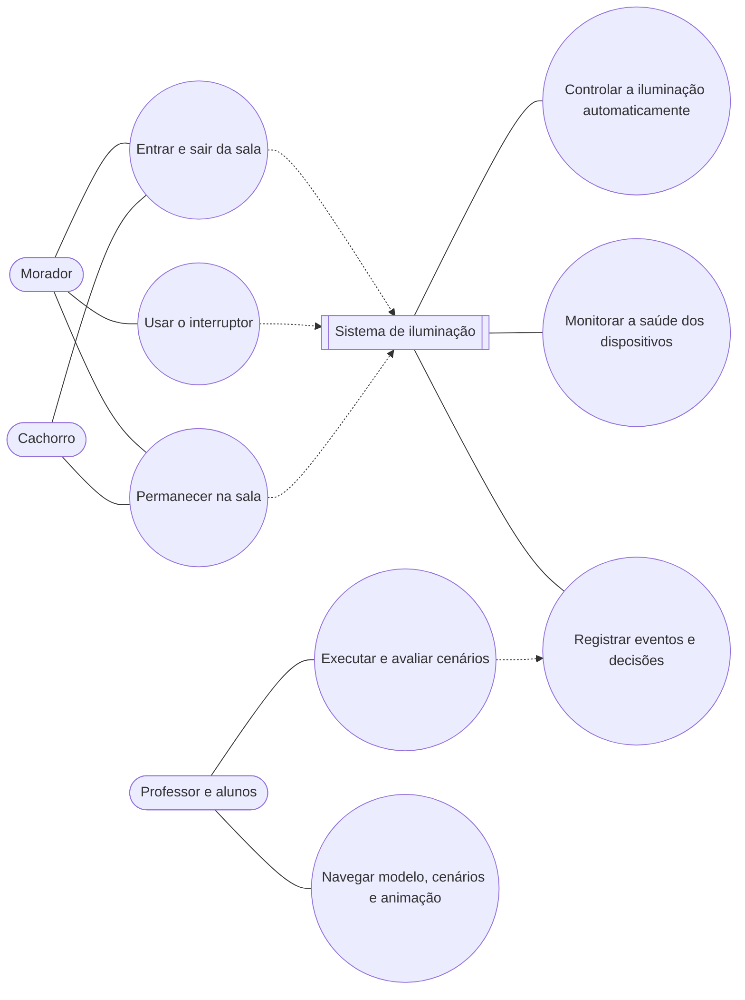

**Figura 1 — Casos de uso do incremento 0.** Mermaid não tem notação própria de casos de uso, então eles aparecem como elipses num fluxograma. No repositório, o mesmo diagrama também existe em PlantUML.

### 6.2 Classes

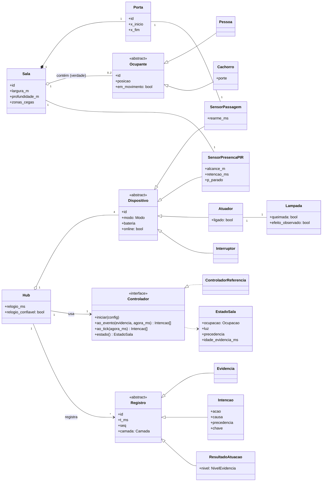

**Figura 2 — Classes do incremento 0.** `Evidencia`, `Intencao`, `ResultadoAtuacao` e `EstadoSala` (que corresponde ao `EstadoComodo` da V2) seguem a V2. `Ocupante` e suas subclasses só existem na camada de verdade do simulador; o hub nunca os vê.

### 6.3 Estados da ocupação inferida

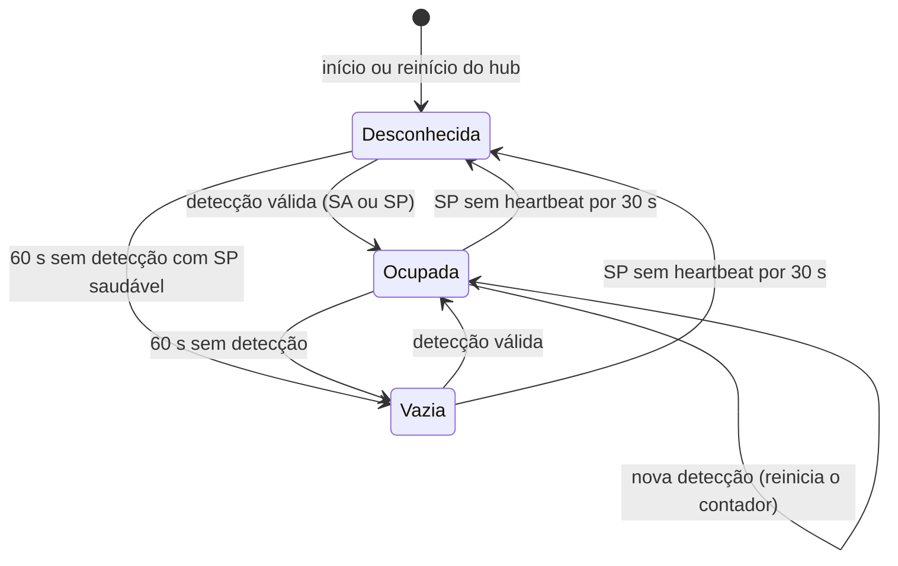

**Figura 3 — Ocupação inferida pelo controlador.** A verdade pode ser diferente desse estado; medir essa diferença é o objetivo do painel.

### 6.4 Estados da luz

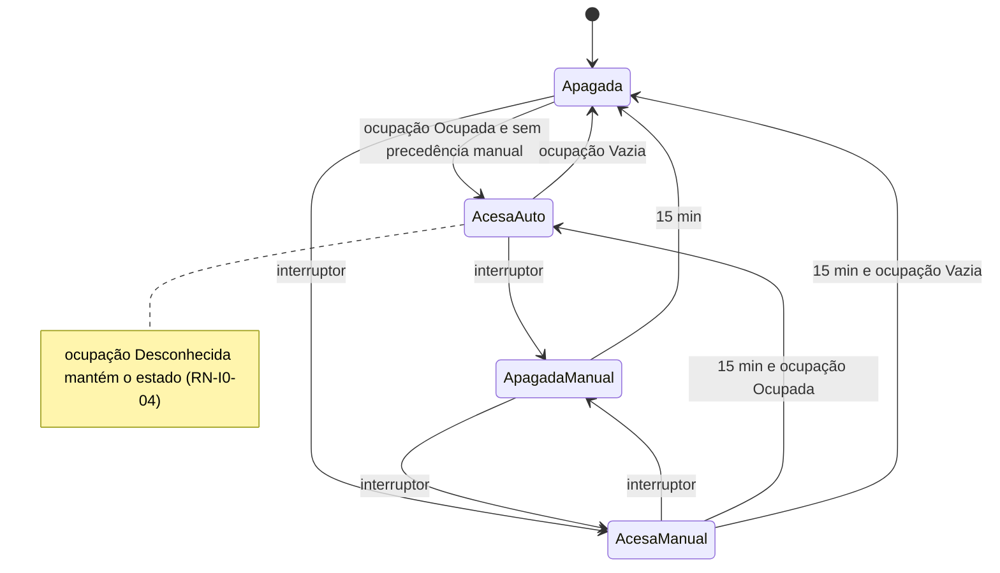

**Figura 4 — Estados da luz.** Cada transição gera uma `Intencao`, e o resultado é classificado conforme a RN-I0-06.

### 6.5 Sequência — N01: morador entra na sala vazia

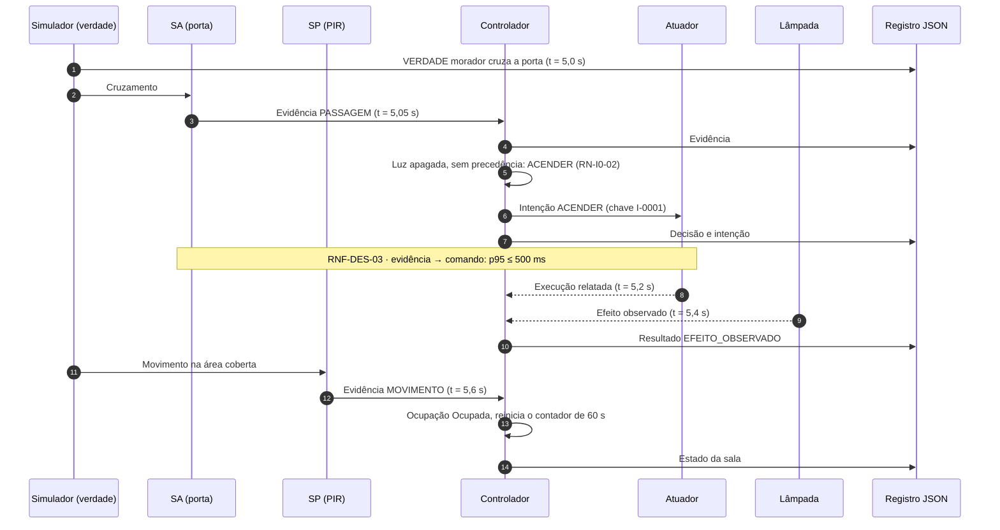

**Figura 5 — Cenário N01.**

### 6.6 Sequência — FN01: morador lê parado e a luz apaga

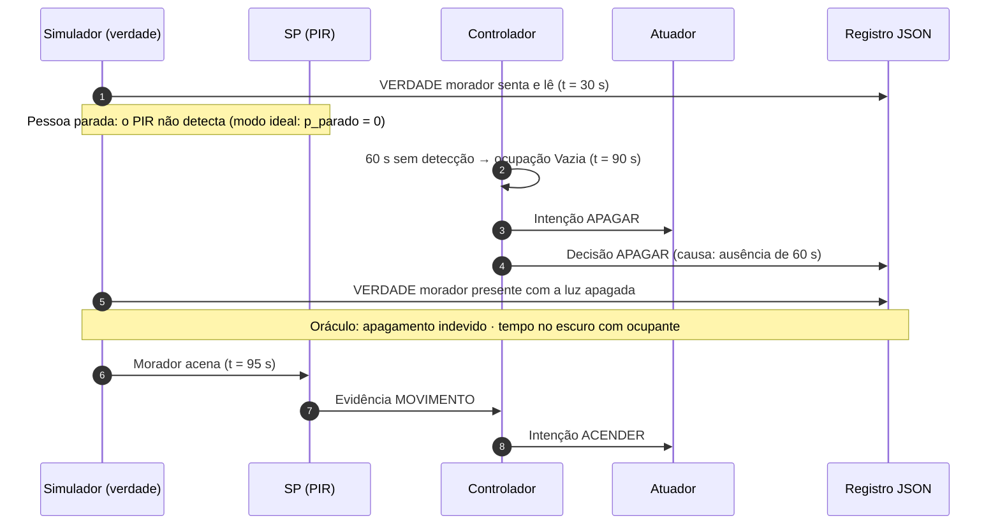

**Figura 6 — Cenário FN01**, uma limitação conhecida e documentada.

---

## 7. Arquitetura de software

### 7.1 Componentes

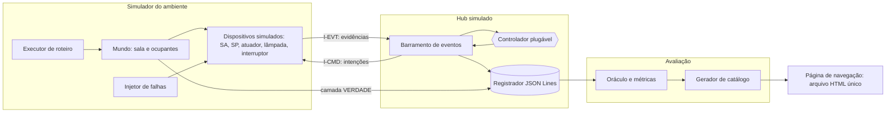

**Figura 7 — Componentes do incremento 0.**

| Componente | Responsabilidade | Pacote Python |
|---|---|---|
| Executor de roteiro | Lê o roteiro JSON e move os ocupantes no tempo | `sim.roteiro` |
| Mundo | Posições, movimento e presença real (camada de verdade) | `sim.mundo` |
| Dispositivos simulados | Modelos da §4.3, nos modos ideal e realista | `sim.dispositivos` |
| Injetor de falhas | Ativa as falhas F01–F06 em instantes do roteiro | `sim.falhas` |
| Barramento | Entrega evidências ao controlador e intenções aos dispositivos, com `seq` e relógio do hub | `hub.barramento` |
| Controlador | Interface única (§7.2) e controlador de referência (§5) | `hub.controlador` |
| Registrador | Grava todas as camadas, somente acréscimo | `hub.registro` |
| Oráculo e métricas | Compara verdade e decisão, calcula métricas e verifica asserções | `avaliacao` |
| Gerador de catálogo | Roda todos os cenários e gera o catálogo e a página | `catalogo` |
| Página | Navegação offline (§11) | `site/` (gerado) |

### 7.2 Interface do controlador

É o contrato que os alunos implementam.

```python
from typing import Protocol

class Controlador(Protocol):
    nome: str

    def iniciar(self, config: "ConfigSala") -> None:
        """Recebe parâmetros (§5.2) e a descrição da sala."""

    def ao_evento(self, ev: "Evidencia", agora_ms: int) -> list["Intencao"]:
        """Chamado a cada evidência (SA, SP, interruptor, heartbeat, resultado)."""

    def ao_tick(self, agora_ms: int) -> list["Intencao"]:
        """Chamado a cada 100 ms; usado para temporizações."""

    def estado(self) -> "EstadoSala":
        """Ocupação inferida, luz, precedência e idade da última evidência."""
```

**Regras do contrato:**

- O controlador **não acessa a camada de verdade**.
- Toda `Intencao` declara `causa` e `regra`, para que o painel explique cada decisão.
- O controlador não pode guardar estado fora do próprio objeto, o que garante execuções reproduzíveis.
- A escolha do controlador é feita por linha de comando: `python -m sim --controlador alunos.grupo3:MeuControlador`.

---

## 8. Registro em JSON

### 8.1 Arquivos por cenário

| Arquivo | Formato | Papel |
|---|---|---|
| `sala.json` | JSON | Estrutura: dimensões, porta, dispositivos, zona cega, parâmetros |
| `roteiros/<ID>.json` | JSON | Entrada: ações dos ocupantes e falhas ao longo do tempo |
| `saida/<ID>/<controlador>/<semente>/eventos.jsonl` | JSON Lines | Todas as camadas, um evento por linha |
| `esperado/<ID>.json` | JSON | Oráculo: asserções no formato dado/quando/então |
| `saida/<ID>/<controlador>/<semente>/metricas.json` | JSON | Métricas e resultado das asserções |
| `catalogo.json` | JSON | Índice de cenários, execuções e requisitos rastreados |
| `schemas/*.schema.json` | JSON Schema | Validação de todos os arquivos acima |

### 8.2 Camadas do evento

| Camada | Quem gera | Classe V2 correspondente |
|---|---|---|
| `VERDADE` | Simulador | — (exclusiva do oráculo) |
| `PERCEPCAO` | Dispositivos | `Evidencia` |
| `DECISAO` | Controlador | `Decisao` e `Intencao` |
| `ATUACAO` | Atuador e lâmpada | `ResultadoAtuacao` |
| `ESTADO` | Controlador, a cada 1 s e a cada mudança | `EstadoComodo` |
| `SISTEMA` | Hub e injetor | Falha, reinício, lacuna, relógio |

### 8.3 Exemplos

**Roteiro (`roteiros/N01.json`):**

```json
{
  "id": "N01",
  "titulo": "Morador entra na sala vazia",
  "tipo": "NORMAL",
  "duracao_ms": 120000,
  "estado_inicial": {"ocupantes_na_sala": [], "luz": "APAGADA"},
  "acoes": [
    {"t_ms": 5000, "ocupante": "morador", "acao": "ENTRAR"},
    {"t_ms": 6000, "ocupante": "morador", "acao": "ANDAR", "ate": [2.5, 2.0], "vel_m_s": 1.0},
    {"t_ms": 10000, "ocupante": "morador", "acao": "ANDAR_ALEATORIO", "duracao_ms": 100000}
  ],
  "falhas": [],
  "requisitos": ["RF-OPR-01", "RNF-DES-03", "CV02", "CF05"]
}
```

**Eventos (`eventos.jsonl`, uma linha por evento):**

```json
{"id":"N01-42-000051","t_ms":5000,"seq":51,"camada":"VERDADE","tipo":"CRUZOU_PORTA","ocupante":"morador","sentido":"ENTRADA"}
{"id":"N01-42-000052","t_ms":5050,"seq":52,"camada":"PERCEPCAO","origem":"SA-01","tipo":"PASSAGEM","relogio_hub_ms":5050,"relogio_confiavel":true}
{"id":"N01-42-000053","t_ms":5051,"seq":53,"camada":"DECISAO","tipo":"INTENCAO","acao":"ACENDER","causa":"PASSAGEM_SA","regra":"RN-I0-02","precedencia":"AUTOMATICA","chave":"I-0001"}
{"id":"N01-42-000055","t_ms":5400,"seq":55,"camada":"ATUACAO","tipo":"RESULTADO","chave":"I-0001","nivel":"EFEITO_OBSERVADO"}
{"id":"N01-42-000060","t_ms":6000,"seq":60,"camada":"ESTADO","ocupacao":"OCUPADA","luz":"ACESA_AUTO","precedencia":"AUTOMATICA","idade_evidencia_ms":400}
```

**Esperado (`esperado/N01.json`):**

```json
{
  "cenario": "N01",
  "modo": "IDEAL",
  "assercoes": [
    {"id": "A1", "dado": "sala vazia e luz apagada", "quando": "morador cruza a porta em t=5000",
     "entao": {"tipo": "luz", "valor": "ACESA", "ate_ms": 6000}},
    {"id": "A2", "entao": {"tipo": "metrica", "nome": "latencia_reacao_ms_p95", "max": 500}},
    {"id": "A3", "entao": {"tipo": "metrica", "nome": "apagamentos_indevidos", "max": 0}}
  ]
}
```

**Métricas (`metricas.json`):**

```json
{
  "cenario": "N01", "controlador": "referencia", "semente": 42, "modo": "IDEAL",
  "metricas": {"desperdicio_s": 0.0, "escuro_com_ocupante_s": 0.4, "apagamentos_indevidos": 0,
               "acionamentos": 1, "latencia_reacao_ms_p95": 51},
  "assercoes": {"A1": "PASSOU", "A2": "PASSOU", "A3": "PASSOU"}
}
```

### 8.4 Regras do registro

- O registro é **somente acréscimo**. Correções viram novos eventos (INV-06).
- `t_ms` é o tempo do simulador (verdade). `relogio_hub_ms` é o relógio do hub, que pode divergir em F06.
- `seq` é monotônico por execução e define a ordem, mesmo se o relógio do hub saltar.
- O `id` é composto por cenário, semente e `seq`, para que execuções possam ser comparadas linha a linha.

---

## 9. Catálogo de cenários

**Como ler a tabela:** "Ideal" é o que um sistema perfeito faria. "Referência" é o que o controlador de referência faz, e é isso que as asserções verificam. Nos cenários de exceção, a diferença entre os dois é a limitação documentada. Os cenários rodam no modo ideal, salvo indicação, e cada um dura de 2 a 30 minutos.

### 9.1 Normais

| ID | Cenário | Ideal | Referência (asserções) | Rastreia |
|---|---|---|---|---|
| N01 | Morador entra na sala vazia | Acende ao entrar | Acende em ≤ 1 s; latência p95 ≤ 500 ms | RF-OPR-01; CV02; CF05 |
| N02 | Morador sai e a sala fica vazia | Apaga ao sair | Apaga 60 s ± 1 s após a última detecção; desperdício ≤ 90 s | RF-OPR-01 |
| N03 | Morador anda pela sala por 10 min | Acesa sem interrupção | 0 apagamentos indevidos | RF-OPR-01 |
| N04 | Morador apaga no interruptor para ver um filme e, mais tarde, acende manualmente e sai | Respeita a vontade | Não reacende por 15 min após apagar; não apaga por 15 min após acender | RF-OPR-02; CV08 |
| N05 | Cachorro entra sozinho e anda | Acende (ocupante) | Acende em ≤ 1 s | RN-I0-01 |
| N06 | Morador sai e o cachorro fica andando | Mantém acesa | 0 apagamentos indevidos | RN-I0-01 |

### 9.2 Falsos positivos

| ID | Cenário | Ideal | Referência (asserções) | Rastreia |
|---|---|---|---|---|
| FP01 | Morador passa pela porta sem entrar (pega algo e volta) | Não acende | Acende e apaga após 60 s; desperdício ≈ 60 s | RN09; §5.3 |
| FP02 | Corrente de ar quente dispara o PIR com a sala vazia | Não acende | Acende e apaga após 60 s | Modelo do SP |
| FP03 | Disparo espúrio do SA (ruído elétrico) com a sala vazia | Não acende | Acende e apaga após 60 s | Modelo do SA |

### 9.3 Falsos negativos

| ID | Cenário | Ideal | Referência (asserções) | Rastreia |
|---|---|---|---|---|
| FN01 | Morador senta e lê parado por 10 min | Mantém acesa | Apaga 60 s após o último movimento; reacende ao gesto | RF-OPR-01; Figura 6 |
| FN02 | Morador vê TV com microgestos esparsos (modo realista) | Mantém acesa | Ciclos de apagar e reacender; conta os apagamentos indevidos | CV15 |
| FN03 | Morador fica na zona cega Z1 | Mantém acesa | Apaga após 60 s | DI-05 |
| FN04 | Entrada rápida em que o SA falha (modo realista, velocidade > 2 m/s) | Acende ao entrar | Acende só pelo SP, com atraso de 0,5 a 1,5 s; mede o tempo no escuro | Modelo do SA |
| FN05 | Cachorro deita e dorme por 20 min | Mantém acesa (é ocupante) | Apaga após 60 s | RN-I0-01; DI-10 |

### 9.4 Falhas

| ID | Cenário | Ideal | Referência (asserções) | Rastreia |
|---|---|---|---|---|
| F01 | SP deixa de responder com o morador na sala | Mantém e avisa | Após 30 s, ocupação desconhecida; não apaga; evento de saúde | RN-I0-04; RN01; CV03 |
| F02 | Bateria do SP cai abaixo de 15% | Avisa antes de falhar | Evento de bateria baixa; detecção degradada medida | RF-OPR-09 |
| F03 | Lâmpada queimada | Detecta a divergência | Execução relatada sem efeito observado; resultado desconhecido | RN-I0-06; CV04 |
| F04 | Atuador não confirma (relé travado) | Tenta de novo e avisa | Uma nova tentativa com a mesma chave; depois, falha sinalizada | RN-I0-07; RF-OPR-05 |
| F05 | Hub reinicia por 20 s no meio do cenário | Retoma sem perder o controle | Lacuna registrada; reinicia em desconhecida; lê a lâmpada; retoma | RN-I0-08 |
| F06 | Relógio do hub salta −5 min | Ordem preservada | `relogio_confiavel=false`; ordem por `seq`; métricas pelo tempo do simulador | RF-SYN-01 |

**Total:** 6 normais, 3 falsos positivos, 5 falsos negativos e 6 falhas, ou seja, 20 cenários.

---

## 10. Métricas e critérios de aceitação

### 10.1 Métricas

| Métrica | Definição | Fonte |
|---|---|---|
| Desperdício (s) | Tempo com luz acesa e nenhum ocupante na sala | Verdade × atuação |
| Escuro com ocupante (s) | Tempo com ocupante na sala e luz apagada, excluindo a precedência de apagar manual | Verdade × atuação |
| Apagamentos indevidos (n) | Transições de acesa para apagada com ocupante presente, sem comando manual | Verdade × decisão |
| Acionamentos (n) | Número de intenções executadas (comparativo, sem limite) | Decisão |
| Latência de reação (ms, p95) | Da evidência ao comando para o atuador | Percepção × decisão |
| Atraso percebido (ms) | Do ocupante cruzar a porta até o efeito observado na lâmpada | Verdade × atuação |

### 10.2 Limites (modo ideal, cenários normais)

| Métrica | Limite | Origem |
|---|---|---|
| Latência de reação p95 | ≤ 500 ms | RNF-DES-03 |
| Escuro com ocupante após entrar | ≤ 1 s | Proposta anterior, aceita |
| Desperdício por saída | ≤ T_apagamento + 30 s = 90 s | Idem |
| Apagamentos indevidos | 0 | Idem |

Nos **cenários de exceção**, as asserções verificam o comportamento documentado da referência (testes de caracterização). As métricas mostram o tamanho da limitação. No **modo realista**, cada cenário roda com 30 sementes, e o painel mostra a distribuição.

### 10.3 Invariantes verificadas pelo oráculo em todas as execuções

| ID | Verificação | Base |
|---|---|---|
| OR-01 | Nenhum evento é alterado ou removido; `seq` é estritamente crescente | INV-06 |
| OR-02 | O nível de resultado nunca passa da capacidade da lâmpada | INV-08 |
| OR-03 | Ocupação inferida "vazia" só ocorre depois de 60 s sem detecção e com o SP saudável | INV-09 ajustada |
| OR-04 | Nenhum apagamento automático com ocupação desconhecida | RN01 |
| OR-05 | Cada chave de intenção produz no máximo um efeito | RF-OPR-05 |
| OR-06 | O controlador nunca recebe eventos da camada de verdade | Contrato §7.2 |

---

## 11. Página de navegação

A página é um único arquivo `index.html` **gerado com os dados embutidos**. Ela abre com duplo clique, sem servidor, sem internet e sem instalação. Os diagramas são pré-renderizados em SVG durante a geração.

| Aba | Conteúdo | Interações |
|---|---|---|
| **Modelo** | Diagramas da §6; regras RN-I0; tabela de rastreabilidade V1–V3 | Clicar numa classe, regra ou requisito mostra onde aparece e quais cenários o exercitam |
| **Cenários** | Catálogo com tipo, resultado das asserções (passou ou falhou) e métricas, por controlador | Filtros por tipo, controlador e requisito; comparação lado a lado de dois controladores |
| **Animação** | Planta da sala com morador, cachorro, zona cega, raios do SA e SP, e a lâmpada acesa ou apagada | Reproduzir, pausar, passo a passo, velocidades 1× a 60×; linha do tempo clicável |
| **Painel** | Linha do tempo em faixas: verdade (quem está na sala), SA, SP, ocupação inferida, intenções, luz (comandada e observada), falhas; tabela de eventos; métricas | Cursor sincronizado com a animação; destaque de apagamentos indevidos e desperdício; exportação CSV e impressão em PDF |
| **Editor de roteiro** (dentro de Cenários) | Formulário de ações e falhas no tempo | Gera o `roteiros/<ID>.json`, que depois roda em Python |

---

## 12. Repositório e integração contínua

Repositório: **ReginaldoArakaki/PCS5039_ambiente_reg10k_vCl0**

```
PCS5039_ambiente_reg10k_v0/
├── README.md                    # como instalar, rodar e navegar
├── docs/
│   ├── ambiente-simulacao-v02.md
│   ├── uml/                     # fontes Mermaid e PlantUML da §6
│   └── roteiro-alunos.md        # exercícios da §13.2
├── sim/                         # simulador: roteiro, mundo, dispositivos, falhas
├── hub/                         # barramento, registrador, controlador de referência
├── avaliacao/                   # oráculo, métricas, asserções
├── catalogo/                    # gerador de catálogo e da página
├── alunos/                      # controladores dos grupos (um módulo por grupo)
├── cenarios/
│   ├── sala.json
│   ├── roteiros/                # N01 … F06
│   └── esperado/                # asserções
├── schemas/                     # JSON Schema
├── tests/                       # pytest: unidades e catálogo como teste
├── saida/                       # gerado (fora do controle de versão)
├── site/                        # index.html gerado
└── .github/workflows/ci.yml     # valida schemas, roda o catálogo, publica a página
```

**Integração contínua (GitHub Actions):** a cada envio de código, os JSON são validados contra os schemas, os 20 cenários rodam com o controlador de referência e com cada controlador em `alunos/`, a determinação é conferida (mesma semente, mesmo hash do `eventos.jsonl`), e a página é gerada como artefato. Um controlador de aluno que viole as invariantes OR-01 a OR-06 reprova a execução.

**Requisitos de ambiente:** Python 3.11 ou superior, apenas bibliotecas de uso comum (por exemplo, `jsonschema` e `pytest`), sem banco de dados nem broker de mensagens.

---

## 13. Roteiro didático e cronograma

### 13.1 Preparação (antes do dia 1, responsabilidade do professor)

| Item | Entrega |
|---|---|
| P1 | Referência completa no repositório: simulador, controlador, oráculo, 20 cenários, página |
| P2 | Diagramas da §6 versionados em `docs/uml` |
| P3 | `roteiro-alunos.md` com os exercícios da §13.2 |
| P4 | Integração contínua funcionando, com a referência aprovada |

### 13.2 Exercícios dos alunos

| Ex. | Atividade | Técnica de arquitetura | Cenários-alvo |
|---|---|---|---|
| E1 | Revisar o modelo de negócio do incremento: regras RN-I0 e a decisão sobre o cachorro; propor uma regra alternativa | Modelagem de negócio | N05, FN05 |
| E2 | Completar ou criticar os diagramas de classes e de estados | UML estrutural e comportamental | Todos |
| E3 | Implementar um **controlador alternativo** que reduza o falso positivo da porta. Por exemplo: o SA acende só se o SP confirmar em até 3 s | Componentização; interface | FP01, FN04 |
| E4 | Implementar um **tempo de apagamento adaptativo**, que espera mais quando houve entrada pela porta e nenhuma saída | Lógica de controle | FN01–FN03, FN05 |
| E5 | Criar 2 cenários novos com o editor, com as asserções correspondentes | Testes; catálogo | Novos |
| E6 | Comparar os controladores no painel e discutir os trade-offs (desperdício × escuro com ocupante) | Avaliação; integração | Catálogo inteiro |

### 13.3 Cronograma (3 dias)

| Dia | Manhã | Tarde | Entregável dos grupos |
|---|---|---|---|
| **1 — Negócio e modelos** | Apresentação do ambiente; execução da referência; navegação nas quatro abas | E1 e E2 | Regras revisadas; diagramas criticados; análise escrita de 3 cenários |
| **2 — Componentes e implementação** | Interface do controlador; padrões de teste | E3 e E4 | Controlador no diretório `alunos/` com a integração contínua aprovada |
| **3 — Integração e testes** | E5: novos cenários | E6: comparação e apresentação dos grupos; retrospectiva; preparação do incremento 1 | Relatório de 1 página com métricas comparadas; cenários novos no catálogo |

---

## 14. Critérios de pronto

| # | Critério | Como verificar |
|---|---|---|
| CP-01 | Os 20 cenários rodam com a referência e passam nas asserções | Integração contínua |
| CP-02 | Determinação: mesma semente gera o mesmo `eventos.jsonl` | Hash na integração contínua |
| CP-03 | Todos os JSON são válidos contra os schemas | Integração contínua |
| CP-04 | Invariantes OR-01 a OR-06 respeitadas em todas as execuções | Oráculo |
| CP-05 | A página abre offline e as quatro abas funcionam com os 20 cenários | Inspeção |
| CP-06 | Diagramas da §6 versionados e consistentes com o código (nomes de classes e estados) | Inspeção |
| CP-07 | Rastreabilidade da §3.2 navegável na aba Modelo | Inspeção |
| CP-08 | Um controlador de exemplo de aluno (por exemplo, do E3) roda pela interface sem mudanças no simulador | Integração contínua |

---

## 15. Riscos, pendências e próximos incrementos

### 15.1 Riscos

| Risco | Efeito | Mitigação |
|---|---|---|
| 3 dias é pouco para todos os exercícios | Grupos não chegam a E5 e E6 | E3 ou E4 obrigatório; E5 opcional; a referência pronta reduz o trabalho de base |
| Modelo do PIR pouco realista | Conclusões erradas sobre sensores reais | Parâmetros documentados e ajustáveis; o modo realista é explicitamente um modelo didático |
| Página pesada com execuções de 30 sementes | Abertura lenta | Embutir apenas a semente de referência; as demais ficam como métricas resumidas |
| Divergência entre diagramas e código | Perda de valor didático | CP-06; nomes de classes iguais nos dois |

### 15.2 Revisões da V1–V3

| ID | Revisão | Documento | Situação |
|---|---|---|---|
| RV-01 | Nova regra **RN34**: ocupante inclui animal de grande porte; a automação o atende | V1 §7.2 | Aprovada em 24/10/2026 (A12, V1 v02) |
| RV-02 | **PS05**: substituir "duas leituras com 3 s de intervalo" por "T_apagamento configurável, padrão de 60 s sem detecção" | V1 §9 e INV-09 da V2 | Aprovada em 24/10/2026 (A13, V1 e V2/V3 v02) |
| RV-03 | Classe **Passagem**, para o SA vinculado à porta (já identificada na conversa sobre as duas casas; necessária a partir do incremento 1) | V2 §2.2 | Aprovada em 24/10/2026 (A14, V2/V3 v02: classe Passagem, INV-15) |

### 15.3 Pendências

| ID | Pendência | Quando |
|---|---|---|
| PI-01 | Comportamento desejado com o ocupante **dormindo**: manter acesa ou aceitar apagar? Hoje FN05 trata o apagamento como indevido | Antes do incremento 2 |
| PI-02 | Aprovar as propostas RV-01 a RV-03 | **Resolvida em 24/10/2026** |
| PI-03 | Definir se os controladores dos alunos serão avaliados por métrica (ranking) ou por análise escrita | Dia 1 |

### 15.4 O que o incremento 1 herda

O incremento 1 reutiliza o simulador, o registro, o oráculo, a página e a interface do controlador sem mudanças de formato. Ele acrescenta a classe Passagem, um segundo cômodo e cenários de movimento entre cômodos, que é onde o SA sem direção passa a ser o problema central.

---

## 16. Referências

| ID | Documento |
|---|---|
| R13 | V1 — Business Drivers da Plataforma Reg10k, v02, 24/10/2026 |
| R14 | V2 e V3 — Requisitos funcionais e não funcionais da plataforma Reg10k, v02, 24/10/2026 |
| — | Respostas às dúvidas do incremento 0, 23/10/2026 |
| — | Respostas às dúvidas do ambiente de duas residências, 22/10/2026 (plano dos incrementos 4 e 5) |
````

---

## Arquivo: `docs/ambiente-simulacao-v0dt.md`

````markdown
# Plano do ambiente de simulação — v0dt (gêmeo digital integrado)

**Documento:** ambiente-simulacao-v0dt.md
**Versão:** 02 | **Data:** 24/10/2026 (v01, plano, de 24/10/2026)
**Disciplina:** PCS5039 — Engenharia de Software Orientada a IoT (EPUSP)
**Linha de pesquisa:** Laboratório de Digital Twin de Arquitetura de Sistemas de Software (EPUSP) e GLIP USP
**Repositório:** https://github.com/ReginaldoArakaki/PCS5039_ambiente_reg10k_vCl0
**Base:** V1 Business Drivers v02, V2/V3 Requisitos v02 e plano do ambiente v02 (incremento 0, entregue como versão v0).
**Situação:** entregue. Plano aprovado com as propostas DQ-01 a DQ-05 e implementado no repositório (tag `v0dt`). Os ajustes feitos na construção estão marcados com ◆ e listados na §12.4.

---

## Histórico de versões

| Versão | Data | Alterações |
|---|---|---|
| 01 | 24/10/2026 | Plano para aprovação |
| 02 | 24/10/2026 | Entrega: DQ-01 a DQ-05 aprovadas; RN-DT-04 refinada e RN-DT-09 nova; métricas e cenários ajustados na construção; resultados na §12.3 |

---

## Sumário

1. Decisões e nomenclatura de versões
2. Objetivo e posição na trilha
3. Escopo e rastreabilidade com V1–V3
4. Arquitetura da v0dt
5. Regras do gêmeo e da sincronização
6. Canal simulado e app simulado
7. Registro: novas camadas
8. Cenários
9. Métricas e invariantes
10. Página de navegação
11. Exercícios e cronograma
12. Critérios de pronto e documentação da entrega
13. Decisões a confirmar
14. Referências

---

## 1. Decisões e nomenclatura de versões

### 1.1 Decisões que orientam a v0dt

| ID | Decisão | Origem |
|---|---|---|
| DT-01 | O gêmeo digital entra **antes** do segundo cômodo. O mundo físico da v0 não muda: uma sala, uma porta, o morador e o Rex | Responsável pelo projeto, 24/10/2026 |
| DT-02 | O escopo do gêmeo é **espelho e sincronização**: DTReg10k-L no hub, DTReg10k-R na plataforma, canal, comandos remotos, configuração versionada, desconexão e reconexão | Idem (recomendação aceita) |
| DT-03 | O **aprendizado mínimo** (perfil horário de ocupação e sugestão de tempo de apagamento com aceite) fica como exercício **opcional** | Idem |
| DT-04 | A documentação (V2/V3, plano, README, roteiro dos alunos) é atualizada **na entrega da v0dt** | Idem |
| DT-05 | Os 20 cenários da v0 são **regressão**: têm de passar sem nenhuma alteração | Princípio de mudar uma variável por vez |

### 1.2 Nomenclatura de versões (proposta)

O número acompanha o **porte da automação** e o sufixo `dt` indica a presença do gêmeo digital:

| Versão | Porte | Gêmeo | Incremento da trilha |
|---|---|---|---|
| v0 ✓ | 1 cômodo (sala) | — | 0 |
| **v0dt** | 1 cômodo (sala) | Espelho e sincronização | 1 |
| v1dt | 2 cômodos e passagem | Espelha 2 cômodos | 2 |
| v1dt.1 | 2 cômodos, mais pessoas e visitante | Idem | 3 |
| v2dt | Casa A (4 cômodos) | Idem | 4 |
| v3dt | Casa B (7 cômodos) | Com aprendizado completo | 5 |

No repositório, cada entrega recebe uma **tag** com o nome da versão (`v0`, `v0dt`, …). O código continua num único repositório.

---

## 2. Objetivo e posição na trilha

**Objetivo:** introduzir o DTReg10k (A08 da V1) num ambiente cujo mundo físico os alunos já conhecem. Assim, toda diferença observada nas métricas vem do gêmeo e da sincronização. Os alunos passam a ver **três pontos de vista** sobre a mesma sala: o que **acontece** (verdade), o que o **hub acha** (DTReg10k-L) e o que a **plataforma acha** (DTReg10k-R), além do caminho entre eles (canal).

**Conceitos novos:** autoridade por tipo de registro (RN27, RN28), sincronização com atualidade medida (PS11), comando remoto com validade e efeito único (PS01, PS12, RN11), reconexão com o estado atual antes do histórico (RN12), configuração versionada (pendente, aplicada, recusada) e operação local sem plataforma (RNF-CON-01).

---

## 3. Escopo e rastreabilidade com V1–V3

### 3.1 Dentro e fora

| Dentro | Fora (versão indicada) |
|---|---|
| DTReg10k-L no hub: estado da sala, configuração aplicada, fila persistente | Segundo cômodo e passagem (v1dt) |
| DTReg10k-R: projeção do registro recebido, atualidade e divergências | Mais pessoas e visitante (v1dt.1) |
| Canal simulado com latência, perda, duplicação, reordenação e desconexão | Assinatura, suspensão e membros (fora da trilha de simulação) |
| App simulado: consulta, comando remoto, mudança de preferência | Aprendizado completo (v3dt); mínimo como exercício opcional |
| Configuração versionada (T_apagamento como preferência do titular) | Várias casas na mesma plataforma |
| Reconexão ordenada e reconciliação L ↔ R | |

### 3.2 O que da V1–V3 a v0dt realiza

| Artefato | Como aparece |
|---|---|
| A08, A11 | DTReg10k-L e DTReg10k-R; metas de tempo real PS11 (5 s) e PS12 (3 s) |
| RF-SYN-01 a RF-SYN-06 | Publicação L→R, resumo de 30 s, fila persistente, reconexão ordenada, autoridade e distribuição R→L |
| RF-OPR-03, RF-OPR-04, RF-OPR-05 | Comando remoto com validade, classificação do resultado, efeito único |
| RF-OPR-07 | Preferência alterada no app, "pendente de aplicação" até a confirmação do hub |
| RF-ACO-01, RF-ACO-03 | O app mostra idade e atualidade; recebe atualizações por evento |
| RNF-DES-01, RNF-DES-02 | Atualidade do gêmeo p95 ≤ 5 s; comando remoto p95 ≤ 3 s |
| RNF-CON-01, RNF-CON-02, RNF-CON-06, RNF-CON-07 | Casa funciona sem plataforma; fila; reconexão; efeito único |
| RNF-USA-03 | "Desatualizado" e "desconhecido" nunca aparecem como estado atual |
| INV-03, INV-06, INV-07, INV-10, INV-14 | Verificadas pelo oráculo (§9.2) |
| CF04, CF06 da V3 | Reproduzidos integralmente |
| CV04, CV05, CV29 da V1 | Cenários DT03, DT07, DT06 |

---

## 4. Arquitetura da v0dt

### 4.1 Componentes

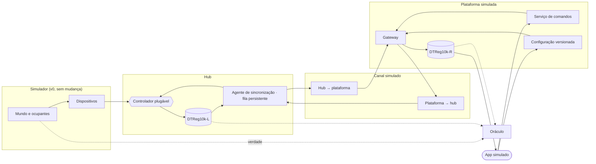

**Figura 1 — Componentes da v0dt.** O simulador e o controlador da v0 não mudam. Entram o agente de sincronização, o canal, a plataforma e o app.

| Componente | Responsabilidade | Requisitos |
|---|---|---|
| DTReg10k-L | Estado da sala segundo o hub; versão de configuração aplicada; autoridade sobre fatos locais | RN27; RF-SYN-05 |
| Agente de sincronização | Publica evidências, decisões e resultados; resumo a cada 30 s; fila persistente durante desconexão; reconexão com o estado atual antes do histórico; recebe comandos e configuração | RF-SYN-01 a RF-SYN-04, RF-SYN-06 |
| Canal simulado | Atraso, perda, duplicação, reordenação e desconexão, configuráveis por cenário | §6.1 |
| Gateway | Recebe mensagens do hub; descarta duplicadas; roteia comandos e configuração | RF-OPR-05 |
| DTReg10k-R | Projeção do registro recebido; idade de cada atributo; marca "atual", "desatualizado" ou "sem evidência"; registra divergências | RF-SYN-05; RF-ACO-01 |
| Serviço de comandos | Cria intenções remotas com validade de 30 s e chave de idempotência; correlaciona o resultado | RF-OPR-03, RF-OPR-04 |
| Configuração versionada | Guarda a preferência do titular; versão "pendente" até a confirmação do hub | RF-OPR-07; INV-14 |
| App simulado | Ator dos roteiros: consulta, comando remoto, mudança de preferência | §6.2 |

### 4.2 Fluxos principais

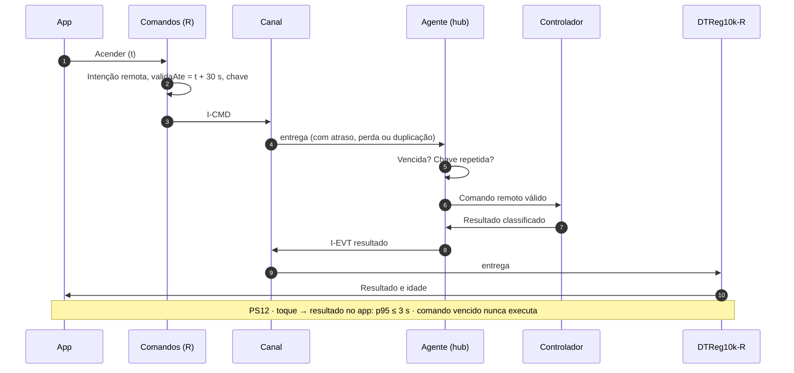

**Figura 2 — Comando remoto.** Uma mensagem duplicada no canal tem efeito único. Um comando que chega vencido é recusado e registrado como EXPIRADA.

### 4.3 Mudança mínima no contrato do controlador

A interface `Controlador` da v0 continua a mesma. Os controladores dos alunos da v0 rodam na v0dt sem alteração. Duas novidades chegam como evidências normais:

| Evidência nova | Origem | O que o controlador faz |
|---|---|---|
| `COMANDO_REMOTO` (acao, chave, solicitante) | Agente de sincronização, já validado quanto à validade e à duplicidade | Aplica a precedência: a remota fica abaixo da manual e acima da automática (R10 §7.2) |
| `CONFIGURACAO` (versao, t_apagamento_ms) | Agente, após verificar a assinatura da versão | Passa a usar o novo parâmetro; o agente confirma a versão aplicada |

---

## 5. Regras do gêmeo e da sincronização

| ID | Regra | Origem |
|---|---|---|
| RN-DT-01 | O DTReg10k-L é a autoridade sobre fatos locais (evidências, decisões, resultados). O DTReg10k-R é a autoridade sobre a configuração. Divergências são resolvidas por essa autoridade e registradas | RN27, RN28 |
| RN-DT-02 | O hub publica cada evento com `seq` e um resumo de estado a cada 30 s. Durante a desconexão, guarda tudo na fila persistente | RF-SYN-01 a RF-SYN-03 |
| RN-DT-03 | Na reconexão, o hub envia primeiro o estado atual e depois o histórico em ordem de `seq`. O histórico nunca restabelece a atualidade | RF-SYN-04; RN12 |
| RN-DT-04 ◆ | O DTReg10k-R marca o estado como **atual** (sessão ativa e idade ≤ 60 s, PS06), **desatualizado** ou **sem evidência**. A idade conta da recepção do último estado, no relógio da plataforma. Quando a sessão cai, o R fica desatualizado na hora, e só um estado recebido depois da reconexão o torna atual de novo | RF-ACO-01; RNF-USA-03 |
| RN-DT-05 | Todo comando remoto tem validade de 30 s (PS01) e chave de idempotência. O hub recusa o vencido e o repetido. Sem resultado em 10 s (PS02), o app mostra "desconhecido" | RF-OPR-03 a RF-OPR-05 |
| RN-DT-06 | Com o hub desconectado, o app recebe recusa imediata com o motivo, a última evidência e a idade, e o comando não fica pendente | CF04 |
| RN-DT-07 | Mudança de preferência cria uma nova versão de configuração, "pendente" até o hub confirmá-la; o hub nunca aplica versão menor que a já aplicada | RF-OPR-07; INV-14 |
| RN-DT-08 | Indisponibilidade da plataforma ou do canal não altera a automação local | RNF-CON-01 |
| RN-DT-09 ◆ | Comando remoto aceito cria precedência REMOTA por T_manual (15 min) sobre a automação. É recusado se houver precedência manual ativa; o interruptor sempre prevalece sobre o app | RN07; R10 §7.2 |

### 5.1 Parâmetros novos

| Parâmetro | Valor padrão | Origem |
|---|---|---|
| Resumo de estado | A cada 30 s | RF-SYN-02 |
| Limite de atualidade (PS06) | 60 s | V1 |
| Validade do comando remoto (PS01) | 30 s | V1 |
| Prazo do resultado (PS02) | 10 s | V1 |
| Capacidade da fila do hub | 7 dias de eventos | RNF-CON-02 |
| Espera de reconexão | Exponencial a partir de 1 s, máx. 30 s, com componente aleatório | V2 §5.3 de R11 |

---

## 6. Canal simulado e app simulado

### 6.1 Canal

| Parâmetro | Ideal | Realista | Por cenário |
|---|---|---|---|
| Latência por mensagem | 100 ms | 50–400 ms | Sim |
| Perda | 0 | 1% | Sim |
| Duplicação | 0 | 0,5% | Sim |
| Reordenação | Não | Sim, dentro de 1 s | Sim |
| Desconexão | Só quando o roteiro pede | Só quando o roteiro pede | `CANAL_DESCONECTA` com duração |
| Plataforma fora do ar | Só quando o roteiro pede | Só quando o roteiro pede | `PLATAFORMA_FORA` com duração |

O canal usa entrega **pelo menos uma vez** com confirmação: mensagem sem confirmação é reenviada pelo agente, por isso a duplicação é tratada pela chave de idempotência.

### 6.2 App

Novas ações nos roteiros, com o ator `app`:

| Ação | Parâmetros | Efeito |
|---|---|---|
| `APP_COMANDO` | `acao` (ACENDER ou APAGAR) | Cria intenção remota (RN-DT-05) |
| `APP_PREFERENCIA` | `t_apagamento_ms` | Cria nova versão de configuração (RN-DT-07) |
| `APP_CONSULTA` | — | Registra o que o app mostra naquele instante (estado, idade, atualidade) |

---

## 7. Registro: novas camadas

O registro continua único e somente acréscimo. Entram duas camadas:

| Camada | Quem gera | Exemplos |
|---|---|---|
| `REDE` | Canal simulado | Envio, entrega, perda, duplicação, desconexão, reconexão |
| `PLATAFORMA` | DTReg10k-R, comandos, configuração e app | Estado projetado com idade e atualidade, intenção remota, versão de configuração, consulta do app |

As seis camadas da v0 (VERDADE, PERCEPCAO, DECISAO, ATUACAO, ESTADO, SISTEMA) permanecem com o mesmo formato. O oráculo passa a comparar **três** visões no mesmo instante: verdade × DTReg10k-L (ESTADO) × DTReg10k-R (PLATAFORMA).

---

## 8. Cenários

### 8.1 Regressão

Os 20 cenários da v0 (N01–N06, FP01–FP03, FN01–FN05, F01–F06) rodam com o canal ideal ligado e têm de passar **sem alteração** de roteiro nem de asserções.

### 8.2 Novos cenários do gêmeo

| ID | Cenário | Esperado | Rastreia |
|---|---|---|---|
| DT01 | Comando remoto acende a sala vazia | Resultado no app em ≤ 3 s; efeito observado; R atual | RF-OPR-03; PS12; CF04 |
| DT02 | Comando remoto com o hub desconectado | Recusa imediata com motivo, última evidência e idade; nada fica pendente | RN-DT-06; CF04 |
| DT03 | Rede lenta (35 s de atraso): o comando chega vencido | Hub recusa; resultado EXPIRADA; luz não muda | INV-07; PS01; CV04 |
| DT04 | Canal duplica o comando | Um único efeito; a segunda cópia é registrada como repetida | RN11; RNF-CON-07 |
| DT05 | Desconexão de 10 min com o morador entrando e saindo | Automação local normal; R "desatualizado" assim que a sessão cai ◆; na volta, estado atual antes do histórico, divergência registrada e R atual em ≤ 5 s | RN-DT-03; RF-SYN-04; CF06 |
| DT06 | Preferência T_apagamento = 120 s alterada com o hub offline | Versão "pendente" no app; aplicada e confirmada na reconexão; daí em diante a luz apaga em 120 s | RF-OPR-07; INV-14; CV29 |
| DT07 | Plataforma fora do ar por 5 min | Casa funciona normalmente; fila cresce e esvazia na volta; nenhuma perda | RNF-CON-01; RNF-CON-02; CV05 |
| DT08 | Canal realista (perda de 1%, duplicação e reordenação) por 30 min, com morador e Rex | Atualidade p95 ≤ 5 s; nenhuma divergência além do prazo; nada fica na fila; distribuição em 30 sementes ◆ | RNF-DES-01; PS11 |
| DT09 | Comando remoto de acender durante a precedência manual de apagar | Recusado por precedência; o app mostra o motivo | RN07; R10 §7.2 |
| DT10 | Hub reinicia com a plataforma conectada | R "desatualizado" assim que a sessão cai; após o reinício, lacuna registrada e R atual de novo | RN-I0-08; RN-DT-04 |
| DT11 | Relógio do hub salta −5 min durante a sincronização | R ordena por `seq`; idade calculada pelo tempo de recepção; nenhuma regressão de atualidade | RF-SYN-01; F06 |
| DT12 | Rex sozinho com o morador consultando pelo app fora de casa | App mostra "ocupada" e luz acesa, ambos atuais; nada distingue cachorro de pessoa (RN09, RN34) | RF-ACO-01; RN34 |

**Total:** 20 de regressão e 12 novos, ou seja, 32 cenários.

---

## 9. Métricas e invariantes

### 9.1 Métricas novas

| Métrica | Definição | Limite (modo ideal) |
|---|---|---|
| Atualidade do gêmeo p95 (ms) | Da mudança de estado no hub até o DTReg10k-R refleti-la, com sessão ativa | ≤ 5.000 (PS11) |
| Comando remoto p95 (ms) | Do toque no app até o resultado classificado no app | ≤ 3.000 (PS12) |
| Comandos vencidos executados | Intenções remotas executadas após `validaAte` | 0 |
| Efeitos duplicados | Comutações repetidas para a mesma chave | 0 |
| Reconciliação após reconexão (ms) | Da sessão restabelecida até o R voltar a "atual" | ≤ 5.000 |
| Divergência L × R além do prazo (s) ◆ | Tempo com R "atual" e ocupação ou luz diferentes do L, descontados os 5 s de sincronização (PS11) | 0 |
| Eventos não entregues ◆ | Eventos que ficaram na fila do hub no fim da execução | 0 |
| Fila máxima ◆ | Maior número de eventos na fila do hub (informativo) | — |

◆ A "desatualização honesta" do plano virou a invariante OR-08, que é mais forte: vale em todo instante, não em porcentagem.

### 9.2 Invariantes novas

| ID | Verificação | Base |
|---|---|---|
| OR-07 | Nenhuma intenção remota é executada após `validaAte` | INV-07; PS01 |
| OR-08 | O DTReg10k-R e o app nunca dizem "atual" sem sessão ou com estado de mais de 60 s | RN-DT-04; RNF-USA-03 |
| OR-09 | Evento histórico recebido na reconexão nunca substitui um estado mais recente no R | RN-DT-03; RN12 |
| OR-10 | Versão aplicada no hub ≤ versão vigente no R; toda versão pendente termina aplicada ou recusada após a reconexão | INV-14 |
| OR-11 | Cada chave produz no máximo um efeito, mesmo com duplicação no canal | INV-10; RN11 |
| OR-12 | Com a plataforma ou o canal fora, as decisões locais são idênticas às da mesma execução com tudo conectado | RNF-CON-01 |

A OR-12 é verificada por **execução pareada**: o mesmo roteiro com a mesma semente roda duas vezes, com e sem a falha de rede, e as camadas DECISAO e ATUACAO são comparadas.

---

## 10. Página de navegação

| Aba | Novidade |
|---|---|
| Modelo | Diagramas da v0dt; regras RN-DT; nomenclatura de versões; rastreabilidade com RF-SYN e CF04/CF06 |
| Cenários | Filtro por versão (regressão v0 × novos DT); resultado da execução pareada da OR-12 |
| Animação | Ao lado da planta: **"o que o hub acha"** (DTReg10k-L) e **"o que a plataforma acha"** (DTReg10k-R, com idade e selo atual/desatualizado); indicador de conexão e mensagens em trânsito |
| Painel | Faixas novas na linha do tempo: **Gêmeo remoto** (ocupação e luz segundo o R, hachurado quando desatualizado), **Canal** (conectado, desconectado, perdas, duplicações) e **App** (comandos, preferências, consultas) |

---

## 11. Exercícios e cronograma

### 11.1 Preparação (antes do dia 1)

A referência completa da v0dt no repositório, com tag `v0dt`, regressão da v0 aprovada e página gerada.

### 11.2 Exercícios

| Ex. | Atividade | Técnica | Cenários-alvo |
|---|---|---|---|
| E7 | Ler os modelos da v0dt e explicar, para DT05, o que cada um dos três pontos de vista mostra antes, durante e depois da desconexão | Modelagem de sistemas distribuídos | DT05 |
| E8 | Implementar uma política alternativa de exibição no app (por exemplo, mostrar a "última evidência conhecida" com destaque quando desatualizado) e verificar a OR-08 | Componentização; honestidade da informação | DT05, DT07, DT10 |
| E9 | Criar 2 cenários de rede com o editor (por exemplo, desconexões curtas e repetidas) e escrever as asserções | Testes de sistemas distribuídos | Novos |
| E10 (opcional) | **Aprendizado mínimo:** a partir de 3 semanas simuladas, o gêmeo calcula o perfil horário de ocupação e sugere T_apagamento por faixa de horário; a sugestão só vale após aceite simulado (RN-DT-07); medir o efeito em FN01 e FN02 | Gêmeo comportamental explicável | FN01, FN02, DT06 |

### 11.3 Cronograma (2 dias)

| Dia | Manhã | Tarde | Entregável |
|---|---|---|---|
| 1 — Modelos e componentes | Apresentação da v0dt; três pontos de vista na animação | E7 e início do E8 | Análise do DT05; desenho da política do E8 |
| 2 — Integração e testes | E8 concluído e E9 | Comparação na página; E10 para quem avançar | Política do app aprovada nas invariantes; cenários novos no catálogo |

---

## 12. Critérios de pronto e documentação da entrega

### 12.1 Critérios de pronto

| # | Critério |
|---|---|
| CP-DT-01 | Os 20 cenários da v0 passam sem alteração (regressão) |
| CP-DT-02 | Os 12 cenários DT passam nas asserções de requisito |
| CP-DT-03 | Invariantes OR-01 a OR-12 respeitadas em todas as execuções |
| CP-DT-04 | Determinação: mesma semente, mesmo registro, inclusive com o canal realista |
| CP-DT-05 | Controlador de exemplo da v0 (grupo_exemplo) roda na v0dt sem mudança |
| CP-DT-06 | Schemas atualizados (camadas REDE e PLATAFORMA, ações do app, falhas de rede) e todos os JSON válidos |
| CP-DT-07 | Página com os três pontos de vista, abrindo também no visualizador do app |
| CP-DT-08 | Integração contínua verde e tag `v0dt` no repositório |

### 12.2 Documentação atualizada na entrega (DT-04)

| Documento | Atualização |
|---|---|
| Este plano | Passa de "para aprovação" a "entregue", com os resultados |
| V2/V3 Requisitos | v03 entregue: nova §3.6 com requisitos exercitados, OR-07 a OR-12 ligadas às invariantes V2 e refinamentos RS-01 a RS-06 |
| V1 Business Drivers | Só se surgir regra de negócio nova durante a construção (hoje não há previsão) |
| README e roteiro dos alunos | Comandos, cenários DT, exercícios E7–E10 |
| Página | Abas atualizadas (§10) |

---

### 12.3 Resultados da entrega

| Critério | Resultado |
|---|---|
| CP-DT-01 | Os 20 cenários da v0 passam sem alteração de roteiro nem de asserções |
| CP-DT-02 | Os 12 cenários DT passam em todas as asserções com a referência e com o `grupo_exemplo` |
| CP-DT-03 | OR-01 a OR-12 respeitadas em todas as 64 execuções; a OR-12 é verificada por execução pareada em DT05, DT07, DT08 e nos cenários realistas da v0 |
| CP-DT-04 | Mesma semente, mesmo registro, inclusive com o canal realista |
| CP-DT-05 | O `grupo_exemplo` da v0 roda sem mudança |
| CP-DT-06 | Schemas de sala, roteiro, esperado, evento e métricas atualizados; todos os JSON válidos |
| CP-DT-07 | Página com os três pontos de vista, testada no navegador e em visualizador embutido (iframe com sandbox), sem erros |
| CP-DT-08 | 92 testes passam; catálogo completo em cerca de 40 s |

Medições da referência (simulação, não sistema real):

| Métrica | Canal ideal | Canal realista (DT08, 30 sementes) |
|---|---|---|
| Atualidade do gêmeo p95 | 100 ms | mediana 342 ms; pior caso 3,3 s |
| Comando remoto p95 | 850 ms (DT01, DT04) | — |
| Reconciliação | 100 ms | — |
| Divergência além do prazo | 0 s | 0 s em todas as sementes |
| Comandos vencidos executados, efeitos duplicados, eventos não entregues | 0 | 0 |

### 12.4 Ajustes feitos na construção (◆)

| Ajuste | Motivo |
|---|---|
| RN-DT-04: R desatualizado assim que a sessão cai; só estado novo restabelece a atualidade | Em DT10, um estado de 27 s voltaria a ser "atual" antes de chegar o estado do hub religado |
| RN-DT-04: idade medida pela recepção, no relógio da plataforma | Em DT11, a idade calculada pelo relógio do hub regrediria com o salto |
| RN-DT-09 (nova): precedência REMOTA | O plano dizia "abaixo da manual, acima da automática", mas sem duração nem regra de recusa |
| Divergência com tolerância de 5 s | Divergência durante a propagação é inevitável; o critério verificável é "além do prazo de PS11" |
| DT08 com morador e Rex e distribuição em 30 sementes | Mostra a variação da atualidade com perdas (reenvio de 3 s) |
| Cenários com tempos ajustados (DT05, DT06, DT07) | Para que a divergência e a mudança de T_apagamento fiquem observáveis |

Os achados foram levados à V2/V3 v03 (§3.6, refinamentos RS-01 a RS-06).

## 13. Decisões (aprovadas em 24/10/2026)

Todas as propostas foram aprovadas como estavam.

| ID | Pergunta | Proposta |
|---|---|---|
| DQ-01 | Nomenclatura de versões e tags (§1.2) | Como na tabela da §1.2 |
| DQ-02 | Preferência do titular nesta versão | Só T_apagamento; outras preferências a partir da v1dt |
| DQ-03 | O app precisa de autenticação e papéis? | Não nesta versão: um único titular; membros e revogação ficam fora |
| DQ-04 | Os controladores dos alunos devem tratar `COMANDO_REMOTO`? | Sim, com a precedência da R10 §7.2 (RN-DT-09); a referência herdada já trata. Quem não tratar continua aprovado nas invariantes, mas falha nas asserções de requisito de DT01 e DT04 |
| DQ-05 | O E10 (aprendizado mínimo) entra na avaliação? | Como bônus |

---

## 14. Referências

| ID | Documento |
|---|---|
| R13 | V1 — Business Drivers da Plataforma Reg10k, v02, 24/10/2026 |
| R14 | V2 e V3 — Requisitos funcionais e não funcionais da plataforma Reg10k, v02, 24/10/2026 |
| R15 | Plano do ambiente de simulação — incremento 0, v02, 24/10/2026 |
| — | Repositório ReginaldoArakaki/PCS5039_ambiente_reg10k_vCl0, versão v0 |
````

---

## Arquivo: `docs/ambiente-simulacao-v0dta.md`

```markdown
# Plano de ajuste — v0dta (espelho visual do gêmeo digital)

**Documento:** ambiente-simulacao-v0dta.md
**Versão:** 02 | **Data:** 24/10/2026 (v01, plano, de 24/10/2026)
**Disciplina:** PCS5039 — Engenharia de Software Orientada a IoT (EPUSP)
**Linha de pesquisa:** Laboratório de Digital Twin de Arquitetura de Sistemas de Software (EPUSP) e GLIP USP
**Base:** v0dt entregue (tag `v0dt`), plano v0dt v02 e V2/V3 v03.
**Situação:** entregue. Plano aprovado com as propostas DQA-01 a DQA-06 e implementado no repositório (tag `v0dta`). Os ajustes feitos na construção estão marcados com ◆ e listados na §11.

---

## Histórico de versões

| Versão | Data | Alterações |
|---|---|---|
| 01 | 24/10/2026 | Plano para aprovação |
| 02 | 24/10/2026 | Entrega: DQA-01 a DQA-06 aprovadas; "não afirma" passa a incluir a incerteza declarada; resultados na §11 |

---

## 1. O que muda e por quê

A v0dt já registra o que o gêmeo sabe, mas só como texto e faixas na linha do tempo. A **v0dta** (a v0dt com o ajuste "a") desenha esse conhecimento como um **cômodo espelho**: uma segunda planta da sala, montada apenas com o que o gêmeo recebeu, ao lado da sala real.

O espelho **não é uma cópia da sala real**, e é aí que está o valor didático. As diferenças entre as duas plantas são exatamente os limites do sistema:

| Na sala real (verdade) | No cômodo espelho (gêmeo) | Por quê |
|---|---|---|
| Morador e Rex com posição e identidade | Uma "mancha de presença" sem identidade nem posição | SA e SP não identificam pessoa, cachorro, direção ou contagem (RN09, RN34) |
| Lâmpada acesa ou apagada de fato | Estado da luz segundo o gêmeo, com o nível de evidência (efeito observado, execução relatada, desconhecido) | RN02: intenção, execução e efeito são distintos |
| O que acontece agora | O que o gêmeo sabia há *n* segundos, com a idade visível | Atualidade (PS06, PS11) |
| Interação física: porta, interruptor | Interação remota: comando e preferência pelo app | O titular só age no espelho pelo app (RN-DT-05, RN-DT-09) |
| Sempre disponível | Congelado e hachurado quando a sessão cai | RN-DT-04 |

As **amostras** são retratos lado a lado (sala real × espelho), com os dados de cada lado, em três momentos de cada execução: **início, meio e fim**. Elas servem para relatórios, para a correção dos exercícios e para comparar controladores e versões sem precisar assistir à animação.

---

## 2. Decisões que orientam o ajuste

| ID | Decisão | Origem |
|---|---|---|
| DTA-01 | O espelho é uma **projeção somente leitura** do gêmeo. A página não simula nada: toda a lógica continua no motor Python | Princípio da v0 (página só reproduz) |
| DTA-02 | Há dois espelhos possíveis: o do hub (DTReg10k-L) e o da plataforma (DTReg10k-R). O padrão é o **R**, que é o que o titular vê; o L fica numa chave de alternância | DT-02 da v0dt |
| DTA-03 | O espelho só usa dados que chegaram ao gêmeo. Nada da camada VERDADE entra nele (estende a OR-06 à página) | OR-06 |
| DTA-04 | Interação no espelho é a do app: o espelho mostra comandos e preferências como ações do titular, nunca como interruptor | RN-DT-09 |
| DTA-05 | Os 32 cenários da v0dt são regressão: decisões, atuações e asserções não mudam | DT-05 da v0dt |

---

## 3. Ajustes no motor (pequenos)

Hoje o DTReg10k-R só registra o estado consolidado (ocupação, luz, precedência, alertas). Para desenhar sensores e evidências no espelho, ele precisa registrar também o que recebeu.

| Ajuste | Onde | Efeito |
|---|---|---|
| A1. Registrar as evidências recebidas: `PLATAFORMA/EVIDENCIA_RECEBIDA` com origem (SA-01, SP-01, INT-01), tipo, instante de origem e de recepção | `plataforma/plataforma.py` | O espelho pisca o SA e acende o cone do SP quando a evidência **chega**, não quando acontece |
| A2. Registrar os resultados de atuação recebidos, com o nível | Idem | O espelho mostra a lâmpada com o nível de evidência |
| A3. Gerar as **amostras** de cada execução: `saida/<cenário>/<controlador>/<semente>/espelho/amostras.json` e três SVG (`inicio.svg`, `meio.svg`, `fim.svg`) | Novo `avaliacao/espelho.py` | Retratos que abrem em qualquer navegador e entram em relatório |
| A4. Métrica de **fidelidade do espelho**, decomposta | `avaliacao/oraculo.py` | Ver §5 |

Os ajustes A1 e A2 só acrescentam eventos na camada PLATAFORMA. Os hashes dos registros mudam, mas as camadas DECISAO e ATUACAO ficam idênticas, e a OR-12 e os testes confirmam isso.

---

## 4. Amostras: início, meio e fim

### 4.1 Instantes

| Amostra | Instante padrão | Ajuste |
|---|---|---|
| Início | Primeira ação do roteiro + 5 s | Mostra o espelho saindo de "sem evidência" |
| Meio | Metade da duração | — |
| Fim | Duração − 1 s | Mostra o estado final e a fila |

O roteiro pode trocar os instantes padrão por momentos de interesse, com o campo opcional `amostras_ms` (por exemplo, DT05 em 30 s, 300 s e 665 s: antes, durante e logo depois da queda).

### 4.2 Conteúdo de cada amostra

| Lado | Visual | Dados |
|---|---|---|
| Sala real | Planta com morador, Rex, luz física, SA e SP | Quem está na sala, luz física |
| Espelho (R ou L) | Planta do gêmeo: mancha de presença, luz com o nível de evidência, últimos sinais de SA e SP, selo de atualidade, conexão | Ocupação, luz, idade, atualidade, conexão, versão de configuração, último comando do app |
| Rodapé | Selo **confere**, **diverge** ou **não afirma** (desatualizado) | Classificação da diferença (§5) |

---

## 5. Fidelidade do espelho

A diferença entre a sala real e o espelho tem duas causas que os alunos precisam separar:

| Métrica | Definição | Causa que isola |
|---|---|---|
| `espelho_fiel_s` | Tempo em que o espelho R está atual e confere com a verdade (ocupação e luz) | — |
| `erro_de_percepcao_s` | Tempo em que o hub (L) já diverge da verdade | Sensores e controlador (FN, FP) |
| `erro_de_sincronizacao_s` | Tempo em que o L confere com a verdade, mas o R ainda não confere com o L | Canal e plataforma |
| `espelho_nao_afirma_s` ◆ | Tempo com o R desatualizado, sem evidência, com a plataforma fora ou com a ocupação declarada **desconhecida** | Conexão ou incerteza declarada (RN01) |

As quatro somam a duração do cenário. Exemplo esperado:
- **FN01:** o erro aparece como **percepção**.
- **DT05:** aparece como **não afirma**.
- **DT08:** aparece como **sincronização**, em fatias curtas.

Nenhuma dessas métricas vira requisito nesta versão: elas são de caracterização.

---

## 6. Página

| Aba | Ajuste |
|---|---|
| Animação | A planta real e o **cômodo espelho** lado a lado e sincronizados pelo mesmo cursor de tempo, com chave R/L. O espelho congela e é hachurado sem sessão. Comandos do app aparecem no espelho como toque no ícone do app |
| Painel | Faixa "Fidelidade do espelho", colorida pelas quatro classes da §5 |
| Cenários | Galeria de **amostras** (início, meio e fim) por cenário e controlador, lado a lado, com exportação dos SVG |
| Modelo | Tabela "real × espelho" (§1) e as métricas de fidelidade |

---

## 7. Cenários e testes

| Item | Conteúdo |
|---|---|
| Regressão | Os 32 cenários; DECISAO e ATUACAO idênticas às da v0dt (teste novo compara as assinaturas com a tag `v0dt`) |
| Amostras | `amostras_ms` em DT05, DT06, DT08 e DT10; padrão nos demais |
| Asserção nova | Tipo `espelho`: no instante *t*, a classe do espelho (por exemplo, DT05 em 300 s: "não afirma"). ◆ Entra só nos cenários DT; nos da v0 a verificação fica nos testes, para não alterar os arquivos de regressão |
| Testes novos | O espelho nunca usa a verdade (DTA-03); as quatro classes somam a duração; cada execução gera 3 amostras SVG válidas |

---

## 8. Exercício e cronograma (1 dia)

| Ex. | Atividade |
|---|---|
| E11 | Para 3 cenários (um FN, um de falha de rede, um do app), use as amostras para explicar cada diferença entre a sala real e o espelho e classifique a causa como percepção, sincronização ou conexão. Proponha uma mudança (no controlador, no canal ou na exibição) que aumente o tempo de espelho fiel, e meça |

| Período | Atividade |
|---|---|
| Manhã | Apresentação do espelho e das amostras; E11 nos cenários indicados |
| Tarde | Mudança proposta, medição e comparação das amostras antes × depois |

---

## 9. Critérios de pronto

| # | Critério |
|---|---|
| CP-DTA-01 | 32 cenários com DECISAO e ATUACAO idênticas às da v0dt |
| CP-DTA-02 | Espelho R e L na animação, sincronizado com a sala real, sem nenhum dado da verdade |
| CP-DTA-03 | 3 amostras SVG e `amostras.json` por execução; galeria na página |
| CP-DTA-04 | Métricas de fidelidade com as quatro classes somando a duração |
| CP-DTA-05 | Schemas, testes e integração contínua verdes; tag `v0dta` |
| CP-DTA-06 | Documentação: este plano entregue, README, roteiro (E11) e nota na V2/V3 §3.6 (espelho como visão de RepresentacaoRemota) |

---

## 10. Decisões (aprovadas em 24/10/2026)

Todas as propostas foram aprovadas como estavam.

| ID | Pergunta | Proposta |
|---|---|---|
| DQA-01 | O que é uma "amostra"? | Retrato lado a lado (sala real × espelho) com os dados dos dois lados, em início, meio e fim; o roteiro pode indicar outros instantes |
| DQA-02 | O espelho padrão é o da plataforma (R) ou o do hub (L)? | R por padrão, com chave para L |
| DQA-03 | O espelho mostra os ocupantes? | Não: só uma mancha de presença, sem identidade, posição ou contagem (RN09). Desenhar o morador no espelho seria usar a verdade |
| DQA-04 | O espelho é interativo (clicar na lâmpada do espelho envia comando)? | Não nesta versão: a página só reproduz. Os comandos do app vêm do roteiro e aparecem no espelho. Interação ao vivo exigiria simular no navegador ou um servidor, e fica como opção para uma versão futura |
| DQA-05 | Métricas de fidelidade como requisito ou caracterização? | Caracterização nesta versão |
| DQA-06 | Duração | 1 dia, sem cenário novo além das asserções `espelho` |

---

## 11. Entrega

### 11.1 Critérios de pronto

| Critério | Resultado |
|---|---|
| CP-DTA-01 | As camadas DECISAO e ATUACAO dos 32 cenários, com os dois controladores, são idênticas às da v0dt: o teste compara com assinaturas gravadas na tag `v0dt` (`tests/dados/assinaturas-v0dt.json`) |
| CP-DTA-02 | Cômodo espelho na animação, ao lado da sala real e com o mesmo cursor, com chave plataforma (R) ou hub (L); um teste confere que o lado do espelho não contém nenhum dado da verdade |
| CP-DTA-03 | 3 amostras SVG e `amostras.json` por execução em `saida/<cenário>/<controlador>/42/espelho/`; galeria na aba Cenários, com os mesmos SVG (R e L), download e "ver na animação" |
| CP-DTA-04 | As quatro classes somam a duração em todos os cenários (teste) |
| CP-DTA-05 | 165 testes passam; JSON válidos; página sem erros no navegador e no visualizador embutido |
| CP-DTA-06 | Este plano entregue, README, roteiro (E11), diagrama `espelho-v0dta` e nota na V2/V3 v04 |

### 11.2 Fidelidade do espelho (referência, semente 42)

| Cenário | Fiel | Percepção | Sincronização | Não afirma | Leitura |
|---|---|---|---|---|---|
| N01 | 95,5% | 0,2 s | 0 s | 5,2 s | Só o início, antes da primeira evidência |
| N02 | 66,4% | ~60 s | 0 s | ~5 s | A espera de 60 s após a saída é erro de percepção por projeto (T_apagamento) |
| FN01 | 15,0% | 759,8 s | 0 s | 5,2 s | Morador parado: o hub acha a sala vazia |
| FN05 | 4,7% | 1.424,6 s | 0 s | 5,2 s | Rex dormindo: mesmo efeito |
| F01 | 24,9% | 0,2 s | 0 s | 225,0 s | SP mudo: o hub declara "desconhecida", e o espelho não afirma em vez de errar |
| F03 | 0% | 174,8 s | 0 s | 5,2 s | Lâmpada queimada: o hub acha que está acesa |
| DT05 | 32,1% | 0,2 s | 0 s | 611,3 s | Enlace fora: o espelho não afirma |
| DT07 | 28,9% | 29,9 s | 0 s | 311,3 s | Plataforma fora |
| DT08 | 92,5% | 121,6 s | 0,1 s | 13,3 s | Canal realista: a sincronização quase não aparece; o que pesa é a espera após as saídas |

O resultado mais útil para a aula: com o canal realista, o erro de **sincronização** é de décimos de segundo, enquanto o de **percepção** (sensores, controlador e T_apagamento) é de minutos. O gargalo da fidelidade está na sala, não na rede.

### 11.3 Ajustes feitos na construção (◆)

| Ajuste | Motivo |
|---|---|
| "Não afirma" inclui a ocupação declarada desconhecida | Com o SP mudo (F01) ou no começo de cada cenário, o hub declara que não sabe (RN01). Contar isso como erro de percepção puniria a incerteza honesta |
| Asserções `espelho` só nos cenários DT | Os arquivos da v0 continuam intocados (regressão) |
| Galeria com os SVG gerados pelo Python, embutidos na página | Uma única fonte para os retratos da página e dos relatórios |
```

---

## Arquivo: `docs/ambiente-simulacao-v0dtb.md`

```markdown
# Ambiente de simulação v0dtb Observação comportamental explicável

## Objetivo

A v0dtb é um exercício didático e estatístico para estudar a viabilidade de incorporar inteligência digital futura ao processo Reg10k. O estudo não se limita à iluminação: episódios e perfis são uma base experimental para conveniências preditivas futuras aos moradores.

## Premissas aprovadas

- A ocupação representa pessoa ou animal de grande porte, sem identificação individual ou de espécie.
- O comportamento de espera associado a `T_apagamento` é intencional e pertence à decisão do controlador.
- O processamento comportamental ocorre somente no Hub; plataforma e verdade simulada não participam da derivação.
- O estudo presume consentimento prévio dos moradores; a modelagem do fluxo de consentimento fica fora desta versão.
- Registros e projeções comportamentais têm retenção de 30 dias para o estudo estatístico.
- O sistema pode sugerir configuração, mas não a aplica automaticamente.

## Capacidades

1. Deduplicar e ordenar o log local.
2. Derivar intervalos e episódios de ocupação, incluindo intervalos inconclusivos.
3. Produzir perfil por hora e tipo de dia com cobertura e confiança.
4. Abster-se quando houver menos de 21 dias ou menos de 80% de cobertura.
5. Avaliar candidatos de `T_apagamento` por método contrafactual determinístico.
6. Registrar proposta, benefício estimado e necessidade de aceite.

## Fronteira de confiança

O módulo `hub/comportamento.py` aceita somente as camadas locais `PERCEPCAO`, `DECISAO`, `ATUACAO`, `ESTADO` e `SISTEMA`. Eventos `VERDADE`, `REDE` e `PLATAFORMA` são descartados. A verdade continua disponível apenas ao oráculo de pesquisa para avaliação externa.

## Saídas

Cada execução grava `comportamento.json` ao lado de `eventos.jsonl` e `metricas.json`, contendo intervalos, episódios, perfil horário, sugestão e métricas de cobertura. As projeções identificam a versão do algoritmo e podem ser reconstruídas a partir do log local durante a retenção.

## Métricas iniciais

- cobertura comportamental percentual;
- tempo inconclusivo;
- número de episódios ocupados;
- número de episódios inconclusivos;
- maturidade do perfil;
- benefício estimado da sugestão, sem aplicação automática.

## Limites desta versão

- Não distingue morador e cachorro.
- Não usa aprendizado de máquina.
- Não produz diagnóstico clínico, de segurança ou identificação de rotina individual.
- Não aplica automaticamente preferências.
- Não transfere o perfil comportamental para a plataforma.
```

---

## Arquivo: `docs/plataforma/v1-business-drivers-plataforma-reg10k-v02.md`

````markdown
# V1 — Business Drivers da Plataforma Reg10k

**Documento:** v1-business-drivers-plataforma-reg10k-v02.md
**Versão:** 02 | **Data:** 24/10/2026 (v01 de 18/10/2026)
**Referencial:** RM-ODP adaptado. V1 Negócio, tratada como **Visão Business Drivers** [R08].
**Projeto:** engenharia da plataforma digital da Reg10k para 10.000 residências assinantes, com automação local e Digital Twin DTReg10k.
**Roteiro aplicado:** plano-v1-business-drivers-plataforma-v01.md [R12], etapas E1–E7.
**Situação:** modelagem para validação. As decisões marcadas **A** foram expressas pelo responsável pelo projeto. As demais são propostas (**P**) ou derivam de fontes (**F**). Nenhum número deste documento é medição.

---

## Histórico de versões

| Versão | Data | Alterações |
|---|---|---|
| 01 | 18/10/2026 | Primeira modelagem da Visão Business Drivers (A01–A08) |
| 02 | 24/10/2026 | D09 decidida (A09, kit sem fiação): RN25, MP2 passo 4, RNP-MP2-04, CV28 e interface de visita técnica reescritos; H05 confirmada. D13 decidida: I01 e I02 viram A10 e A11. Revisões aprovadas do plano do ambiente de simulação: RN34 (A12), PS05 com 60 s (A13) e SA vinculado à passagem (A14). Nenhuma alteração de contagem: 49 RNP e 23 cenários de aceitação |

---

## Sumário

1. Identificação e decisões vigentes
2. Contexto e fronteira da plataforma
3. Direcionadores de negócio (BD01–BD08)
4. Partes interessadas e papéis
5. Macroprocessos MP1–MP4
6. Governança e registros do DTReg10k (MT)
7. Regras de negócio
8. Requisitos de negócio da plataforma (RNP)
9. Qualidade, parâmetros e volumes
10. Cenários de aceitação
11. Interfaces com processos fora do foco
12. Rastreabilidade e encaminhamentos para V2–V5
13. Decisões pendentes e registro de validação
14. Referências

---

## 1. Identificação e decisões vigentes

### 1.1 Convenção

| Marca | Significado |
|---|---|
| **A** | Decisão expressa pelo responsável pelo projeto |
| **F** | Comportamento ou limite documentado nas fontes R01–R11 |
| **P** | Proposta desta modelagem, sujeita a aceite pelo papel indicado |
| **I** | Interpretação de uma decisão **A**, registrada para confirmação |

Salvo indicação, as definições deste documento são **P**.

### 1.2 Decisões aprovadas

| ID | Decisão | Origem | Efeito na V1 |
|---|---|---|---|
| A01 | Recursos aportados por investidores, com carta branca | R11 §0.1 | Custo não é critério eliminatório. Prazo, risco, qualidade e conformidade passam a ser os critérios |
| A02 | 10.000 clientes contratam por assinatura assim que o serviço estiver disponível | R11 §0.1 | Pico de adesão e incorporação no lançamento (BD01) |
| A03 | Arquitetura em cinco visões | R11 §0.1 | Esta V1 encaminha requisitos para V2–V5 (§12) |
| A04 | O projeto foca a **engenharia da plataforma** | R12 §1 | Requisitos escritos como capacidades que a plataforma oferece |
| A05 (D01) | A plataforma digital constitui uma empresa de operação: **a Reg10k** | Responsável pelo projeto, 18/10/2026 | Um único operador. Os papéis de operação, suporte e gestão pertencem à Reg10k |
| A06 (D02) | **Kit Reg10k com instalação DIY** (faça você mesmo) | Idem | O morador instala e comissiona. MP1 inclui expedição; MP2 é guiado pela plataforma |
| A07 (D03) | **Kit de referência Reg10k** | Idem | Capacidades conhecidas por modelo de item. Sem multifabricante no lançamento |
| A08 (D04) | A plataforma digital está conectada em tempo real, online, com o Digital Twin local e remoto: **o DTReg10k** | Idem | O DTReg10k tem duas representações sincronizadas (§6) |
| A09 (D09) | **Kit sem fiação**: o kit DIY contém só itens de encaixe ou plugáveis (lâmpadas e módulos), sem intervenção na instalação elétrica fixa. Pontos de luz que exigiriam fiação só com visita técnica opcional | Responsável pelo projeto, 24/10/2026 | RN25 e MP2 reescritos; H05 confirmada; a capacidade de observar o efeito passa a depender do modelo de item plugável (RF-KIT-01 da V2) |
| A10 (D13, ex-I01) | A plataforma **gerencia** a assinatura; o processamento do pagamento fica com provedor externo | Idem | RN27 e RN29 passam a se apoiar em decisão aprovada |
| A11 (D13, ex-I02) | "Tempo real" = sincronização DTReg10k-L → R com p95 ≤ 5 s (PS11) e comando remoto com p95 ≤ 3 s (PS12), sem dependência da conexão para a iluminação local | Idem | PS11 e PS12 deixam de ser propostas |
| A12 (RV-01) | **RN34**: ocupante é pessoa ou animal de grande porte; a automação o atende | Plano do ambiente de simulação v01 §15.2, aprovado em 24/10/2026 | Nova regra (§7.2) |
| A13 (RV-02) | **PS05**: ausência estável = T_apagamento configurável, padrão de 60 s sem nenhuma detecção | Idem | Substitui "duas leituras com 3 s de intervalo" (§9.1) |
| A14 (RV-03) | O sensor de passagem é vinculado a uma **passagem** (porta) entre dois cômodos, ou entre cômodo e exterior, e não a um cômodo | Idem | MP2 passo 3; classe Passagem na V2 |

### 1.3 Interpretação a confirmar

| ID | Interpretação | Motivo | Confirmar em |
|---|---|---|---|
| I03 | "Gestores" são os gestores da Reg10k (negócio, operação, qualidade). Um gestor externo (síndico ou administradora) só existe se D11 o confirmar | A05 indica operador único; o vínculo condominial não foi confirmado | D11 |

### 1.4 O que muda em relação a R10/R11

| Tema | Antes | Nesta V1 |
|---|---|---|
| Instalação | Equipes de campo (≈97 duplas em R11 CL10) | Morador instala; a Reg10k oferece suporte remoto. Visita técnica é exceção fora do foco |
| Incorporação | Técnico confere vínculo presencialmente (PN01.3) | Vínculo comprovado por **kit nominal** (pré-associado à residência), leitura de códigos e testes automáticos |
| Gargalo do lançamento | Capacidade de campo | Logística de expedição, sessões simultâneas de comissionamento e suporte remoto |
| Hardware | Equipamentos variados; capacidade declarada por instalação | Kit de referência; capacidade conhecida por modelo de item |
| Assinatura | Fora do escopo (R10) ou interface (R12) | Gerida pela plataforma (A10) |
| Gêmeo | Representações local e central (R03) | **DTReg10k-L** (no hub da casa) e **DTReg10k-R** (na plataforma), com autoridade definida por tipo de registro (RN27) |

---

## 2. Contexto e fronteira da plataforma

### 2.1 Visão de contexto

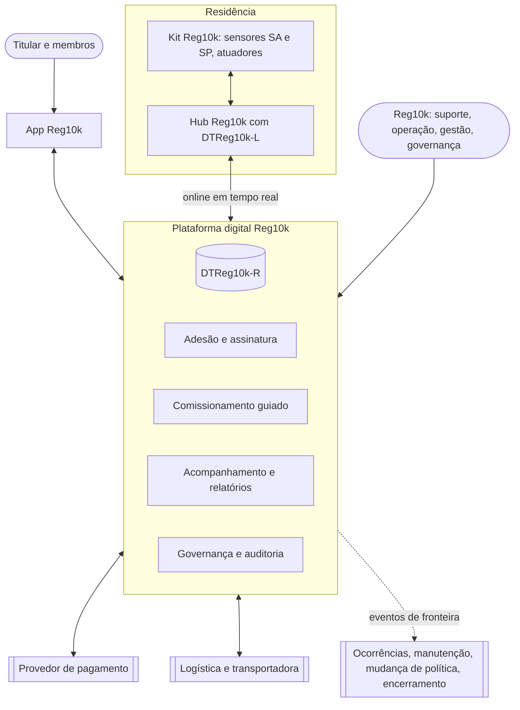

**Figura 1 — Contexto da plataforma Reg10k.** Os elementos com borda dupla são externos ou fora do foco desta V1.

### 2.2 Glossário mínimo

| Termo | Significado |
|---|---|
| Reg10k | Empresa operadora da plataforma (A05) |
| Kit Reg10k | Conjunto de referência: um hub e os dispositivos da residência (sensores de passagem SA, sensores de presença SP e atuadores de iluminação), identificados por número de série (A06, A07) |
| Kit nominal | Kit cujos números de série foram associados a uma residência antes da expedição (RN24) |
| Hub Reg10k | Controlador local que executa a automação e hospeda o DTReg10k-L |
| DTReg10k | Digital Twin da residência (A08). **DTReg10k-L**: representação local no hub. **DTReg10k-R**: representação remota na plataforma |
| Titular | Assinante responsável pela residência; pode convidar membros |
| Incorporação | Da adesão até o kit entregue e confirmado (MP1) |
| Comissionamento | Instalação guiada, vínculos, testes e ativação (MP2) |
| Ativação | Momento em que a residência passa a "ativa" e a assinatura começa a ser cobrada (RN20) |

### 2.3 Fronteira

| Dentro do foco | Fora do foco (interface, §11) |
|---|---|
| Adesão online, elegibilidade, assinatura e seus efeitos sobre o serviço | Processamento financeiro, emissão fiscal e cobrança judicial |
| Alocação de kit nominal, rastreio de expedição e confirmação de recebimento | Operação logística, estoque físico e transporte |
| Comissionamento DIY guiado, testes, ativação e suporte remoto à sessão | Visita técnica presencial |
| Operação da automação local e remota, sincronização DTReg10k-L/R | Atendimento de presença inesperada (central) |
| Acompanhamento por titular, membros e gestores Reg10k | Manutenção e troca de dispositivos; alteração de políticas da base; transferência e encerramento |
| Governança, registros, auditoria, privacidade | Política comercial (preços, planos) |

### 2.4 Premissas

| ID | Premissa | Situação | Validação |
|---|---|---|---|
| H01 | 10.000 residências ativas como base inicial, com margem de projeto de 5× para a plataforma | A02; margem **P** (D08) | SER |
| H02 | A residência possui internet própria (Wi-Fi ou cabo) para o hub | P; condição de elegibilidade (RN31) | SER |
| H03 | A iluminação essencial funciona localmente sem conexão externa | F (R03, R10 RN04) | Ensaio na ativação (PS14) |
| H04 | Configuração típica de 6 cômodos automatizados por residência: 1 SA por passagem, 1 SP e 1 atuador por cômodo | P; hipótese de dimensionamento herdada de R10/R11; SA por passagem conforme A14 | Catálogo de kits (A09) |
| H05 | O kit DIY não exige intervenção na instalação elétrica fixa | **A** (A09) | Catálogo de kits e certificações (V2 RNF-LEG-04) |
| H06 | Os kits são entregues ao longo de cerca de 4 semanas após a abertura das assinaturas | P; depende da logística | D14 |

---

## 3. Direcionadores de negócio

Os direcionadores derivam de DN01–DN06 [R10] e das decisões A01–A08. A prioridade relativa orienta escolhas de engenharia quando dois direcionadores conflitam.

| ID | Direcionador | Objetivo | Medida (indicador, §9.3) | Meta proposta | Dono | Processos | Prioridade |
|---|---|---|---|---|---|---|---|
| BD01 | Prontidão para 10.000 assinantes no lançamento | Absorver o pico de adesão e comissionamento sem degradar residências ativas | IQ14 vazão de adesão; IQ15 sessões simultâneas; IQ03 atualidade das ativas | Ensaio aprovado nos cenários CL-A e CL-C | SER | MP1, MP2 | 2 |
| BD02 | Autoinstalação bem-sucedida e segura | O morador conclui sozinho, com segurança, na maioria dos casos | IQ16 conclusão DIY sem visita; IQ17 tempo de comissionamento | ≥ 90% sem visita; mediana ≤ 2 h | SER | MP2 | 2 |
| BD03 | Autonomia e continuidade local | A casa funciona sem a plataforma | IQ04 continuidade local | ≥ 99% das ativações com ensaio de autonomia aprovado | OPE | MP2, MP3 | **1** |
| BD04 | Confiança no DTReg10k | Distinguir intenção, relato, observação e desconhecido; L e R coerentes | IQ02, IQ03, IQ18 sincronização L→R | Ver §9.3 | OPE | MP3, MP4, MT | **1** |
| BD05 | Transparência para usuários e gestores | Cada perfil vê o necessário, com atualidade e cobertura explícitas | IQ08 cobertura; uso do app (a definir) | Cobertura ≥ 95% | SER | MP4 | 3 |
| BD06 | Governança, privacidade e isolamento | Acesso por residência, finalidade e vigência; direitos do titular | IQ10 isolamento; IQ19 atendimento de direitos do titular | 100% das tentativas indevidas negadas; zero exposição confirmada | GOV | MT, MP4 | **1** |
| BD07 | Incorporação correta e rastreável | DTReg10k corresponde à residência e aos itens certos | IQ01 ativação válida; IQ11 integridade; IQ20 retrabalho de vínculo | 100%; zero vínculos cruzados | IMP | MP1, MP2, MT | **1** |
| BD08 | Escala e evolução sustentadas pelo investimento | Crescer além de 10.000 e de iluminação sem refazer a base | Margem ensaiada; tipos de dispositivo adicionáveis sem migração do DTReg10k | 5× em ensaio (D08) | SER | Todos | 3 |

**Leitura da prioridade:** 1 = inegociável (não se troca por prazo); 2 = condição de lançamento; 3 = pode evoluir após o lançamento. Assim, se houver conflito entre acelerar o lançamento (BD01) e preservar a correção do vínculo (BD07), prevalece BD07.

---

## 4. Partes interessadas e papéis

### 4.1 Papéis

| Código | Papel | Organização | Responsabilidade e limite |
|---|---|---|---|
| TIT | Titular da assinatura | Cliente | Contrata, instala o kit, define preferências, convida e revoga membros, exerce direitos de titular de dados |
| MEM | Membro da residência | Cliente | Usa e acompanha a casa conforme papel concedido pelo titular; não gerencia assinatura |
| OCU | Ocupante ou visitante | — | É detectado pelos sensores; não recebe permissão por estar presente; não é identificado (RN09) |
| SUP | Suporte remoto Reg10k | Reg10k | Assiste comissionamento e uso; acessa detalhes somente com delegação e vigência (PS10) |
| IMP | Responsável pela incorporação | Reg10k | Responde pelo processo MP1–MP2, pelas regras de ativação e pela revisão de exceções |
| LOGR | Responsável logístico Reg10k | Reg10k | Responde pela alocação de kits e pela integração com a transportadora |
| OPE | Responsável pela operação da plataforma | Reg10k | Responde pela confiabilidade do DTReg10k, sincronização e continuidade |
| SER | Responsável pelo serviço (produto) | Reg10k | Responde por direcionadores, metas, kits e políticas padrão |
| GES | Gestor Reg10k | Reg10k | Consulta agregados de negócio e qualidade; não acessa detalhe individual por padrão |
| COM | Responsável comercial | Reg10k | Responde por assinatura, cancelamento e relacionamento |
| GOV | Governança de dados (encarregado LGPD) | Reg10k | Define e verifica permissões, retenção, consentimentos e direitos do titular |

Sistemas externos: provedor de pagamento, transportadora, canais de mensagem (e-mail, push, SMS).

### 4.2 Responsabilidade por macroprocesso

| Macroprocesso | Responsável final | Executores | Consultados | Informados |
|---|---|---|---|---|
| MP1 Adesão e incorporação | IMP | Plataforma (automático), TIT, LOGR, COM | GOV | SER, GES |
| MP2 Comissionamento e conexão ao DTReg10k | IMP | TIT, plataforma, hub, SUP | OPE | SER, GES |
| MP3 Operação da automação | SER | Hub (DTReg10k-L), plataforma, TIT, MEM | OPE | TIT; OPE em exceção |
| MP4 Acompanhamento digital | SER | Plataforma, SUP | GOV | TIT, MEM, GES |
| MT Governança e registros | GOV | Plataforma, OPE | SER, IMP | GES |

Funções automáticas da plataforma executam etapas, mas respondem ao papel responsável final. O DTReg10k não é responsável por processo nem concede permissão (R10 §4.3).

---

## 5. Macroprocessos

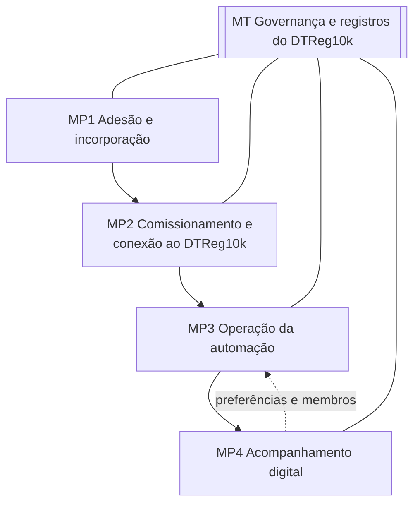

**Figura 2 — Macroprocessos no foco desta V1.**

### 5.1 Ciclo de vida da residência na incorporação

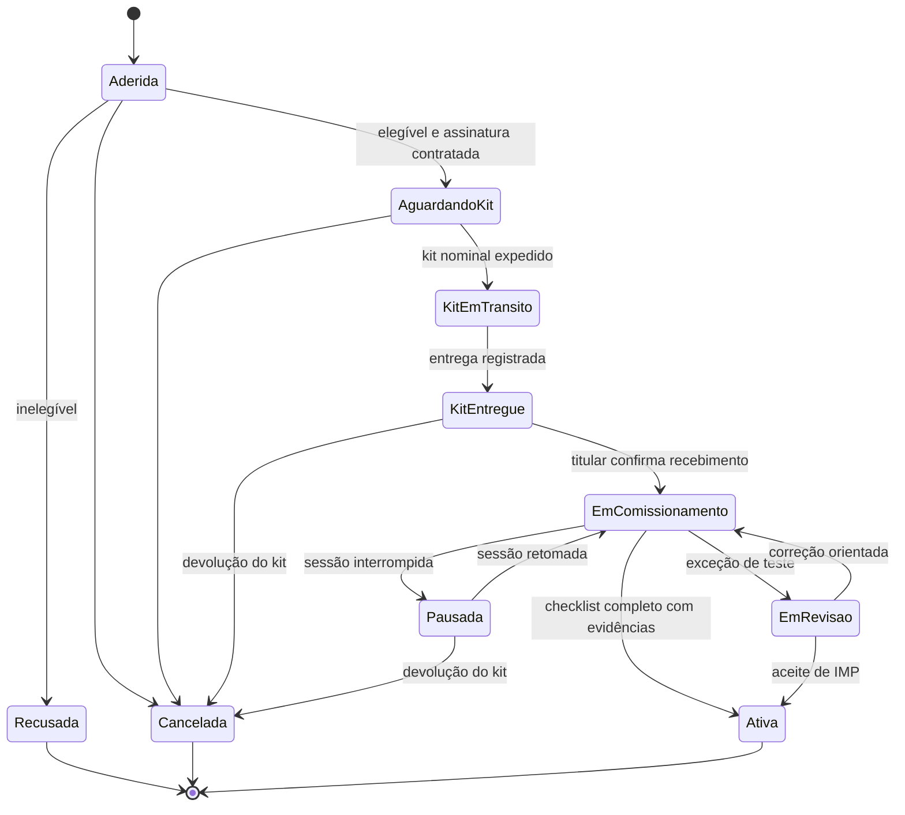

**Figura 3 — Estados da residência até a ativação.** Após "Ativa", valem os estados de R10 §6.1 (ativa com degradação, suspensa e outros).

### 5.2 MP1 — Adesão e incorporação da residência

**Objetivo:** contratar a assinatura e entregar à residência o kit correto, já associado a ela no DTReg10k-R. **Direcionadores:** BD01, BD06, BD07. **Responsável final:** IMP. **Executores:** plataforma, TIT, LOGR, COM. **Consultados:** GOV.

**Gatilho e precondições:** titular inicia a adesão online; identidade e endereço informados. **Entradas:** dados do titular e da residência, respostas de elegibilidade, meio de pagamento (tokenizado pelo provedor), aceites.

**Fluxo normal:**

1. O titular cria conta, informa residência e aceita termos e política de privacidade em versões identificadas.
2. A plataforma aplica o questionário de elegibilidade (internet, cômodos, tipo de iluminação). Define a configuração-alvo e o kit, ou recusa com motivo (RN31).
3. A plataforma cria a residência e o DTReg10k-R em estado "Aderida", impedindo duplicidade de endereço e unidade (RN05).
4. A plataforma cria a assinatura em "contratada" e autoriza o meio de pagamento no provedor, sem cobrança (RN20, RN29).
5. A residência entra na fila de expedição com posição e previsão visíveis (RN21).
6. LOGR aloca um kit e a plataforma registra os números de série do hub e dos dispositivos como **kit nominal** da residência (RN24).
7. A plataforma registra expedição e entrega a partir dos eventos da transportadora.
8. O titular confirma o recebimento lendo no app o código do hub. A residência passa a "Em comissionamento".

**Decisões e exceções:**

| Situação | Tratamento |
|---|---|
| Inelegível (sem internet, configuração não suportada) | Recusa com motivo, sem cobrança; titular pode refazer após mudança |
| Endereço e unidade já cadastrados | Bloqueio e revisão por IMP; não cria segundo DTReg10k |
| Autorização de pagamento recusada | Adesão pendente; nada é expedido |
| Entrega registrada, mas não confirmada pelo titular | Estado "entregue, não confirmado"; contato proativo após prazo; não inicia contagem de abandono |
| Kit danificado ou incompleto | Substituição do kit nominal com novo registro; série anterior marcada como devolvida |
| Desistência antes da ativação | Cancelamento com devolução do kit, inclusive o direito de arrependimento em compra à distância (CDC, art. 49), conforme política comercial |

**Resultado terminal:** kit nominal recebido e confirmado; ou adesão recusada ou cancelada com motivo.

**Registros no DTReg10k:** identidade da residência e do titular; aceites versionados; configuração-alvo; assinatura e seus estados; kit nominal e séries; eventos de expedição e entrega; confirmação de recebimento.

**Visibilidade:** TIT vê posição na fila, previsão, rastreio e estado da assinatura. GES vê o funil agregado. SUP vê o caso individual quando há atendimento aberto.

**Volumes:** CL-A e CL-B (§9.4). **Requisitos:** RNP-MP1-01 a 09. **Cenários:** CV25, CV33, CV35.

### 5.3 MP2 — Configuração inicial da automação local e conexão ao DTReg10k

**Objetivo:** o titular instala o kit, a plataforma comprova vínculos e funcionamento, o DTReg10k-L e o DTReg10k-R ficam sincronizados e a residência é ativada. **Direcionadores:** BD02, BD03, BD04, BD07. **Responsável final:** IMP. **Executores:** TIT, hub, plataforma, SUP. **Consultados:** OPE.

**Gatilho e precondições:** residência "Em comissionamento"; kit nominal confirmado; internet disponível. **Entradas:** configuração-alvo, kit nominal, política padrão vigente, guia de instalação por item.

**Fluxo normal:**

1. O titular abre a sessão de comissionamento no app e reivindica o hub pela leitura de seu código. A plataforma aceita somente se o hub pertencer ao kit nominal da residência do titular (RN24).
2. O hub se conecta, recebe identidade e configuração-alvo, cria o DTReg10k-L e estabelece a sincronização com o DTReg10k-R.
3. O app guia a instalação cômodo a cômodo. Para cada item, o titular lê o código e confirma o cômodo; para o sensor de passagem (SA), confirma a porta, isto é, a passagem entre dois cômodos ou entre cômodo e exterior (A14). A plataforma cria o vínculo com início de vigência apenas dentro da sessão aberta (RN05, RN06).
4. Todos os passos são de encaixe ou de ligar na tomada; nenhum passo mexe na instalação elétrica fixa (RN25). Se o titular indicar um ponto de luz sem soquete ou tomada compatível, a plataforma não gera passo de instalação para ele e oferece visita técnica.
5. A plataforma executa testes guiados por item: o titular caminha pelo cômodo (passagem), permanece (presença), sai (ausência), e o atuador é acionado. Cada teste registra o nível de evidência alcançado (RN02).
6. A plataforma executa o ensaio de autonomia: o hub opera sem conexão externa por PS14, depois reconecta e reconcilia com o DTReg10k-R (RN04).
7. O app apresenta as capacidades e limitações da instalação por cômodo (o que é observado, o que é apenas relatado). O titular escolhe preferências iniciais dentro dos limites da política padrão.
8. Com o checklist completo e com evidências, a plataforma ativa a residência automaticamente (RN26). A assinatura inicia o ciclo de cobrança (RN20). O titular recebe o resumo da ativação.

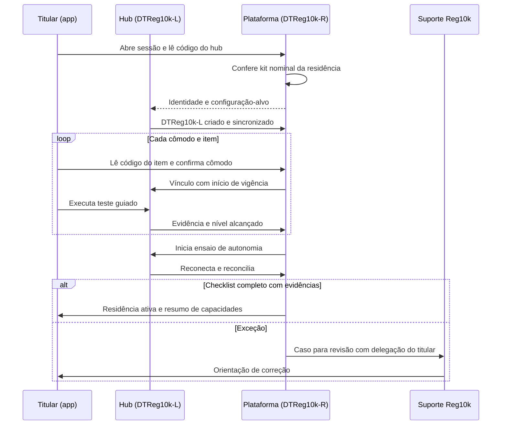

**Figura 4 — Comissionamento DIY guiado.**

**Decisões e exceções:**

| Situação | Tratamento |
|---|---|
| Código lido pertence a outro kit | Recusa, explicação e registro da tentativa; nenhum vínculo criado (CV01, CV33) |
| Item não detectado ou teste reprovado | Orientação de correção; repetição limitada; persistindo, caso para SUP e possível troca do item (interface de manutenção) |
| Atuador executa sem evidência suficiente | Teste "desconhecido", não aprovado como observado; capacidade declarada conforme evidência real |
| Ponto de luz sem soquete ou tomada compatível (exigiria fiação) | Nenhum passo de instalação para esse ponto; oferta de visita técnica (fora do foco); os demais itens seguem |
| Sessão interrompida | Progresso preservado; retomada sem refazer etapas aprovadas |
| Sessão sem progresso além de PS13 | Contato proativo de SUP; kit continua nominal da residência (RN30) |
| Ensaio de autonomia reprovado | Residência não é ativada; caso para revisão por IMP |
| Internet indisponível durante a sessão | Etapas locais continuam no hub; ativação aguarda a reconciliação com o DTReg10k-R |

**Resultado terminal:** residência ativa com vínculos e testes comprovados; ou em revisão com responsável e próximo passo; ou cancelada com devolução.

**Registros no DTReg10k:** reivindicação do hub; criação do DTReg10k-L; vínculos com vigência; resultados de testes com nível de evidência; ensaio de autonomia; capacidades declaradas; preferências iniciais; aceite automático ou revisão de IMP; evento de ativação.

**Visibilidade:** TIT acompanha o checklist em tempo real. SUP vê a sessão somente com delegação do titular e durante a vigência. GES vê o funil agregado (iniciadas, pausadas, ativadas, em revisão).

**Volumes:** CL-C e CL-D (§9.4). **Requisitos:** RNP-MP2-01 a 11. **Cenários:** CV01, CV14, CV26–CV28, CV32, CV33.

### 5.4 MP3 — Operação da automação

**Objetivo:** iluminação adequada ao uso, decidida localmente, com intervenções do titular e membros e reflexo fiel no DTReg10k. **Direcionadores:** BD03, BD04. **Responsável final:** SER. **Executores:** hub (DTReg10k-L), plataforma, TIT, MEM. Mantém as regras de PN02 [R10 §8].

**Gatilho:** passagem, leitura de presença, intervenção local, comando remoto pelo app, término de intervenção temporária, mudança de preferência.

**Fluxo normal:**

1. O hub identifica o cômodo e a causa da avaliação.
2. Valida autorização (se houver solicitante remoto) e a validade das evidências de presença (PS04).
3. Aplica a precedência: restrição local > intervenção manual > rotina de ocupação [R10 §7.2]; apagamento exige ausência estável (PS05).
4. Registra a intenção no DTReg10k-L e aciona o atuador.
5. Acompanha até PS02 e classifica o resultado no nível demonstrado (RN02).
6. Sincroniza com o DTReg10k-R dentro de PS11; o app de quem acompanha a casa reflete o resultado.

**Comando remoto pelo app:** a plataforma cria a intenção com validade PS01 e a envia ao hub. O hub recusa se a validade venceu ou se há precedência superior. O resultado chega ao app com o nível alcançado (PS12).

**Decisões e exceções:**

| Situação | Tratamento |
|---|---|
| Presença desconhecida (sensor sem resposta) | Não apagar por silêncio; contingência configurada (RN01) |
| Hub sem conexão externa | Automação local continua; comandos remotos recusados com motivo; app mostra a última evidência e sua idade |
| Reconexão | Estado atual sincroniza antes do histórico; comandos vencidos expiram; histórico não restabelece atualidade (RN04, RN12) |
| Mesmo fato recebido duas vezes | Um único efeito (RN11) |
| Preferência alterada no app com hub offline | Versão pendente; aplicada e confirmada na reconexão (RN28) |
| Assinatura suspensa | Funções remotas suspensas; iluminação local e acionamento manual preservados (RN19) |
| Presença incompatível com evidência anterior | Detecção local (RN03, RN17) e evento de fronteira para ocorrências; sem rotular invasão (§11) |
| Item sem resposta persistente | Aviso ao titular (MP4) e evento de fronteira para manutenção |

**Resultado terminal:** ação com resultado classificado; recusada, substituída ou expirada com motivo; ou desconhecida com aviso.

**Registros no DTReg10k:** evidências, intenções, decisões com versão de política, resultados, mudanças de preferência e sua aplicação local.

**Visibilidade:** TIT e MEM veem estado, causa e resultado. GES vê apenas agregados. OPE vê saúde da sincronização sem dados de presença individuais.

**Volumes:** CL-E. **Requisitos:** RNP-MP3-01 a 10. **Cenários:** CV02–CV05, CV08, CV15, CV22, CV29.

### 5.5 MP4 — Acompanhamento digital para usuários e gestores

**Objetivo:** informar cada perfil com atualidade, cobertura e limites explícitos. **Direcionadores:** BD04, BD05, BD06. **Responsável final:** SER. **Executores:** plataforma, SUP. **Consultados:** GOV.

**Gatilho:** consulta, agenda de relatório, mudança relevante (aviso), convite ou revogação de membro, pedido de titular de dados.

**Fluxo normal:**

1. A plataforma autentica o usuário e verifica papel, residência, finalidade e vigência.
2. Monta a visão do perfil (§5.5.1) a partir do DTReg10k-R, exibindo idade da informação, nível de evidência e conectividade do hub.
3. Envia avisos conforme preferências do titular e registra envio separado de entrega.
4. Emite o relatório mensal da residência com cobertura e lacunas (RN10, PS09).
5. Atualiza o painel agregado de GES com a base prevista no denominador, inclusive residências offline.
6. Atende pedidos de titular de dados (acesso, correção, eliminação) conforme política de retenção (RN33).

#### 5.5.1 Matriz de visibilidade

| Informação | TIT | MEM | SUP | GES | OPE |
|---|---|---|---|---|---|
| Estado atual por cômodo, idade e nível de evidência | Sim | Conforme papel | Com delegação e vigência | Não | Não |
| Histórico de ações (causa, solicitante, resultado) | Sim | Conforme papel | Com delegação | Não | Não |
| Presença e ausências detalhadas | Sim (30 dias) | Conforme papel | Com delegação | Não | Não |
| Saúde de hub e itens | Sim | Sim | Sim | Agregado | Sim, sem presença |
| Assinatura e cobrança | Sim | Não | Para atendimento | Agregado | Não |
| Funil de incorporação e comissionamento | Próprio caso | Não | Casos atendidos | Agregado | Agregado |
| Indicadores IQ da base | Não | Não | Não | Sim | Sim |
| Registros de auditoria | Acessos à sua residência | Não | Não | Não | Sob GOV |

**Exceções:** destinatário sem permissão vigente → negação sem expor dados (CV09); membro revogado → acesso encerrado na hora (CV30); dados insuficientes → relatório parcial identificado, nunca preenchido com zeros (CV13); falha de canal de aviso → tentativa registrada, informação disponível no app (CV17).

**Resultado terminal:** informação entregue ao perfil autorizado, com atualidade e cobertura explícitas; ou negação registrada.

**Registros no DTReg10k:** consultas e negações relevantes, convites e revogações, avisos e status de entrega, versões de relatório, pedidos de titular e seu atendimento.

**Volumes:** CL-F. **Requisitos:** RNP-MP4-01 a 09. **Cenários:** CV09, CV13, CV17, CV30, CV31, CV34.

---

## 6. MT — Governança e registros do DTReg10k

### 6.1 Duas representações, uma identidade

O DTReg10k de cada residência é **um gêmeo lógico** com duas representações (A08):

- **DTReg10k-L**, no hub: decide a automação, registra evidências na origem e continua operando sem conexão.
- **DTReg10k-R**, na plataforma: consolida, serve aplicativos e gestão, mantém configuração, permissões, assinatura e auditoria.

A residência é contada uma única vez (R10 §2.3).

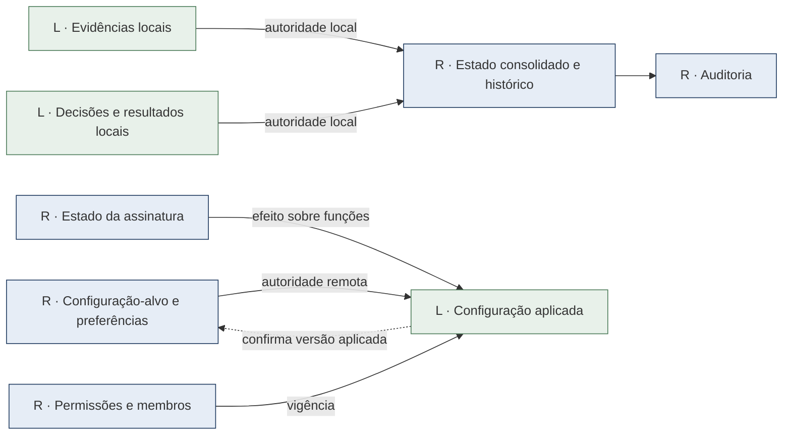

**Figura 5 — Autoridade por tipo de registro entre DTReg10k-L (L, verde) e DTReg10k-R (R, azul).**

### 6.2 Regras de autoridade e conflito

| Tipo de registro | Autoridade | Regra de conflito |
|---|---|---|
| Evidências físicas, decisões locais e resultados de atuação | DTReg10k-L | A plataforma nunca altera um fato local. Correções são novos registros (RN12) |
| Configuração-alvo, preferências, política aplicável | DTReg10k-R | O hub aplica a versão mais recente válida e confirma; até confirmar, R mostra "pendente de aplicação" |
| Permissões, membros, delegações | DTReg10k-R | Revogação vale imediatamente na plataforma; no hub, na próxima sincronização, e nunca concede mais acesso local do que o vigente |
| Estado da assinatura | DTReg10k-R | Propaga efeitos ao hub; suspensão não desativa funções locais essenciais (RN19) |
| Vínculos de itens | DTReg10k-R, criados em sessão de comissionamento com evidência local | Divergência entre o item que responde e o vínculo registrado gera evento de fronteira para manutenção, sem alteração automática |

### 6.3 Matriz de registros

| Registro | Criado por | Autoridade | Quem vê | Retenção proposta |
|---|---|---|---|---|
| Identidade da residência e do titular | MP1 | R | TIT; Reg10k por finalidade | Vigência + 180 dias, salvo obrigação legal |
| Aceites e consentimentos versionados | MP1, MP4 | R | TIT, GOV | Vigência + prazo legal a definir por GOV |
| Assinatura e eventos comerciais | MP1, MP2, MP3 | R | TIT, COM | Prazos legais e fiscais a definir |
| Kit nominal e números de série | MP1 | R | SUP, LOGR, OPE | Vigência + 180 dias |
| Sessões de comissionamento e testes | MP2 | L e R | TIT, SUP, IMP | Vigência + 180 dias |
| Vínculos item ↔ cômodo, com vigência | MP2 | R | TIT, SUP | Vigência + 180 dias [R10 §7.5] |
| Configuração, preferências e versões aplicadas | MP2, MP3 | R (alvo), L (aplicada) | TIT, OPE | Vigência + 180 dias |
| Evidências detalhadas de presença e iluminação | MP3 | L | TIT, MEM; SUP com delegação | 30 dias [R10 §7.5] |
| Intenções, decisões e resultados | MP3 | L (resultado) | TIT, MEM | 180 dias [R10 §7.5] |
| Avisos e relatórios | MP4 | R | Destinatários autorizados | Relatórios agregados 12 meses [R10 §7.5] |
| Pedidos de titular e atendimento | MP4 | R | TIT, GOV | Prazo legal a definir |
| Auditoria de acessos e autorizações | Todos | R | GOV | 12 meses |

Retenção prorrogada para um caso em aberto exige justificativa de GOV, escopo e reavaliação a cada 30 dias [R10 §7.5].

### 6.4 Princípios de governança

1. Todo registro tem origem (L ou R), instante, autor ou causa e versão de política.
2. Registros de fato são imutáveis; o estado do DTReg10k-R pode ser reconstruído a partir deles.
3. Toda decisão de acesso, inclusive negações, gera auditoria.
4. Dados de presença são tratados como dado pessoal comportamental: minimização, finalidade restrita, agregação para gestão e consideração de terceiros presentes (ocupantes e visitantes).
5. Antes do lançamento, GOV conclui o Relatório de Impacto à Proteção de Dados (RIPD).

---

## 7. Regras de negócio

### 7.1 Regras herdadas e aplicadas

| ID | Regra resumida | Origem | Aplicação nesta V1 |
|---|---|---|---|
| RN01 | Falta de resposta nunca prova ausência; contingência configurada | R10 | MP3 |
| RN02 | Intenção, envio, recebimento, execução relatada e efeito observado são distintos | R10 | MP2 (testes), MP3, MP4 |
| RN03 | Presença inesperada é suspeita, não invasão | R10 | MP3 (fronteira) |
| RN04 | Falta de plataforma não interrompe a iluminação local; ações vencidas não são reaplicadas | R10 | MP2 (ensaio), MP3 |
| RN05 | Vínculo e acesso acompanham residência, titular e ciclo de vida | R10 | MP1, MP2, MT |
| RN06 | Ativação exige identificação, capacidades, configuração, teste local e aceite | R10 | **Redefinida por RN26** para o DIY |
| RN07 | Cada intervenção tem solicitante, motivo, prazo e resultado; precedência definida | R10 | MP3 |
| RN09 | SA e SP não identificam pessoa, idade, direção ou contagem | R10 (F) | MP3, MP4 |
| RN10 | Relatório indica período, base prevista, cobertura e limitações | R10 | MP4 |
| RN11 | Reprocessamento não duplica efeito | R10 | MP3, MT |
| RN12 | Dados tardios não apagam conclusões históricas | R10 | MP3, MT |
| RN15 | Mínimo necessário; acesso temporário termina com a intervenção | R10 | MP2 (SUP), MP4 |
| RN17 | Verificação periódica de suspeita a cada 5 min | R10 (F) | MP3 |
| RN19 | Suspensão comercial preserva iluminação local e acionamento manual | R11 | MP3 |
| RN20 | Cobrança começa na ativação, proporcional no primeiro ciclo | R11 | MP1, MP2 |
| RN21 | Fila de expedição com critérios publicados e visível ao titular | R11 (adaptada) | MP1 |
| RN23 | Nenhuma versão de software, firmware ou política chega a 100% da base sem lotes | R11 | Transversal |

### 7.2 Regras novas

| ID | Regra | Marca |
|---|---|---|
| RN24 | **Kit nominal:** os números de série do hub e dos itens são associados à residência antes da expedição. Só o titular dessa residência (ou membro com papel de instalação) pode reivindicá-los | P |
| RN25 | **Kit sem fiação (autoinstalação segura):** o kit DIY contém apenas itens de encaixe ou plugáveis, e nenhum passo da autoinstalação mexe na instalação elétrica fixa. Pontos de luz que exigiriam fiação não entram no roteiro de instalação e são encaminhados à visita técnica opcional | **A** (A09) |
| RN26 | **Ativação DIY:** a plataforma ativa automaticamente quando todos os itens do checklist têm evidência registrada (reivindicação, vínculos, testes por item, ensaio de autonomia, preferências iniciais). Faltando qualquer evidência, o caso vai à revisão de IMP; nunca há ativação por declaração do usuário | P; redefine RN06 |
| RN27 | **Autoridade do DTReg10k:** DTReg10k-L é autoridade para fatos locais; DTReg10k-R é autoridade para configuração, permissões e assinatura (§6.2) | P; A08 + A10 |
| RN28 | **Reconciliação L↔R:** divergências são resolvidas pela autoridade do tipo de registro, com registro da divergência e da resolução; configuração pendente é visível como tal | P |
| RN29 | **Assinatura gerida pela plataforma:** o estado da assinatura integra o DTReg10k-R e seus efeitos chegam ao hub; dados de cartão não são armazenados na plataforma | **A** (A10) |
| RN30 | **Comissionamento abandonado:** sem progresso por PS13, SUP faz contato proativo. O kit continua nominal da residência até cancelamento | P |
| RN31 | **Elegibilidade antes da expedição:** internet disponível e configuração suportada pelo kit de referência são verificadas antes de alocar kit | P |
| RN32 | **Membros:** o titular convida e revoga membros com papéis (consulta, controle, instalação). Revogação é imediata na plataforma | P |
| RN33 | **Direitos do titular de dados:** a plataforma permite acesso, correção, portabilidade e eliminação, respeitando retenções legais e a política de §6.3 | P; LGPD |
| RN34 | **Ocupante:** pessoa ou animal de grande porte. Os sensores não distinguem um do outro (RN09) e a automação atende a qualquer ocupante | **A** (A12) |

---

## 8. Requisitos de negócio da plataforma (RNP)

Formato: "A plataforma deve permitir que…". Todos são **P**, com aceite do responsável final do macroprocesso, salvo indicação.

### 8.1 MP1 — Adesão e incorporação

| ID | Requisito | BD | Etapa / Regra | Critério de aceitação |
|---|---|---|---|---|
| RNP-MP1-01 | Permitir que o titular faça a adesão online, registrando identidade, residência e aceites com versão e instante | BD06 | MP1.1; RN33 | Dado um titular sem aceite da política de privacidade, quando tentar concluir, então a adesão não é concluída e nenhum DTReg10k é criado |
| RNP-MP1-02 | Aplicar elegibilidade antes da expedição e definir a configuração-alvo e o kit | BD02 | MP1.2; RN31 | Dada residência sem internet declarada, quando concluir o questionário, então é recusada com motivo e nada é cobrado nem expedido |
| RNP-MP1-03 | Criar a residência e o DTReg10k-R sem duplicidade de endereço e unidade | BD07 | MP1.3; RN05 | Dado endereço e unidade já cadastrados, quando nova adesão for feita, então não se cria segundo DTReg10k e o caso vai a IMP |
| RNP-MP1-04 | Criar e gerir a assinatura com autorização do meio de pagamento, sem cobrança antes da ativação | BD01 | MP1.4; RN20, RN29 | Dada residência não ativada no fechamento do ciclo, quando o ciclo fechar, então nenhum valor é cobrado |
| RNP-MP1-05 | Associar ao DTReg10k-R os números de série do kit nominal antes da expedição | BD07 | MP1.6; RN24 | Dado item sem série registrada, quando LOGR tentar incluí-lo no kit, então a inclusão é recusada |
| RNP-MP1-06 | Mostrar ao titular a posição na fila e a previsão de expedição | BD05 | MP1.5; RN21 | Dada mudança de previsão, quando ocorrer, então o titular é avisado e o histórico da previsão fica registrado |
| RNP-MP1-07 | Registrar eventos de expedição e entrega e exigir confirmação de recebimento pelo titular | BD07 | MP1.7–8 | Dada entrega registrada sem confirmação, então a residência fica "entregue, não confirmado" e não inicia comissionamento |
| RNP-MP1-08 | Permitir cancelamento antes da ativação com registro de devolução do kit | BD06 | Exceções MP1 | Dado cancelamento dentro do prazo de arrependimento, quando solicitado, então a assinatura é encerrada sem cobrança e a devolução fica pendente com responsável |
| RNP-MP1-09 | Sustentar o pico de adesões do lançamento sem degradar residências ativas | BD01 | CL-A | Dado ensaio com 10.000 adesões em 1 h, então nenhuma adesão é perdida e IQ03 das residências ativas permanece dentro da meta |

### 8.2 MP2 — Comissionamento e conexão ao DTReg10k

| ID | Requisito | BD | Etapa / Regra | Critério de aceitação |
|---|---|---|---|---|
| RNP-MP2-01 | Aceitar a reivindicação do hub somente pelo titular (ou membro com papel de instalação) da residência do kit nominal | BD07 | MP2.1; RN24 | Dado hub de outro kit, quando o titular ler seu código, então a plataforma recusa, explica e registra a tentativa |
| RNP-MP2-02 | Criar o DTReg10k-L no hub e estabelecer a sincronização com o DTReg10k-R | BD04 | MP2.2; RN27 | Dado hub reivindicado, então R registra a versão de configuração aplicada por L antes de qualquer teste |
| RNP-MP2-03 | Vincular cada item a um cômodo somente dentro de sessão de comissionamento aberta, com início de vigência e resultado de teste | BD07 | MP2.3; RN05, RN26 | Dado item já vinculado a outra residência, quando o titular tentar vinculá-lo, então a plataforma recusa e registra |
| RNP-MP2-04 | Gerar o roteiro de instalação apenas com passos de encaixe ou de tomada e encaminhar à visita técnica os pontos de luz que exigiriam fiação | BD02 | MP2.4; RN25 | Dado um ponto de luz sem soquete compatível, quando o titular o indicar, então a plataforma não gera passo de instalação para ele e oferece visita técnica |
| RNP-MP2-05 | Executar testes guiados por item e registrar o nível de evidência alcançado | BD04 | MP2.5; RN02 | Dado atuador acionado sem evidência de efeito, então o teste fica "desconhecido" e não é registrado como observado |
| RNP-MP2-06 | Executar e registrar o ensaio de autonomia local antes da ativação | BD03 | MP2.6; RN04, PS14 | Dado ensaio em que a iluminação não responde sem conexão, então a residência não é ativada e vai à revisão |
| RNP-MP2-07 | Apresentar ao titular as capacidades e limitações por cômodo | BD04 | MP2.7 | Dado cômodo sem observação de efeito, então o app informa que o resultado será apenas relatado |
| RNP-MP2-08 | Ativar automaticamente com checklist completo e encaminhar exceções a IMP | BD07 | MP2.8; RN26 | Dado checklist com um item sem evidência, então não há ativação e o caso fica com responsável |
| RNP-MP2-09 | Preservar o progresso de sessões interrompidas e acionar contato após PS13 sem progresso | BD02 | Exceções MP2; RN30 | Dada sessão retomada, então etapas aprovadas não são repetidas; dada inatividade além de PS13, então SUP recebe o caso |
| RNP-MP2-10 | Permitir a SUP acompanhar a sessão com delegação do titular, limitada à sessão e à vigência | BD06 | MP2; RN15, PS10 | Dado SUP sem delegação, quando tentar abrir a sessão, então é negado e auditado |
| RNP-MP2-11 | Sustentar sessões simultâneas de comissionamento no pico do lançamento | BD01 | CL-C | Dado ensaio com 1.000 sessões simultâneas, então os testes registram resultado dentro de PS12 |

### 8.3 MP3 — Operação da automação

| ID | Requisito | BD | Etapa / Regra | Critério de aceitação |
|---|---|---|---|---|
| RNP-MP3-01 | Decidir a iluminação no hub, sem depender da plataforma | BD03 | MP3.1–4; RN01, RN04 | Dada perda de conexão, então a automação local continua e IQ04 registra a continuidade |
| RNP-MP3-02 | Aceitar comandos remotos com validade, autorização e precedência | BD04 | MP3; RN07, PS01 | Dado comando vencido ou hub offline, então é recusado com motivo e não fica pendente |
| RNP-MP3-03 | Registrar intervenção manual local como evidência com precedência temporária | BD03 | MP3.3; PS03 | Dada intervenção manual, então a automação ordinária não a desfaz antes de PS03 |
| RNP-MP3-04 | Classificar o resultado e refleti-lo no DTReg10k-R dentro de PS11 | BD04 | MP3.5–6; RN02 | Dado resultado sem confirmação até PS02, então o app mostra "desconhecido", nunca "aceso" |
| RNP-MP3-05 | Aplicar contingência de presença desconhecida | BD03 | MP3; RN01 | Dado SP sem resposta, então não há apagamento por silêncio |
| RNP-MP3-06 | Garantir efeito único para o mesmo fato ou comando | BD04 | RN11 | Dado comando reenviado com a mesma identificação, então há um único efeito |
| RNP-MP3-07 | Na reconexão, sincronizar estado atual antes do histórico e expirar comandos vencidos | BD04 | RN04, RN12 | Dado retorno após 1 h offline, então nenhum comando vencido é executado e o histórico não é marcado como atual |
| RNP-MP3-08 | Aplicar a suspensão comercial sem desativar funções locais essenciais | BD03 | RN19 | Dada assinatura suspensa, então a iluminação local e o interruptor funcionam e o app explica a suspensão |
| RNP-MP3-09 | Permitir ao titular alterar preferências dentro dos limites da política e confirmar a aplicação no hub | BD04 | RN27, RN28 | Dada alteração com hub offline, então R mostra "pendente de aplicação" até a confirmação de L |
| RNP-MP3-10 | Detectar localmente presença incompatível e emitir evento de fronteira para ocorrências | BD04 | RN03, RN17 | Dada passagem tardia que explica a presença, então a suspeita é conciliada antes do envio |

### 8.4 MP4 — Acompanhamento digital

| ID | Requisito | BD | Etapa / Regra | Critério de aceitação |
|---|---|---|---|---|
| RNP-MP4-01 | Exibir ao titular o estado por cômodo com idade da informação, nível de evidência e conectividade | BD04 | MP4.2; PS06 | Dado estado mais antigo que PS06, então é exibido como "desatualizado" com a idade |
| RNP-MP4-02 | Exibir o histórico de ações com causa, solicitante e resultado | BD05 | MP4.2; RN07 | Dada ação substituída por precedência, então o histórico mostra a substituição e o motivo |
| RNP-MP4-03 | Enviar avisos (hub offline, item sem resposta, bateria, resultado desconhecido) registrando envio e entrega separadamente | BD05 | MP4.3 | Dado canal sem confirmação, então o aviso fica "enviado", não "entregue" |
| RNP-MP4-04 | Emitir relatório mensal da residência com cobertura e lacunas | BD05 | MP4.4; RN10, PS09 | Dados períodos sem evidência, então aparecem como lacuna, não como zero |
| RNP-MP4-05 | Permitir ao titular convidar e revogar membros com papéis | BD06 | RN32 | Dada revogação, então a próxima consulta do membro é negada |
| RNP-MP4-06 | Oferecer a GES painel agregado da base, com denominador fixo e sem detalhe individual de presença | BD05 | MP4.5; RN15 | Dada residência offline, então ela permanece no denominador e aparece como sem evidência |
| RNP-MP4-07 | Permitir a SUP acessar detalhe somente com finalidade, delegação e vigência, com auditoria | BD06 | RN15, PS10 | Dada delegação expirada, então o acesso é negado e auditado |
| RNP-MP4-08 | Atender pedidos de titular de dados | BD06 | MP4.6; RN33 | Dado pedido de eliminação, então os dados sem obrigação de retenção são eliminados e o titular recebe comprovante com o que foi mantido e por quê |
| RNP-MP4-09 | Sustentar sessões simultâneas de acompanhamento com atualização em tempo real | BD01 | CL-F | Dado ensaio com 10.000 sessões, então as atualizações chegam dentro de PS11 |

### 8.5 MT — Governança e registros

| ID | Requisito | BD | Regra | Critério de aceitação |
|---|---|---|---|---|
| RNP-MT-01 | Registrar fatos, decisões e eventos de ciclo de vida de forma imutável, com origem L ou R, instante e autor ou causa | BD04 | RN12 | Dada correção de um fato, então surge novo registro e o anterior permanece |
| RNP-MT-02 | Aplicar a autoridade por tipo de registro e registrar divergências e resoluções | BD04 | RN27, RN28 | Dada configuração alterada em R durante desconexão, então L aplica na volta e R registra a confirmação |
| RNP-MT-03 | Manter identidade única de residência, kit, hub e itens, e vínculos com vigência | BD07 | RN05, RN24 | Dado item, então há no máximo um vínculo vigente |
| RNP-MT-04 | Versionar configuração e política e registrar a versão aplicada em cada hub | BD08 | RN23, RN28 | Dada consulta de uma decisão, então a versão de política usada é identificável |
| RNP-MT-05 | Auditar decisões de acesso, inclusive negações | BD06 | RN15 | Dada negação, então há registro de quem, o quê, quando e motivo |
| RNP-MT-06 | Aplicar retenção e destinação por classe, com prorrogação justificada | BD06 | §6.3 | Dado fim do prazo sem prorrogação, então o detalhe é eliminado ou agregado |
| RNP-MT-07 | Registrar aceites e consentimentos com versão | BD06 | RN33 | Dada nova versão da política de privacidade, então o titular precisa aceitar para funções que dependam dela |
| RNP-MT-08 | Manter o estado da assinatura no DTReg10k e propagar seus efeitos ao hub | BD03 | RN19, RN29 | Dada suspensão, então o hub recebe o efeito e preserva as funções locais essenciais |
| RNP-MT-09 | Permitir reconstruir o estado do DTReg10k-R a partir dos registros | BD04 | RN12 | Dado estado consolidado perdido, então a reconstrução reproduz o estado e o histórico |
| RNP-MT-10 | Garantir isolamento entre residências em toda consulta e ação | BD06 | RN05 | Dada tentativa de acesso a outra residência, então é negada sem revelar se ela existe |

---

## 9. Qualidade, parâmetros e volumes

### 9.1 Parâmetros herdados

PS01 a PS10 de R10 §7.1 permanecem como propostas: validade de comando remoto de 30 s, acompanhamento de atuação de 10 s, intervenção manual de 15 min, idade máxima de presença para decidir de 10 s, ausência estável (PS05, revisada por A13: T_apagamento configurável, padrão de 60 s sem nenhuma detecção), atualidade de supervisão de 60 s, verificação de suspeita de 5 min, recuperação após reconexão, relatório mensal e acesso temporário de técnico de 4 h.

### 9.2 Parâmetros novos

| Código | Parâmetro proposto | Aplicação |
|---|---|---|
| PS11 | Sincronização DTReg10k-L → DTReg10k-R: p95 ≤ 5 s em conectividade normal | Definição de "tempo real" (A11); MP3, MP4 |
| PS12 | Comando remoto do app até resultado registrado no app: p95 ≤ 3 s, dentro da validade PS01 | MP3 |
| PS13 | Comissionamento sem progresso por 7 dias aciona contato proativo | RN30 |
| PS14 | Ensaio de autonomia na ativação: 10 min sem conexão externa, com acionamentos locais verificados | MP2; IQ04 |
| PS15 | Delegação de SUP para comissionamento: até o fim da sessão ou 4 h, o que ocorrer antes | RNP-MP2-10 |

### 9.3 Indicadores

IQ01–IQ04, IQ08, IQ10 e IQ11 permanecem conforme R10 §11. Novos indicadores:

| ID | Indicador e fórmula | Janela | Dono | Meta proposta |
|---|---|---|---|---|
| IQ14 | Vazão de adesão = adesões concluídas / adesões iniciadas, no pico | Lançamento, por hora | SER | ≥ 99% sem erro de plataforma |
| IQ15 | Sessões de comissionamento atendidas no prazo = testes com resultado em PS12 / testes executados | Diária | OPE | ≥ 99% |
| IQ16 | Conclusão DIY sem visita = ativações sem encaminhamento a visita técnica / ativações | Mensal | IMP | ≥ 90% |
| IQ17 | Tempo de comissionamento = mediana e p90 do início da sessão à ativação, descontadas pausas declaradas | Mensal | IMP | Mediana ≤ 2 h |
| IQ18 | Sincronização em tempo real = eventos sincronizados em PS11 / eventos gerados com hub conectado | Diária | OPE | ≥ 95% (p95) |
| IQ19 | Atendimento de direitos do titular = pedidos concluídos no prazo legal / pedidos recebidos | Mensal | GOV | 100% |
| IQ20 | Retrabalho de vínculo = residências com vínculo corrigido em até 30 dias após a ativação / ativações | Mensal | IMP | ≤ 1%, com zero vínculos entre residências |

Regras de medição de R10 §11.1 se aplicam: denominador fixo, residências offline incluídas, ausência de evidência separada e "não aplicável" quando o denominador é zero.

### 9.4 Volumes do lançamento e da operação

Hipóteses para dimensionamento, não previsões. Base H01, H04 e H06.

| ID | Cenário | Cálculo | Consequência para a plataforma |
|---|---|---|---|
| CL-A | Adesão no lançamento | 10.000 adesões; hipótese de 50% nas primeiras 24 h e 20% desse dia na hora de pico → **1.000 adesões/h** (≈ 0,28/s). Projeto: **10.000 em 1 h** (≈ 2,8/s) | Identidade, aceites, elegibilidade e autorização de pagamento sob pico; fila de expedição consistente |
| CL-B | Kits e itens | 1 hub + 6 SA + 6 SP + 6 atuadores = 19 itens por kit → **190.000 itens**; com 5% de reserva ≈ **199.500** | Cadastro de séries antes da expedição; rastreio de 10.000 kits |
| CL-C | Comissionamento no fim de semana | 10.000 kits em 4 semanas → 2.500/semana; 40% iniciados no sábado → **1.000 sessões** no dia; mediana de 2 h numa janela de 6 h → ≈ **333 sessões simultâneas** em média. Projeto: **1.000 simultâneas** | Testes guiados com resposta dentro de PS12; ensaio até 3.000 |
| CL-D | Suporte remoto no pico | Hipótese de 15% das sessões pedindo ajuda → 150 no sábado; 20 min cada → 3.000 min = **50 h** numa janela de 6 h → ≈ **8,3 atendimentos simultâneos** | Fila de suporte com contexto da sessão; dimensionamento da equipe é decisão da Reg10k |
| CL-E | Operação | Resumo de estado a cada 30 s → **333 msg/s**; 300 eventos/residência/dia → 3 milhões/dia (≈ 35/s; pico ≈ 175/s); comandos remotos de projeto: 100/s | Sincronização L→R dentro de PS11 [R11 §3.5] |
| CL-F | Acompanhamento | Hipótese de 2,5 contas por residência → **25.000 contas**; 30% das residências abrem o app na hora de pico → 3.000 sessões. Projeto: **10.000 sessões simultâneas** com atualização em tempo real | Atualizações por assinatura de eventos, sem consultas repetidas |
| CL-G | Relatórios mensais | 10.000 relatórios no fechamento, dentro de PS09 | Emissão em lote sem afetar operação |

Margem de capacidade da plataforma: 5× a base (D08), conforme R11 §5.4.

---

## 10. Cenários de aceitação

Percurso documental: cada cenário tem caminho, responsável e evidência previstos. Não representam testes executados.

| ID | Dado / quando | Então | Processo |
|---|---|---|---|
| CV01 | Titular lê o código de um hub que pertence a outro kit | Recusa, explicação, registro; nenhum vínculo | MP2.1 |
| CV02 | Presença válida, sem bloqueio superior | Hub acende, classifica o resultado e sincroniza | MP3 |
| CV03 | SP deixa de responder | Ocupação desconhecida; sem apagamento por silêncio | MP3 |
| CV04 | Atuador sem confirmação até PS02 | "Desconhecido" no DTReg10k e no app | MP3 |
| CV05 | Plataforma indisponível | Iluminação local continua; comando remoto recusado com motivo | MP3 |
| CV08 | Automação e titular pedem ações diferentes | Intervenção manual prevalece; substituição registrada | MP3 |
| CV09 | Membro tenta consultar outra residência | Negado, auditado, sem revelar existência | MP4, MT |
| CV13 | Relatório com residências sem dados recentes | Cobertura parcial explícita, sem zeros | MP4 |
| CV14 | Vínculos corretos, ensaio de autonomia reprovado | Não ativa; revisão por IMP | MP2 |
| CV15 | Passagens repetidas e leituras alternantes | Sem apagamento até ausência estável; sem inferir idade | MP3 |
| CV17 | Aviso enviado sem confirmação do canal | "Enviado", não "entregue"; informação no app | MP4 |
| CV22 | Assinatura suspensa | Iluminação local preservada; funções remotas suspensas com explicação | MP3, MT |
| CV25 | 10.000 adesões em poucas horas | Nenhuma perda; fila consistente; nenhuma cobrança antes da ativação | MP1 |
| CV26 | Titular abandona o comissionamento | Progresso preservado; contato após PS13; kit permanece nominal | MP2 |
| CV27 | Item não detectado após orientação | Caso para SUP; troca de item pela interface de manutenção; demais itens seguem | MP2 |
| CV28 | Titular indica um ponto de luz sem soquete compatível (exigiria fiação) | Nenhum passo de fiação gerado; oferta de visita técnica; os demais itens seguem | MP2 |
| CV29 | Preferência alterada no app com hub offline | "Pendente de aplicação" até a confirmação; sem conflito silencioso | MP3, MT |
| CV30 | Titular revoga membro | Próxima consulta do membro negada; revogação auditada | MP4 |
| CV31 | GES consulta o painel da base | Somente agregados; residências offline no denominador | MP4 |
| CV32 | 1.000 sessões simultâneas no sábado | Testes com resultado dentro de PS12; residências ativas sem degradação | MP2 |
| CV33 | Kit entregue a endereço errado; outra pessoa tenta reivindicar | Recusa por não ser titular da residência do kit; caso para LOGR | MP1, MP2 |
| CV34 | Titular pede eliminação de dados | Eliminação do que não tem retenção obrigatória; comprovante explicando o que foi mantido | MP4, MT |
| CV35 | Autorização de pagamento recusada na adesão | Adesão pendente; nada expedido; titular orientado | MP1 |

---

## 11. Interfaces com processos fora do foco

| Processo externo | Evento de fronteira | Informação trocada | Responsável pelo aceite |
|---|---|---|---|
| Ocorrências e central (R10 PN03) | Suspeita de presença conciliada (RNP-MP3-10) | Residência, cômodo, evidências, qualidade, instante | Central (CEN, R10) |
| Manutenção e troca de itens (R10 PN06) | Item sem resposta persistente; teste reprovado no comissionamento | Item, série, vínculo, histórico de testes | Manutenção Reg10k |
| Visita técnica | Ponto de luz que exigiria fiação (RN25); exceção não resolvida remotamente | Sessão, itens pendentes, endereço, janela | IMP |
| Alteração de políticas da base (R10 PN08) | Nova versão de política em lotes (RN23) | Versão, lote, critérios de reversão | SER |
| Transferência e encerramento (R10 PN09) | Pedido do titular; cancelamento após ativação | Assinatura, membros, retenção, devolução do kit | COM, GOV |
| Provedor de pagamento | Autorização, cobrança, falha, contestação | Token, valores, estados (sem dados de cartão) | COM |
| Logística e transportadora | Expedição, rastreio, entrega, devolução | Kit nominal, endereço, eventos | LOGR |

---

## 12. Rastreabilidade e encaminhamentos para V2–V5

### 12.1 Rastreabilidade interna

| BD | Macroprocesso | Regras | Requisitos | Cenários |
|---|---|---|---|---|
| BD01 | MP1, MP2, MP4 | RN20, RN21 | RNP-MP1-04, 09; RNP-MP2-11; RNP-MP4-09 | CV25, CV32 |
| BD02 | MP2 | RN25, RN30, RN31 | RNP-MP1-02; RNP-MP2-04, 09 | CV26, CV27, CV28 |
| BD03 | MP2, MP3 | RN01, RN04, RN19 | RNP-MP2-06; RNP-MP3-01, 03, 05, 08; RNP-MT-08 | CV03, CV05, CV14, CV22 |
| BD04 | MP2, MP3, MP4, MT | RN02, RN11, RN12, RN27, RN28 | RNP-MP2-02, 05, 07; RNP-MP3-02, 04, 06, 07, 09, 10; RNP-MP4-01; RNP-MT-01, 02, 09 | CV02, CV04, CV08, CV15, CV29 |
| BD05 | MP4 | RN10 | RNP-MP1-06; RNP-MP4-02, 03, 04, 06 | CV13, CV17, CV31 |
| BD06 | MP4, MT | RN15, RN32, RN33 | RNP-MP1-01, 08; RNP-MP2-10; RNP-MP4-05, 07, 08; RNP-MT-05, 06, 07, 10 | CV09, CV30, CV34 |
| BD07 | MP1, MP2, MT | RN05, RN24, RN26 | RNP-MP1-03, 05, 07; RNP-MP2-01, 03, 08; RNP-MT-03 | CV01, CV33 |
| BD08 | Todos | RN23 | RNP-MT-04 | — (ensaio de margem em V4) |

### 12.2 Encaminhamentos

| Para | Item encaminhado | Origem |
|---|---|---|
| V2 Informação | Entidades novas: Passagem (porta entre cômodos ou para o exterior, A14), Kit, Item de kit, Sessão de comissionamento, Teste, Membro e papel, Aceite e consentimento, Pedido de titular. Autoridade L/R por tipo de registro como invariante. Estados de incorporação (Figura 3) | MP1, MP2, MT |
| V2 Informação | Classificação LGPD dos novos registros e prazos legais a definir | §6.3 |
| V3 Computação | Objetos: adesão e elegibilidade, alocação de kit nominal, orquestrador de comissionamento, serviço de reivindicação, sincronização L↔R com confirmação de versão, gestão de membros, atendimento de direitos do titular | MP1–MP4, MT |
| V3 Computação | Contratos de sessão de comissionamento e de teste com nível de evidência | RNP-MP2-03, 05 |
| V4 Engenharia | Dimensionamento CL-A, CL-C, CL-E e CL-F; app com operação parcial sem conexão durante o comissionamento; atualização em tempo real para 10.000 sessões; reconstrução do DTReg10k-R | §9.4 |
| V4 Engenharia | Mecanismos de PS11 e PS12; ensaio de margem 5× | A11, D08 |
| V5 Tecnologia | Composição do kit de referência sem fiação (A09): lâmpadas e módulos plugáveis com observação de efeito quando possível; identificação de itens por código legível no app; homologação Anatel e certificações compulsórias dos itens; provedor de pagamento; canais de aviso | A06, A07, A09, A10 |

---

## 13. Decisões pendentes e registro de validação

### 13.1 Decisões

| ID | Pergunta | Proposta | Responsável | Momento |
|---|---|---|---|---|
| D05 | Canais de acompanhamento | App móvel e web para titular e membros; web para GES; avisos por push e e-mail | SER | Antes da V3 |
| D06 | Visibilidade do gestor sobre cada residência | Agregados por padrão; detalhe somente para SUP com delegação | SER, GOV | Antes da V2 |
| D07 | Presença inesperada no escopo | Detecção local em MP3; atendimento fora do foco | SER | Antes da V3 |
| D08 | Margem de capacidade e extensão | 5× a base; novos tipos de dispositivo sem migrar o DTReg10k | SER | Antes da V4 |
| D09 | Composição do kit DIY e segurança elétrica | **Decidida em 24/10/2026 → A09**: kit sem fiação | — | — |
| D10 | Início da cobrança | Na ativação (RN20) | COM, SER | Antes do lançamento |
| D11 | Existe gestor externo (síndico ou administradora)? | Não no lançamento (I03) | SER | Antes da V2 |
| D12 | Canais e horário do suporte remoto | Chat e voz no app, com cobertura ampliada nos fins de semana do lançamento (CL-C, CL-D) | SER | Antes do lançamento |
| D13 | Confirmar I01 (assinatura gerida pela plataforma) e I02 (definição de tempo real) | **Decidida em 24/10/2026 → A10 e A11** | — | — |
| D14 | Ritmo de expedição dos kits | 4 semanas (H06) | LOGR | Antes da V4 |

### 13.2 Conferência contra o roteiro

| Critério do plano [R12 §10] | Situação nesta versão |
|---|---|
| Fronteira plataforma × operação explícita; D01–D04 decididas | Atendido (A04–A08); D09 e D13 decididas (A09–A11); demais com proposta e responsável |
| BD com medida, dono e processos | Atendido como proposta (§3); falta aceite |
| MP1–MP4 com ficha, exceções e resultado terminal | Atendido (§5) |
| Registros no DTReg10k e visibilidade por etapa | Atendido (§§5, 6) |
| MT com identidade, vínculos, evidências, decisões, acessos, retenção e auditoria | Atendido (§6); prazos legais pendentes de GOV |
| RNP com BD, regra, aceitação e marca | Atendido: 49 requisitos (§8) |
| Volumes com hipóteses explícitas | Atendido (§9.4) |
| Cenários percorridos documentalmente | Atendido (§10) |
| Interfaces fora do foco | Atendido (§11) |
| Encaminhamentos para V2–V5 sem decisão tecnológica | Atendido (§12.2) |
| Aceites registrados | **Pendente**: nomes, datas e aceites dos responsáveis |

### 13.3 Registro

| Campo | Registro |
|---|---|
| Documento | v1-business-drivers-plataforma-reg10k-v02.md (e versão .docx) |
| Roteiro aplicado | Plano V1 Business Drivers v01 [R12], E1–E7 |
| Decisões incorporadas | A01–A14 |
| Interpretação a confirmar | I03 (depende de D11) |
| Decisão bloqueante | Nenhuma |
| Próximo passo | Aceite de BD01–BD08 pelos responsáveis; manter a V2/V3 v02 alinhada a esta versão |

---

## 14. Referências

| ID | Documento | Uso |
|---|---|---|
| R01–R07 | Fontes originais listadas em R10 §16 | Requisitos RF01–RF09, eventos, gêmeo digital e projeto original |
| R08 | Arakaki e Castro, [Labour 2030](https://www.cnmf.pt/xms/files/03_Comunicacao/2022/LawAcademy_Labour2030_2022.pdf#page=165), pp. físicas 165–167 | Fundamentação do RM-ODP adaptado |
| R09 | Plano de revisão da V1, v1.2 | Plano antecedente |
| R10 | Modelo de negócio da plataforma de casas, v01, 16/10/2026 | Regras RN01–RN18, PS01–PS10, IQ01–IQ12, CV01–CV19 |
| R11 | Arquitetura nas cinco visões, v02, 18/10/2026 | A01–A03, RN19–RN23, volumes e arquitetura de referência |
| R12 | Plano de execução da V1 Business Drivers, v01, 18/10/2026 | Roteiro aplicado |
| — | Decisões do responsável pelo projeto, 18/10/2026 | A05–A08 (respostas a D01–D04) |
| — | Lei 13.709/2018 (LGPD) e Código de Defesa do Consumidor, art. 49 | Direitos do titular e direito de arrependimento |
````

---

## Arquivo: `docs/plataforma/v2v3-requisitos-plataforma-reg10k-v04.md`

````markdown
# V2 e V3 — Requisitos funcionais e não funcionais da plataforma Reg10k

**Documento:** V2 e V3 requisitos funcionais e não funcionais plataforma reg10k-v04.md
**Versão:** 04 | **Data:** 24/10/2026 (v01 de 22/10/2026; v02 e v03 de 24/10/2026)
**Referencial:** RM-ODP adaptado [R08]. **V2 Informação** (modelo estático estrutural, invariantes e classificação de dados) e **V3 Computação** (objetos, interfaces e comportamento dinâmico).
**Base:** V1 — Business Drivers da Plataforma Reg10k, v02 [R13], com 8 direcionadores (BD01–BD08), 4 macroprocessos (MP1–MP4) e a governança MT, 34 regras e 49 requisitos de negócio (RNP).
**Situação:** modelagem para validação. Os requisitos derivam das RNP da V1. Metas numéricas são propostas, salvo quando herdadas de decisão aprovada. Nenhum valor é medição.

---

## Histórico de versões

| Versão | Data | Alterações |
|---|---|---|
| 01 | 22/10/2026 | Primeira versão: 59 RF, 41 RNF, modelos estático e dinâmico, checklist |
| 02 | 24/10/2026 | Alinhada à V1 v02. D09 decidida (A09, kit sem fiação): RF-KIT-01, RF-COM-04, RNF-USA-01 e RNF-LEG-04 reescritos, sem a marca de dependência; nova INV-16. D13 decidida: I01 e I02 viram A10 e A11. RN34 em RF-OPR-01 (A12). PS05 com 60 s em RF-OPR-01 e INV-09 (A13). Classe Passagem, enumeração TipoPassagem, RF-COM-05 e INV-15 para o SA vinculado à porta (A14). Contagens: 59 RF, 41 RNF, 42 classes, 16 invariantes, 22 enumerações |
| 03 | 24/10/2026 | Entrega da v0dt do ambiente de simulação [R15]. Nova seção 3.6: requisitos de sincronização, comando remoto e configuração exercitados em 12 cenários; correspondência entre as invariantes OR-07 a OR-12 do oráculo e INV-07, INV-10, INV-14; seis refinamentos (RS-01 a RS-06). Nova pendência PD08 e novo encaminhamento para V4. Requisitos, classes e invariantes sem alteração de contagem |
| 04 | 24/10/2026 | Entrega da v0dta (cômodo espelho) [R16]: refinamento RS-07 na §3.6.3 e referência R16. Sem alteração de requisitos, classes ou invariantes |

---

## Sumário

0. Enquadramento, convenções e premissas
1. Requisitos funcionais e não funcionais
2. Modelagem estática estrutural (V2)
3. Modelagem dinâmica e computacional (V3)
4. Checklist de qualidade da modelagem de requisitos
5. Pendências e encaminhamentos para V4–V5
6. Referências

---

## 0. Enquadramento, convenções e premissas

### 0.1 Papel deste documento na cadeia de visões

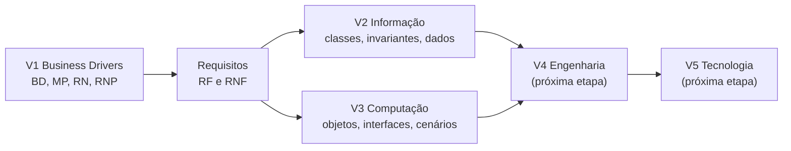

**Figura 1 — Posição deste documento na cadeia RM-ODP.**

Este documento faz a ponte entre o negócio (V1) e a arquitetura de engenharia (V4/V5). Cada RNP da V1 se desdobra em requisitos funcionais (o que o sistema faz) e não funcionais (com que qualidade). Esses requisitos são realizados por classes de informação (V2) e por objetos computacionais em cenários (V3). Nenhuma escolha de tecnologia é feita aqui.

### 0.2 Convenções

| Elemento | Formato | Exemplo |
|---|---|---|
| Requisito funcional | RF-<módulo>-nn | RF-COM-02 |
| Requisito não funcional | RNF-<característica>-nn | RNF-DES-02 |
| Invariante de informação | INV-nn | INV-01 |
| Objeto computacional | OC-nn | OC-05 |
| Interface | I-<sigla> | I-CMD |
| Cenário funcional | CF-nn (realiza CV da V1) | CF04 |
| Prioridade (MoSCoW) | **M** deve; **S** deveria; **C** poderia | M |
| Verificação | **T** teste; **D** demonstração; **I** inspeção; **A** análise | T |
| Marca de origem | **A** aprovado; **F** fonte; **P** proposta; **N** nova nesta versão (sem RNP correspondente) | P |

**Módulos funcionais:** ADE (adesão e assinatura), KIT (kit nominal e logística), COM (comissionamento), OPR (operação da automação), SYN (sincronização do DTReg10k), ACO (acompanhamento), GOV (governança, identidade e auditoria).

**Características não funcionais** (ISO/IEC 25010:2023): DES (eficiência de desempenho), CON (confiabilidade), SEG (segurança), PRI (privacidade e proteção de dados), USA (capacidade de interação, ou usabilidade), EVO (manutenibilidade e flexibilidade), CMP (compatibilidade), LEG (conformidade legal e regulatória).

### 0.3 Decisões e premissas em vigor

| ID | Conteúdo | Situação | Efeito neste documento |
|---|---|---|---|
| A05–A08 | Operador Reg10k; kit DIY; kit de referência; DTReg10k local e remoto em tempo real | Aprovadas na V1 | Base de todo o modelo |
| A09 (D09) | Kit sem fiação: só itens de encaixe ou plugáveis; pontos que exigiriam fiação só com visita técnica | Aprovada em 24/10/2026 | RF-KIT-01, RF-COM-04, RNF-USA-01, RNF-LEG-04 e INV-16 |
| A10 (ex-I01) | A plataforma gerencia a assinatura; pagamento por provedor externo | Aprovada em 24/10/2026 | Módulo ADE |
| A11 (ex-I02) | "Tempo real" = sincronização p95 ≤ 5 s e comando remoto p95 ≤ 3 s | Aprovada em 24/10/2026 | Metas de RNF-DES-01 e RNF-DES-02 |
| A12 | RN34: ocupante é pessoa ou animal de grande porte | Aprovada em 24/10/2026 | RF-OPR-01; métricas de ocupação |
| A13 | PS05: ausência estável = 60 s sem detecção (configurável) | Aprovada em 24/10/2026 | RF-OPR-01; INV-09 |
| A14 | SA vinculado a uma passagem (porta), não a um cômodo | Aprovada em 24/10/2026 | Classe Passagem; RF-COM-05; INV-02 e INV-15 |

Na v01, o símbolo † marcava os requisitos que dependiam de D09. Com a decisão A09, eles foram reescritos e a marca deixou de existir.

---

## 1. Requisitos funcionais e não funcionais

### 1.1 Requisitos funcionais

#### ADE — Adesão e assinatura

| ID | Requisito | Descrição | Origem V1 | Pri. | Verif. |
|---|---|---|---|---|---|
| RF-ADE-01 | Cadastro de conta e residência | Registrar o titular (nome, contato, identificação) e a residência (endereço normalizado, unidade, número de cômodos). Criar credencial de acesso ao app | RNP-MP1-01 | M | T |
| RF-ADE-02 | Aceites versionados | Registrar o aceite de termos de uso e política de privacidade com versão do documento, instante e canal. Sem os aceites obrigatórios, a adesão não é concluída e nada mais é criado | RNP-MP1-01; RNP-MT-07 | M | T |
| RF-ADE-03 | Elegibilidade | Aplicar o questionário (internet, cômodos, tipo de iluminação e de encaixe) contra o catálogo do kit de referência. Resultado: elegível, com configuração-alvo e composição do kit; ou recusado, com motivo e orientação | RNP-MP1-02; RN31 | M | T |
| RF-ADE-04 | Prevenção de duplicidade | Recusar a criação de uma segunda residência ativa com o mesmo endereço normalizado e unidade. O conflito abre caso para IMP | RNP-MP1-03; RN05 | M | T |
| RF-ADE-05 | Criação do DTReg10k-R | Na conclusão da adesão, criar a residência em "Aderida" e o seu DTReg10k-R, com identidade única | RNP-MP1-03 | M | T |
| RF-ADE-06 | Gestão da assinatura | Criar a assinatura em "contratada", obter do provedor a autorização do meio de pagamento (sem cobrança) e gerir os estados contratada, ativa, inadimplente, suspensa e cancelada. Iniciar a cobrança no evento de ativação, proporcional no primeiro ciclo | RNP-MP1-04; RN20, RN29 | M | T |
| RF-ADE-07 | Cancelamento antes da ativação | Encerrar a assinatura sem cobrança e abrir pendência de devolução do kit com responsável. Respeitar o prazo de arrependimento de 7 dias da compra a distância | RNP-MP1-08 | M | T |
| RF-ADE-08 | Suspensão e reativação | Ao suspender ou reativar, registrar o novo estado no DTReg10k-R e propagar o efeito ao hub (funções remotas desabilitadas ou restabelecidas) | RNP-MP3-08; RNP-MT-08; RN19 | M | T |

#### KIT — Kit nominal e logística

| ID | Requisito | Descrição | Origem V1 | Pri. | Verif. |
|---|---|---|---|---|---|
| RF-KIT-01 | Catálogo do kit de referência | Manter os modelos de item (hub, sensor de passagem SA, sensor de presença SP, lâmpada ou módulo plugável) com capacidades declaradas: nível máximo de evidência, forma de instalação (encaixe ou tomada), firmware mínimo e guia de instalação. Nenhum modelo do kit DIY exige intervenção na instalação elétrica fixa (INV-16) | RNP-MP2-07; A07; A09 | M | I |
| RF-KIT-02 | Fila de expedição | Ordenar a expedição por critérios publicados. Exibir ao titular posição e previsão; avisar mudanças e guardar o histórico de previsões | RNP-MP1-06; RN21 | S | T |
| RF-KIT-03 | Alocação de kit nominal | Associar à residência os números de série do hub e de cada item antes da expedição. Recusar série inexistente no cadastro ou já alocada a outra residência | RNP-MP1-05; RN24 | M | T |
| RF-KIT-04 | Integração logística | Receber da transportadora eventos de expedição, entrega e devolução, de forma idempotente, e atualizar o estado do kit | RNP-MP1-07 | M | T |
| RF-KIT-05 | Confirmação de recebimento | Exigir que o titular confirme o recebimento lendo o código do hub. Até lá, manter "entregue, não confirmado" e não abrir comissionamento | RNP-MP1-07 | M | T |
| RF-KIT-06 | Substituição de kit ou item | Substituir item danificado ou ausente: registrar a nova série no kit nominal e marcar a anterior como devolvida | V1 §5.2 (exceções MP1) | S | T |

#### COM — Comissionamento

| ID | Requisito | Descrição | Origem V1 | Pri. | Verif. |
|---|---|---|---|---|---|
| RF-COM-01 | Sessão de comissionamento | Abrir, pausar e retomar a sessão, preservando etapas aprovadas. Uma única sessão ativa por residência | RNP-MP2-09 | M | T |
| RF-COM-02 | Reivindicação do hub | Aceitar a leitura do código do hub somente se o hub pertencer ao kit nominal da residência e o solicitante for titular ou membro com papel de instalação. Recusar com motivo e auditar a tentativa | RNP-MP2-01; RN24 | M | T |
| RF-COM-03 | Provisionamento do hub | Entregar ao hub identidade, credencial e configuração-alvo. Criar o DTReg10k-L e registrar no DTReg10k-R a versão de configuração aplicada antes de qualquer teste | RNP-MP2-02 | M | T |
| RF-COM-04 | Instalação guiada | Conduzir a instalação cômodo a cômodo, só com passos de encaixe ou de tomada, com instruções por modelo de item. Ponto de luz sem soquete ou tomada compatível não gera passo de instalação: a plataforma oferece visita técnica | RNP-MP2-04; RN25; A09 | M | D |
| RF-COM-05 | Vínculo do item | Criar o vínculo com início de vigência somente em sessão aberta: o SA se vincula a uma passagem (porta entre dois cômodos ou para o exterior); os demais itens, a um cômodo. Recusar item fora do kit nominal ou com vínculo vigente em outra residência | RNP-MP2-03; RN05; A14 | M | T |
| RF-COM-06 | Testes guiados | Executar por item os testes aplicáveis (passagem, presença, ausência, acionamento) e registrar o nível de evidência alcançado. Até 3 tentativas; persistindo a falha, caso para SUP | RNP-MP2-05; RN02 | M | T |
| RF-COM-07 | Ensaio de autonomia | Comandar o hub a operar isolado da plataforma por PS14 (10 min), verificar acionamentos locais, reconectar e reconciliar com o DTReg10k-R | RNP-MP2-06; RN04 | M | T |
| RF-COM-08 | Capacidades e preferências iniciais | Exibir por cômodo o que será observado e o que será apenas relatado. Coletar preferências iniciais dentro dos limites da política vigente | RNP-MP2-07 | M | D |
| RF-COM-09 | Ativação | Ativar automaticamente quando todas as etapas do checklist tiverem evidência. Caso contrário, abrir revisão para IMP. A ativação gera o evento que inicia a cobrança | RNP-MP2-08; RN26 | M | T |
| RF-COM-10 | Suporte à sessão | Permitir ao titular delegar a SUP o acompanhamento da sessão, limitado à sessão e a PS15 (4 h). Sem delegação, negar e auditar | RNP-MP2-10; RN15 | M | T |
| RF-COM-11 | Abandono | Detectar sessão sem progresso por PS13 (7 dias) e abrir caso de contato proativo para SUP, mantendo o kit nominal | RNP-MP2-09; RN30 | S | T |

#### OPR — Operação da automação

| ID | Requisito | Descrição | Origem V1 | Pri. | Verif. |
|---|---|---|---|---|---|
| RF-OPR-01 | Decisão local de iluminação | No hub, avaliar presença válida (idade ≤ PS04), precedência [R10 §7.2] e ausência estável (PS05: 60 s sem detecção, configurável) para acender ou apagar. Qualquer ocupante conta, inclusive animal de grande porte (RN34). Presença desconhecida aplica contingência e nunca apaga por silêncio. Nada disso depende da plataforma | RNP-MP3-01; RNP-MP3-05; RN01; RN34; A13 | M | T |
| RF-OPR-02 | Intervenção manual local | Registrar acionamento manual como evidência com precedência temporária por PS03 (15 min) | RNP-MP3-03; RN07 | M | T |
| RF-OPR-03 | Comando remoto | Criar intenção com solicitante, motivo, validade PS01 (30 s) e chave de idempotência. O hub valida validade, autorização e precedência; a recusa volta com motivo | RNP-MP3-02; RN07 | M | T |
| RF-OPR-04 | Classificação do resultado | Classificar cada atuação em recebido, execução relatada, efeito observado, rejeitado, expirado ou desconhecido (sem evidência até PS02, 10 s) | RNP-MP3-04; RN02 | M | T |
| RF-OPR-05 | Efeito único | Garantir um único efeito por chave de idempotência de comando e por identificador de evidência | RNP-MP3-06; RN11 | M | T |
| RF-OPR-06 | Presença incompatível | Detectar localmente presença incompatível, verificar a cada 5 min, conciliar com passagem tardia e só então emitir evento de fronteira para ocorrências | RNP-MP3-10; RN03, RN17 | S | T |
| RF-OPR-07 | Alteração de preferência | Validar a preferência contra os limites da política e marcá-la "pendente de aplicação" até a confirmação do hub | RNP-MP3-09; RN28 | M | T |
| RF-OPR-08 | Efeito da suspensão no hub | Com assinatura suspensa, recusar comandos remotos com motivo e manter automação local e interruptor | RNP-MP3-08; RN19 | M | T |
| RF-OPR-09 | Saúde de hub e itens | Detectar item sem resposta, bateria baixa e falhas; gerar aviso ao titular e evento de fronteira para manutenção | V1 §5.4 (exceções MP3); RNP-MP4-03 | S | T |

#### SYN — Sincronização do DTReg10k

| ID | Requisito | Descrição | Origem V1 | Pri. | Verif. |
|---|---|---|---|---|---|
| RF-SYN-01 | Publicação L→R | Publicar evidências, decisões e resultados com identificador único, sequência local, instante de origem e indicação de relógio confiável | RNP-MT-01 | M | T |
| RF-SYN-02 | Resumo de estado | Publicar resumo de estado da residência a cada 30 s, para que a plataforma meça a atualidade (PS06, 60 s) | RNP-MP4-01; PS06 | M | T |
| RF-SYN-03 | Fila local persistente | Durante desconexão, guardar eventos no hub e reenviá-los em ordem na reconexão | RNP-MP3-07; RN04 | M | T |
| RF-SYN-04 | Reconexão ordenada | Na reconexão, enviar o estado atual antes do histórico; o histórico não restabelece atualidade; comandos vencidos expiram | RNP-MP3-07; RN12 | M | T |
| RF-SYN-05 | Autoridade e divergência | Resolver divergências L↔R pela autoridade do tipo de registro (V1 §6.2) e registrar a divergência e a resolução | RNP-MT-02; RN27, RN28 | M | T |
| RF-SYN-06 | Distribuição R→L | Distribuir configuração, política, permissões e estado de assinatura ao hub e registrar a versão confirmada como aplicada | RNP-MT-04; RNP-MP3-09 | M | T |
| RF-SYN-07 | Reconstrução | Reconstruir o estado do DTReg10k-R a partir dos registros imutáveis | RNP-MT-09; RN12 | S | T |

#### ACO — Acompanhamento

| ID | Requisito | Descrição | Origem V1 | Pri. | Verif. |
|---|---|---|---|---|---|
| RF-ACO-01 | Painel da residência | Exibir estado por cômodo com idade da informação, nível de evidência e conectividade do hub. Estado mais antigo que PS06 aparece como "desatualizado" | RNP-MP4-01 | M | T |
| RF-ACO-02 | Histórico de ações | Exibir causa, solicitante, resultado e substituições por precedência | RNP-MP4-02; RN07 | M | T |
| RF-ACO-03 | Atualização em tempo real | Enviar ao app as mudanças do DTReg10k-R por assinatura de eventos, sem que o app precise consultar repetidamente | RNP-MP4-09 | M | T |
| RF-ACO-04 | Avisos | Enviar avisos (hub offline, item sem resposta, bateria, resultado desconhecido, previsão de entrega) conforme preferências do titular, registrando envio e entrega separadamente | RNP-MP4-03 | M | T |
| RF-ACO-05 | Relatório mensal | Emitir relatório com período, base prevista, cobertura e lacunas; período sem evidência aparece como lacuna, nunca como zero | RNP-MP4-04; RN10 | M | T |
| RF-ACO-06 | Gestão de membros | Convidar membros com papel (consulta, controle, instalação) e revogá-los com efeito imediato na plataforma | RNP-MP4-05; RN32 | M | T |
| RF-ACO-07 | Painel agregado Reg10k | Oferecer a GES funil de incorporação e indicadores IQ com denominador fixo e residências offline incluídas, sem detalhe individual | RNP-MP4-06 | M | T |
| RF-ACO-08 | Checklist em tempo real | Mostrar ao titular o progresso do comissionamento etapa a etapa, com o resultado de cada teste | V1 §5.3 (visibilidade MP2) | S | D |

#### GOV — Governança, identidade e auditoria

| ID | Requisito | Descrição | Origem V1 | Pri. | Verif. |
|---|---|---|---|---|---|
| RF-GOV-01 | Autenticação | Autenticar titulares e membros (segundo fator opcional) e a equipe Reg10k (segundo fator obrigatório) | RNP-MT-10 | M | T |
| RF-GOV-02 | Autorização por residência | Decidir cada consulta e ação por residência, papel, finalidade e vigência. Negar sem revelar se o recurso existe | RNP-MT-10; RNP-MP4-07; RN05, RN15 | M | T |
| RF-GOV-03 | Delegação temporária | Conceder a SUP acesso de detalhe com finalidade e vigência (PS10, 4 h), revogável pelo titular | RNP-MP4-07; PS10 | M | T |
| RF-GOV-04 | Auditoria | Registrar decisões de acesso, inclusive negações, com quem, o quê, quando e motivo | RNP-MT-05 | M | T |
| RF-GOV-05 | Registros imutáveis | Armazenar fatos e decisões apenas por acréscimo; correção gera novo registro que referencia o anterior | RNP-MT-01; RN12 | M | T |
| RF-GOV-06 | Identidades únicas | Manter identidade única de residência, kit, hub e item, e vínculos com vigência | RNP-MT-03 | M | T |
| RF-GOV-07 | Retenção e destinação | Aplicar retenção por classe (V1 §6.3), com eliminação ou agregação automática e prorrogação somente com justificativa de GOV | RNP-MT-06 | M | T |
| RF-GOV-08 | Novo aceite | Quando a política de privacidade mudar, exigir novo aceite para as funções que dependem dela | RNP-MT-07 | M | T |
| RF-GOV-09 | Direitos do titular | Atender acesso, correção, portabilidade e eliminação, com comprovante do que foi mantido e por quê | RNP-MP4-08; RN33 | M | T |
| RF-GOV-10 | Versões de política em lotes | Versionar a política, liberá-la em lotes e permitir reversão | RNP-MT-04; RN23 | S | T |

### 1.2 Requisitos não funcionais

#### DES — Eficiência de desempenho

| ID | Requisito | Descrição e métrica | Meta | Verif. | Origem |
|---|---|---|---|---|---|
| RNF-DES-01 | Sincronização em tempo real | Tempo entre o registro no DTReg10k-L e a disponibilidade no DTReg10k-R, com hub conectado | p95 ≤ 5 s; ≥ 95% dos eventos (IQ18) | T (carga) + medição contínua | PS11; A11 |
| RNF-DES-02 | Comando remoto | Tempo entre o toque no app e a exibição do resultado classificado | p95 ≤ 3 s, sempre dentro da validade PS01 | T (carga) | PS12; A11 |
| RNF-DES-03 | Reação local | Tempo entre a evidência de presença e o comando ao atuador, no hub | p95 ≤ 500 ms | T (bancada) | **N**; BD03 |
| RNF-DES-04 | Pico de adesão | Adesões concluídas sem perda; tempo de resposta de cada etapa | 10.000 adesões em 1 h; p95 ≤ 2 s por etapa | T (carga) | RNP-MP1-09; CL-A |
| RNF-DES-05 | Pico de comissionamento | Sessões simultâneas com teste registrado dentro de PS12 | 1.000 simultâneas (ensaio até 3.000); IQ15 ≥ 99% | T (carga) | RNP-MP2-11; CL-C |
| RNF-DES-06 | Ingestão | Vazão sustentada sem perda | 333 resumos/s + pico de 175 eventos/s + 100 comandos/s, com margem 5× | T (carga) | CL-E; D08 |
| RNF-DES-07 | Acompanhamento | Sessões de app simultâneas recebendo atualizações dentro de RNF-DES-01 | 10.000 sessões | T (carga) | RNP-MP4-09; CL-F |
| RNF-DES-08 | Relatórios em lote | Emissão dos relatórios mensais sem degradar RNF-DES-01 | 10.000 relatórios no prazo PS09 | T (carga) | CL-G |

#### CON — Confiabilidade

| ID | Requisito | Descrição e métrica | Meta | Verif. | Origem |
|---|---|---|---|---|---|
| RNF-CON-01 | Autonomia local | Iluminação automática e interruptor funcionam sem plataforma, por tempo indeterminado | 100% dos cenários de queda; ≥ 99% das ativações com ensaio aprovado (IQ04) | T (ensaio PS14) | BD03; RN04 |
| RNF-CON-02 | Fila local | Capacidade da fila persistente do hub sem perda | ≥ 7 dias de eventos | T (bancada) | R11 §5.2 |
| RNF-CON-03 | Disponibilidade central | Disponibilidade mensal da supervisão, app e API | ≥ 99,9% (≈ 43 min/mês) | A + medição | R11 §5.5 |
| RNF-CON-04 | Disponibilidade no lançamento | Disponibilidade de adesão e comissionamento na janela do lançamento | ≥ 99,9% por semana | A + medição | **N**; BD01 |
| RNF-CON-05 | Recuperação de dados | Perda máxima e tempo de retorno | RPO ≤ 1 min (assinatura, configuração, permissões); RPO ≈ 0 para evidências ainda no hub; RTO ≤ 1 h em perda regional | T (exercício de recuperação) | R11 §5.5 |
| RNF-CON-06 | Reconexão em massa | Hubs reconectando simultaneamente após falha central | 10.000 em 60 s, sem perda e sem executar comando vencido | T (carga) | R11 CV20 |
| RNF-CON-07 | Entrega e efeito | Entrega pelo menos uma vez, com efeito único | 0 efeitos duplicados em ensaio de reenvio | T | RN11 |

#### SEG — Segurança

| ID | Requisito | Descrição e métrica | Meta | Verif. | Origem |
|---|---|---|---|---|---|
| RNF-SEG-01 | Identidade do hub | Credencial individual por hub e autenticação mútua no canal com a plataforma | 100% dos hubs; credencial revogável | T + I | R11 §5.7 |
| RNF-SEG-02 | Isolamento entre residências | Nenhuma consulta ou ação alcança outra residência | 0 vazamentos em teste de intrusão antes do lançamento (IQ10) | T (intrusão) | RNP-MT-10; BD06 |
| RNF-SEG-03 | Revogação efetiva | Tempo para revogação de membro ou delegação valer | ≤ 5 s na plataforma; na próxima sincronização no hub | T | RN32; RNF-DES-01 |
| RNF-SEG-04 | Criptografia | Dados em trânsito e dados pessoais em repouso cifrados | 100% dos canais e repositórios de dados pessoais | I | LGPD; BD06 |
| RNF-SEG-05 | Auditoria íntegra | Registros de auditoria não alteráveis e consultáveis por GOV | Retenção de 12 meses; alteração detectável | I + T | RNP-MT-05 |
| RNF-SEG-06 | Atualizações assinadas | Firmware, configuração e política assinados, liberados em lotes, com retorno automático | 100% das liberações; nenhuma direto a 100% da base | T | RN23 |
| RNF-SEG-07 | Dados de pagamento | Nenhum dado de cartão armazenado; somente token do provedor | 0 ocorrências em inspeção | I | RN29 |

#### PRI — Privacidade e proteção de dados

| ID | Requisito | Descrição e métrica | Meta | Verif. | Origem |
|---|---|---|---|---|---|
| RNF-PRI-01 | Retenção | Eliminação ou agregação no fim do prazo de cada classe | Presença detalhada 30 dias; operação 180 dias; agregados e auditoria 12 meses | T + I | V1 §6.3 |
| RNF-PRI-02 | Minimização por perfil | GES só agregados; OPE sem dados de presença; SUP só com delegação | Conforme matriz de visibilidade da V1 §5.5.1 | T | RNP-MP4-06; RN15 |
| RNF-PRI-03 | Prazo dos direitos do titular | Pedidos atendidos no prazo legal | 100% (IQ19) | A + medição | RNP-MP4-08 |
| RNF-PRI-04 | Avaliação de impacto | Relatório de Impacto à Proteção de Dados concluído | Antes do lançamento | I | V1 §6.4 |

#### USA — Capacidade de interação (usabilidade)

| ID | Requisito | Descrição e métrica | Meta | Verif. | Origem |
|---|---|---|---|---|---|
| RNF-USA-01 | Autoinstalação | Proporção de ativações sem visita técnica e duração do comissionamento | ≥ 90% sem visita (IQ16); mediana ≤ 2 h (IQ17) | T (piloto com usuários) | BD02 |
| RNF-USA-02 | Correção do vínculo | Retrabalho de vínculo até 30 dias após ativação | ≤ 1%; 0 vínculos entre residências (IQ20) | Medição | BD07 |
| RNF-USA-03 | Transparência da incerteza | Todo estado exibido mostra idade e nível de evidência; "desconhecido" nunca aparece como "aceso" | 100% das telas de estado | I + T | BD04; RN02 |
| RNF-USA-04 | Mensagens de recusa | Toda recusa informa motivo e próximo passo em português | 100% das recusas | I | V1 §5 |
| RNF-USA-05 | Acessibilidade | App e web acessíveis | WCAG 2.2 nível AA | I + T | **N**; BD05 |

#### EVO — Manutenibilidade e flexibilidade

| ID | Requisito | Descrição e métrica | Meta | Verif. | Origem |
|---|---|---|---|---|---|
| RNF-EVO-01 | Novos dispositivos | Adicionar tipo de dispositivo por catálogo, sem migrar o modelo do DTReg10k | 0 migrações estruturais para um novo tipo | D | BD08 |
| RNF-EVO-02 | Versões de contrato | Interfaces versionadas; hub aceita versões N e N-1 durante liberações | 100% das interfaces I-* | I | R11 §5.2 |
| RNF-EVO-03 | Escala | Capacidade projetada | 50.000 residências equivalentes (5×), com ensaio | T (carga) | D08 |
| RNF-EVO-04 | Observabilidade | IQ01–IQ20 calculados continuamente; correlação ponta a ponta por identificador de comando e de sessão | Alerta antes do descumprimento de meta | D | V1 §9.3 |

#### CMP — Compatibilidade

| ID | Requisito | Descrição e métrica | Meta | Verif. | Origem |
|---|---|---|---|---|---|
| RNF-CMP-01 | Plataformas de cliente | App em Android e iOS; web nos navegadores atuais | Duas últimas versões principais de cada sistema | T | **N**; D05 |
| RNF-CMP-02 | Falha de sistemas externos | Indisponibilidade de pagamento, transportadora ou canal de aviso não afeta a operação da casa nem a consulta ao app | 0 impactos em MP3 durante falha simulada | T | V1 §11 |

#### LEG — Conformidade legal e regulatória

| ID | Requisito | Descrição | Meta | Verif. | Origem |
|---|---|---|---|---|---|
| RNF-LEG-01 | LGPD | Bases legais, direitos do titular, RIPD, encarregado | Parecer de GOV antes do lançamento | I | BD06 |
| RNF-LEG-02 | Homologação Anatel | Itens com radiofrequência homologados | 100% dos modelos do catálogo | I | R11 §6.1 |
| RNF-LEG-03 | Código de Defesa do Consumidor | Direito de arrependimento em compra a distância (art. 49) | Fluxo RF-ADE-07 disponível | T | RNP-MP1-08 |
| RNF-LEG-04 | Segurança do produto | Itens do kit DIY só de encaixe ou plugáveis, com as certificações compulsórias aplicáveis à categoria de cada item (por exemplo, INMETRO para produtos elétricos de uso doméstico, quando aplicável) | 100% dos modelos do catálogo com certificação verificada | I | RN25; A09 |

### 1.3 Rastreabilidade RNP → requisitos

| RNP (V1) | Requisitos |
|---|---|
| RNP-MP1-01 | RF-ADE-01, RF-ADE-02 |
| RNP-MP1-02 | RF-ADE-03 |
| RNP-MP1-03 | RF-ADE-04, RF-ADE-05 |
| RNP-MP1-04 | RF-ADE-06 |
| RNP-MP1-05 | RF-KIT-03 |
| RNP-MP1-06 | RF-KIT-02 |
| RNP-MP1-07 | RF-KIT-04, RF-KIT-05 |
| RNP-MP1-08 | RF-ADE-07, RNF-LEG-03 |
| RNP-MP1-09 | RNF-DES-04 |
| RNP-MP2-01 | RF-COM-02 |
| RNP-MP2-02 | RF-COM-03 |
| RNP-MP2-03 | RF-COM-05 |
| RNP-MP2-04 | RF-COM-04 |
| RNP-MP2-05 | RF-COM-06 |
| RNP-MP2-06 | RF-COM-07 |
| RNP-MP2-07 | RF-COM-08, RF-KIT-01 |
| RNP-MP2-08 | RF-COM-09 |
| RNP-MP2-09 | RF-COM-01, RF-COM-11 |
| RNP-MP2-10 | RF-COM-10 |
| RNP-MP2-11 | RNF-DES-05 |
| RNP-MP3-01 | RF-OPR-01 |
| RNP-MP3-02 | RF-OPR-03 |
| RNP-MP3-03 | RF-OPR-02 |
| RNP-MP3-04 | RF-OPR-04 |
| RNP-MP3-05 | RF-OPR-01 |
| RNP-MP3-06 | RF-OPR-05 |
| RNP-MP3-07 | RF-SYN-03, RF-SYN-04 |
| RNP-MP3-08 | RF-OPR-08, RF-ADE-08 |
| RNP-MP3-09 | RF-OPR-07, RF-SYN-06 |
| RNP-MP3-10 | RF-OPR-06 |
| RNP-MP4-01 | RF-ACO-01, RF-SYN-02 |
| RNP-MP4-02 | RF-ACO-02 |
| RNP-MP4-03 | RF-ACO-04, RF-OPR-09 |
| RNP-MP4-04 | RF-ACO-05 |
| RNP-MP4-05 | RF-ACO-06 |
| RNP-MP4-06 | RF-ACO-07, RNF-PRI-02 |
| RNP-MP4-07 | RF-GOV-02, RF-GOV-03 |
| RNP-MP4-08 | RF-GOV-09, RNF-PRI-03 |
| RNP-MP4-09 | RF-ACO-03, RNF-DES-07 |
| RNP-MT-01 | RF-SYN-01, RF-GOV-05 |
| RNP-MT-02 | RF-SYN-05 |
| RNP-MT-03 | RF-GOV-06 |
| RNP-MT-04 | RF-SYN-06, RF-GOV-10 |
| RNP-MT-05 | RF-GOV-04, RNF-SEG-05 |
| RNP-MT-06 | RF-GOV-07, RNF-PRI-01 |
| RNP-MT-07 | RF-GOV-08, RF-ADE-02 |
| RNP-MT-08 | RF-ADE-08 |
| RNP-MT-09 | RF-SYN-07 |
| RNP-MT-10 | RF-GOV-01, RF-GOV-02, RNF-SEG-02 |

---

## 2. Modelagem estática estrutural (V2 Informação)

### 2.1 Pacotes do domínio

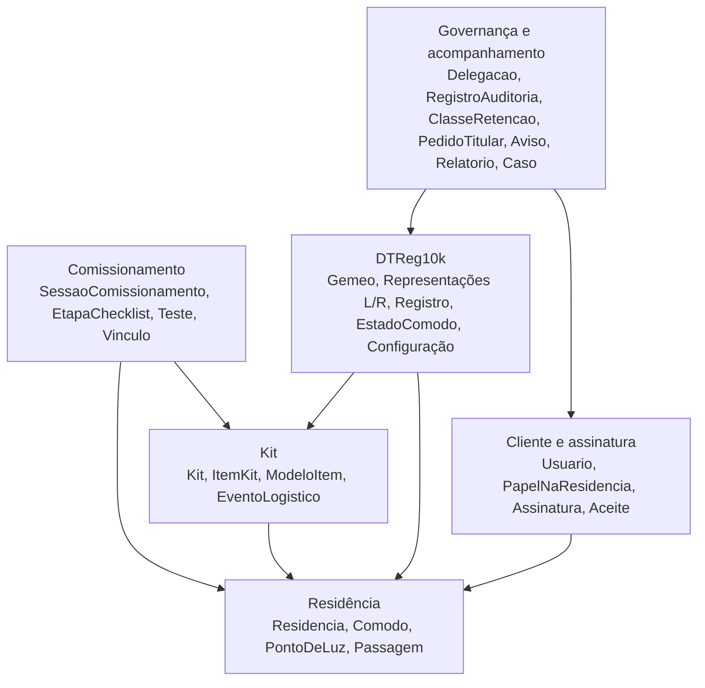

**Figura 2 — Pacotes do domínio e dependências.** A seta indica "depende de".

### 2.2 Diagramas de classes — cliente, residência, kit e comissionamento

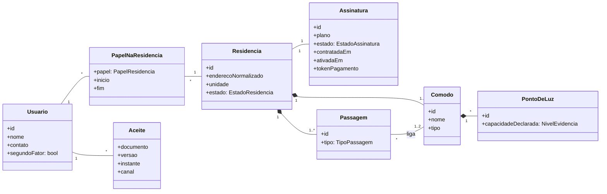

**Figura 3 — Classes de cliente e residência.** A `Passagem` liga dois cômodos (INTERNA) ou um cômodo ao exterior (EXTERNA); é onde fica o SA (A14).

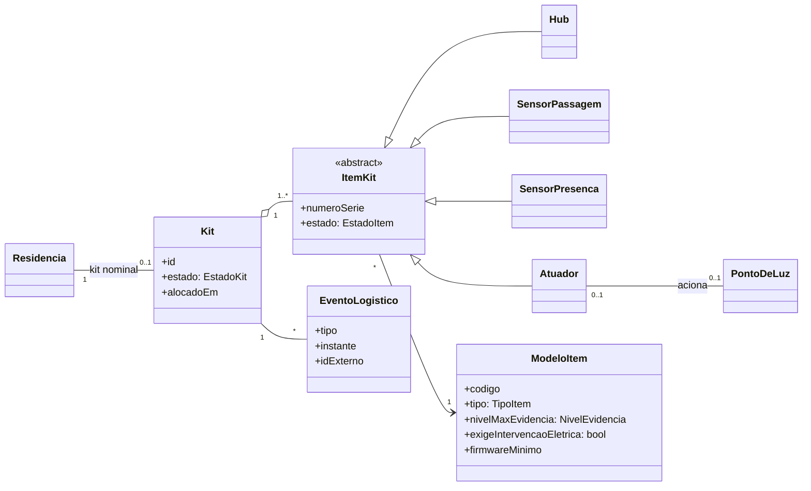

**Figura 4 — Classes do kit.** `Residencia` e `PontoDeLuz` aparecem sem atributos porque estão detalhadas na Figura 3.

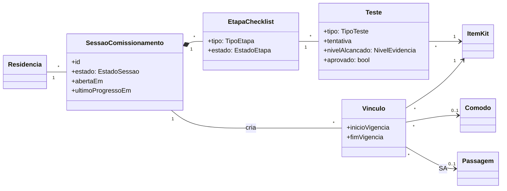

**Figura 5 — Classes de comissionamento.** O vínculo aponta para um cômodo ou, no caso do SA, para uma passagem (INV-15). `Residencia`, `Comodo`, `Passagem` e `ItemKit` aparecem sem atributos porque estão detalhadas nas Figuras 3 e 4.

### 2.3 Diagrama de classes — DTReg10k e operação

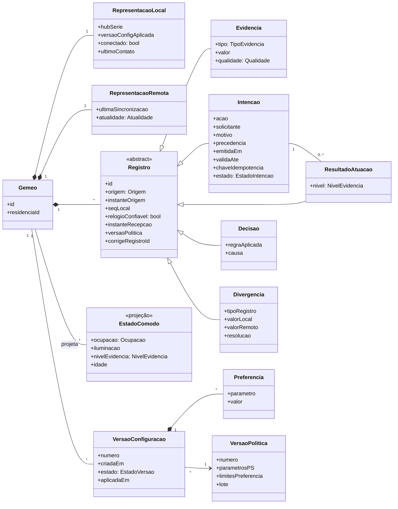

**Figura 6 — Classes do DTReg10k.** `Gemeo` liga-se 1–1 a `Residencia` (Figura 3). `EstadoComodo` é uma projeção recalculável a partir de `Registro` (INV-06).

### 2.4 Diagrama de classes — governança e acompanhamento

```mermaid
classDiagram
    direction LR
    class Delegacao {
        +finalidade
        +inicio
        +fim
        +concedidaPor
        +revogadaEm
    }
    class RegistroAuditoria {
        +quem
        +acao
        +recurso
        +decisao: DecisaoAcesso
        +motivo
        +instante
    }
    class ClasseRetencao {
        +classe
        +prazo
        +destinacao
    }
    class Prorrogacao {
        +justificativa
        +escopo
        +reavaliarEm
    }
    class PedidoTitular {
        +tipo: TipoPedido
        +abertoEm
        +prazo
        +concluidoEm
        +comprovante
    }
    class Aviso {
        +tipo
        +canal
        +enviadoEm
        +entregueEm
    }
    class Relatorio {
        +periodo
        +basePrevista
        +cobertura
        +versao
    }
    class Caso {
        +tipo: TipoCaso
        +responsavel
        +estado
        +abertoEm
    }
    class EventoFronteira {
        +tipo
        +destino
        +instante
    }
    Delegacao "*" --> "1" Usuario : delegado
    Delegacao "*" --> "1" Residencia
    RegistroAuditoria "*" --> "0..1" Residencia
    ClasseRetencao "1" -- "*" Prorrogacao
    PedidoTitular "*" --> "1" Usuario
    Aviso "*" --> "1" Residencia
    Relatorio "*" --> "1" Residencia
    Caso "*" --> "1" Residencia
    Caso "0..1" -- "0..1" Delegacao : autoriza acesso
    EventoFronteira "*" --> "1" Residencia
```

**Figura 7 — Classes de governança e acompanhamento.**

### 2.5 Dicionário de classes

| Classe | Responsabilidade | Atributos-chave | Regras e requisitos |
|---|---|---|---|
| Usuario | Pessoa que usa a plataforma (cliente ou equipe Reg10k) | id, contato, segundoFator | RF-GOV-01 |
| PapelNaResidencia | Papel de um usuário em uma residência, com vigência | papel (TITULAR, MEMBRO_CONSULTA, MEMBRO_CONTROLE, MEMBRO_INSTALACAO) | RN32; INV-11; RF-ACO-06 |
| Assinatura | Contrato de serviço e seus estados | estado, ativadaEm, tokenPagamento | RN19, RN20, RN29; INV-05; RF-ADE-06 |
| Aceite | Evidência de aceite de documento versionado | documento, versao, instante | RF-ADE-02, RF-GOV-08 |
| Residencia | Unidade atendida; raiz de isolamento | enderecoNormalizado, unidade, estado | RN05; INV-13; RF-ADE-04 |
| Comodo / PontoDeLuz | Estrutura física e capacidade declarada por ponto de luz | capacidadeDeclarada | RN02; INV-08 |
| Passagem | Porta entre dois cômodos, ou entre um cômodo e o exterior; onde fica o SA | tipo (INTERNA, EXTERNA), cômodos ligados | A14; INV-15 |
| Kit | Conjunto nominal alocado a uma residência | estado (alocado, expedido, entregue, confirmado, devolvido) | RN24; RF-KIT-03 |
| ItemKit (Hub, SensorPassagem, SensorPresenca, Atuador) | Dispositivo físico identificado por série | numeroSerie, estado | INV-01, INV-02 |
| ModeloItem | Capacidades do kit de referência | nivelMaxEvidencia, exigeIntervencaoEletrica (sempre falso no kit DIY) | RF-KIT-01; RNF-EVO-01; INV-16 |
| EventoLogistico | Fato externo de expedição, entrega ou devolução | idExterno (idempotência) | RF-KIT-04 |
| SessaoComissionamento | Unidade de trabalho do comissionamento DIY | estado, ultimoProgressoEm | RF-COM-01, RF-COM-11; PS13 |
| EtapaChecklist / Teste | Evidência de cada etapa e teste | nivelAlcancado, tentativa | RN26; INV-04; RF-COM-06 |
| Vinculo | Item ↔ cômodo (ou SA ↔ passagem), com vigência | inicioVigencia, fimVigencia | RN05; INV-01, INV-02, INV-15 |
| Gemeo | DTReg10k da residência, com duas representações | — | A08; INV-03 |
| RepresentacaoLocal / Remota | Estado de cada representação e da sincronização | versaoConfigAplicada, atualidade | RN27; INV-14 |
| Registro (abstrato) | Fato imutável com origem e ordem | origem, seqLocal, relogioConfiavel | RN12; INV-06 |
| Evidencia, Intencao, ResultadoAtuacao, Decisao, Divergencia | Tipos de registro | validaAte, chaveIdempotencia, nivel | RN02, RN07, RN11, RN28; INV-07, INV-10 |
| EstadoComodo | Projeção para consulta: ocupação, iluminação, nível, idade | idade, nivelEvidencia | RNF-USA-03; INV-09 |
| VersaoConfiguracao / Preferencia / VersaoPolitica | Configuração-alvo versionada e seus limites | estado (pendente, aplicada, recusada) | RN23, RN27, RN28 |
| Delegacao | Acesso temporário com finalidade | fim, revogadaEm | RN15; INV-12 |
| RegistroAuditoria | Decisão de acesso, inclusive negação | decisao, motivo | RF-GOV-04; RNF-SEG-05 |
| ClasseRetencao / Prorrogacao | Prazo e destinação por classe | prazo, reavaliarEm | RF-GOV-07; RNF-PRI-01 |
| PedidoTitular | Pedido de direito do titular | tipo, prazo, comprovante | RN33; RF-GOV-09 |
| Aviso / Relatorio | Comunicação ao usuário | enviadoEm, entregueEm, cobertura | RN10; RF-ACO-04, RF-ACO-05 |
| Caso / EventoFronteira | Trabalho humano ou saída para processo externo | responsavel, destino | V1 §11 |

### 2.6 Enumerações

| Enumeração | Valores |
|---|---|
| EstadoResidencia | ADERIDA, RECUSADA, AGUARDANDO_KIT, KIT_EM_TRANSITO, KIT_ENTREGUE, EM_COMISSIONAMENTO, PAUSADA, EM_REVISAO, ATIVA, ATIVA_DEGRADADA, SUSPENSA, CANCELADA |
| EstadoAssinatura | CONTRATADA, ATIVA, INADIMPLENTE, SUSPENSA, CANCELADA |
| EstadoSessao | ABERTA, PAUSADA, EM_REVISAO, CONCLUIDA, ABANDONADA, CANCELADA |
| NivelEvidencia (ordenado) | SEM_EVIDENCIA < ENVIADO < RECEBIDO < EXECUCAO_RELATADA < EFEITO_OBSERVADO |
| EstadoIntencao | SOLICITADA, REJEITADA, ENVIADA, EXPIRADA, RECEBIDA, EXECUCAO_RELATADA, EFEITO_OBSERVADO, DESCONHECIDA |
| Ocupacao | OCUPADO, VAZIO, DESCONHECIDA |
| Origem | LOCAL, REMOTA |
| Atualidade | ATUAL, DESATUALIZADO, SEM_EVIDENCIA |
| EstadoVersao | PENDENTE, APLICADA, RECUSADA |
| TipoTeste | PASSAGEM, PRESENCA, AUSENCIA, ACIONAMENTO, AUTONOMIA |
| TipoCaso | REVISAO_ATIVACAO, SUPORTE, ABANDONO, DUPLICIDADE, LOGISTICA |
| DecisaoAcesso | PERMITIDO, NEGADO |
| TipoPassagem | INTERNA, EXTERNA |
| PapelResidencia | TITULAR, MEMBRO_CONSULTA, MEMBRO_CONTROLE, MEMBRO_INSTALACAO |
| EstadoKit | ALOCADO, EXPEDIDO, ENTREGUE, CONFIRMADO, EM_DEVOLUCAO, DEVOLVIDO |
| EstadoItem | EM_ESTOQUE, ALOCADO, VIGENTE, SUBSTITUIDO, DEVOLVIDO |
| TipoItem | HUB, SENSOR_PASSAGEM, SENSOR_PRESENCA, ATUADOR |
| TipoEtapa | REIVINDICACAO, PROVISIONAMENTO, VINCULO, TESTE, ENSAIO_AUTONOMIA, PREFERENCIAS |
| EstadoEtapa | PENDENTE, EM_EXECUCAO, COM_EVIDENCIA, FALHOU |
| TipoEvidencia | PASSAGEM, PRESENCA, AUSENCIA, ACIONAMENTO_MANUAL, RESULTADO_ATUACAO, SAUDE |
| Qualidade | VALIDA, DEGRADADA, SUSPEITA |
| TipoPedido | ACESSO, CORRECAO, PORTABILIDADE, ELIMINACAO |

### 2.7 Invariantes (esquema invariante)

Expressas em notação próxima de OCL.

| ID | Invariante | Regra |
|---|---|---|
| INV-01 | `context ItemKit inv: vinculos->select(fimVigencia = null)->size() <= 1` | RN05 |
| INV-02 | `context Vinculo inv: item.kit.residencia = (if passagem <> null then passagem.residencia else comodo.residencia endif)` | RN24 |
| INV-03 | `context Residencia inv: gemeo->size() = 1 and kit.itens->select(oclIsKindOf(Hub) and estado = VIGENTE)->size() <= 1` | A08; RN05 |
| INV-04 | `context Residencia inv: estado = ATIVA implies sessoes->exists(s | s.estado = CONCLUIDA and (s.etapas->forAll(e | e.estado = COM_EVIDENCIA) or s.casoRevisao.aceite = IMP))` | RN26 |
| INV-05 | `context Assinatura inv: estado = ATIVA implies residencia.ativadaEm <> null` | RN20 |
| INV-06 | `context Registro inv: imutável após criação; correção somente por novo Registro com corrigeRegistroId` | RN12 |
| INV-07 | `context Intencao inv: estado in {RECEBIDA, EXECUCAO_RELATADA, EFEITO_OBSERVADO} implies recebidaEm <= validaAte` | PS01; RN04 |
| INV-08 | `context ResultadoAtuacao inv: nivel <= pontoDeLuz.capacidadeDeclarada` | RN02 |
| INV-09 | `context EstadoComodo inv: ocupacao = VAZIO implies (agora - ultimaDeteccao >= T_apagamento) and spSaudavel` (T_apagamento padrão 60 s) | RN01; PS05 (A13) |
| INV-10 | `context Gemeo inv: registros->select(oclIsKindOf(Intencao))->isUnique(chaveIdempotencia)` | RN11 |
| INV-11 | `context Residencia inv: papeis->select(papel = TITULAR and fim = null)->size() = 1` (exceto ADERIDA antes do aceite) | RN32 |
| INV-12 | `context Delegacao inv: fim <= inicio + 4h` | PS10, PS15 |
| INV-13 | `context Residencia inv: Residencia.allInstances()->select(estado <> CANCELADA)->isUnique(enderecoNormalizado + unidade)` | RN05 |
| INV-14 | `context Gemeo inv: representacaoLocal.versaoConfigAplicada <= versaoVigenteRemota` | RN27 |
| INV-15 | `context Vinculo inv: if item.oclIsKindOf(SensorPassagem) then passagem <> null and comodo = null else comodo <> null and passagem = null endif` | A14 |
| INV-16 | `context Kit inv: itens->forAll(i | not i.modelo.exigeIntervencaoEletrica)` | A09; RN25 |

### 2.8 Classificação dos dados

| Classe de dado | Classes do modelo | Classificação | Retenção | Acesso |
|---|---|---|---|---|
| Identificação e contrato | Usuario, Residencia, Assinatura, Aceite | Pessoal | Vigência + 180 dias ou prazo legal | TIT; Reg10k por finalidade |
| Pagamento | Assinatura.tokenPagamento | Pessoal (sem dado de cartão) | Prazo legal | COM |
| Comportamental | Evidencia (presença), EstadoComodo | **Pessoal sensível ao contexto** (revela rotina) | Detalhe 30 dias | TIT, MEM; SUP com delegação |
| Operacional | Intencao, Decisao, ResultadoAtuacao, Sessao, Teste, Vinculo | Pessoal | 180 dias ou vigência + 180 dias | TIT; SUP com delegação |
| Técnico | ItemKit, ModeloItem, saúde do hub | Pseudonimizável | Vigência + 180 dias | OPE |
| Governança | RegistroAuditoria, PedidoTitular, Delegacao | Pessoal | 12 meses ou prazo legal | GOV |

---

## 3. Modelagem dinâmica e computacional (V3)

### 3.1 Objetos computacionais

```mermaid
flowchart LR
    subgraph HUB["Hub Reg10k (borda)"]
        OC01[OC-01 Controle de iluminação]
        OC02[OC-02 Executor de comandos]
        OC03[OC-03 Detector de presença incompatível]
        OC04[(OC-04 DTReg10k-L)]
        OC05[OC-05 Agente de sincronização]
        OC01 --> OC04
        OC02 --> OC04
        OC03 --> OC04
        OC04 --> OC05
    end
    subgraph PLAT["Plataforma Reg10k"]
        OC06[OC-06 Gateway de dispositivos]
        OC07[OC-07 Adesão e assinatura]
        OC08[OC-08 Kit e logística]
        OC09[OC-09 Orquestrador de comissionamento]
        OC10[(OC-10 DTReg10k-R)]
        OC11[OC-11 Comandos]
        OC12[OC-12 Acompanhamento e relatórios]
        OC13[OC-13 Notificações]
        OC14[OC-14 Identidade e autorização]
        OC15[(OC-15 Auditoria)]
        OC16[OC-16 Casos e fronteira]
    end
    OC05 <-->|I-EVT, I-CFG| OC06
    OC02 <-->|I-CMD| OC06
    OC06 --> OC10
    OC11 --> OC06
    OC09 --> OC06
    OC09 --> OC10
    OC12 --> OC10
    APP[App e web] -->|I-APP| OC14
    OC14 --> OC07
    OC14 --> OC09
    OC14 --> OC11
    OC14 --> OC12
    OC14 --> OC15
    OC07 <-->|I-PAG| PAG[[Provedor de pagamento]]
    OC08 <-->|I-LOG| LOG[[Transportadora]]
    OC12 --> OC13
    OC16 -->|I-FRO| EXT[[Processos fora do foco]]
```

**Figura 8 — Objetos computacionais e interfaces.** Bordas duplas indicam sistemas externos ou fora do foco.

| Código | Objeto | Responsabilidade | Realiza |
|---|---|---|---|
| OC-01 | Controle de iluminação (hub) | Decisão local, precedência, contingência | RF-OPR-01, RF-OPR-02 |
| OC-02 | Executor de comandos (hub) | Validar validade, autorização, precedência e idempotência; classificar resultado | RF-OPR-03, RF-OPR-04, RF-OPR-05, RF-OPR-08 |
| OC-03 | Detector de presença incompatível (hub) | Verificação a cada 5 min e conciliação | RF-OPR-06 |
| OC-04 | DTReg10k-L | Registros locais e configuração aplicada | RF-SYN-01, RF-SYN-05 |
| OC-05 | Agente de sincronização (hub) | Publicação, resumo de 30 s, fila persistente, reconexão ordenada | RF-SYN-01 a RF-SYN-04, RF-SYN-06 |
| OC-06 | Gateway de dispositivos | Autenticação mútua, roteamento por residência, controle de admissão | RNF-SEG-01, RNF-CON-06 |
| OC-07 | Adesão e assinatura | Conta, aceites, elegibilidade, assinatura | RF-ADE-01 a RF-ADE-08 |
| OC-08 | Kit e logística | Catálogo, fila, alocação nominal, eventos da transportadora | RF-KIT-01 a RF-KIT-06 |
| OC-09 | Orquestrador de comissionamento | Sessão, reivindicação, provisionamento, vínculos, testes, ensaio, ativação | RF-COM-01 a RF-COM-11 |
| OC-10 | DTReg10k-R | Registros consolidados, projeções, versões, divergências, reconstrução | RF-SYN-05 a RF-SYN-07, RF-OPR-07, RF-GOV-05, RF-GOV-06 |
| OC-11 | Comandos | Criar intenções, correlacionar resultados | RF-OPR-03, RF-OPR-04 |
| OC-12 | Acompanhamento e relatórios | Painéis, histórico, tempo real, relatórios, painel agregado | RF-ACO-01 a RF-ACO-03, RF-ACO-05, RF-ACO-07, RF-ACO-08 |
| OC-13 | Notificações | Avisos multicanal com envio e entrega | RF-ACO-04 |
| OC-14 | Identidade e autorização | Autenticação, papéis, membros, delegações, decisões de acesso | RF-GOV-01 a RF-GOV-03, RF-ACO-06 |
| OC-15 | Auditoria | Registro íntegro de acessos e decisões | RF-GOV-04 |
| OC-16 | Casos e fronteira | Casos para IMP e SUP, retenção, direitos do titular, eventos para processos externos | RF-GOV-07 a RF-GOV-10, RF-COM-11, RF-OPR-09 |

### 3.2 Interfaces

| Interface | Entre | Conteúdo | Aspectos não funcionais do contrato |
|---|---|---|---|
| I-EVT | Hub → plataforma | Evidências, decisões, resultados, resumo de 30 s | Identificador único, seqLocal, relogioConfiavel; entrega pelo menos uma vez (RNF-CON-07); p95 ≤ 5 s (RNF-DES-01); versão N/N-1 (RNF-EVO-02) |
| I-CMD | Plataforma → hub | Intenção com validaAte e chave de idempotência; resposta com nível | Expiração no transporte e no hub (INV-07); p95 ≤ 3 s (RNF-DES-02) |
| I-CFG | Plataforma → hub | Configuração, política, permissões, estado de assinatura; confirmação de versão | Assinatura digital (RNF-SEG-06); versão monotônica (INV-14) |
| I-COM | App → plataforma | Sessão, reivindicação, vínculo, testes, ensaio | Autorização por papel de instalação (RF-COM-02); 1.000 sessões (RNF-DES-05) |
| I-APP | App e web → plataforma | Consultas, preferências, membros, pedidos do titular, assinatura de eventos | Autorização por residência (RNF-SEG-02); 10.000 sessões (RNF-DES-07); acessibilidade (RNF-USA-05) |
| I-PAG | Plataforma ↔ provedor | Autorização, cobrança, estado, contestação | Token sem dado de cartão (RNF-SEG-07); idempotência; falha não afeta MP3 (RNF-CMP-02) |
| I-LOG | Transportadora → plataforma | Expedição, entrega, devolução | Idempotência por idExterno; falha não afeta MP3 (RNF-CMP-02) |
| I-NOT | Plataforma → canais | Avisos | Envio separado de entrega (RF-ACO-04) |
| I-FRO | Plataforma → processos externos | Eventos de fronteira (ocorrências, manutenção, visita, encerramento) | Entrega garantida com confirmação de aceite pelo destino |

### 3.3 Cenários funcionais

Cada cenário mostra o fluxo principal, as alternativas e, em notas «RNF», os requisitos não funcionais que restringem o trecho.

#### CF01 — Adesão no pico do lançamento (realiza CV25, CV35)

```mermaid
sequenceDiagram
    autonumber
    actor T as Titular (app)
    participant ID as OC-14 Identidade
    participant AD as OC-07 Adesão e assinatura
    participant KT as OC-08 Kit e logística
    participant DT as OC-10 DTReg10k-R
    participant PG as Provedor de pagamento
    Note over T,PG: «RNF-DES-04» 10.000 adesões em 1 h, p95 ≤ 2 s por etapa · «RNF-CON-04» ≥ 99,9%
    T->>ID: Cria conta
    T->>AD: Aceita termos e política (versões)
    AD->>AD: Registra aceites (RF-ADE-02)
    T->>AD: Responde elegibilidade
    alt Inelegível
        AD-->>T: Recusa com motivo (RF-ADE-03) · «RNF-USA-04»
    else Endereço e unidade já cadastrados
        AD-->>T: Adesão em análise, caso para IMP (RF-ADE-04)
    else Elegível
        AD->>DT: Cria residência ADERIDA e Gêmeo (RF-ADE-05)
        AD->>PG: Autoriza meio de pagamento (token)
        Note over AD,PG: «RNF-SEG-07» sem dado de cartão · «RNF-CMP-02» falha externa não perde a adesão
        alt Autorização recusada
            PG-->>AD: Recusado
            AD-->>T: Adesão pendente, nada expedido (CV35)
        else Autorizado
            PG-->>AD: Token autorizado
            AD->>AD: Assinatura CONTRATADA, sem cobrança (RF-ADE-06)
            AD->>KT: Entra na fila de expedição
            KT-->>T: Posição e previsão (RF-KIT-02)
        end
    end
```

**Figura 9 — CF01.**

#### CF02 — Reivindicação do hub e provisionamento (realiza CV01, CV33)

```mermaid
sequenceDiagram
    autonumber
    actor T as Titular (app)
    participant AZ as OC-14 Autorização
    participant OR as OC-09 Comissionamento
    participant KT as OC-08 Kit
    participant GW as OC-06 Gateway
    participant H as Hub (OC-04/05)
    participant DT as OC-10 DTReg10k-R
    participant AU as OC-15 Auditoria
    T->>OR: Abre sessão e lê código do hub
    OR->>AZ: Solicitante é titular ou membro instalação?
    OR->>KT: Hub pertence ao kit nominal desta residência?
    alt Não pertence ou sem papel
        OR->>AU: Registra tentativa recusada (RF-GOV-04)
        OR-->>T: Recusa com motivo · «RNF-SEG-02» não revela outra residência
    else Pertence
        H->>GW: Conecta com credencial individual
        Note over H,GW: «RNF-SEG-01» autenticação mútua
        GW->>OR: Hub autenticado
        OR->>H: Identidade e configuração-alvo v1 (I-CFG)
        Note over OR,H: «RNF-SEG-06» configuração assinada
        H->>H: Cria DTReg10k-L
        H->>DT: Confirma versão aplicada v1 (RF-COM-03)
        DT-->>T: Hub conectado, checklist liberado (RF-ACO-08)
    end
```

**Figura 10 — CF02.**

#### CF03 — Vínculo, testes, ensaio de autonomia e ativação (realiza CV14, CV27, CV28, CV32)

```mermaid
sequenceDiagram
    autonumber
    actor T as Titular (app)
    participant OR as OC-09 Comissionamento
    participant H as Hub
    participant DT as OC-10 DTReg10k-R
    participant AD as OC-07 Assinatura
    participant CS as OC-16 Casos
    Note over T,CS: «RNF-DES-05» 1.000 sessões simultâneas · «RNF-USA-01» mediana ≤ 2 h, ≥ 90% sem visita
    loop Cada cômodo e item
        T->>OR: Lê código do item e confirma cômodo
        OR->>OR: Item no kit nominal e sem vínculo vigente? (INV-01, INV-02)
        opt Ponto de luz sem soquete compatível
            OR-->>T: Sem passo de fiação, oferta de visita técnica (RF-COM-04)
        end
        OR->>DT: Vínculo com início de vigência (RF-COM-05)
        T->>H: Executa teste guiado
        H->>DT: Evidência e nível alcançado (RF-COM-06)
        Note over H,DT: «RNF-DES-01» p95 ≤ 5 s · «RNF-USA-03» nível exibido
    end
    OR->>H: Inicia ensaio de autonomia (PS14 = 10 min)
    H->>H: Opera isolado, acionamentos locais verificados
    H->>DT: Reconecta e reconcilia (RF-COM-07)
    Note over H,DT: «RNF-CON-01» autonomia local comprovada
    alt Todas as etapas com evidência
        OR->>DT: Residência ATIVA (RF-COM-09)
        OR->>AD: Evento de ativação
        AD->>AD: Assinatura ATIVA, cobrança proporcional (RN20)
        OR-->>T: Resumo de capacidades (RF-COM-08)
    else Falta evidência ou ensaio reprovado
        OR->>CS: Caso REVISAO_ATIVACAO para IMP
        CS-->>T: Orientação de correção ou visita técnica
    end
```

**Figura 11 — CF03.**

#### CF04 — Comando remoto pelo app (realiza CV04, CV05, CV08)

```mermaid
sequenceDiagram
    autonumber
    actor M as Titular ou membro (app)
    participant AZ as OC-14 Autorização
    participant CM as OC-11 Comandos
    participant GW as OC-06 Gateway
    participant EX as OC-02 Executor (hub)
    participant AT as Atuador
    participant DT as OC-10 DTReg10k-R
    Note over M,DT: «RNF-DES-02» toque → resultado no app: p95 ≤ 3 s
    M->>AZ: Acender sala
    AZ->>AZ: Papel de controle vigente? Assinatura ativa?
    AZ->>CM: Autorizado
    CM->>CM: Intenção: validaAte = agora + 30 s, chave de idempotência
    alt Hub offline
        CM-->>M: Recusado: hub sem conexão, última evidência e idade (RF-OPR-03)
    else Hub conectado
        CM->>GW: I-CMD
        GW->>EX: Intenção
        EX->>EX: Vencida? Chave repetida? Precedência superior?
        alt Vencida ou precedência manual (PS03)
            EX-->>DT: REJEITADA ou EXPIRADA com motivo
        else Aceita
            EX->>AT: Aciona
            AT-->>EX: Corrente/luminosidade observada
            EX-->>DT: Resultado: EFEITO_OBSERVADO ou EXECUCAO_RELATADA
            Note over EX,DT: «RNF-CON-07» efeito único · sem evidência em 10 s (PS02) → DESCONHECIDA
        end
        DT-->>M: Resultado classificado (RF-OPR-04) · «RNF-USA-03»
    end
```

**Figura 12 — CF04.**

#### CF05 — Decisão local com presença desconhecida (realiza CV02, CV03, CV15)

```mermaid
sequenceDiagram
    autonumber
    participant SA as Sensor de passagem
    participant SP as Sensor de presença
    participant CI as OC-01 Controle de iluminação
    participant L as OC-04 DTReg10k-L
    participant AG as OC-05 Sincronização
    Note over SA,AG: Ocorre no hub, sem dependência da plataforma · «RNF-CON-01»
    SA->>CI: Passagem no corredor
    CI->>L: Evidência registrada
    CI->>CI: Presença válida (idade ≤ 10 s), sem precedência superior
    CI->>L: Decisão: acender (RF-OPR-01)
    Note over SA,CI: «RNF-DES-03» evidência → comando ao atuador: p95 ≤ 500 ms
    SP--xCI: Sem resposta
    CI->>CI: Ocupação DESCONHECIDA, não apaga por silêncio (INV-09)
    CI->>L: Contingência aplicada
    AG->>AG: Publica quando houver conexão (RF-SYN-01)
    Note over AG: «RNF-CON-02» fila de até 7 dias
```

**Figura 13 — CF05.**

#### CF06 — Reconexão e reconciliação com preferência pendente (realiza CV05, CV29)

```mermaid
sequenceDiagram
    autonumber
    actor T as Titular (app)
    participant DT as OC-10 DTReg10k-R
    participant CM as OC-11 Comandos
    participant GW as OC-06 Gateway
    participant AG as OC-05 Sincronização (hub)
    participant L as OC-04 DTReg10k-L
    Note over AG,L: Hub offline, operação local continua
    T->>DT: Altera horário de iluminação noturna
    DT->>DT: Valida limites da política, versão v8 PENDENTE (RF-OPR-07)
    DT-->>T: Exibe "pendente de aplicação"
    AG->>GW: Reconexão com espera aleatória
    Note over AG,GW: «RNF-CON-06» 10.000 hubs em 60 s com controle de admissão
    AG->>GW: 1º estado atual + versão aplicada v7
    GW->>DT: Estado ATUAL (RF-SYN-04)
    AG->>GW: 2º histórico em ordem de seqLocal
    GW->>DT: Registros marcados como históricos, duplicados descartados
    CM->>CM: Comandos com validaAte vencido → EXPIRADA
    DT->>AG: Configuração v8 (I-CFG)
    AG->>L: Aplica v8
    AG->>DT: Confirma v8 aplicada (RF-SYN-06)
    alt Divergência entre L e R
        DT->>DT: Resolve pela autoridade do tipo, registra Divergencia (RF-SYN-05)
    end
    DT-->>T: "Aplicada", estado atual · «RNF-DES-01»
```

**Figura 14 — CF06.**

#### CF07 — Revogação de membro e consulta negada (realiza CV09, CV30)

```mermaid
sequenceDiagram
    autonumber
    actor T as Titular (app)
    actor M as Membro revogado (app)
    participant ID as OC-14 Identidade e autorização
    participant AU as OC-15 Auditoria
    participant DT as OC-10 DTReg10k-R
    participant H as Hub
    T->>ID: Revoga membro
    ID->>ID: Encerra PapelNaResidencia (fim = agora)
    ID->>AU: Registra revogação
    ID->>H: Permissões atualizadas (I-CFG)
    Note over ID,H: «RNF-SEG-03» ≤ 5 s na plataforma, no hub na próxima sincronização
    M->>ID: Consulta estado da casa
    ID->>AU: Registra negação (RF-GOV-04)
    ID-->>M: Acesso negado, sem dados · «RNF-SEG-02»
```

**Figura 15 — CF07.**

#### CF08 — Suspensão e reativação da assinatura (realiza CV22)

```mermaid
sequenceDiagram
    autonumber
    participant PG as Provedor de pagamento
    participant AD as OC-07 Assinatura
    participant DT as OC-10 DTReg10k-R
    participant H as Hub
    actor T as Titular (app)
    PG->>AD: Inadimplência confirmada (I-PAG, idempotente)
    AD->>AD: INADIMPLENTE → avisos → SUSPENSA
    AD->>DT: Estado da assinatura SUSPENSA (RF-ADE-08)
    DT->>H: Efeito: funções remotas desabilitadas (I-CFG)
    Note over H: «RNF-CON-01» iluminação local e interruptor preservados (RN19)
    T->>DT: Tenta comando remoto
    DT-->>T: Recusado: assinatura suspensa, com orientação (RF-OPR-08)
    PG->>AD: Pagamento confirmado
    AD->>DT: ATIVA
    DT->>H: Funções remotas restabelecidas
```

**Figura 16 — CF08.**

#### CF09 e CF10 — Cenários descritos em tabela

| Cenário | Gatilho | Fluxo principal | Alternativas | Requisitos | RNF destacados |
|---|---|---|---|---|---|
| CF09 Pedido de eliminação de dados (CV34) | Titular solicita eliminação no app | OC-14 autentica → OC-16 abre PedidoTitular com prazo → identifica dados por classe → elimina o que não tem retenção obrigatória → emite comprovante com o que foi mantido e por quê → auditoria | Assinatura ativa: eliminação implica encerramento, com confirmação explícita | RF-GOV-09, RF-GOV-07, RF-GOV-04 | RNF-PRI-03 (prazo legal), RNF-PRI-01, RNF-SEG-05 |
| CF10 Relatório mensal (CV13) | Fechamento do mês | OC-12 fixa período e base prevista → calcula cobertura por residência → marca lacunas → publica versão → OC-13 avisa o titular | Residência sem evidência no período: relatório parcial identificado, sem zeros | RF-ACO-05, RF-ACO-04 | RNF-DES-08 (lote sem degradar sincronização), RNF-PRI-02 |

### 3.4 Máquinas de estados

#### Intenção (comando remoto)

```mermaid
stateDiagram-v2
    [*] --> Solicitada
    Solicitada --> Rejeitada : sem autorização / hub offline / assinatura suspensa
    Solicitada --> Enviada
    Enviada --> Expirada : validaAte vencido [PS01 = 30 s]
    Enviada --> Recebida
    Recebida --> Rejeitada : precedência superior / chave repetida
    Recebida --> ExecucaoRelatada
    ExecucaoRelatada --> EfeitoObservado : ponto de luz com observação
    Enviada --> Desconhecida : sem evidência em PS02 = 10 s
    Recebida --> Desconhecida : sem evidência em PS02 = 10 s
    Rejeitada --> [*]
    Expirada --> [*]
    EfeitoObservado --> [*]
    ExecucaoRelatada --> [*] : ponto sem observação
    Desconhecida --> [*]
```

**Figura 17 — Estados da Intenção.** Restrições não funcionais: RNF-DES-02 (p95 ≤ 3 s até o estado final), RNF-CON-07 (efeito único), INV-07.

#### Sessão de comissionamento

```mermaid
stateDiagram-v2
    [*] --> Aberta : hub reivindicado
    Aberta --> Pausada : titular interrompe
    Pausada --> Aberta : retomada sem refazer etapas
    Pausada --> Abandonada : sem progresso por PS13 = 7 dias
    Abandonada --> Aberta : contato de SUP e retomada
    Aberta --> EmRevisao : teste falha 3 vezes / ensaio reprovado / passo de risco não confirmado
    EmRevisao --> Aberta : correção orientada
    EmRevisao --> Concluida : aceite de IMP
    Aberta --> Concluida : checklist completo com evidências
    Aberta --> Cancelada
    Pausada --> Cancelada
    Concluida --> [*]
    Cancelada --> [*]
```

**Figura 18 — Estados da sessão de comissionamento.** Restrições: RNF-USA-01, RNF-DES-05, INV-04.

#### Assinatura

```mermaid
stateDiagram-v2
    [*] --> Contratada : token autorizado, sem cobrança
    Contratada --> Ativa : evento de ativação da residência
    Contratada --> Cancelada : desistência antes da ativação
    Ativa --> Inadimplente : falha de cobrança
    Inadimplente --> Ativa : pagamento confirmado
    Inadimplente --> Suspensa : prazo de aviso esgotado
    Suspensa --> Ativa : regularização
    Ativa --> Cancelada : pedido do titular
    Suspensa --> Cancelada : pedido ou política comercial
    Cancelada --> [*]
```

**Figura 19 — Estados da assinatura.** Restrições: INV-05, RNF-SEG-07, RNF-CMP-02. Em `Suspensa`, vale RNF-CON-01.

#### Versão de configuração

```mermaid
stateDiagram-v2
    [*] --> Pendente : criada no DTReg10k-R
    Pendente --> Aplicada : hub confirma (I-CFG)
    Pendente --> Recusada : hub rejeita (assinatura inválida / incompatível)
    Pendente --> Substituida : nova versão antes da aplicação
    Aplicada --> Substituida : versão posterior aplicada
    Recusada --> [*]
    Substituida --> [*]
```

**Figura 20 — Estados da versão de configuração.** Restrições: INV-14, RNF-SEG-06, RNF-EVO-02.

### 3.5 Matriz cenário × requisitos não funcionais

| Cenário | DES | CON | SEG | PRI | USA | EVO | CMP |
|---|---|---|---|---|---|---|---|
| CF01 Adesão | 04 | 04 | 07 | — | 04 | — | 02 |
| CF02 Reivindicação | — | — | 01, 02, 06 | — | 04 | 02 | — |
| CF03 Comissionamento | 01, 05 | 01 | — | — | 01, 02, 03 | — | — |
| CF04 Comando remoto | 02 | 07 | 02 | — | 03 | — | — |
| CF05 Decisão local | 03 | 01, 02 | — | — | — | — | — |
| CF06 Reconexão | 01 | 05, 06, 07 | 06 | — | 03 | 02 | — |
| CF07 Revogação | — | — | 02, 03, 05 | 02 | — | — | — |
| CF08 Suspensão | — | 01 | 07 | — | 04 | — | 02 |
| CF09 Eliminação | — | — | 05 | 01, 03 | — | — | — |
| CF10 Relatório | 08 | — | — | 02 | 03 | 04 | — |

Os números referem-se ao sufixo do RNF (por exemplo, DES 04 = RNF-DES-04).

### 3.6 Validação na simulação v0dt

A v0dt do ambiente de simulação da disciplina PCS5039 (repositório ReginaldoArakaki/PCS5039_ambiente_reg10k_vCl0, tag `v0dt`) realiza, para uma sala com um morador e um cachorro de grande porte, os objetos OC-02, OC-04, OC-05, OC-10 e OC-11 e as interfaces I-EVT, I-CMD e I-CFG. Nenhum valor desta seção é medição de sistema real: são resultados de simulação determinística (semente 42, mais 30 sementes no canal realista) que verificam se o modelo é consistente e executável [R15].

#### 3.6.1 Requisitos exercitados

| Requisito | Como a v0dt o realiza | Cenários | Resultado (referência) |
|---|---|---|---|
| RF-SYN-01, RF-SYN-02 | O agente de sincronização publica cada evento com número de sequência e um resumo a cada 30 s | DT08, DT11 | Atualidade p95 de 100 ms no canal ideal; 342 ms de mediana e 3,3 s no pior caso entre 30 sementes no canal realista |
| RF-SYN-03, RNF-CON-02 | Fila persistente no hub durante a queda; sobrevive ao reinício | DT05, DT07, DT10 | Fila máxima de 15 eventos; 0 evento não entregue |
| RF-SYN-04, RNF-CON-06 | Espera exponencial de 1 s a 30 s; estado atual antes do histórico | DT05, DT07, DT10 | Reconciliação em 100 ms após a sessão voltar |
| RF-SYN-05 | Divergência registrada e resolvida pela autoridade do hub (RN27) | DT05 | 1 divergência (ocupação) registrada e resolvida |
| RF-SYN-06, RF-OPR-07, INV-14 | Versão de configuração pendente até a confirmação do hub; distribuída na reconexão | DT06 | Versão 2 aplicada 1 s após a reconexão; a luz passa a apagar em 120 s |
| RF-OPR-03, RNF-DES-02 | Comando remoto com validade de 30 s, chave e recusa com motivo | DT01, DT02, DT09 | 850 ms do toque ao resultado; recusa imediata com o hub desconectado |
| RF-OPR-04 | Classificação: efeito observado, rejeitada, expirada, desconhecido (PS02) | DT01, DT03, DT09 | Todos os níveis exercitados |
| RF-OPR-05, RNF-CON-07, INV-10 | Chave de idempotência no hub; número de sequência na plataforma | DT04, DT08 | 0 efeito duplicado |
| INV-07 | Comando que chega vencido é recusado no hub | DT03 | 0 comando vencido executado |
| RF-ACO-01, RNF-USA-03 | O app mostra idade e o selo atual ou desatualizado | DT02, DT10, DT12 | O app nunca mostra "atual" sem sessão ou com mais de 60 s |
| RNF-CON-01 | A casa funciona sem a plataforma | DT05, DT07 | Decisões locais idênticas às da execução sem a falha de rede |

#### 3.6.2 Invariantes do oráculo e invariantes V2

| Oráculo | Verificação | Invariante ou requisito V2/V3 |
|---|---|---|
| OR-07 | Nenhuma intenção remota aceita ou executada depois de validaAte | INV-07 |
| OR-08 | O DTReg10k-R e o app nunca dizem "atual" sem sessão ou com estado de mais de 60 s | RNF-USA-03; PS06 |
| OR-09 | Estado aplicado no DTReg10k-R só avança; histórico não substitui estado mais recente | RN12; INV-06 |
| OR-10 | Versão aplicada no hub ≤ versão vigente; pendente termina resolvida | INV-14 |
| OR-11 | Cada comando remoto produz no máximo uma intenção | INV-10 |
| OR-12 | Com a rede ou a plataforma fora, as decisões locais são idênticas (execução pareada) | RNF-CON-01 |

#### 3.6.3 Refinamentos que a simulação trouxe

| ID | Achado | Efeito no modelo | Marca |
|---|---|---|---|
| RS-01 | A idade no DTReg10k-R precisa ser medida pela recepção, no relógio da plataforma: com o relógio do hub saltando (DT11), a idade calculada pela origem regride | RF-ACO-01 e RepresentacaoRemota.atualidade: idade = agora − recepção do último estado | N |
| RS-02 | Depois de uma queda de sessão, um estado ainda "jovem" (menos de 60 s) não pode voltar a ser "atual" antes de chegar o estado novo do hub (DT10) | RF-SYN-04: a atualidade só é restabelecida por um estado recebido depois da reconexão | N |
| RS-03 | A queda da sessão marca o DTReg10k-R como desatualizado na hora, sem esperar os 60 s de PS06 | RNF-USA-03: "desatualizado" quando a sessão cai ou a idade passa de PS06 | N |
| RS-04 | O comando remoto precisa de lugar explícito na precedência [R10 §7.2]: abaixo da intervenção manual e acima da rotina de ocupação, por PS03 (15 min) | RF-OPR-03; proposta de regra para a V1 (RN-DT-09 na simulação) | P |
| RS-05 | Com 1% de perda, a atualidade p95 depende do temporizador de reenvio (3 s na simulação): em 2 de 30 sementes ficou perto de 3,3 s | Encaminhamento para V4: reenvio menor que PS11 menos a latência do canal | P |
| RS-06 | A divergência L × R é inevitável durante a propagação; o critério verificável é "nenhuma divergência além do prazo de sincronização (PS11)" | Critério de aceite de RNF-DES-01 | N |
| RS-07 | O espelho visual (v0dta) mostrou que, mesmo com o canal realista, a diferença entre a casa real e o que o titular vê vem quase toda da percepção local (sensores, controlador, T_apagamento), e só décimos de segundo da sincronização | RepresentacaoRemota ganha uma visão derivada, o "cômodo espelho", com a fidelidade em quatro classes (fiel, percepção, sincronização, não afirma); a incerteza declarada (RN01) conta como "não afirma", nunca como erro | N |

---

## 4. Checklist de qualidade da modelagem de requisitos

Critérios baseados na ISO/IEC/IEEE 29148:2018 (qualidade de requisitos individuais e do conjunto) e na coerência entre visões RM-ODP. Resultado: **Atende**, **Parcial** ou **Pendente**. As contagens foram conferidas por script sobre este arquivo.

### 4.1 Requisitos individuais

| # | Critério | Resultado | Evidência e observação |
|---|---|---|---|
| Q01 | **Necessário:** todo requisito tem origem na V1 ou é marcado como novo | Atende | 59 RF e 41 RNF com origem; 4 RNF novos marcados **N** (RNF-DES-03, RNF-CON-04, RNF-USA-05, RNF-CMP-01), a aceitar (PD05) |
| Q02 | **Singular:** cada requisito expressa uma capacidade | Parcial | RF-ADE-06 e RF-COM-09 agregam estados ou efeitos encadeados; manter, mas testar por subcritério |
| Q03 | **Inequívoco:** termos definidos no glossário da V1 ou nas enumerações | Atende | Níveis de evidência, estados e papéis enumerados (§2.6) |
| Q04 | **Verificável:** método de verificação indicado | Atende | Todos os RF e RNF têm T, D, I ou A |
| Q05 | **Mensurável (RNF):** métrica e meta numérica ou critério objetivo | Parcial | RNF-DES-08 depende de PS09 sem valor. RNF-LEG-04 deixou de depender de D09 (A09) |
| Q06 | **Viável:** metas compatíveis com a arquitetura de referência (R11) | Atende | Volumes de §1.2 são os da V1 e de R11 §3.5, com margem 5× |
| Q07 | **Livre de solução:** sem escolha de tecnologia | Atende | Protocolos, produtos e fornecedores ficam para V5 |
| Q08 | **Priorizado:** MoSCoW atribuído | Atende | 51 M e 8 S entre os RF; RNF tratados como condição de lançamento |

### 4.2 Conjunto de requisitos

| # | Critério | Resultado | Evidência e observação |
|---|---|---|---|
| Q09 | **Completo em relação à V1:** toda RNP tem requisito | Atende | 49 de 49 RNP rastreadas (§1.3) |
| Q10 | **Consistente:** sem metas conflitantes | Atende | RNF-DES-02 (3 s) é menor que PS01 (30 s); RNF-SEG-03 depende de RNF-DES-01, coerente |
| Q11 | **Cobertura de qualidade:** todas as características ISO 25010 relevantes consideradas | Atende | DES, CON, SEG, PRI, USA, EVO, CMP, LEG; portabilidade tratada em CMP |
| Q12 | **Decisões não confirmadas sinalizadas** | Atende | D09 e D13 decididas (A09–A11); nenhuma decisão aberta afeta os requisitos desta versão |
| Q13 | **Validado por partes interessadas** | Pendente | Sem aceite de SER, IMP, OPE e GOV |

### 4.3 Modelo estático (V2)

| # | Critério | Resultado | Evidência e observação |
|---|---|---|---|
| Q14 | Toda entidade citada nos RF tem classe correspondente | Atende | 42 classes em cinco diagramas e dicionário (§2.5), incluindo Passagem (A14) |
| Q15 | Multiplicidades explícitas nas associações | Atende | Todas as associações dos diagramas de classe têm multiplicidade |
| Q16 | Regras estruturais da V1 expressas como invariantes | Atende | 16 invariantes, cada uma com regra de origem (§2.7) |
| Q17 | Estados de negócio representados por enumerações e máquinas de estados | Atende | 22 enumerações, todas as usadas nos diagramas; 4 máquinas de estados em §3.4 e o ciclo da residência na V1 |
| Q18 | Dados pessoais classificados com retenção e acesso | Atende | §2.8 |
| Q19 | Separação entre fato (imutável) e projeção (derivada) | Atende | `Registro` imutável; `EstadoComodo` como projeção (INV-06) |

### 4.4 Modelo dinâmico (V3)

| # | Critério | Resultado | Evidência e observação |
|---|---|---|---|
| Q20 | Todo RF é realizado por um objeto computacional | Atende | Tabela de §3.1 cobre os 59 RF |
| Q21 | Todo cenário de aceitação relevante da V1 tem cenário funcional | Parcial | 20 dos 23 CV da V1 realizados por CF01–CF10. CV17 (aviso não entregue), CV26 (abandono) e CV31 (painel agregado) têm requisitos (RF-ACO-04, RF-COM-11, RF-ACO-07) e máquina de estados, mas não cenário próprio |
| Q22 | Fluxos alternativos e de exceção modelados | Atende | Blocos `alt` e `opt` em CF01–CF08 |
| Q23 | RNF destacados nos modelos onde restringem o comportamento | Atende | Notas «RNF» nos diagramas e matriz §3.5: 30 dos 41 RNF aparecem nos modelos. Os 11 restantes (RNF-DES-06, RNF-CON-03, RNF-SEG-04, RNF-PRI-04, RNF-EVO-01, RNF-EVO-03, RNF-CMP-01, RNF-LEG-01 a 04) restringem capacidade, plataforma ou conformidade, e não um comportamento de cenário; são verificados por ensaio de carga ou inspeção |
| Q24 | Interfaces com aspectos não funcionais de contrato | Atende | §3.2 |
| Q25 | Temporizações das políticas (PS01, PS02, PS03, PS13, PS14) visíveis nas transições | Atende | Figuras 17 e 18 e cenários CF03–CF05 |

### 4.5 Coerência entre visões

| # | Critério | Resultado | Evidência e observação |
|---|---|---|---|
| Q26 | V1 → requisitos: rastreabilidade bidirecional | Atende | §1.3 (RNP → requisito) e coluna "Origem" (requisito → RNP). 57 dos 59 RF derivam de RNP; RF-KIT-06 e RF-ACO-08 derivam das exceções e da visibilidade dos processos (V1 §§5.2 e 5.3) |
| Q27 | Requisitos → V2/V3: cada requisito ligado a classe ou objeto | Atende | Dicionário (§2.5) e objetos (§3.1) |
| Q28 | Encaminhamentos para V4/V5 registrados | Atende | §5.2 |

### 4.6 Síntese do checklist

| Resultado | Quantidade | Itens |
|---|---|---|
| Atende | 24 | Q01, Q03, Q04, Q06–Q12, Q14–Q20, Q22–Q28 |
| Parcial | 3 | Q02, Q05, Q21 |
| Pendente | 1 | Q13 |

**Leitura:** a modelagem está completa em relação à V1 e internamente coerente. Os pontos parciais são de refinamento (dividir dois requisitos compostos, fixar PS09, acrescentar três cenários). O único pendente é a validação com as partes interessadas, que não depende de mais modelagem.

---

## 5. Pendências e encaminhamentos

### 5.1 Pendências desta modelagem

| ID | Pendência | Efeito | Responsável |
|---|---|---|---|
| PD01 | D09: composição do kit DIY e segurança elétrica | **Resolvida em 24/10/2026 (A09)** | — |
| PD02 | D13: confirmar I01 (assinatura gerida) e I02 (tempo real) | **Resolvida em 24/10/2026 (A10, A11)** | — |
| PD03 | Valor de PS09 (prazo do relatório mensal) | RNF-DES-08 | SER |
| PD04 | Prazos legais de retenção por classe | RNF-PRI-01; ClasseRetencao | GOV |
| PD05 | Aceite dos RNF novos (RNF-DES-03, RNF-CON-04, RNF-USA-05, RNF-CMP-01) | Ainda não existem na V1 | SER |
| PD06 | Cenários para CV17, CV26 e CV31 | Q21 parcial | Arquiteto |
| PD07 | Validação com partes interessadas | Q13 pendente | Responsável pelo projeto |
| PD08 | Levar à V1 a precedência do comando remoto (RS-04) e os critérios RS-01 a RS-03 e RS-06 | RF-OPR-03, RF-ACO-01, RF-SYN-04, RNF-USA-03, RNF-DES-01 | Responsável pelo projeto |

### 5.2 Encaminhamentos para V4 e V5

| Para | Item | Origem |
|---|---|---|
| V4 Engenharia | Distribuição de OC-01 a OC-05 no hub e de OC-06 a OC-16 na plataforma; canais com entrega pelo menos uma vez | §3.1; RNF-CON-07 |
| V4 Engenharia | Dimensionamento para RNF-DES-04 a RNF-DES-07 e RNF-CON-06, com ensaio 5× | §1.2 |
| V4 Engenharia | Replicação e recuperação para RNF-CON-03 e RNF-CON-05 | §1.2 |
| V4 Engenharia | Temporizador de reenvio compatível com PS11 sob perda de mensagens | RS-05; §3.6 |
| V4 Engenharia | Segregação por residência na persistência e chaves de cifragem | RNF-SEG-02, RNF-SEG-04 |
| V5 Tecnologia | Protocolo hub–plataforma com expiração de mensagem e sessão persistente | I-EVT, I-CMD |
| V5 Tecnologia | Mecanismo de registro imutável e reconstrução de projeções | RF-GOV-05, RF-SYN-07 |
| V5 Tecnologia | Elemento seguro no hub para credencial individual; assinatura de firmware | RNF-SEG-01, RNF-SEG-06 |
| V5 Tecnologia | Provedor de pagamento, canais de aviso e plataforma de app conforme RNF-CMP-01 | I-PAG, I-NOT |

---

## 6. Referências

| ID | Documento |
|---|---|
| R08 | Arakaki e Castro, [Labour 2030](https://www.cnmf.pt/xms/files/03_Comunicacao/2022/LawAcademy_Labour2030_2022.pdf#page=165), pp. físicas 165–167 — RM-ODP adaptado |
| R10 | Modelo de negócio da plataforma de casas, v01, 16/10/2026 |
| R11 | Arquitetura nas cinco visões, v02, 18/10/2026 |
| R13 | V1 — Business Drivers da Plataforma Reg10k, v02, 24/10/2026 |
| R15 | Plano do ambiente de simulação — v0dt (gêmeo digital integrado), entregue em 24/10/2026; repositório ReginaldoArakaki/PCS5039_ambiente_reg10k_vCl0, tag v0dt |
| R16 | Plano de ajuste do ambiente de simulação — v0dta (cômodo espelho), entregue em 24/10/2026; tag v0dta |
| — | ISO/IEC/IEEE 29148:2018 — Requirements engineering |
| — | ISO/IEC 25010:2023 — Product quality model |
| — | ITU-T X.901–X.904 / ISO/IEC 10746 — RM-ODP |
| — | W3C WCAG 2.2 |
| — | Lei 13.709/2018 (LGPD); Código de Defesa do Consumidor, art. 49 |
````

---

## Arquivo: `docs/requisitos-v0dtb.md`

```markdown
# Requisitos do incremento v0dtb

## Requisitos funcionais

| ID | Requisito | Verificação |
|---|---|---|
| RF-COMPT-01 | O Hub deve derivar episódios de ocupação exclusivamente de registros locais | Teste e inspeção |
| RF-COMPT-02 | Cada episódio deve registrar início, fim, estado, confiança, evidências e versão do algoritmo | Teste de contrato |
| RF-COMPT-03 | O Hub deve produzir perfil por faixa horária e tipo de dia, com cobertura e dias observados | Teste longitudinal |
| RF-COMPT-04 | O perfil deve se abster de afirmar maturidade antes de 21 dias ou com cobertura inferior a 80% | Teste de limiar |
| RF-COMPT-05 | O Hub pode produzir sugestão explicável de `T_apagamento` por avaliação contrafactual | Teste determinístico |
| RF-COMPT-06 | A sugestão não pode alterar a configuração sem aceite posterior explícito | Inspeção e regressão |
| RF-COMPT-07 | O estudo deve exportar métricas em JSON e CSV adequadas à análise estatística | Teste de artefato |
| RF-COMPT-08 | A projeção deve ser reconstruível após duplicação e reordenação do mesmo conjunto de registros | Teste metamórfico |

## Requisitos não funcionais

| ID | Requisito | Meta |
|---|---|---|
| RNF-COMPT-01 | Explicabilidade | Todo episódio e sugestão identifica método e evidências |
| RNF-COMPT-02 | Minimização | Nenhuma identidade, posição ou distinção pessoa/animal no perfil |
| RNF-COMPT-03 | Isolamento | Nenhum evento `VERDADE`, `REDE` ou `PLATAFORMA` participa da derivação |
| RNF-COMPT-04 | Retenção experimental | 30 dias para registro e projeção comportamental |
| RNF-COMPT-05 | Determinismo | Mesmo conjunto de registros produz saída idêntica |
| RNF-COMPT-06 | Compatibilidade | Decisões e atuações da v0dta permanecem inalteradas |

## Invariantes

- **INV-COMPT-01:** `local_processamento = HUB`.
- **INV-COMPT-02:** `identifica_ocupante = false`.
- **INV-COMPT-03:** `retencao_dias = 30`.
- **INV-COMPT-04:** sugestão com estado `PROPOSTA` implica `requer_aceite = true` e `aplicacao_automatica = false`.
- **INV-COMPT-05:** perfil maduro implica `dias_no_periodo >= 21` e `cobertura >= 0,8`.
- **INV-COMPT-06:** replay, duplicação e reordenação não mudam episódios, perfil ou sugestão.

## Dados para publicação

Os resultados são de simulação e devem ser publicados como métricas experimentais, nunca como medição de residências reais. Cada linha deve identificar cenário, semente, janela, algoritmo e parâmetros. A verdade sintética pode ser usada separadamente pelo oráculo para calcular desempenho, mas não integra o perfil gerado pelo Hub.
```

---

## Arquivo: `docs/resultado-estudo-comportamental-v0dtb.md`

````markdown
# Resultado de referência do estudo comportamental v0dtb

## Desenho experimental

- Simulação sintética, sem dados de residência real.
- Quatro cenários, 30 sementes por cenário e janela de 30 dias.
- Derivação exclusivamente a partir de registros locais do Hub.
- Ocupação agregada: pessoa ou animal de grande porte, sem identificação.
- Sugestões exigem aceite e nunca são aplicadas automaticamente.

## Resultado da execução de referência

| Cenário | Execuções | Cobertura média | Perfis maduros | Propostas |
|---|---:|---:|---:|---:|
| ROTINA_REGULAR | 30 | 100,00% | 30 | 30 |
| MUDANCA_ROTINA | 30 | 100,00% | 30 | 30 |
| RETORNOS_CURTOS | 30 | 100,00% | 30 | 30 |
| COBERTURA_BAIXA | 30 | 52,78% | 0 | 0 |

O resultado confirma o mecanismo de abstenção: as 30 execuções com baixa cobertura ficaram abaixo do limiar de 80% e não geraram perfil maduro nem proposta. Nas demais 90 execuções houve dados suficientes para gerar proposta explicável. Em nenhuma das 120 execuções houve aplicação automática.

## Reprodução

```console
python -m tools.estudo_comportamental
python -m pytest -q
python -m catalogo.validar
```

Os artefatos detalhados são `saida/estudo-comportamental/metricas.json`, `metricas.csv` e `manifesto.json`. O diretório `saida/` é deliberadamente ignorado pelo Git para evitar versionar produtos regeneráveis.

## Interpretação

Este resultado valida o encadeamento técnico e os controles de qualidade dos dados; não demonstra eficácia em uma residência real. Uma publicação deve identificar os dados como sintéticos e relatar cenários, sementes, parâmetros, versão do algoritmo, cobertura e regras de abstenção.
````

---

## Arquivo: `docs/roteiro-alunos.md`

````markdown
# Roteiro dos alunos — Incremento 0 (3 dias)

**Disciplina:** PCS5039 — Engenharia de Software Orientada a IoT
**Ambiente:** sala com uma porta, um morador e o Rex (cachorro de grande porte); SA, SP (PIR), atuador, lâmpada e interruptor.
**Referência:** o plano do incremento 0 está em `docs/ambiente-simulacao-v02.md`; o da v0dt, no fim deste roteiro. Siga as seções indicadas em cada exercício.

## Antes de começar

```bash
pip install -r requirements.txt
python -m catalogo          # gera saida/ e site/index.html
```

Abra `site/index.html`. Percorra as quatro abas, assista a N01, FP01 e FN01 na aba **Animação** e compare-os na aba **Painel**.

## Dia 1 — Negócio e modelos

### E1. Modelo de negócio (plano §1.2 e §5.1)

1. Leia as regras RN-I0-01 a RN-I0-08 (aba Modelo → Regras).
2. A decisão de tratar o cachorro como ocupante (RN-I0-01) fez de FN05 um falso negativo. **Proponha uma regra alternativa** e diga quais cenários mudariam de tipo e quais métricas piorariam ou melhorariam.
3. Responda: o que deveria acontecer quando o morador **dorme** no sofá? (Pendência PI-01 do plano.)

**Entrega:** uma página com a regra proposta e a análise.

### E2. UML estrutural e comportamental (plano §6)

1. Compare `docs/uml/classes.mmd` com o código (`sim/modelos.py`, `hub/controlador.py`, `sim/dispositivos.py`). Liste divergências de nome, atributo ou multiplicidade.
2. Os diagramas de estados (`estados-ocupacao`, `estados-luz`) cobrem o reinício do hub (F05)? E a lâmpada queimada (F03)? Proponha as transições que faltam.
3. Escolha um cenário de falha e desenhe a sequência correspondente em Mermaid.

**Entrega:** diagramas revisados em `docs/uml/` do grupo e a análise escrita de 3 cenários (o que a verdade, a percepção e a decisão mostram em cada um).

## Dia 2 — Componentes e implementação

Todo controlador implementa a interface `Controlador` (`hub/controlador.py`):

```python
iniciar(config)                  # parâmetros; chamado de novo após reinício do hub
ao_evento(evidencia, agora_ms)   # devolve uma lista de Intencao
ao_tick(agora_ms)                # a cada 100 ms; temporizações
estado()                         # EstadoSala: ocupação, luz, precedência, idade, alertas
```

Regras do contrato: o controlador não lê a verdade, toda intenção declara `causa` e `regra`, e ele não guarda estado fora do próprio objeto.

### E3. Reduzir o falso positivo da porta (FP01, FN04)

O `alunos/grupo_exemplo` já mostra uma solução simples: o SA sozinho não acende; quem acende é o SP. Rode `python -m catalogo` e compare na aba Cenários → Comparação.

1. Explique por que FP01 e FP03 melhoraram e por que o escuro na entrada aumentou (0,4 s → 0,8 s).
2. Implemente uma variante melhor. Ideia: o SA acende só se o SP confirmar em até 3 s, mas sem perder a entrada quando o PIR está em repouso.

### E4. Tempo de apagamento adaptativo (FN01 a FN03, FN05)

1. Implemente um controlador que espere mais quando houve uma passagem pela porta (provável entrada) e nenhuma passagem depois (sem saída).
2. Meça o efeito em FN01, FN03 e FN05 (escuro com ocupante) **e** em N02 (desperdício na saída).

**Entrega do dia 2:** `alunos/grupoN/` com o controlador, passando nas invariantes (`python -m pytest -q`).

## Dia 3 — Integração e testes

### E5. Novos cenários

1. Na aba Cenários → Editor de roteiro, crie 2 cenários novos. Sugestões: o Rex entra correndo atrás do morador (rearme do SA), ou o morador entra com o SP sem resposta.
2. Salve os JSON em `cenarios/roteiros/`. Escreva as asserções em `cenarios/esperado/<ID>.json`, marcando o nível de cada uma: REQUISITO ou CARACTERIZACAO.
3. Rode `python -m catalogo.validar` e `python -m catalogo`.

### E6. Comparação e apresentação

1. Na aba Cenários → Comparação, compare o seu controlador com a referência.
2. Discuta o trade-off **desperdício × escuro com ocupante**. Algum controlador melhora os dois ao mesmo tempo? Em quais cenários?

**Entrega do dia 3:** relatório de 1 página com a tabela comparativa (exportada em CSV) e a apresentação do grupo.

## Avaliação

| Item | Peso sugerido |
|---|---|
| E1 e E2: modelos e análise | 30% |
| E3 ou E4: controlador (invariantes respeitadas, requisitos aprovados) | 35% |
| E5: cenários novos com asserções válidas | 15% |
| E6: análise comparativa e apresentação | 20% |

O critério de ranking por métrica ou de análise escrita é a pendência PI-03 do plano.

---

# Roteiro dos alunos — v0dt: gêmeo digital (2 dias)

**Ambiente:** a mesma sala, o mesmo morador e o mesmo Rex. Entram o DTReg10k-L (hub), o DTReg10k-R (plataforma), o canal simulado e o app do titular.
**Referência:** `docs/ambiente-simulacao-v0dt.md`. Os 20 cenários da v0 continuam no catálogo como regressão.

## Antes de começar

```bash
python -m catalogo          # agora com 32 cenários
python -m sim --cenario DT05
```

Na aba **Animação**, abra DT05 e observe lado a lado o que **acontece**, o que o **hub acha** e o que a **plataforma acha**. Na aba **Painel**, veja as faixas "plataforma (R)", "Canal" e "App".

O contrato do controlador não mudou. Duas evidências novas chegam pelo `ao_evento`, com origem `PLATAFORMA`:

| Evidência | Dados | O que fazer |
|---|---|---|
| `COMANDO_REMOTO` | `acao`, `chave_remota`, `solicitante` | Já chega dentro da validade e sem duplicata. Toda intenção devolvida responde ao comando; lista vazia é recusa. Siga a RN-DT-09: abaixo da manual, acima da automática |
| `CONFIGURACAO` | `versao`, `t_apagamento_ms` | O `ConfigSala` recebido em `iniciar` já vem atualizado; use o novo valor |

Quem herda de `ControladorReferencia` já trata as duas.

## Dia 1 — Modelos e componentes

### E7. Três pontos de vista (plano v0dt §4, §5 e §7)

1. Para DT05, descreva o que a verdade, o DTReg10k-L e o DTReg10k-R mostram **antes**, **durante** e **depois** da queda do enlace. Em que instante o R deixa de ser "atual"? Por que ele registra uma divergência na volta, e quem tem a autoridade para resolvê-la (RN27)?
2. Desenhe em Mermaid a sequência de DT06 (preferência alterada com o hub offline), do toque no app até a luz apagar em 120 s.
3. Compare `docs/uml/componentes-v0dt.mmd` com o código (`hub/sincronizacao.py`, `plataforma/`). Liste as divergências.

### E8. Honestidade da informação no app (DT02, DT05, DT07, DT10)

1. O app mostra o último estado com idade e o selo "desatualizado". Proponha uma política alternativa de exibição (por exemplo, esconder a ocupação após 5 min sem sessão, ou mostrar a "última evidência conhecida" com destaque) e escreva-a como regra.
2. Num ramo git do grupo, implemente a política em `plataforma/plataforma.py` (métodos `_atualizar` e `app_consulta`) e rode DT02, DT05, DT07 e DT10 com `python -m sim --cenario <ID>`. A invariante **OR-08** continua respeitada? Os testes (`python -m pytest -q`) continuam passando?

**Entrega do dia 1:** análise de DT05, sequência de DT06 e a regra de exibição proposta.

## Dia 2 — Integração e testes

### E9. Cenários de rede

1. No editor de roteiro, crie 2 cenários com o ator `app` e falhas de rede. Sugestões: quedas curtas e repetidas do enlace (a espera de reconexão dobra a cada tentativa); duas preferências seguidas com o hub offline (a primeira fica SUBSTITUIDA); comando remoto com a plataforma fora do ar.
2. Escreva as asserções com os tipos novos: `gemeo`, `comando`, `config` e `app_consulta`.
3. Rode `python -m catalogo.validar` e `python -m catalogo`. Em que cenários a execução pareada (OR-12) se aplica, e por quê?

### E10 (opcional, bônus). Aprendizado mínimo

1. Gere 3 semanas simuladas de rotina do morador (roteiros longos ou uma sequência de roteiros).
2. A partir do registro, calcule o perfil horário de ocupação e sugira um T_apagamento por faixa de horário.
3. A sugestão só vale depois de aceita (simule com `APP_PREFERENCIA`, RN-DT-07). Meça o efeito em FN01 e FN02: o escuro com ocupante cai? O desperdício sobe quanto?

**Entrega do dia 2:** política do app aprovada nas invariantes, cenários novos no catálogo e a discussão da OR-12.

## Avaliação da v0dt

| Item | Peso sugerido |
|---|---|
| E7: modelos e análise dos três pontos de vista | 35% |
| E8: política do app (OR-08 respeitada, requisitos aprovados) | 35% |
| E9: cenários de rede com asserções válidas | 30% |
| E10: aprendizado mínimo | bônus de até 15% |

---

# v0dta: cômodo espelho (1 dia)

O **cômodo espelho** é a sala desenhada só com o que o gêmeo recebeu: presença sem identidade nem posição, luz com o nível de evidência, sinais dos sensores quando chegam à plataforma, idade e selo de atualidade. A **fidelidade do espelho** classifica cada instante:

| Classe | Quando | Causa |
|---|---|---|
| Fiel | O espelho está atual e confere com a sala real | — |
| Percepção | O hub já erra | Sensores, controlador, espera de T_apagamento |
| Sincronização | O hub acerta, a plataforma ainda não | Canal e plataforma |
| Não afirma | Espelho desatualizado ou ocupação declarada desconhecida | Conexão ou incerteza honesta (RN01) |

As **amostras** (início, meio e fim) ficam na aba Cenários e em `saida/<cenário>/<controlador>/42/espelho/`.

### E11. Explicar o espelho e aumentar a fidelidade

1. Escolha 3 cenários: um falso negativo (FN01, FN03 ou FN05), um de rede (DT05, DT07 ou DT08) e um do app (DT01, DT06 ou DT09). Em cada amostra, explique cada diferença entre a sala real e o espelho e classifique a causa.
2. Proponha **uma** mudança que aumente o tempo de espelho fiel: no controlador (por exemplo, o T_apagamento adaptativo do E4), no canal (parâmetros em `cenarios/sala.json` → `plataforma`) ou na plataforma. Meça antes e depois com as métricas `espelho_fiel_s`, `erro_de_percepcao_s`, `erro_de_sincronizacao_s` e `espelho_nao_afirma_s`.
3. Discuta: transformar "não afirma" em "fiel" escondendo a incerteza é uma melhoria? Por que a RN01 proíbe isso?

**Entrega:** as 3 análises com as amostras (SVG) e a medição antes × depois.

| Item | Peso sugerido |
|---|---|
| E11.1: análise das amostras | 50% |
| E11.2: mudança e medição | 35% |
| E11.3: discussão | 15% |
````

---

## Arquivo: `docs/uml/casos-de-uso.mmd`

```mermaid
flowchart LR
    MOR([Morador]) --- UC1((Entrar e sair da sala))
    CAO([Cachorro]) --- UC1
    MOR --- UC2((Usar o interruptor))
    MOR --- UC3((Permanecer na sala))
    CAO --- UC3
    UC1 -.-> SIS[[Sistema de iluminação]]
    UC2 -.-> SIS
    UC3 -.-> SIS
    SIS --- UC4((Controlar a iluminação automaticamente))
    SIS --- UC5((Monitorar a saúde dos dispositivos))
    SIS --- UC6((Registrar eventos e decisões))
    TIT([Titular pelo app]) --- UC9((Consultar a casa a distância))
    TIT --- UC10((Comandar a luz a distância))
    TIT --- UC11((Mudar a preferência de apagamento))
    UC9 -.-> PLT[[Plataforma e gêmeo remoto]]
    UC10 -.-> PLT
    UC11 -.-> PLT
    PLT --- UC12((Sincronizar com o hub))
    UC12 -.-> SIS
    PROF([Professor e alunos]) --- UC7((Executar e avaliar cenários))
    PROF --- UC8((Navegar modelo, cenários e animação))
    UC7 -.-> UC6
```

---

## Arquivo: `docs/uml/classes.mmd`

```mermaid
classDiagram
    direction LR
    class Sala {
        +id
        +largura_m
        +profundidade_m
        +zonas_cegas
    }
    class Porta {
        +id
        +x_inicio
        +x_fim
    }
    class Ocupante {
        <<abstract>>
        +id
        +posicao
        +em_movimento: bool
    }
    class Pessoa
    class Cachorro {
        +porte
    }
    class Dispositivo {
        <<abstract>>
        +id
        +modo: Modo
        +bateria
        +online: bool
    }
    class SensorPassagem {
        +rearme_ms
    }
    class SensorPresencaPIR {
        +alcance_m
        +retencao_ms
        +p_parado
    }
    class Atuador {
        +ligado: bool
    }
    class Lampada {
        +queimada: bool
        +efeito_observado: bool
    }
    class Interruptor
    class Hub {
        +relogio_ms
        +relogio_confiavel: bool
    }
    class Controlador {
        <<interface>>
        +iniciar(config)
        +ao_evento(evidencia, agora_ms) Intencao[]
        +ao_tick(agora_ms) Intencao[]
        +estado() EstadoSala
    }
    class ControladorReferencia
    class Registro {
        <<abstract>>
        +id
        +t_ms
        +seq
        +camada: Camada
    }
    class Evidencia
    class Intencao {
        +acao
        +causa
        +precedencia
        +chave
    }
    class ResultadoAtuacao {
        +nivel: NivelEvidencia
    }
    class EstadoSala {
        +ocupacao: Ocupacao
        +luz
        +precedencia
        +idade_evidencia_ms
    }
    Sala "1" *-- "1" Porta
    Sala "1" o-- "0..2" Ocupante : contém (verdade)
    Ocupante <|-- Pessoa
    Ocupante <|-- Cachorro
    Dispositivo <|-- SensorPassagem
    Dispositivo <|-- SensorPresencaPIR
    Dispositivo <|-- Atuador
    Dispositivo <|-- Interruptor
    Porta "1" -- "1" SensorPassagem
    Sala "1" -- "1" SensorPresencaPIR
    Atuador "1" -- "1" Lampada
    Hub "1" o-- "4" Dispositivo
    Hub "1" --> "1" Controlador : usa
    Controlador <|.. ControladorReferencia
    Registro <|-- Evidencia
    Registro <|-- Intencao
    Registro <|-- ResultadoAtuacao
    Hub "1" --> "*" Registro : registra
    Controlador ..> EstadoSala
```

---

## Arquivo: `docs/uml/componentes-v0dt.mmd`

```mermaid
flowchart LR
    subgraph SIM["Simulador (v0, sem mudança)"]
        MUN[Mundo e ocupantes] --> DSP[Dispositivos: SA, SP, atuador, lâmpada, interruptor]
        FAL[Injetor de falhas: dispositivos, hub e rede] --> DSP
    end
    subgraph HUB["Hub"]
        CTL{{Controlador plugável}}
        DTL[(DTReg10k-L: registro, estado, versão aplicada)]
        AGS[Agente de sincronização · fila persistente]
        CTL --> DTL --> AGS
        AGS -->|COMANDO_REMOTO, CONFIGURACAO| CTL
    end
    subgraph CAN["Canal simulado"]
        UP[SOBE: do hub para a plataforma]
        DOWN[DESCE: da plataforma para o hub]
    end
    subgraph PLAT["Plataforma simulada"]
        GW[Gateway · descarta duplicatas]
        DTR[(DTReg10k-R: projeção, idade, atualidade)]
        CMD[Comandos · validade 30 s · chave]
        CFG[Configuração versionada]
        GW --> DTR
    end
    APP([App simulado · titular]) --> CMD
    APP --> CFG
    DTR --> APP
    DSP -->|I-EVT| CTL
    CTL -->|I-CMD local| DSP
    AGS --> UP --> GW
    CMD --> DOWN
    CFG --> DOWN
    DOWN --> AGS
    MUN -. VERDADE .-> ORA[Oráculo: OR-01 a OR-12]
    DTL -.-> ORA
    DTR -.-> ORA
    ORA --> WEB[Página: verdade × hub × plataforma]
```

---

## Arquivo: `docs/uml/componentes.mmd`

```mermaid
flowchart LR
    subgraph SIM["Simulador do ambiente"]
        ROT[Executor de roteiro] --> MUN[Mundo: sala e ocupantes]
        MUN --> DSP[Dispositivos simulados: SA, SP, atuador, lâmpada, interruptor]
        FAL[Injetor de falhas] --> DSP
    end
    subgraph HUB["Hub simulado"]
        BAR[Barramento de eventos] --> CTL{{Controlador plugável}}
        CTL --> BAR
        BAR --> REG[(Registrador JSON Lines)]
    end
    subgraph AVA["Avaliação"]
        ORA[Oráculo e métricas]
        CAT[Gerador de catálogo]
    end
    DSP -->|I-EVT: evidências| BAR
    BAR -->|I-CMD: intenções| DSP
    MUN -->|camada VERDADE| REG
    REG --> ORA
    ORA --> CAT
    CAT --> WEB[Página de navegação: arquivo HTML único]
```

---

## Arquivo: `docs/uml/config.json`

```json
{"theme":"neutral","themeVariables":{"fontFamily":"Arial, Helvetica, sans-serif","fontSize":"15px"}}
```

---

## Arquivo: `docs/uml/espelho-v0dta.mmd`

```mermaid
flowchart TD
    T([instante t]) --> A{R atual, plataforma no ar e ocupação conhecida?}
    A -- não --> NA[NÃO AFIRMA · conexão ou incerteza declarada]
    A -- sim --> B{R confere com a verdade? ocupação e luz}
    B -- sim --> F[FIEL]
    B -- não --> C{L confere com a verdade?}
    C -- não --> P[PERCEPÇÃO · sensores e controlador]
    C -- sim --> S[SINCRONIZAÇÃO · canal e plataforma]
    style F fill:#d1fae5,stroke:#1a7f4b
    style P fill:#ede9fe,stroke:#7c3aed
    style S fill:#ffedd5,stroke:#c2410c
    style NA fill:#e2e8f0,stroke:#64748b
```

---

## Arquivo: `docs/uml/estados-gemeo-remoto.mmd`

```mermaid
stateDiagram-v2
    [*] --> SemEvidencia
    SemEvidencia --> Atual: primeiro estado do hub com sessão ativa
    Atual --> Atual: estado ou resumo recebido (idade volta a 0)
    Atual --> Desatualizado: idade > 60 s (PS06)
    Atual --> Desatualizado: sessão cai (enlace, hub ou plataforma)
    Desatualizado --> Atual: sessão ativa e estado novo do hub (n maior)
    Desatualizado --> Desatualizado: histórico da fila (não restabelece a atualidade)
    note right of Desatualizado
        O app mostra o último valor com idade e o selo
        "desatualizado", nunca como estado atual (RNF-USA-03)
    end note
```

---

## Arquivo: `docs/uml/estados-luz.mmd`

```mermaid
stateDiagram-v2
    [*] --> Apagada
    Apagada --> AcesaAuto : ocupação Ocupada e sem precedência manual
    AcesaAuto --> Apagada : ocupação Vazia
    Apagada --> AcesaManual : interruptor
    AcesaAuto --> ApagadaManual : interruptor
    AcesaManual --> ApagadaManual : interruptor
    ApagadaManual --> AcesaManual : interruptor
    AcesaManual --> AcesaAuto : 15 min e ocupação Ocupada
    AcesaManual --> Apagada : 15 min e ocupação Vazia
    ApagadaManual --> Apagada : 15 min
    note right of AcesaAuto : ocupação Desconhecida mantém o estado (RN-I0-04)
```

---

## Arquivo: `docs/uml/estados-ocupacao.mmd`

```mermaid
stateDiagram-v2
    [*] --> Desconhecida : início ou reinício do hub
    Desconhecida --> Ocupada : detecção válida (SA ou SP)
    Desconhecida --> Vazia : 60 s sem detecção com SP saudável
    Vazia --> Ocupada : detecção válida
    Ocupada --> Ocupada : nova detecção (reinicia o contador)
    Ocupada --> Vazia : 60 s sem detecção
    Ocupada --> Desconhecida : SP sem heartbeat por 30 s
    Vazia --> Desconhecida : SP sem heartbeat por 30 s
```

---

## Arquivo: `docs/uml/sequencia-DT01.mmd`

```mermaid
sequenceDiagram
    autonumber
    actor T as Titular (app)
    participant CMD as Comandos (plataforma)
    participant C as Canal
    participant AG as Agente (hub)
    participant CTL as Controlador
    participant EX as Executor e atuador
    participant R as DTReg10k-R
    T->>CMD: Acender (t)
    alt hub desconectado (DT02)
        CMD-->>T: REJEITADA: HUB_DESCONECTADO, última evidência e idade
    else sessão ativa
        CMD->>CMD: Intenção remota, validaAte = t + 30 s, chave CMD-nnn
        CMD->>C: COMANDO
        C->>AG: entrega (atraso, perda ou duplicação)
        AG-->>CMD: ACK_COMANDO
        alt agora > validaAte (DT03)
            AG->>R: RESULTADO_COMANDO: EXPIRADA
        else chave já vista (DT04)
            AG->>AG: COMANDO_REMOTO_RECEBIDO: REPETIDO, sem efeito
        else válido
            AG->>CTL: evidência COMANDO_REMOTO
            alt precedência manual (DT09)
                CTL-->>AG: lista vazia
                AG->>R: RESULTADO_COMANDO: REJEITADA
            else
                CTL-->>AG: Intencao ACENDER, precedência REMOTA
                AG->>EX: executa com chave local
                EX-->>AG: EFEITO_OBSERVADO
                AG->>R: RESULTADO_COMANDO: EFEITO_OBSERVADO
            end
        end
        R-->>T: resultado e idade
    end
    Note over T,R: PS12 toque → resultado p95 ≤ 3 s. Sem resultado em 10 s o app mostra DESCONHECIDO
```

---

## Arquivo: `docs/uml/sequencia-DT05.mmd`

```mermaid
sequenceDiagram
    autonumber
    participant CTL as Controlador
    participant AG as Agente (hub)
    participant C as Canal
    participant R as DTReg10k-R
    actor T as Titular (app)
    Note over C: t = 60 s, enlace cai
    AG->>AG: SESSAO_CAIU, espera 1 s, 2 s, 4 s ... até 30 s
    R->>R: DESATUALIZADO, DESCONECTADO
    T->>R: consulta
    R-->>T: último estado, com idade e selo desatualizado
    CTL->>AG: decisões locais continuam (OR-12)
    AG->>AG: eventos vão para a fila persistente
    Note over C: t = 660 s, enlace volta
    AG->>C: tentativa de reconexão
    AG->>R: 1º RESUMO com o estado atual (n alto)
    R->>R: DIVERGENCIA: R dizia OCUPADA, hub diz VAZIA. Adota o hub (RN27)
    R->>R: ATUAL
    AG->>R: depois, o histórico da fila em ordem de n
    R->>R: histórico vai ao registro, não muda o estado atual (OR-09)
    R-->>AG: ACK de cada mensagem, a fila esvazia
```

---

## Arquivo: `docs/uml/sequencia-FN01.mmd`

```mermaid
sequenceDiagram
    autonumber
    participant V as Simulador (verdade)
    participant SP as SP (PIR)
    participant C as Controlador
    participant A as Atuador
    participant R as Registro JSON
    V->>R: VERDADE morador senta e lê (t = 30 s)
    Note over V,SP: Pessoa parada: o PIR não detecta (modo ideal: p_parado = 0)
    C->>C: 60 s sem detecção → ocupação Vazia (t = 90 s)
    C->>A: Intenção APAGAR
    C->>R: Decisão APAGAR (causa: ausência de 60 s)
    V->>R: VERDADE morador presente com a luz apagada
    Note over V,R: Oráculo: apagamento indevido · tempo no escuro com ocupante
    V->>SP: Morador acena (t = 95 s)
    SP->>C: Evidência MOVIMENTO
    C->>A: Intenção ACENDER
```

---

## Arquivo: `docs/uml/sequencia-N01.mmd`

```mermaid
sequenceDiagram
    autonumber
    participant V as Simulador (verdade)
    participant SA as SA (porta)
    participant SP as SP (PIR)
    participant C as Controlador
    participant A as Atuador
    participant L as Lâmpada
    participant R as Registro JSON
    V->>R: VERDADE morador cruza a porta (t = 5,0 s)
    V->>SA: Cruzamento
    SA->>C: Evidência PASSAGEM (t = 5,05 s)
    C->>R: Evidência
    C->>C: Luz apagada, sem precedência: ACENDER (RN-I0-02)
    C->>A: Intenção ACENDER (chave I-0001)
    C->>R: Decisão e intenção
    Note over SA,A: RNF-DES-03 · evidência → comando: p95 ≤ 500 ms
    A-->>C: Execução relatada (t = 5,2 s)
    L-->>C: Efeito observado (t = 5,4 s)
    C->>R: Resultado EFEITO_OBSERVADO
    V->>SP: Movimento na área coberta
    SP->>C: Evidência MOVIMENTO (t = 5,6 s)
    C->>C: Ocupação Ocupada, reinicia o contador de 60 s
    C->>R: Estado da sala
```

---

## Arquivo: `hub/__init__.py`

```python

```

---

## Arquivo: `hub/comportamento.py`

```python
"""v0dtb: projeção comportamental explicável, calculada somente no hub.

O módulo recebe o registro local e deriva episódios e perfis sem consultar a
camada VERDADE, a plataforma, identidades ou posições.  Ele é deliberadamente
determinístico: os mesmos fatos locais produzem a mesma projeção, mesmo quando
o registro é reapresentado fora de ordem ou com duplicatas.
"""
from __future__ import annotations

from collections import defaultdict
from typing import Iterable

CAMADAS_LOCAIS = {"PERCEPCAO", "DECISAO", "ATUACAO", "ESTADO", "SISTEMA"}
ESTADOS_OCUPACAO = {"OCUPADA", "VAZIA", "DESCONHECIDA"}
RETENCAO_DIAS = 30
JANELA_MINIMA_DIAS = 21
FAIXA_MS = 60 * 60 * 1000
DIA_MS = 24 * FAIXA_MS
CANDIDATOS_APAGAMENTO_MS = (30_000, 60_000, 90_000, 120_000, 180_000)


def _eventos_locais(eventos: Iterable[dict]) -> list[dict]:
    """Ordena e deduplica o log, descartando tudo que não pertence ao hub."""
    unicos: dict[str, dict] = {}
    for e in eventos:
        if e.get("camada") not in CAMADAS_LOCAIS:
            continue
        chave = str(e.get("id") or f"{e.get('seq')}:{e.get('t_ms')}:{e.get('tipo')}")
        unicos.setdefault(chave, e)
    return sorted(unicos.values(), key=lambda e: (int(e.get("t_ms", 0)), int(e.get("seq", 0)), str(e.get("id", ""))))


def _intervalos_ocupacao(eventos: list[dict], fim_ms: int) -> list[dict]:
    mudancas = [(0, "DESCONHECIDA")]
    for e in eventos:
        if e.get("camada") == "ESTADO" and e.get("tipo") == "ESTADO_SALA" and e.get("ocupacao") in ESTADOS_OCUPACAO:
            par = (int(e["t_ms"]), e["ocupacao"])
            if par[0] == mudancas[-1][0]:
                mudancas[-1] = par
            elif par[1] != mudancas[-1][1]:
                mudancas.append(par)
    saida = []
    for i, (inicio, estado) in enumerate(mudancas):
        fim = mudancas[i + 1][0] if i + 1 < len(mudancas) else fim_ms
        if fim > inicio:
            saida.append({"inicio_ms": inicio, "fim_ms": min(fim, fim_ms), "estado": estado})
    return saida


def _episodios(intervalos: list[dict], eventos: list[dict]) -> list[dict]:
    episodios = []
    estados = [e for e in eventos if e.get("camada") == "ESTADO" and e.get("tipo") == "ESTADO_SALA"]
    for n, it in enumerate(intervalos, 1):
        if it["estado"] == "VAZIA":
            continue
        suporte = [e["id"] for e in estados if it["inicio_ms"] <= int(e["t_ms"]) <= it["fim_ms"]][:8]
        dur = it["fim_ms"] - it["inicio_ms"]
        episodios.append({
            "id": f"EO-{n:05d}",
            "inicio_ms": it["inicio_ms"],
            "fim_ms": it["fim_ms"],
            "duracao_ms": dur,
            "estado": "OCUPADO" if it["estado"] == "OCUPADA" else "INCONCLUSIVO",
            "confianca": 1.0 if it["estado"] == "OCUPADA" else 0.0,
            "evidencias": suporte,
            "algoritmo": "episodios-hub-v1",
        })
    return episodios


def _perfil(intervalos: list[dict], fim_ms: int) -> tuple[list[dict], dict]:
    soma = defaultdict(lambda: {"ocupado_ms": 0, "observavel_ms": 0, "dias": set()})
    for it in intervalos:
        cursor = it["inicio_ms"]
        while cursor < it["fim_ms"]:
            dia = cursor // DIA_MS
            hora = (cursor % DIA_MS) // FAIXA_MS
            limite = min(it["fim_ms"], (dia * DIA_MS) + ((hora + 1) * FAIXA_MS))
            chave = ("FIM_DE_SEMANA" if dia % 7 in (5, 6) else "DIA_UTIL", int(hora))
            if it["estado"] != "DESCONHECIDA":
                soma[chave]["observavel_ms"] += limite - cursor
                soma[chave]["dias"].add(int(dia))
                if it["estado"] == "OCUPADA":
                    soma[chave]["ocupado_ms"] += limite - cursor
            cursor = limite
    dias_totais = max(1, (fim_ms + DIA_MS - 1) // DIA_MS)
    perfil = []
    obs_total = 0
    for (tipo_dia, hora), d in sorted(soma.items()):
        obs = d["observavel_ms"]
        obs_total += obs
        cobertura = obs / (len(d["dias"]) * FAIXA_MS) if d["dias"] else 0
        prob = d["ocupado_ms"] / obs if obs else None
        confianca = min(1.0, len(d["dias"]) / JANELA_MINIMA_DIAS) * cobertura
        perfil.append({
            "tipo_dia": tipo_dia,
            "hora": hora,
            "probabilidade_ocupacao": None if prob is None else round(prob, 4),
            "cobertura": round(cobertura, 4),
            "dias_observados": len(d["dias"]),
            "confianca": round(confianca, 4),
        })
    cobertura_global = obs_total / fim_ms if fim_ms else 0
    resumo = {
        "dias_no_periodo": int(dias_totais),
        "cobertura": round(cobertura_global, 4),
        "janela_minima_dias": JANELA_MINIMA_DIAS,
        "maduro": dias_totais >= JANELA_MINIMA_DIAS and cobertura_global >= 0.8,
    }
    return perfil, resumo


def _sugestao(intervalos: list[dict], atual_ms: int, resumo: dict) -> dict:
    vazios = [x["fim_ms"] - x["inicio_ms"] for x in intervalos if x["estado"] == "VAZIA"]
    if not resumo["maduro"] or not vazios:
        return {
            "estado": "SEM_EVIDENCIA_SUFICIENTE",
            "parametro": "t_apagamento_ms",
            "valor_atual": atual_ms,
            "motivo": "exige ao menos 21 dias e cobertura observável de 80%",
            "aplicacao_automatica": False,
        }
    avaliacoes = []
    for c in CANDIDATOS_APAGAMENTO_MS:
        desperdicio = sum(min(g, c) for g in vazios)
        retornos_antes = sum(1 for g in vazios if g < c)
        # Penaliza fortemente desligamentos em ausências curtas; mantém a regra auditável.
        custo = desperdicio + retornos_antes * 5 * 60_000
        avaliacoes.append({"valor_ms": c, "desperdicio_estimado_ms": desperdicio,
                           "retornos_antes_do_limite": retornos_antes, "custo": custo})
    melhor = min(avaliacoes, key=lambda x: (x["custo"], abs(x["valor_ms"] - atual_ms)))
    estado = "PROPOSTA" if melhor["valor_ms"] != atual_ms else "MANTER"
    return {
        "estado": estado,
        "parametro": "t_apagamento_ms",
        "valor_atual": atual_ms,
        "valor_proposto": melhor["valor_ms"],
        "beneficio_estimado_ms": max(0, sum(min(g, atual_ms) for g in vazios) - melhor["desperdicio_estimado_ms"]),
        "retornos_antes_do_limite": melhor["retornos_antes_do_limite"],
        "metodo": "contrafactual-deterministico-v1",
        "aplicacao_automatica": False,
        "requer_aceite": estado == "PROPOSTA",
    }


def analisar_comportamento(eventos: Iterable[dict], fim_ms: int, t_apagamento_ms: int = 60_000) -> dict:
    """Produz a projeção v0dtb e métricas adequadas a estudos estatísticos."""
    locais = _eventos_locais(eventos)
    intervalos = _intervalos_ocupacao(locais, int(fim_ms))
    episodios = _episodios(intervalos, locais)
    perfil, resumo = _perfil(intervalos, int(fim_ms))
    sugestao = _sugestao(intervalos, int(t_apagamento_ms), resumo)
    inconclusivo = sum(x["fim_ms"] - x["inicio_ms"] for x in intervalos if x["estado"] == "DESCONHECIDA")
    return {
        "versao": "v0dtb",
        "local_processamento": "HUB",
        "semantica_ocupacao": "PESSOA_OU_ANIMAL_GRANDE_PORTE",
        "identifica_ocupante": False,
        "retencao_dias": RETENCAO_DIAS,
        "eventos_locais_considerados": len(locais),
        "intervalos": intervalos,
        "episodios": episodios,
        "perfil_horario": perfil,
        "resumo": resumo,
        "sugestao": sugestao,
        "metricas": {
            "cobertura_comportamental_pct": round(100 * resumo["cobertura"], 2),
            "tempo_inconclusivo_s": round(inconclusivo / 1000, 1),
            "episodios_ocupacao": sum(1 for e in episodios if e["estado"] == "OCUPADO"),
            "episodios_inconclusivos": sum(1 for e in episodios if e["estado"] == "INCONCLUSIVO"),
            "perfil_maduro": resumo["maduro"],
        },
    }
```

---

## Arquivo: `hub/controlador.py`

```python
"""Interface do controlador (plano §7.2) e controlador de referência (plano §5).

Os alunos implementam a interface `Controlador`. O controlador recebe
apenas evidências (nunca a verdade do simulador), devolve intenções e
informa o estado inferido.

v0dt: duas evidências novas chegam pelo mesmo `ao_evento`, com origem
PLATAFORMA. COMANDO_REMOTO (acao, chave_remota) já chega validado quanto à
validade e à duplicidade; toda intenção devolvida ao tratá-lo responde ao
comando, e devolver lista vazia é recusá-lo. CONFIGURACAO (versao e
parâmetros) avisa que a configuração mudou; o objeto ConfigSala recebido em
`iniciar` já vem atualizado pelo hub. O tempo `agora_ms` é monotônico: não salta
quando o relógio de parede do hub é ajustado (cenário F06).
"""
from __future__ import annotations

from typing import Optional, Protocol, runtime_checkable

from sim.modelos import (
    ACENDER, ACESA_AUTO, ACESA_MANUAL, APAGADA, APAGADA_MANUAL, APAGAR,
    AUTOMATICA, DESCONHECIDA, DESCONHECIDO, LUZ_ACESA, MANUAL, OCUPADA, REMOTA, VAZIA,
    ConfigSala, EstadoSala, Evidencia, Intencao,
)


@runtime_checkable
class Controlador(Protocol):
    nome: str

    def iniciar(self, config: ConfigSala) -> None:
        """Recebe os parâmetros. Chamado no início e após cada reinício do hub."""

    def ao_evento(self, ev: Evidencia, agora_ms: int) -> list[Intencao]:
        """Chamado a cada evidência entregue pelo barramento."""

    def ao_tick(self, agora_ms: int) -> list[Intencao]:
        """Chamado a cada 100 ms; usado para temporizações."""

    def estado(self) -> EstadoSala:
        """Ocupação inferida, luz, precedência, idade da evidência e alertas."""


class ControladorReferencia:
    """Implementa as regras RN-I0-01 a RN-I0-05 do plano e a RN-DT-09 da v0dt.

    RN-I0-06 a RN-I0-08 (classificação, nova tentativa e reinício) ficam no
    executor do hub, para que os controladores dos alunos tratem só da decisão.
    """

    nome = "referencia"

    # ------------------------------------------------------------------ ciclo
    def iniciar(self, config: ConfigSala) -> None:
        self.cfg = config
        self.t0: Optional[int] = None
        self.agora = 0
        self.ocupacao = DESCONHECIDA          # Figura 3: início em Desconhecida
        self.luz = APAGADA
        self.manual_ate: Optional[int] = None
        self.tipo_intervencao = MANUAL       # MANUAL (interruptor) ou REMOTA (app)
        self.ultima_det: Optional[int] = None
        self.causa_det = ""
        self.detectou_agora = False
        self.sp_alto = False
        self.ultimo_hb: Optional[int] = None
        self.saudavel_desde: Optional[int] = None
        self.sp_estava_saudavel = True
        self.alertas: set[str] = set()

    def ao_evento(self, ev: Evidencia, agora_ms: int) -> list[Intencao]:
        self._marcar_tempo(agora_ms)
        t = ev.tipo
        if t == "PASSAGEM":
            self._deteccao(agora_ms, "PASSAGEM_SA")
        elif t == "MOVIMENTO":
            self.sp_alto = True
            self._deteccao(agora_ms, "MOVIMENTO_SP")
        elif t == "FIM_MOVIMENTO":
            self.sp_alto = False
            self.ultima_det = agora_ms
        elif t == "HEARTBEAT":
            self._heartbeat(ev, agora_ms)
        elif t == "INTERRUPTOR":
            return self._manual(agora_ms) + self._avaliar(agora_ms)
        elif t == "COMANDO_REMOTO":
            return self._remoto(ev, agora_ms) + self._avaliar(agora_ms)
        elif t == "CONFIGURACAO":
            for k, v in ev.dados.items():
                if k in self.cfg.__dataclass_fields__:
                    setattr(self.cfg, k, v)
        elif t == "LEITURA_LAMPADA":
            # RN-I0-08: após reinício, adota o estado observado da lâmpada
            self.luz = ACESA_AUTO if ev.dados.get("acesa") else APAGADA
        elif t == "RESULTADO":
            nivel = ev.dados.get("nivel")
            if nivel == DESCONHECIDO:
                self.alertas.add("FALHA_ATUADOR")
            if ev.dados.get("divergencia"):
                self.alertas.add("DIVERGENCIA_EFEITO")
        return self._avaliar(agora_ms)

    def ao_tick(self, agora_ms: int) -> list[Intencao]:
        self._marcar_tempo(agora_ms)
        return self._avaliar(agora_ms)

    def estado(self) -> EstadoSala:
        idade = None if self.ultima_det is None else self.agora - self.ultima_det
        return EstadoSala(
            ocupacao=self.ocupacao,
            luz=self.luz,
            precedencia=self.tipo_intervencao if self.manual_ate is not None else AUTOMATICA,
            idade_evidencia_ms=idade,
            alertas=tuple(sorted(self.alertas)),
        )

    # ----------------------------------------------------------- auxiliares
    def _marcar_tempo(self, agora: int) -> None:
        if self.t0 is None:
            self.t0 = agora
        self.agora = agora

    def _sp_saudavel(self, agora: int) -> bool:
        ref = self.ultimo_hb if self.ultimo_hb is not None else self.t0
        return agora - ref <= self.cfg.t_heartbeat_falha_ms

    def _dispara_acendimento(self, causa: str, agora: int) -> bool:
        """Gancho para variações: decide se esta detecção pode acender a luz."""
        return True

    def _deteccao(self, agora: int, causa: str) -> None:
        self.ultima_det = agora
        self.causa_det = causa
        if self._dispara_acendimento(causa, agora):
            self.detectou_agora = True
            if self._sp_saudavel(agora):
                self.ocupacao = OCUPADA

    def _heartbeat(self, ev: Evidencia, agora: int) -> None:
        if not self.sp_estava_saudavel:
            self.saudavel_desde = agora
            self.sp_estava_saudavel = True
        self.ultimo_hb = agora
        self.alertas.discard("SP_SEM_RESPOSTA")
        bateria = ev.dados.get("bateria", 100)
        if bateria < 15:
            self.alertas.add("BATERIA_BAIXA")
        else:
            self.alertas.discard("BATERIA_BAIXA")
        alto = bool(ev.dados.get("alto"))
        if alto:
            # Informação de nível: recupera o estado do SP (útil após reinício)
            self.sp_alto = True
            self._deteccao(agora, "HEARTBEAT_SP")
        elif self.sp_alto:
            self.sp_alto = False
            self.ultima_det = agora

    def _manual(self, agora: int) -> list[Intencao]:
        """RN-I0-05: o interruptor alterna a luz e cria precedência de 15 min."""
        self.manual_ate = agora + self.cfg.t_manual_ms
        self.tipo_intervencao = MANUAL
        if self.luz in LUZ_ACESA:
            self.luz = APAGADA_MANUAL
            return [Intencao(APAGAR, "INTERRUPTOR", "RN-I0-05", MANUAL)]
        self.luz = ACESA_MANUAL
        return [Intencao(ACENDER, "INTERRUPTOR", "RN-I0-05", MANUAL)]

    def _remoto(self, ev: Evidencia, agora: int) -> list[Intencao]:
        """RN-DT-09: comando do app cria precedência REMOTA por T_manual.

        É recusado (lista vazia) se houver precedência manual ativa; o
        interruptor, depois, sempre prevalece sobre a precedência remota.
        """
        if self.manual_ate is not None and self.tipo_intervencao == MANUAL:
            return []
        acao = ev.dados.get("acao")
        self.manual_ate = agora + self.cfg.t_manual_ms
        self.tipo_intervencao = REMOTA
        if acao == ACENDER:
            self.luz = ACESA_MANUAL
            return [Intencao(ACENDER, "COMANDO_REMOTO", "RN-DT-09", REMOTA)]
        self.luz = APAGADA_MANUAL
        return [Intencao(APAGAR, "COMANDO_REMOTO", "RN-DT-09", REMOTA)]

    def _avaliar(self, agora: int) -> list[Intencao]:
        saida: list[Intencao] = []
        saudavel = self._sp_saudavel(agora)

        # RN-I0-04: SP sem heartbeat → ocupação desconhecida, nunca apaga por silêncio
        if not saudavel:
            if self.sp_estava_saudavel:
                self.sp_estava_saudavel = False
            self.ocupacao = DESCONHECIDA
            self.sp_alto = False
            self.alertas.add("SP_SEM_RESPOSTA")
        elif self.sp_alto:
            self.ultima_det = agora
            self.ocupacao = OCUPADA

        # RN-I0-03: 60 s sem detecção → vazia (exige SP saudável)
        if saudavel and self.ocupacao != VAZIA and not self.sp_alto:
            refs = [r for r in (self.ultima_det, self.saudavel_desde, self.t0) if r is not None]
            if agora - max(refs) >= self.cfg.t_apagamento_ms:
                self.ocupacao = VAZIA

        # Fim da precedência manual (Figura 4)
        if self.manual_ate is not None and agora >= self.manual_ate:
            self.manual_ate = None
            if self.luz == ACESA_MANUAL:
                self.luz = ACESA_AUTO
            elif self.luz == APAGADA_MANUAL:
                self.luz = APAGADA
                if self.ocupacao == OCUPADA:
                    self.causa_det = "FIM_PRECEDENCIA_MANUAL"

        if self.manual_ate is None:
            if self.luz == ACESA_AUTO and self.ocupacao == VAZIA:
                self.luz = APAGADA
                saida.append(Intencao(APAGAR, "AUSENCIA", "RN-I0-03"))
            elif self.luz == APAGADA and (self.ocupacao == OCUPADA or self.detectou_agora):
                self.luz = ACESA_AUTO
                saida.append(Intencao(ACENDER, self.causa_det or "DETECCAO", "RN-I0-02"))

        self.detectou_agora = False
        return saida
```

---

## Arquivo: `hub/hub.py`

```python
"""Hub simulado: barramento, executor de atuações e ciclo de vida do controlador.

- Barramento: entrega evidências ao controlador (nunca a verdade) e registra
  percepção, decisões e estado (plano §7.1).
- Executor: aplica RN-I0-06 (classificação), RN-I0-07 (nova tentativa com a
  mesma chave) e RN-I0-08 (reinício com lacuna e leitura da lâmpada).
- v0dt: recebe do agente de sincronização os comandos remotos (como evidência
  COMANDO_REMOTO) e as novas versões de configuração (evidência CONFIGURACAO),
  e devolve ao agente o resultado de cada comando remoto.
"""
from __future__ import annotations

from typing import Callable, Optional

from sim.modelos import (
    ACENDER, ATUACAO, DECISAO, DESCONHECIDO, EFEITO_OBSERVADO, ESTADO,
    EXECUCAO_RELATADA, MANUAL, PERCEPCAO, SISTEMA, SUBSTITUIDA, VERDADE,
    ConfigSala, Evidencia, Intencao,
)
from hub.registro import Registro


class Executor:
    """Envia intenções ao atuador e classifica o resultado."""

    def __init__(self, hub: "Hub", boot: int):
        self.hub = hub
        self.boot = boot
        self.n = 0
        self.pend: dict[str, dict] = {}
        self.lampada_observada: Optional[bool] = None

    def nova_chave(self) -> str:
        self.n += 1
        return f"I-{self.boot}-{self.n:04d}"

    def enviar(self, intencao: Intencao, t: int, evidencia_id: Optional[str], ocupacao: str,
               chave_remota: Optional[str] = None) -> None:
        # Uma intenção nova substitui as pendentes (o último pedido vale)
        for chave in list(self.pend):
            p = self.pend.pop(chave)
            self._resultado(t, chave, p["acao"], SUBSTITUIDA, False)
        chave = self.nova_chave()
        extra = {"chave_remota": chave_remota} if chave_remota else {}
        if chave_remota:
            self.hub.remotas[chave] = chave_remota
        self.hub.reg.add(
            DECISAO, "INTENCAO", t, acao=intencao.acao, causa=intencao.causa,
            regra=intencao.regra, precedencia=intencao.precedencia, chave=chave,
            evidencia_id=evidencia_id, ocupacao_no_momento=ocupacao,
            controlador=self.hub.ctrl.nome, **extra,
        )
        self.pend[chave] = {"acao": intencao.acao, "t_envio": t, "tentativas": 1, "confirmado": False}
        self.hub.comandar_atuador(chave, intencao.acao, t)

    def observar(self, ev: Evidencia) -> None:
        if ev.tipo == "CONFIRMACAO":
            p = self.pend.get(ev.dados.get("chave"))
            if p:
                p["confirmado"] = True
        elif ev.tipo in ("EFEITO", "LEITURA_LAMPADA"):
            self.lampada_observada = bool(ev.dados.get("acesa"))

    def tick(self, t: int) -> None:
        cfg = self.hub.cfg
        for chave in list(self.pend):
            p = self.pend[chave]
            desejado = p["acao"] == ACENDER
            if p["confirmado"] and self.lampada_observada == desejado:
                self.pend.pop(chave)
                self._resultado(t, chave, p["acao"], EFEITO_OBSERVADO, False)
                continue
            decorrido = t - p["t_envio"]
            if not p["confirmado"] and p["tentativas"] == 1 and decorrido >= cfg.t_retentativa_ms:
                p["tentativas"] = 2
                self.hub.reg.add(SISTEMA, "RETENTATIVA", t, chave=chave, acao=p["acao"])
                self.hub.comandar_atuador(chave, p["acao"], t)
            if decorrido >= cfg.t_confirmacao_ms:
                self.pend.pop(chave)
                if p["confirmado"]:
                    self._resultado(t, chave, p["acao"], EXECUCAO_RELATADA, True)
                else:
                    self._resultado(t, chave, p["acao"], DESCONHECIDO, False)

    def _resultado(self, t: int, chave: str, acao: str, nivel: str, divergencia: bool) -> None:
        self.hub.reg.add(ATUACAO, "RESULTADO", t, chave=chave, acao=acao, nivel=nivel, divergencia=divergencia)
        remota = self.hub.remotas.pop(chave, None)
        if remota and self.hub.agente is not None:
            self.hub.agente.resultado_comando(t, remota, nivel)
        self.hub.resultados_a_entregar.append(
            Evidencia(f"res-{chave}", t, "HUB", "RESULTADO",
                      {"chave": chave, "acao": acao, "nivel": nivel, "divergencia": divergencia})
        )


class Hub:
    def __init__(self, reg: Registro, fabrica_controlador: Callable[[], object], cfg: ConfigSala,
                 comandar_atuador: Callable[[str, str, int], None]):
        self.reg = reg
        self.cfg = cfg
        self.fabrica = fabrica_controlador
        self.comandar_atuador = comandar_atuador
        self.ligado = True
        self.boot = 1
        self.ctrl = None
        self.executor: Optional[Executor] = None
        self.resultados_a_entregar: list[Evidencia] = []
        self.ultimo_estado = None
        self.alertas_ativos: set[str] = set()
        self.desligado_em: Optional[int] = None
        self.entregas = {c: 0 for c in ("PERCEPCAO", "VERDADE")}
        self.agente = None                     # v0dt: agente de sincronização
        self.remotas: dict[str, str] = {}      # chave do executor → chave do comando remoto
        self._chave_remota: Optional[str] = None
        self._intencoes_remotas = 0
        self._iniciar_controlador()

    # ----------------------------------------------------------- ciclo de vida
    def _iniciar_controlador(self) -> None:
        self.ctrl = self.fabrica()
        self.ctrl.iniciar(self.cfg)
        self.executor = Executor(self, self.boot)
        self.ultimo_estado = None
        self.resultados_a_entregar = []

    def desligar(self, t: int) -> None:
        self.reg.add(SISTEMA, "HUB_DESLIGADO", t)
        self.ligado = False
        self.desligado_em = t
        self.ctrl = None
        self.executor = None
        self.alertas_ativos = set()
        self.remotas = {}
        if self.agente is not None:
            self.agente.desligar(t)

    def ligar(self, t: int, lampada_acesa: bool) -> None:
        self.boot += 1
        self.ligado = True
        self.reg.add(SISTEMA, "HUB_LIGADO", t, boot=self.boot)
        self.reg.add(SISTEMA, "LACUNA", t, inicio_ms=self.desligado_em, fim_ms=t)
        self._iniciar_controlador()
        # RN-I0-08: lê o estado da lâmpada pelo sensor de efeito
        self.receber(t, "LAMP-01", "LEITURA_LAMPADA", {"acesa": lampada_acesa}, t)
        if self.agente is not None:
            self.agente.ligar(t)

    # ------------------------------------------------------------------ v0dt
    def comando_remoto(self, t: int, chave: str, acao: str, solicitante: str) -> Optional[str]:
        """Entrega o comando remoto ao controlador. Devolve o motivo da recusa, ou None se virou intenção."""
        if not self.ligado:
            return "HUB_DESLIGADO"
        self._chave_remota = chave
        self._intencoes_remotas = 0
        try:
            self.receber(t, "PLATAFORMA", "COMANDO_REMOTO",
                         {"chave_remota": chave, "acao": acao, "solicitante": solicitante}, t)
        finally:
            self._chave_remota = None
        if self._intencoes_remotas:
            return None
        e = self.ctrl.estado()
        return "PRECEDENCIA_MANUAL" if e.precedencia == MANUAL else "SEM_DECISAO_DO_CONTROLADOR"

    def aplicar_config(self, t: int, versao: int, parametros: dict) -> None:
        """RN-DT-07: aplica a versão (o agente já garantiu que é maior que a aplicada)."""
        for k, v in parametros.items():
            if k in self.cfg.__dataclass_fields__:
                setattr(self.cfg, k, v)
        self.reg.add(SISTEMA, "CONFIG_APLICADA", t, versao=versao, **parametros)
        if self.ligado:
            self.receber(t, "PLATAFORMA", "CONFIGURACAO", {"versao": versao, **parametros}, t)

    # --------------------------------------------------------------- barramento
    def receber(self, t_emissao: float, origem: str, tipo: str, dados: dict, agora: int) -> None:
        if not self.ligado:
            return
        reg_ev = self.reg.add(PERCEPCAO, tipo, t_emissao, origem=origem, **dados)
        ev = Evidencia(reg_ev["id"], reg_ev["t_ms"], origem, tipo, dict(dados))
        self._entregar(ev, agora)

    def _entregar(self, ev: Evidencia, agora: int) -> None:
        # Contrato §7.2 / OR-06: o controlador só recebe percepção
        self.entregas["PERCEPCAO"] += 1
        self.executor.observar(ev)
        intencoes = self.ctrl.ao_evento(ev, agora)
        self._executar(intencoes, agora, ev.id if not ev.id.startswith("res-") else None)

    def _executar(self, intencoes, agora: int, evidencia_id: Optional[str]) -> None:
        for it in intencoes or []:
            ocup = self.ctrl.estado().ocupacao
            # Toda intenção devolvida ao tratar o COMANDO_REMOTO responde a ele
            remota = self._chave_remota
            if remota:
                self._intencoes_remotas += 1
            self.executor.enviar(it, agora, evidencia_id, ocup, remota)

    def tick(self, t: int) -> None:
        if not self.ligado:
            return
        pendentes, self.resultados_a_entregar = self.resultados_a_entregar, []
        for ev in pendentes:
            self._entregar(ev, t)
        self._executar(self.ctrl.ao_tick(t), t, None)
        self.executor.tick(t)

    def registrar_estado(self, t: int, periodico: bool) -> None:
        if not self.ligado:
            return
        e = self.ctrl.estado()
        chave = (e.ocupacao, e.luz, e.precedencia, e.alertas)
        mudou = chave != self.ultimo_estado
        if mudou or periodico:
            self.reg.add(ESTADO, "ESTADO_SALA", t, ocupacao=e.ocupacao, luz=e.luz,
                         precedencia=e.precedencia, idade_evidencia_ms=e.idade_evidencia_ms,
                         alertas=list(e.alertas), mudanca=mudou)
        self.ultimo_estado = chave
        atuais = set(e.alertas)
        for a in sorted(atuais - self.alertas_ativos):
            self.reg.add(SISTEMA, "ALERTA", t, alerta=a, ativo=True)
        for a in sorted(self.alertas_ativos - atuais):
            self.reg.add(SISTEMA, "ALERTA", t, alerta=a, ativo=False)
        self.alertas_ativos = atuais
```

---

## Arquivo: `hub/registro.py`

```python
"""Registrador do hub: registro somente acréscimo, em JSON Lines (plano §8)."""
from __future__ import annotations

import hashlib
import json
from pathlib import Path

from sim.modelos import VERDADE


class Registro:
    def __init__(self, cenario: str, semente: int):
        self.cenario = cenario
        self.semente = semente
        self.eventos: list[dict] = []
        self._seq = 0
        # Relógio de parede do hub (pode saltar ou derivar); o tempo de
        # simulação t_ms é sempre monotônico.
        self.offset_ms = 0
        self.deriva_ppm = 0.0
        self.relogio_confiavel = True
        # v0dt: o agente de sincronização observa o registro para publicar no DTReg10k-R
        self.ouvintes: list = []

    def relogio_hub(self, t_ms: int) -> int:
        return int(round(t_ms * (1 + self.deriva_ppm / 1e6))) + self.offset_ms

    def add(self, camada: str, tipo: str, t_ms: float, **dados) -> dict:
        self._seq += 1
        ev = {
            "id": f"{self.cenario}-{self.semente}-{self._seq:06d}",
            "t_ms": int(round(t_ms)),
            "seq": self._seq,
            "camada": camada,
            "tipo": tipo,
        }
        # O relógio de parede é do hub: a verdade, o canal e a plataforma não o usam
        if camada not in (VERDADE, "REDE", "PLATAFORMA"):
            ev["relogio_hub_ms"] = self.relogio_hub(int(round(t_ms)))
            ev["relogio_confiavel"] = self.relogio_confiavel
        ev.update(dados)
        self.eventos.append(ev)
        for ouvir in self.ouvintes:
            ouvir(ev)
        return ev

    # ------------------------------------------------------------ persistência
    def linhas(self) -> list[str]:
        return [json.dumps(e, ensure_ascii=False, separators=(",", ":")) for e in self.eventos]

    def salvar(self, caminho: Path) -> str:
        caminho.parent.mkdir(parents=True, exist_ok=True)
        texto = "\n".join(self.linhas()) + "\n"
        caminho.write_text(texto, encoding="utf-8")
        return hashlib.sha256(texto.encode("utf-8")).hexdigest()

    def hash(self) -> str:
        texto = "\n".join(self.linhas()) + "\n"
        return hashlib.sha256(texto.encode("utf-8")).hexdigest()
```

---

## Arquivo: `hub/sincronizacao.py`

```python
"""Agente de sincronização do hub e DTReg10k-L (plano v0dt §4 e §5).

O DTReg10k-L é o que o hub sabe da sala: o registro local (autoridade sobre
evidências, decisões e resultados, RN27), o estado inferido pelo controlador
e a versão de configuração aplicada. O agente o publica na plataforma:

- RN-DT-02: publica cada evento relevante com número de sequência `n` e um
  resumo de estado a cada 30 s; sem sessão, tudo fica na fila persistente.
- RN-DT-03: na reconexão envia primeiro o estado atual (resumo) e depois o
  histórico em ordem de `n`. O histórico nunca restabelece a atualidade.
- RN-DT-05: comando remoto vencido ou repetido é recusado; o válido vira
  evidência COMANDO_REMOTO para o controlador.
- RN-DT-07: nunca aplica versão de configuração menor ou igual à aplicada.

A fila, os comandos já vistos e a versão aplicada sobrevivem ao reinício do
hub (persistência local).
"""
from __future__ import annotations

import random
from collections import OrderedDict
from typing import Optional

from plataforma.canal import SOBE
from sim.modelos import (
    ATUACAO, DECISAO, ESTADO, EXPIRADA, PERCEPCAO, REDE, REJEITADA, SISTEMA,
)

PUBLICAR = {
    PERCEPCAO: {"PASSAGEM", "MOVIMENTO", "FIM_MOVIMENTO", "INTERRUPTOR", "LEITURA_LAMPADA",
                "COMANDO_REMOTO", "CONFIGURACAO"},
    DECISAO: {"INTENCAO"},
    ATUACAO: {"RESULTADO"},
    ESTADO: {"ESTADO_SALA"},
    SISTEMA: {"ALERTA", "LACUNA", "HUB_LIGADO", "HUB_DESLIGADO", "CONFIG_APLICADA", "RELOGIO_SALTO"},
}
_OMITIR = {"id", "camada", "tipo", "mudanca", "relogio_hub_ms", "relogio_confiavel", "seq", "t_ms"}


class AgenteSincronizacao:
    def __init__(self, hub, reg, canal, p: dict, rng: random.Random, plataforma):
        self.hub = hub
        self.reg = reg
        self.canal = canal
        self.p = p
        self.rng = rng
        self.plataforma = plataforma
        self.ligado = True
        self.sessao = False
        # persistente
        self.n = 0
        self.fila: "OrderedDict[int, dict]" = OrderedDict()  # publicadas e ainda não confirmadas
        self.enviada_em: dict[int, float] = {}
        self.comandos_vistos: dict[str, Optional[str]] = {}
        self.versao_aplicada = 0
        self.publicadas = 0
        self.fila_max = 0
        # reconexão
        self.espera_ms = p["reconexao_min_ms"]
        self.proxima_tentativa: Optional[float] = 0
        self.proximo_resumo = 0
        reg.ouvintes.append(self._ouvir)

    # ------------------------------------------------------------ publicação
    def _ouvir(self, ev: dict) -> None:
        tipos = PUBLICAR.get(ev["camada"])
        if not tipos or ev["tipo"] not in tipos:
            return
        if ev["camada"] == ESTADO and not ev.get("mudanca"):
            return
        corpo = {k: v for k, v in ev.items() if k not in _OMITIR}
        self._publicar(ev["t_ms"], {"tipo": "EVENTO", "camada": ev["camada"], "evento": ev["tipo"],
                                    "ref_seq": ev["seq"], "t_origem": ev["t_ms"],
                                    "relogio_hub_ms": ev.get("relogio_hub_ms"),
                                    "relogio_confiavel": ev.get("relogio_confiavel", True), "dados": corpo})

    def _publicar(self, t: float, msg: dict, enfileirar: bool = True) -> None:
        self.n += 1
        msg = {**msg, "n": self.n}
        self.publicadas += 1
        if enfileirar:
            self.fila[self.n] = msg
            self.fila_max = max(self.fila_max, len(self.fila))
        if self.sessao and self.ligado:
            self._enviar(t, msg)

    def _enviar(self, t: float, msg: dict) -> None:
        self.enviada_em[msg["n"]] = t
        self.canal.enviar(t, SOBE, msg, self.plataforma.receber)

    def _resumo(self, t: float, reconexao: bool = False) -> None:
        e = self.hub.ctrl.estado() if self.hub.ctrl else None
        estado = None if e is None else {
            "ocupacao": e.ocupacao, "luz": e.luz, "precedencia": e.precedencia,
            "idade_evidencia_ms": e.idade_evidencia_ms, "alertas": list(e.alertas)}
        # O resumo não entra na fila: perdido, o próximo o substitui
        self._publicar(t, {"tipo": "RESUMO", "ref_seq": self.reg._seq, "t_origem": int(t), "estado": estado,
                           "versao_config": self.versao_aplicada, "reconexao": reconexao,
                           "fila": len(self.fila)}, enfileirar=False)
        self.proximo_resumo = t + self.p["resumo_ms"]

    # --------------------------------------------------------------- sessão
    def sessao_caiu(self, t: float, motivo: str) -> None:
        if not self.sessao:
            return
        self.sessao = False
        self.reg.add(REDE, "SESSAO_CAIU", t, motivo=motivo, fila=len(self.fila))
        self.espera_ms = self.p["reconexao_min_ms"]
        self.proxima_tentativa = t + self._espera()

    def _espera(self) -> float:
        j = self.p.get("reconexao_jitter", 0)
        e = self.espera_ms * (1 + (self.rng.uniform(-j, j) if j else 0))
        self.espera_ms = min(self.espera_ms * 2, self.p["reconexao_max_ms"])
        return e

    def _tentar(self, t: float) -> None:
        if self.canal.enlace and not self.plataforma.fora:
            self.sessao = True
            self.proxima_tentativa = None
            self.reg.add(REDE, "SESSAO_ESTABELECIDA", t, fila=len(self.fila))
            self.plataforma.sessao_estabelecida(t)
            # RN-DT-03: estado atual primeiro, depois o histórico em ordem
            self._resumo(t, reconexao=True)
            for n, msg in list(self.fila.items()):
                self._enviar(t, msg)
        else:
            self.proxima_tentativa = t + self._espera()

    def confirmar(self, t: float, n: int) -> None:
        self.fila.pop(n, None)
        self.enviada_em.pop(n, None)

    # ------------------------------------------------------------ ciclo de vida
    def desligar(self, t: float) -> None:
        if self.sessao:
            self.sessao = False
            self.reg.add(REDE, "SESSAO_CAIU", t, motivo="HUB_DESLIGADO", fila=len(self.fila))
            self.plataforma.sessao_caiu(t, "HUB_DESLIGADO")
        self.ligado = False
        self.proxima_tentativa = None

    def ligar(self, t: float) -> None:
        self.ligado = True
        self.espera_ms = self.p["reconexao_min_ms"]
        self.proxima_tentativa = t + self._espera()

    def tick(self, t: float) -> None:
        if not self.ligado:
            return
        if not self.sessao:
            if self.proxima_tentativa is not None and t >= self.proxima_tentativa:
                self._tentar(t)
            return
        if t >= self.proximo_resumo:
            self._resumo(t)
        reenvio = self.p["reenvio_ms"]
        for n, msg in list(self.fila.items()):
            if t - self.enviada_em.get(n, t) >= reenvio:
                self._enviar(t, msg)

    # --------------------------------------------------------- plataforma → hub
    def receber(self, t: float, msg: dict) -> None:
        if not self.ligado or not self.sessao:
            return
        tipo = msg["tipo"]
        if tipo == "ACK":
            self.confirmar(t, msg["n"])
        elif tipo == "COMANDO":
            self._comando(t, msg)
        elif tipo == "CONFIG":
            self._config(t, msg)

    def _responder(self, t: float, msg: dict) -> None:
        if self.sessao:
            self.canal.enviar(t, SOBE, msg, self.plataforma.receber)

    def _comando(self, t: float, msg: dict) -> None:
        chave = msg["chave"]
        self._responder(t, {"tipo": "ACK_COMANDO", "chave": chave})
        if chave in self.comandos_vistos:
            self.reg.add(SISTEMA, "COMANDO_REMOTO_RECEBIDO", t, chave=chave, acao=msg["acao"],
                         valida_ate_ms=msg["valida_ate_ms"], decisao="REPETIDO")
            return
        if t > msg["valida_ate_ms"]:
            self.comandos_vistos[chave] = EXPIRADA
            self.reg.add(SISTEMA, "COMANDO_REMOTO_RECEBIDO", t, chave=chave, acao=msg["acao"],
                         valida_ate_ms=msg["valida_ate_ms"], decisao="EXPIRADO")
            self.resultado_comando(t, chave, EXPIRADA, motivo="VALIDADE_VENCIDA")
            return
        self.comandos_vistos[chave] = None
        self.reg.add(SISTEMA, "COMANDO_REMOTO_RECEBIDO", t, chave=chave, acao=msg["acao"],
                     valida_ate_ms=msg["valida_ate_ms"], decisao="ACEITO")
        motivo = self.hub.comando_remoto(int(t), chave, msg["acao"], msg.get("solicitante", "titular"))
        if motivo:
            self.resultado_comando(t, chave, REJEITADA, motivo=motivo)

    def resultado_comando(self, t: float, chave: str, nivel: str, motivo: Optional[str] = None) -> None:
        self.comandos_vistos[chave] = nivel
        corpo = {"tipo": "RESULTADO_COMANDO", "chave": chave, "nivel": nivel, "t_origem": int(t)}
        if motivo:
            corpo["motivo"] = motivo
        self._publicar(t, corpo)

    def _config(self, t: float, msg: dict) -> None:
        v = msg["versao"]
        if v <= self.versao_aplicada:
            self.reg.add(SISTEMA, "CONFIG_RECUSADA", t, versao=v, aplicada=self.versao_aplicada)
            self._publicar(t, {"tipo": "RESULTADO_CONFIG", "versao": v, "estado": "RECUSADA",
                               "aplicada": self.versao_aplicada})
            return
        self.versao_aplicada = v
        self.hub.aplicar_config(int(t), v, msg["parametros"])
        self._publicar(t, {"tipo": "RESULTADO_CONFIG", "versao": v, "estado": "APLICADA", "aplicada": v})

    # ------------------------------------------------------------------ resumo
    def balanco(self) -> dict:
        return {"publicadas": self.publicadas, "pendentes_na_fila": len(self.fila), "fila_max": self.fila_max,
                "versao_config_aplicada": self.versao_aplicada}
```

---

## Arquivo: `plataforma/__init__.py`

```python

```

---

## Arquivo: `plataforma/canal.py`

```python
"""Canal simulado entre o hub e a plataforma (plano v0dt §6.1).

O canal tem dois sentidos: SOBE (hub → plataforma) e DESCE (plataforma → hub).
Cada mensagem sofre latência e pode ser perdida ou duplicada. A entrega é
"pelo menos uma vez": quem envia reenvia o que não foi confirmado, por isso
a duplicação é tratada por número de sequência (SOBE) e por chave de
idempotência (DESCE).

O enlace pode cair (falha CANAL_DESCONECTA). Mensagens em trânsito quando o
enlace cai são perdidas. Quem usa o canal é avisado da queda pelo motor.
"""
from __future__ import annotations

import random
from typing import Callable

from sim.modelos import REDE

SOBE = "SOBE"
DESCE = "DESCE"


class Canal:
    def __init__(self, p: dict, rng: random.Random, agendar: Callable, reg):
        self.p = p
        self.rng = rng
        self.agendar = agendar
        self.reg = reg
        self.enlace = True
        self.latencia_extra = {SOBE: 0, DESCE: 0}
        self.duplicar = {SOBE: set(), DESCE: set()}  # tipos de mensagem a duplicar uma vez
        self.perder = {SOBE: set(), DESCE: set()}
        self.contagem = {"enviadas": 0, "perdidas": 0, "duplicadas": 0, "entregues": 0}

    def _latencia(self, sentido: str) -> float:
        a, b = self.p["latencia_ms"]
        base = a if a == b else self.rng.uniform(a, b)
        return base + self.latencia_extra[sentido]

    def enviar(self, t: float, sentido: str, msg: dict, entregar: Callable[[float, dict], None]) -> None:
        self.contagem["enviadas"] += 1
        tipo = msg["tipo"]
        if not self.enlace:
            self._perdida(t, sentido, msg, "ENLACE_FORA")
            return
        if tipo in self.perder[sentido]:
            self.perder[sentido].discard(tipo)
            self._perdida(t, sentido, msg, "INJETADA")
            return
        if self.p.get("p_perda", 0) and self.rng.random() < self.p["p_perda"]:
            self._perdida(t, sentido, msg, "ALEATORIA")
            return
        copias = 1
        if tipo in self.duplicar[sentido]:
            self.duplicar[sentido].discard(tipo)
            copias = 2
        elif self.p.get("p_duplicacao", 0) and self.rng.random() < self.p["p_duplicacao"]:
            copias = 2
        if copias == 2:
            self.contagem["duplicadas"] += 1
            self.reg.add(REDE, "MSG_DUPLICADA", t, sentido=sentido, mensagem=tipo, **_ident(msg))
        for _ in range(copias):
            self.agendar(t + self._latencia(sentido), lambda tt, m=dict(msg): self._entregar(tt, sentido, m, entregar))

    def _entregar(self, t: float, sentido: str, msg: dict, entregar) -> None:
        if not self.enlace:
            self._perdida(t, sentido, msg, "ENLACE_FORA")
            return
        self.contagem["entregues"] += 1
        entregar(t, msg)

    def _perdida(self, t: float, sentido: str, msg: dict, motivo: str) -> None:
        self.contagem["perdidas"] += 1
        self.reg.add(REDE, "MSG_PERDIDA", t, sentido=sentido, mensagem=msg["tipo"], motivo=motivo, **_ident(msg))


def _ident(msg: dict) -> dict:
    """Campos que identificam a mensagem no registro."""
    return {k: msg[k] for k in ("n", "chave", "versao") if k in msg}
```

---

## Arquivo: `plataforma/plataforma.py`

```python
"""Plataforma simulada: gateway, DTReg10k-R, comandos, configuração e app (plano v0dt §4).

DTReg10k-R é uma projeção do que chegou do hub. Ele não decide nada sobre a
sala: o hub é a autoridade sobre fatos locais (RN27). A plataforma é a
autoridade sobre a configuração (RN28).

Regras:
- RN-DT-04: cada atributo é ATUAL (sessão ativa e idade ≤ 60 s, PS06),
  DESATUALIZADO ou SEM_EVIDENCIA. A idade conta desde a recepção do último
  estado (evento de estado ou resumo), no relógio da plataforma.
- RN-DT-03: estado só é aplicado se vier com `n` maior que o último aplicado;
  o histórico recebido na reconexão vai para o registro consolidado, não para
  o estado atual.
- RN-DT-05 / RN-DT-06: comando remoto com validade de 30 s e chave; com o hub
  desconectado, recusa imediata com motivo, última evidência e idade.
- RN-DT-07: preferência cria nova versão "pendente" até o hub confirmar.
"""
from __future__ import annotations

import random
from typing import Optional

from plataforma.canal import DESCE
from sim.modelos import (
    ATUAL, DESATUALIZADO, DESCONHECIDO, PLATAFORMA, REDE, REJEITADA, SEM_EVIDENCIA, ConfigSala,
)

FINAIS = {"EFEITO_OBSERVADO", "EXECUCAO_RELATADA", "DESCONHECIDO", "SUBSTITUIDA", REJEITADA, "EXPIRADA"}


def _lat(rng: random.Random, faixa) -> float:
    a, b = faixa
    return a if a == b else rng.uniform(a, b)


class Plataforma:
    def __init__(self, reg, canal, p: dict, p_app: dict, rng: random.Random, agendar, config_inicial: ConfigSala):
        self.reg = reg
        self.canal = canal
        self.p = p
        self.p_app = p_app
        self.rng = rng
        self.agendar = agendar
        self.agente = None
        self.fora = False
        self.sessao = False
        # DTReg10k-R
        self.estado: Optional[dict] = None
        self.n_aplicado = 0
        self.recepcao_estado: Optional[float] = None
        self.ultima_evidencia: Optional[float] = None
        self.atualidade = SEM_EVIDENCIA
        self.aguarda_estado = True   # após queda da sessão, só um estado novo restabelece a atualidade
        self.recebidas: set[int] = set()
        self.duplicadas = 0
        self.historico_fora_de_ordem = 0
        self._ultimo_log = None
        # comandos
        self.n_cmd = 0
        self.comandos: dict[str, dict] = {}
        # configuração
        self.versao_vigente = 1
        self.versoes = {1: {"parametros": {"t_apagamento_ms": config_inicial.t_apagamento_ms},
                            "estado": "APLICADA", "criada_ms": 0}}
        self.versao_aplicada_hub = 1

    # ============================================================== sessão
    def sessao_estabelecida(self, t: float) -> None:
        self.sessao = True
        self._atualizar(t)
        # RF-SYN-06: distribui a configuração vigente se o hub ainda não a aplicou
        self._distribuir_config(t)

    def sessao_caiu(self, t: float, motivo: str) -> None:
        if self.fora:
            return
        self.sessao = False
        self.aguarda_estado = True
        self._atualizar(t)

    def cair(self, t: float) -> None:
        """Falha PLATAFORMA_FORA: a plataforma para; o estado persistido fica."""
        self.reg.add(REDE, "PLATAFORMA_FORA", t)
        self.sessao = False
        self.aguarda_estado = True
        self._atualizar(t)   # último registro antes de parar: nada mais é "atual"
        self.fora = True

    def voltar(self, t: float) -> None:
        self.fora = False
        self.reg.add(REDE, "PLATAFORMA_VOLTOU", t)
        self._atualizar(t)

    # ===================================================== hub → plataforma
    def receber(self, t: float, msg: dict) -> None:
        if self.fora or not self.sessao:
            return  # a mensagem se perde; o hub a reenviará (fila)
        tipo = msg["tipo"]
        if tipo == "ACK_COMANDO":
            c = self.comandos.get(msg["chave"])
            if c:
                c["ack"] = True
            return
        n = msg["n"]
        self.canal.enviar(t, DESCE, {"tipo": "ACK", "n": n}, self.agente.receber)
        if n in self.recebidas:
            self.duplicadas += 1
            return
        self.recebidas.add(n)
        if tipo == "RESUMO":
            if msg.get("estado") is not None:
                self._aplicar_estado(t, n, msg["estado"], msg["ref_seq"], "RESUMO", msg.get("reconexao", False))
            self._conferir_config(t, msg["versao_config"])
        elif tipo == "EVENTO":
            self._evento(t, n, msg)
        elif tipo == "RESULTADO_COMANDO":
            self._resultado_comando(t, msg)
        elif tipo == "RESULTADO_CONFIG":
            self._resultado_config(t, msg)

    def _evento(self, t: float, n: int, msg: dict) -> None:
        d = msg["dados"]
        if msg["camada"] == "ESTADO":
            estado = {k: d.get(k) for k in ("ocupacao", "luz", "precedencia", "idade_evidencia_ms", "alertas")}
            self._aplicar_estado(t, n, estado, msg["ref_seq"], "EVENTO", False)
        elif msg["camada"] == "PERCEPCAO":
            if msg["evento"] in ("PASSAGEM", "MOVIMENTO", "INTERRUPTOR"):
                self.ultima_evidencia = max(self.ultima_evidencia or 0, t)
            if msg["evento"] in ("PASSAGEM", "MOVIMENTO", "FIM_MOVIMENTO", "INTERRUPTOR"):
                # v0dta: o espelho mostra o sinal quando ele CHEGA à plataforma
                self.reg.add(PLATAFORMA, "EVIDENCIA_RECEBIDA", t, origem=d.get("origem"), evidencia=msg["evento"],
                             t_origem_ms=msg["t_origem"], atraso_ms=int(t - msg["t_origem"]),
                             historico=n < self.n_aplicado)
        elif msg["camada"] == "ATUACAO" and msg["evento"] == "RESULTADO":
            self.reg.add(PLATAFORMA, "RESULTADO_RECEBIDO", t, chave=d.get("chave"), acao=d.get("acao"),
                         nivel=d.get("nivel"), t_origem_ms=msg["t_origem"], historico=n < self.n_aplicado)

    def _aplicar_estado(self, t: float, n: int, estado: dict, ref_seq: int, origem: str, reconexao: bool) -> None:
        if n <= self.n_aplicado:
            # OR-09: histórico ou mensagem atrasada não substitui estado mais recente
            self.historico_fora_de_ordem += 1
            return
        anterior = self.estado
        if reconexao and anterior is not None:
            for k in ("ocupacao", "luz"):
                if anterior.get(k) != estado.get(k):
                    # RF-SYN-05: divergência resolvida pela autoridade do hub (RN27)
                    self.reg.add(PLATAFORMA, "DIVERGENCIA", t, atributo=k, valor_remoto=anterior.get(k),
                                 valor_local=estado.get(k), autoridade="DTReg10k-L", resolucao="ADOTA_LOCAL")
        self.estado = dict(estado)
        self.n_aplicado = n
        self.recepcao_estado = t
        self.aguarda_estado = False
        self._atualizar(t, ref_seq=ref_seq, origem=origem, forcar=(origem == "RESUMO"))

    # =========================================================== atualidade
    def _idade(self, t: float) -> Optional[int]:
        return None if self.recepcao_estado is None else int(t - self.recepcao_estado)

    def _atualizar(self, t: float, ref_seq: Optional[int] = None, origem: Optional[str] = None,
                   forcar: bool = False) -> None:
        if self.fora:
            return
        idade = self._idade(t)
        if self.estado is None:
            atual = SEM_EVIDENCIA
        elif self.sessao and not self.aguarda_estado and idade is not None \
                and idade <= self.p["limite_atualidade_ms"]:
            atual = ATUAL
        else:
            atual = DESATUALIZADO
        self.atualidade = atual
        e = self.estado or {}
        chave = (e.get("ocupacao"), e.get("luz"), e.get("precedencia"), tuple(e.get("alertas") or ()),
                 atual, self.sessao)
        # Registra quando algo muda e a cada resumo recebido (para a idade exibida)
        if chave != self._ultimo_log or forcar:
            campos = {"ocupacao": e.get("ocupacao"), "luz": e.get("luz"), "precedencia": e.get("precedencia"),
                      "alertas": list(e.get("alertas") or []), "atualidade": atual,
                      "conexao": "CONECTADO" if self.sessao else "DESCONECTADO",
                      "recepcao_ms": None if self.recepcao_estado is None else int(self.recepcao_estado),
                      "mudanca": chave != self._ultimo_log}
            if ref_seq is not None:
                campos.update(ref_seq=ref_seq, origem=origem, n=self.n_aplicado)
            self.reg.add(PLATAFORMA, "ESTADO_REMOTO", t, **campos)
            self._ultimo_log = chave

    def tick(self, t: float) -> None:
        if self.fora:
            return
        self._atualizar(t)
        prazo = self.p["prazo_resultado_ms"]
        for chave, c in self.comandos.items():
            if c["final"]:
                continue
            if not c["provisorio"] and t - c["criado_ms"] >= prazo:
                # PS02: sem resultado em 10 s, o app mostra "desconhecido"
                c["provisorio"] = True
                self._ao_app(t, chave, DESCONHECIDO, "SEM_RESULTADO_NO_PRAZO", final=False)
            if self.sessao and not c["ack"] and t < c["valida_ate_ms"] and t - c["enviado_ms"] >= self.p["reenvio_ms"]:
                self._enviar_comando(t, c)
        if self.sessao:
            for v, cfg in self.versoes.items():
                if cfg["estado"] == "PENDENTE" and t - cfg.get("enviada_ms", -10**9) >= self.p["reenvio_ms"]:
                    self._enviar_config(t, v)

    # ============================================================== comandos
    def app_comando(self, t: float, acao: str) -> None:
        self.n_cmd += 1
        chave = f"CMD-{self.n_cmd:03d}"
        self.reg.add(PLATAFORMA, "APP_COMANDO", t, chave=chave, acao=acao)
        if self.fora:
            self._mostrar(t + _lat(self.rng, self.p_app["latencia_ms"]), chave, REJEITADA,
                          "PLATAFORMA_INDISPONIVEL", True, t)
            return
        self.agendar(t + _lat(self.rng, self.p_app["latencia_ms"]), lambda tt: self._criar_comando(tt, chave, acao, t))

    def _criar_comando(self, t: float, chave: str, acao: str, t_app: float) -> None:
        if self.fora:
            self._mostrar(t, chave, REJEITADA, "PLATAFORMA_INDISPONIVEL", True, t_app)
            return
        if not self.sessao:
            # RN-DT-06: recusa imediata, com a última evidência e a idade; nada fica pendente
            idade = self._idade(t)
            self.reg.add(PLATAFORMA, "COMANDO_RECUSADO", t, chave=chave, acao=acao, motivo="HUB_DESCONECTADO",
                         ultima_evidencia_ms=None if self.ultima_evidencia is None else int(self.ultima_evidencia),
                         idade_estado_ms=idade)
            self.comandos[chave] = {"chave": chave, "acao": acao, "t_app": t_app, "criado_ms": t,
                                    "valida_ate_ms": t, "final": True, "provisorio": True, "ack": True,
                                    "enviado_ms": t}
            self._ao_app(t, chave, REJEITADA, "HUB_DESCONECTADO", final=True)
            return
        valida = int(t + self.p["validade_comando_ms"])
        c = {"chave": chave, "acao": acao, "t_app": t_app, "criado_ms": t, "valida_ate_ms": valida,
             "final": False, "provisorio": False, "ack": False, "enviado_ms": t}
        self.comandos[chave] = c
        self.reg.add(PLATAFORMA, "COMANDO_CRIADO", t, chave=chave, acao=acao, valida_ate_ms=valida,
                     solicitante="titular")
        self._enviar_comando(t, c)

    def _enviar_comando(self, t: float, c: dict) -> None:
        c["enviado_ms"] = t
        self.canal.enviar(t, DESCE, {"tipo": "COMANDO", "chave": c["chave"], "acao": c["acao"],
                                     "valida_ate_ms": c["valida_ate_ms"], "solicitante": "titular"},
                          self.agente.receber)

    def _resultado_comando(self, t: float, msg: dict) -> None:
        c = self.comandos.get(msg["chave"])
        if c is None:
            return
        c["ack"] = True
        self.reg.add(PLATAFORMA, "COMANDO_RESULTADO", t, chave=msg["chave"], nivel=msg["nivel"],
                     motivo=msg.get("motivo"))
        if not c["final"]:
            c["final"] = True
            self._ao_app(t, msg["chave"], msg["nivel"], msg.get("motivo"), final=True)

    def _ao_app(self, t: float, chave: str, nivel: str, motivo: Optional[str], final: bool) -> None:
        c = self.comandos[chave]
        self._mostrar(t + _lat(self.rng, self.p_app["latencia_ms"]), chave, nivel, motivo, final, c["t_app"])

    def _mostrar(self, t: float, chave: str, nivel: str, motivo, final: bool, t_app: float) -> None:
        def registrar(tt):
            self.reg.add(PLATAFORMA, "APP_RESULTADO", tt, chave=chave, nivel=nivel, motivo=motivo, final=final,
                         latencia_ms=int(tt - t_app))
        self.agendar(t, registrar)

    # ========================================================== configuração
    def app_preferencia(self, t: float, parametros: dict) -> None:
        self.reg.add(PLATAFORMA, "APP_PREFERENCIA", t, parametros=parametros)
        if self.fora:
            self._mostrar_cfg(t, None, "REJEITADA", "PLATAFORMA_INDISPONIVEL")
            return
        self.agendar(t + _lat(self.rng, self.p_app["latencia_ms"]), lambda tt: self._nova_versao(tt, parametros))

    def _nova_versao(self, t: float, parametros: dict) -> None:
        lo, hi = self.p["t_apagamento_limites_ms"]
        v = parametros.get("t_apagamento_ms")
        if v is None or not lo <= v <= hi:
            self.reg.add(PLATAFORMA, "CONFIG_REJEITADA", t, parametros=parametros, motivo="FORA_DA_POLITICA",
                         limites_ms=[lo, hi])
            self._mostrar_cfg(t, None, "REJEITADA", "FORA_DA_POLITICA")
            return
        self.versao_vigente += 1
        nv = self.versao_vigente
        for antiga, cfg in self.versoes.items():
            if cfg["estado"] == "PENDENTE":
                cfg["estado"] = "SUBSTITUIDA"
                self.reg.add(PLATAFORMA, "CONFIG_VERSAO", t, versao=antiga, estado="SUBSTITUIDA")
        self.versoes[nv] = {"parametros": dict(parametros), "estado": "PENDENTE", "criada_ms": t}
        self.reg.add(PLATAFORMA, "CONFIG_VERSAO", t, versao=nv, estado="PENDENTE", parametros=parametros,
                     aplicada_hub=self.versao_aplicada_hub)
        self._mostrar_cfg(t, nv, "PENDENTE", None)
        if self.sessao:
            self._enviar_config(t, nv)

    def _enviar_config(self, t: float, v: int) -> None:
        self.versoes[v]["enviada_ms"] = t
        self.canal.enviar(t, DESCE, {"tipo": "CONFIG", "versao": v, "parametros": self.versoes[v]["parametros"]},
                          self.agente.receber)

    def _distribuir_config(self, t: float) -> None:
        v = self.versao_vigente
        if self.versoes[v]["estado"] == "PENDENTE":
            self._enviar_config(t, v)

    def _resultado_config(self, t: float, msg: dict) -> None:
        v = msg["versao"]
        self.versao_aplicada_hub = max(self.versao_aplicada_hub, msg.get("aplicada", 0))
        cfg = self.versoes.get(v)
        if cfg is None or cfg["estado"] != "PENDENTE":
            return
        cfg["estado"] = msg["estado"]
        self.reg.add(PLATAFORMA, "CONFIG_VERSAO", t, versao=v, estado=msg["estado"],
                     aplicada_hub=self.versao_aplicada_hub)
        self._mostrar_cfg(t, v, msg["estado"], None)

    def _conferir_config(self, t: float, aplicada: int) -> None:
        self.versao_aplicada_hub = max(self.versao_aplicada_hub, aplicada)
        if aplicada < self.versao_vigente and self.versoes[self.versao_vigente]["estado"] == "PENDENTE":
            return  # já em distribuição
        if aplicada > self.versao_vigente:
            self.reg.add(PLATAFORMA, "DIVERGENCIA", t, atributo="versao_config", valor_remoto=self.versao_vigente,
                         valor_local=aplicada, autoridade="DTReg10k-R", resolucao="REGISTRADA")

    def _mostrar_cfg(self, t: float, versao, estado: str, motivo) -> None:
        def registrar(tt):
            self.reg.add(PLATAFORMA, "APP_CONFIG", tt, versao=versao, estado=estado, motivo=motivo)
        self.agendar(t + _lat(self.rng, self.p_app["latencia_ms"]), registrar)

    # ================================================================= app
    def app_consulta(self, t: float) -> None:
        if self.fora:
            self.reg.add(PLATAFORMA, "APP_CONSULTA", t, disponivel=False)
            return
        self._atualizar(t)
        e = self.estado or {}
        v = self.versoes[self.versao_vigente]
        self.reg.add(PLATAFORMA, "APP_CONSULTA", t, disponivel=True, ocupacao=e.get("ocupacao"), luz=e.get("luz"),
                     atualidade=self.atualidade, idade_ms=self._idade(t),
                     conexao="CONECTADO" if self.sessao else "DESCONECTADO",
                     config_versao=self.versao_vigente, config_estado=v["estado"])

    def balanco(self) -> dict:
        return {"recebidas_unicas": len(self.recebidas), "duplicadas_descartadas": self.duplicadas,
                "historico_sem_efeito_no_estado": self.historico_fora_de_ordem,
                "versao_vigente": self.versao_vigente, "versao_aplicada_hub": self.versao_aplicada_hub,
                "versoes": {str(k): v["estado"] for k, v in self.versoes.items()}}
```

---

## Arquivo: `README.md`

````markdown
# PCS5039 — Ambiente de simulação Reg10k (v0dtb)

Projeto de referência da disciplina **PCS5039 — Engenharia de Software Orientada a IoT** (EPUSP): automação de iluminação residencial em ambiente simulado.

A sala é a do incremento 0: 5 × 4 m com uma porta, dois moradores (uma pessoa e o Rex, um cachorro de grande porte, que também é ocupante), um sensor de passagem (SA) no batente, um sensor de presença PIR (SP) com zona cega, um atuador, uma lâmpada com sensor de efeito e um interruptor. O hub roda um **controlador plugável**: a referência ou o de um grupo.

A **v0dt** acrescenta o gêmeo digital (DTReg10k) sem mudar a sala: o **DTReg10k-L** no hub, o **DTReg10k-R** na plataforma, um **canal** simulado entre os dois (atraso, perda, duplicação e desconexão) e o **app** do titular (consulta, comando remoto e preferência de apagamento). O número da versão acompanha o porte da automação e o sufixo `dt` indica o gêmeo: v0 → v0dt → v1dt (2 cômodos) → …

A **v0dta** (ajuste "a" da v0dt) acrescenta o **cômodo espelho**: a sala desenhada só com o que o gêmeo sabe, ao lado da sala real, com **amostras** (início, meio e fim) e a **fidelidade do espelho**, que separa a causa de cada diferença em percepção, sincronização ou "não afirma".

A **v0dtb** acrescenta observação comportamental explicável somente no Hub: episódios de ocupação, perfil horário com cobertura e confiança, retenção estatística de 30 dias e sugestão contrafactual de `T_apagamento` sem aplicação automática. A ocupação continua significando pessoa ou animal de grande porte, sem identificação.

O estudo reprodutível para publicação é gerado com `python -m tools.estudo_comportamental`. Por padrão, ele executa quatro cenários de 30 dias com 30 sementes e grava JSON, CSV e manifesto em `saida/estudo-comportamental/`.

| Documento | Conteúdo |
|---|---|
| [`docs/ambiente-simulacao-v0dtb.md`](docs/ambiente-simulacao-v0dtb.md) | Premissas e entrega da v0dtb (comportamento local explicável) |
| [`docs/requisitos-v0dtb.md`](docs/requisitos-v0dtb.md) | RF, RNF, invariantes e contrato dos dados para publicação |
| [`docs/resultado-estudo-comportamental-v0dtb.md`](docs/resultado-estudo-comportamental-v0dtb.md) | Resultado de referência do experimento sintético de 30 dias |
| [`docs/ambiente-simulacao-v0dta.md`](docs/ambiente-simulacao-v0dta.md) | Plano e entrega da v0dta (cômodo espelho) |
| [`docs/ambiente-simulacao-v0dt.md`](docs/ambiente-simulacao-v0dt.md) | Plano e entrega da v0dt (gêmeo digital) |
| [`docs/ambiente-simulacao-v02.md`](docs/ambiente-simulacao-v02.md) | Plano do incremento 0 (sala, dispositivos, controlador) |
| [`docs/roteiro-alunos.md`](docs/roteiro-alunos.md) | Exercícios E1–E6 (v0), E7–E10 (v0dt) e E11 (v0dta) |
| [`docs/plataforma/`](docs/plataforma/) | V1 Business Drivers v02 e V2/V3 Requisitos v04 da plataforma Reg10k |

Os documentos da plataforma que este ambiente realiza estão em [`docs/plataforma/`](docs/plataforma/): a V1 Business Drivers (v02) e os requisitos das visões V2 e V3 (v02), no referencial RM-ODP adaptado.

## Começo rápido

Requer Python 3.11 ou superior (testado de 3.9 a 3.13). **Rode todos os comandos dentro da pasta do projeto**; fora dela, o Python responde `No module named sim` (ou `catalogo`).

```bash
cd PCS5039_ambiente_reg10k_vCl0
pip install -r requirements.txt

python -m sim --cenario N01                                   # um cenário com a referência
python -m sim --cenario FP01 --controlador alunos.grupo_exemplo
python -m sim --cenario DT05                                  # gêmeo: desconexão de 10 min
python -m catalogo                                            # todos os cenários e controladores + página
python -m pytest -q                                           # testes
python -m catalogo.validar                                    # valida todos os JSON contra os schemas
```

Depois de `python -m catalogo`, abra **`site/index.html`** com duplo clique. A página funciona sem servidor e sem internet.

## A página

| Aba | O que mostra |
|---|---|
| **Modelo** | Diagramas UML, regras RN-I0, parâmetros, dispositivos (modo ideal e realista), rastreabilidade com V1–V3, métricas e invariantes |
| **Cenários** | Galeria de **amostras do espelho** (início, meio, fim) por cenário e controlador, com download do SVG; os 32 cenários (filtro por versão: v0 de regressão ou v0dt) com o resultado de cada controlador, asserções, comparação entre controladores e o **editor de roteiro** (inclui ações do app e falhas de rede) |
| **Animação** | A sala real e o **cômodo espelho** lado a lado (chave plataforma R ou hub L), a faixa hub ↔ plataforma ↔ app e três pontos de vista: o que **acontece**, o que o **hub acha** (L) e o que a **plataforma acha** (R, com idade e selo atual ou desatualizado) |
| **Painel** | Linha do tempo verdade × SA × SP × hub (L) × decisões × lâmpada × plataforma (R) × canal × app × fidelidade do espelho, métricas, asserções, invariantes e o registro de eventos (exporta CSV; imprime em PDF) |

O endereço guarda a seleção: `site/index.html#painel/FN01/referencia`.

## Como o ambiente funciona

```
roteiro JSON ─► Simulador (mundo + dispositivos + falhas) ─► evidências ─► Hub ─► Controlador plugável
                     │                                                       │  (DTReg10k-L)
                     │                                          Agente de sincronização (fila persistente)
                     │                                                       │ ▲
                     │                                                 Canal simulado (atraso, perda, duplicação, queda)
                     │                                                       ▼ │
                     │                                  Plataforma: DTReg10k-R, comandos, configuração ◄─► App
                     │                                                       │
                     └──────────── camada VERDADE ──────► Registro JSONL ◄───┘ 8 camadas
                                                               │
                                                     Oráculo (métricas, OR-01 a OR-12, asserções) ─► catálogo ─► página
```

- **Três camadas** permitem medir acerto: a **verdade** (quem está na sala, se a lâmpada emite luz), a **percepção** (o que os sensores relatam) e a **decisão** (o que o controlador faz). O controlador nunca recebe a verdade (invariante OR-06).
- O registro segue as classes da V2 (`Evidencia`, `Intencao`, `ResultadoAtuacao`, `EstadoComodo`). Na v0dt entram as camadas **REDE** (sessão, perdas, duplicações) e **PLATAFORMA** (estado do DTReg10k-R, comandos, configuração e app).
- O canal, a plataforma e o agente usam geradores aleatórios próprios: ligar ou derrubar a rede não muda o que acontece na sala. A invariante **OR-12** confere isso por execução pareada (o mesmo roteiro sem a falha de rede deve produzir as mesmas decisões locais).
- A simulação avança em passos de 100 ms e é **determinística por semente**: a mesma semente produz o mesmo `eventos.jsonl`, byte a byte.
- O **modo realista** acrescenta ruído e falhas aleatórias. O catálogo roda cada cenário realista com 30 sementes e mostra a distribuição.

## Cenários

| Tipo | Cenários |
|---|---|
| Normais | N01 entra · N02 sai · N03 anda 10 min · N04 interruptor · N05 cachorro entra · N06 morador sai e o cachorro fica |
| Falsos positivos | FP01 passa pela porta sem entrar · FP02 corrente de ar no PIR · FP03 disparo espúrio do SA |
| Falsos negativos | FN01 lê parado · FN02 TV com microgestos · FN03 zona cega · FN04 entrada rápida e o SA falha · FN05 cachorro dormindo |
| Falhas | F01 SP sem resposta · F02 bateria baixa · F03 lâmpada queimada · F04 atuador travado · F05 hub reinicia · F06 relógio salta |
| Gêmeo digital (v0dt) | DT01 comando remoto acende · DT02 comando com o hub desconectado · DT03 rede lenta, comando vencido · DT04 canal duplica o comando · DT05 desconexão de 10 min · DT06 preferência com o hub offline · DT07 plataforma fora 5 min · DT08 canal realista 30 min · DT09 comando durante precedência manual · DT10 hub reinicia · DT11 relógio salta · DT12 Rex sozinho, consulta pelo app |

Os 20 cenários da v0 são **regressão**: rodam na v0dt sem alteração.

Cada cenário tem um roteiro em `cenarios/roteiros/` e asserções em `cenarios/esperado/`, no formato dado/quando/então, com dois níveis:

- **REQUISITO** vale para qualquer controlador; falhar reprova.
- **CARACTERIZACAO** descreve o comportamento da referência, inclusive suas limitações conhecidas. Em outro controlador, "difere" é informação, não falha. Por exemplo, o `grupo_exemplo` "difere" em FP01 porque não acende mais por engano.

## Como um grupo pluga o próprio controlador

1. Copie `alunos/grupo_exemplo/` para `alunos/grupoN/`.
2. Implemente a interface `Controlador` (`hub/controlador.py`), seja do zero ou herdando de `ControladorReferencia`.
3. Exporte a classe com o nome `Controlador` em `alunos/grupoN/__init__.py` e dê a ela um atributo `nome`.
4. Rode `python -m catalogo`. O controlador entra automaticamente na tabela, na comparação e nos testes.

O controlador **reprova** se violar alguma invariante (OR-01 a OR-12) ou alguma asserção de nível REQUISITO.

Na v0dt chegam duas evidências novas pelo mesmo `ao_evento`, com origem `PLATAFORMA`: `COMANDO_REMOTO` (já validado quanto à validade e à duplicidade; toda intenção devolvida responde ao comando e lista vazia é recusa) e `CONFIGURACAO` (o `ConfigSala` recebido em `iniciar` já vem atualizado). Um controlador da v0 que ignore o comando remoto continua respeitando as invariantes, mas falha nos requisitos de DT01 e DT04.

## Estrutura

```
sim/          simulador: mundo, dispositivos, falhas, motor (python -m sim)
hub/          barramento, registro JSONL, interface Controlador, referência e agente de sincronização (DTReg10k-L)
plataforma/   canal simulado e plataforma (DTReg10k-R, comandos, configuração, app)
avaliacao/    oráculo: métricas, invariantes OR-01..12, asserções; espelho.py: amostras e SVG do cômodo espelho
catalogo/     execução do catálogo, validação de schemas, geração da página (python -m catalogo)
alunos/       controladores dos grupos
cenarios/     sala.json, roteiros/ e esperado/
schemas/      JSON Schema de sala, roteiro, esperado, evento, métricas e catálogo
docs/         plano, roteiro dos alunos e diagramas UML (docs/uml/*.mmd e *.svg)
tests/        pytest
site/         index.html gerado
saida/        gerado: catalogo.json e saida/<cenário>/<controlador>/<semente>/{eventos.jsonl, metricas.json, espelho/}
```

## Diagramas

As fontes Mermaid ficam em `docs/uml/*.mmd`. Para regerar os SVG embutidos na página:

```bash
npx -p @mermaid-js/mermaid-cli mmdc -i docs/uml/classes.mmd -o docs/uml/classes.svg -c docs/uml/config.json -b white
```

## Integração contínua

A cada envio, o GitHub Actions (`.github/workflows/ci.yml`) roda os testes, valida os JSON, executa o catálogo com 30 sementes (modo realista e canal realista) e publica `site/index.html` e `saida/catalogo.json` como artefato. A execução falha se a referência não passar em todas as asserções, se algum controlador violar invariantes ou se alguma execução não for determinística.
````

---

## Arquivo: `requirements.txt`

```text
jsonschema>=4.18
pytest>=7
```

---

## Arquivo: `schemas/catalogo.schema.json`

```json
{
  "$schema": "https://json-schema.org/draft/2020-12/schema",
  "$id": "https://github.com/ReginaldoArakaki/PCS5039_ambiente_reg10k_vCl0/schemas/catalogo.schema.json",
  "title": "Índice do catálogo (catalogo.json)",
  "type": "object",
  "required": [
    "versao",
    "incremento",
    "sala",
    "cenarios",
    "controladores",
    "execucoes",
    "problemas"
  ],
  "properties": {
    "versao": {
      "type": "string"
    },
    "incremento": {
      "type": "integer",
      "description": "0 = v0; 1 = v0dt"
    },
    "sala": {
      "$ref": "sala.schema.json"
    },
    "cenarios": {
      "type": "array",
      "items": {
        "type": "object",
        "required": [
          "id",
          "titulo",
          "tipo",
          "modo",
          "requisitos"
        ]
      }
    },
    "controladores": {
      "type": "array",
      "items": {
        "type": "string"
      },
      "minItems": 1
    },
    "execucoes": {
      "type": "array",
      "items": {
        "$ref": "metricas.schema.json"
      }
    },
    "problemas": {
      "type": "array",
      "items": {
        "type": "string"
      }
    }
  }
}
```

---

## Arquivo: `schemas/esperado.schema.json`

```json
{
  "$schema": "https://json-schema.org/draft/2020-12/schema",
  "$id": "https://github.com/ReginaldoArakaki/PCS5039_ambiente_reg10k_vCl0/schemas/esperado.schema.json",
  "title": "Asserções esperadas (oráculo)",
  "type": "object",
  "required": [
    "cenario",
    "modo",
    "assercoes"
  ],
  "properties": {
    "cenario": {
      "type": "string"
    },
    "modo": {
      "enum": [
        "IDEAL",
        "REALISTA"
      ]
    },
    "semente_referencia": {
      "type": "integer"
    },
    "requisitos": {
      "type": "array",
      "items": {
        "type": "string"
      }
    },
    "assercoes": {
      "type": "array",
      "minItems": 1,
      "items": {
        "type": "object",
        "required": [
          "id",
          "nivel",
          "dado",
          "quando",
          "entao"
        ],
        "properties": {
          "id": {
            "type": "string"
          },
          "nivel": {
            "enum": [
              "REQUISITO",
              "CARACTERIZACAO"
            ]
          },
          "dado": {
            "type": "string"
          },
          "quando": {
            "type": "string"
          },
          "entao": {
            "type": "object",
            "required": [
              "tipo"
            ],
            "properties": {
              "tipo": {
                "enum": [
                  "metrica",
                  "luz",
                  "luz_constante",
                  "intencao",
                  "sem_intencao",
                  "ocupacao",
                  "alerta",
                  "resultado",
                  "evento",
                  "relogio_nao_confiavel",
                  "invariantes",
                  "gemeo",
                  "comando",
                  "config",
                  "app_consulta",
                  "espelho"
                ]
              }
            }
          }
        }
      }
    }
  }
}
```

---

## Arquivo: `schemas/evento.schema.json`

```json
{
  "$schema": "https://json-schema.org/draft/2020-12/schema",
  "$id": "https://github.com/ReginaldoArakaki/PCS5039_ambiente_reg10k_vCl0/schemas/evento.schema.json",
  "title": "Linha de eventos.jsonl",
  "type": "object",
  "required": [
    "id",
    "t_ms",
    "seq",
    "camada",
    "tipo"
  ],
  "properties": {
    "id": {
      "type": "string"
    },
    "t_ms": {
      "type": "integer",
      "minimum": 0
    },
    "seq": {
      "type": "integer",
      "minimum": 1
    },
    "camada": {
      "enum": [
        "VERDADE",
        "PERCEPCAO",
        "DECISAO",
        "ATUACAO",
        "ESTADO",
        "SISTEMA",
        "REDE",
        "PLATAFORMA"
      ]
    },
    "tipo": {
      "type": "string"
    },
    "relogio_hub_ms": {
      "type": "integer"
    },
    "relogio_confiavel": {
      "type": "boolean"
    }
  },
  "allOf": [
    {
      "if": {
        "properties": {
          "camada": {
            "not": {
              "enum": [
                "VERDADE",
                "REDE",
                "PLATAFORMA"
              ]
            }
          }
        }
      },
      "then": {
        "required": [
          "relogio_hub_ms",
          "relogio_confiavel"
        ]
      }
    },
    {
      "if": {
        "properties": {
          "tipo": {
            "const": "INTENCAO"
          }
        }
      },
      "then": {
        "required": [
          "acao",
          "causa",
          "regra",
          "precedencia",
          "chave"
        ],
        "properties": {
          "acao": {
            "enum": [
              "ACENDER",
              "APAGAR"
            ]
          },
          "precedencia": {
            "enum": [
              "AUTOMATICA",
              "MANUAL",
              "REMOTA"
            ]
          }
        }
      }
    },
    {
      "if": {
        "properties": {
          "tipo": {
            "const": "RESULTADO"
          }
        }
      },
      "then": {
        "required": [
          "chave",
          "acao",
          "nivel",
          "divergencia"
        ],
        "properties": {
          "nivel": {
            "enum": [
              "EFEITO_OBSERVADO",
              "EXECUCAO_RELATADA",
              "DESCONHECIDO",
              "SUBSTITUIDA"
            ]
          }
        }
      }
    },
    {
      "if": {
        "properties": {
          "camada": {
            "const": "ESTADO"
          }
        }
      },
      "then": {
        "required": [
          "ocupacao",
          "luz",
          "precedencia",
          "alertas"
        ],
        "properties": {
          "ocupacao": {
            "enum": [
              "OCUPADA",
              "VAZIA",
              "DESCONHECIDA"
            ]
          },
          "luz": {
            "enum": [
              "APAGADA",
              "ACESA_AUTO",
              "ACESA_MANUAL",
              "APAGADA_MANUAL"
            ]
          },
          "precedencia": {
            "enum": [
              "AUTOMATICA",
              "MANUAL",
              "REMOTA"
            ]
          }
        }
      }
    },
    {
      "if": {
        "properties": {
          "camada": {
            "const": "PLATAFORMA"
          },
          "tipo": {
            "const": "ESTADO_REMOTO"
          }
        }
      },
      "then": {
        "required": [
          "atualidade",
          "conexao"
        ],
        "properties": {
          "atualidade": {
            "enum": [
              "ATUAL",
              "DESATUALIZADO",
              "SEM_EVIDENCIA"
            ]
          },
          "conexao": {
            "enum": [
              "CONECTADO",
              "DESCONECTADO"
            ]
          }
        }
      }
    },
    {
      "if": {
        "properties": {
          "tipo": {
            "const": "APP_RESULTADO"
          }
        }
      },
      "then": {
        "required": [
          "chave",
          "nivel",
          "final",
          "latencia_ms"
        ],
        "properties": {
          "nivel": {
            "enum": [
              "EFEITO_OBSERVADO",
              "EXECUCAO_RELATADA",
              "DESCONHECIDO",
              "SUBSTITUIDA",
              "REJEITADA",
              "EXPIRADA"
            ]
          }
        }
      }
    },
    {
      "if": {
        "properties": {
          "tipo": {
            "const": "EVIDENCIA_RECEBIDA"
          }
        }
      },
      "then": {
        "required": [
          "evidencia",
          "t_origem_ms",
          "atraso_ms",
          "historico"
        ]
      }
    }
  ]
}
```

---

## Arquivo: `schemas/metricas.schema.json`

```json
{
  "$schema": "https://json-schema.org/draft/2020-12/schema",
  "$id": "https://github.com/ReginaldoArakaki/PCS5039_ambiente_reg10k_vCl0/schemas/metricas.schema.json",
  "title": "Resultado de uma execução (metricas.json)",
  "type": "object",
  "required": [
    "cenario",
    "controlador",
    "semente",
    "modo",
    "hash_eventos",
    "metricas",
    "invariantes",
    "assercoes",
    "requisitos_ok"
  ],
  "properties": {
    "cenario": {
      "type": "string"
    },
    "controlador": {
      "type": "string"
    },
    "semente": {
      "type": "integer"
    },
    "modo": {
      "enum": [
        "IDEAL",
        "REALISTA"
      ]
    },
    "hash_eventos": {
      "type": "string",
      "pattern": "^[0-9a-f]{64}$"
    },
    "metricas": {
      "type": "object",
      "required": [
        "desperdicio_s",
        "escuro_com_ocupante_s",
        "apagamentos_indevidos",
        "acionamentos",
        "latencia_reacao_ms_p95",
        "atualidade_gemeo_ms_p95",
        "comandos_vencidos_executados",
        "efeitos_duplicados_remotos",
        "espelho_fiel_s",
        "erro_de_percepcao_s",
        "erro_de_sincronizacao_s",
        "espelho_nao_afirma_s"
      ],
      "properties": {
        "desperdicio_s": {
          "type": "number"
        },
        "escuro_com_ocupante_s": {
          "type": "number"
        },
        "apagamentos_indevidos": {
          "type": "integer",
          "minimum": 0
        },
        "acionamentos": {
          "type": "integer",
          "minimum": 0
        },
        "latencia_reacao_ms_p95": {
          "type": [
            "number",
            "null"
          ]
        },
        "atualidade_gemeo_ms_p95": {
          "type": [
            "number",
            "null"
          ]
        },
        "comando_remoto_ms_p95": {
          "type": [
            "number",
            "null"
          ]
        },
        "reconciliacao_ms_max": {
          "type": [
            "number",
            "null"
          ]
        },
        "comandos_vencidos_executados": {
          "type": "integer",
          "minimum": 0
        },
        "efeitos_duplicados_remotos": {
          "type": "integer",
          "minimum": 0
        },
        "comandos_remotos": {
          "type": "integer",
          "minimum": 0
        },
        "divergencia_alem_prazo_s": {
          "type": "number",
          "minimum": 0
        },
        "espelho_fiel_s": {
          "type": "number",
          "minimum": 0
        },
        "erro_de_percepcao_s": {
          "type": "number",
          "minimum": 0
        },
        "erro_de_sincronizacao_s": {
          "type": "number",
          "minimum": 0
        },
        "espelho_nao_afirma_s": {
          "type": "number",
          "minimum": 0
        },
        "cobertura_comportamental_pct": {
          "type": "number",
          "minimum": 0,
          "maximum": 100
        },
        "tempo_inconclusivo_s": {
          "type": "number",
          "minimum": 0
        },
        "episodios_ocupacao": {
          "type": "integer",
          "minimum": 0
        },
        "episodios_inconclusivos": {
          "type": "integer",
          "minimum": 0
        },
        "perfil_maduro": {
          "type": "boolean"
        }
      }
    },
    "invariantes": {
      "type": "object",
      "propertyNames": {
        "pattern": "^OR-(0[1-9]|1[0-2])$"
      },
      "additionalProperties": {
        "type": "object",
        "required": [
          "ok",
          "violacoes"
        ]
      }
    },
    "assercoes": {
      "type": "object",
      "additionalProperties": {
        "type": "object",
        "required": [
          "ok",
          "nivel",
          "detalhe"
        ]
      }
    },
    "requisitos_ok": {
      "type": "boolean"
    },
    "aprovado": {
      "type": "boolean"
    },
    "modo_rede": {
      "enum": [
        "IDEAL",
        "REALISTA"
      ]
    },
    "versao_cenario": {
      "enum": [
        "v0",
        "v0dt",
        "v0dta",
        "v0dtb"
      ]
    },
    "execucao_pareada": {
      "type": "boolean"
    },
    "comportamento": {
      "type": "object",
      "required": ["versao", "local_processamento", "retencao_dias", "episodios", "perfil_horario", "sugestao", "metricas"],
      "properties": {
        "versao": {"const": "v0dtb"},
        "local_processamento": {"const": "HUB"},
        "retencao_dias": {"const": 30},
        "identifica_ocupante": {"const": false},
        "episodios": {"type": "array"},
        "perfil_horario": {"type": "array"},
        "sugestao": {"type": "object"},
        "metricas": {"type": "object"}
      }
    },
    "espelho": {
      "type": "object",
      "required": [
        "segmentos",
        "amostras"
      ],
      "properties": {
        "segmentos": {
          "type": "object",
          "properties": {
            "R": {
              "type": "array",
              "items": {
                "type": "array",
                "prefixItems": [
                  {
                    "type": "integer"
                  },
                  {
                    "type": "integer"
                  },
                  {
                    "enum": [
                      "FIEL",
                      "PERCEPCAO",
                      "SINCRONIZACAO",
                      "NAO_AFIRMA"
                    ]
                  }
                ],
                "minItems": 3,
                "maxItems": 3
              }
            },
            "L": {
              "type": "array",
              "items": {
                "type": "array",
                "prefixItems": [
                  {
                    "type": "integer"
                  },
                  {
                    "type": "integer"
                  },
                  {
                    "enum": [
                      "FIEL",
                      "PERCEPCAO",
                      "SINCRONIZACAO",
                      "NAO_AFIRMA"
                    ]
                  }
                ],
                "minItems": 3,
                "maxItems": 3
              }
            }
          }
        },
        "amostras": {
          "type": "array",
          "maxItems": 3,
          "items": {
            "type": "object",
            "required": [
              "rotulo",
              "t_ms",
              "real",
              "L",
              "R"
            ],
            "properties": {
              "rotulo": {
                "enum": [
                  "inicio",
                  "meio",
                  "fim"
                ]
              },
              "L": {
                "type": "object",
                "required": [
                  "classe"
                ],
                "properties": {
                  "classe": {
                    "enum": [
                      "FIEL",
                      "PERCEPCAO",
                      "SINCRONIZACAO",
                      "NAO_AFIRMA"
                    ]
                  }
                }
              },
              "R": {
                "type": "object",
                "required": [
                  "classe"
                ],
                "properties": {
                  "classe": {
                    "enum": [
                      "FIEL",
                      "PERCEPCAO",
                      "SINCRONIZACAO",
                      "NAO_AFIRMA"
                    ]
                  }
                }
              }
            }
          }
        }
      }
    }
  }
}
```

---

## Arquivo: `schemas/roteiro.schema.json`

```json
{
  "$schema": "https://json-schema.org/draft/2020-12/schema",
  "$id": "https://github.com/ReginaldoArakaki/PCS5039_ambiente_reg10k_vCl0/schemas/roteiro.schema.json",
  "title": "Roteiro de cenário (entrada da simulação)",
  "type": "object",
  "required": [
    "id",
    "titulo",
    "tipo",
    "modo",
    "duracao_ms",
    "estado_inicial",
    "acoes",
    "falhas",
    "requisitos"
  ],
  "properties": {
    "id": {
      "type": "string",
      "pattern": "^[A-Z]{1,2}[0-9]{2}[A-Za-z0-9_-]*$"
    },
    "titulo": {
      "type": "string"
    },
    "tipo": {
      "enum": [
        "NORMAL",
        "FALSO_POSITIVO",
        "FALSO_NEGATIVO",
        "FALHA",
        "GEMEO_DIGITAL"
      ]
    },
    "modo": {
      "enum": [
        "IDEAL",
        "REALISTA"
      ]
    },
    "duracao_ms": {
      "type": "integer",
      "minimum": 1000
    },
    "descricao": {
      "type": "string"
    },
    "comportamento_ideal": {
      "type": "string"
    },
    "comportamento_referencia": {
      "type": "string"
    },
    "estado_inicial": {
      "type": "object",
      "properties": {
        "ocupantes_na_sala": {
          "type": "array"
        },
        "luz": {
          "enum": [
            "APAGADA"
          ]
        }
      }
    },
    "acoes": {
      "type": "array",
      "items": {
        "type": "object",
        "required": [
          "t_ms",
          "ocupante",
          "acao"
        ],
        "properties": {
          "t_ms": {
            "type": "integer",
            "minimum": 0
          },
          "ocupante": {
            "type": "string",
            "description": "ocupante da sala ou 'app' (titular fora de casa, v0dt)"
          },
          "acao": {
            "enum": [
              "ENTRAR",
              "SAIR",
              "ANDAR",
              "ANDAR_ALEATORIO",
              "PARADO",
              "MICROGESTOS",
              "GESTO",
              "PASSAR_PORTA_SEM_ENTRAR",
              "INTERRUPTOR",
              "APP_COMANDO",
              "APP_PREFERENCIA",
              "APP_CONSULTA"
            ]
          },
          "ate": {
            "type": "array",
            "items": {
              "type": "number"
            },
            "minItems": 2,
            "maxItems": 2
          },
          "vel_m_s": {
            "type": "number",
            "exclusiveMinimum": 0
          },
          "duracao_ms": {
            "type": "integer",
            "minimum": 0
          },
          "area": {
            "type": "array",
            "items": {
              "type": "number"
            },
            "minItems": 4,
            "maxItems": 4
          },
          "intervalo_min_ms": {
            "type": "integer",
            "minimum": 0
          },
          "intervalo_max_ms": {
            "type": "integer",
            "minimum": 0
          },
          "comando": {
            "enum": [
              "ACENDER",
              "APAGAR"
            ]
          },
          "t_apagamento_ms": {
            "type": "integer",
            "minimum": 0
          }
        },
        "allOf": [
          {
            "if": {
              "properties": {
                "acao": {
                  "const": "ANDAR"
                }
              }
            },
            "then": {
              "required": [
                "ate"
              ]
            }
          },
          {
            "if": {
              "properties": {
                "acao": {
                  "const": "ANDAR_ALEATORIO"
                }
              }
            },
            "then": {
              "required": [
                "duracao_ms"
              ]
            }
          },
          {
            "if": {
              "properties": {
                "acao": {
                  "const": "APP_COMANDO"
                }
              }
            },
            "then": {
              "required": [
                "comando"
              ],
              "properties": {
                "ocupante": {
                  "const": "app"
                }
              }
            }
          },
          {
            "if": {
              "properties": {
                "acao": {
                  "const": "APP_PREFERENCIA"
                }
              }
            },
            "then": {
              "required": [
                "t_apagamento_ms"
              ],
              "properties": {
                "ocupante": {
                  "const": "app"
                }
              }
            }
          },
          {
            "if": {
              "properties": {
                "acao": {
                  "const": "APP_CONSULTA"
                }
              }
            },
            "then": {
              "properties": {
                "ocupante": {
                  "const": "app"
                }
              }
            }
          }
        ]
      }
    },
    "falhas": {
      "type": "array",
      "items": {
        "type": "object",
        "required": [
          "t_ms",
          "tipo"
        ],
        "properties": {
          "t_ms": {
            "type": "integer",
            "minimum": 0
          },
          "tipo": {
            "enum": [
              "SP_SEM_RESPOSTA",
              "BATERIA_BAIXA",
              "SP_FALSO_DISPARO",
              "SA_ESPURIO",
              "SA_PERDE_PROXIMA",
              "LAMPADA_QUEIMADA",
              "ATUADOR_TRAVADO",
              "HUB_REINICIO",
              "RELOGIO_SALTO",
              "CANAL_DESCONECTA",
              "PLATAFORMA_FORA",
              "CANAL_LATENCIA",
              "CANAL_DUPLICA",
              "CANAL_PERDE"
            ]
          },
          "duracao_ms": {
            "type": "integer",
            "minimum": 0
          },
          "nivel": {
            "type": "integer",
            "minimum": 0,
            "maximum": 100
          },
          "delta_ms": {
            "type": "integer"
          },
          "latencia_ms": {
            "type": "integer",
            "minimum": 0
          },
          "sentido": {
            "enum": [
              "SOBE",
              "DESCE",
              "AMBOS"
            ]
          },
          "mensagem": {
            "enum": [
              "EVENTO",
              "RESUMO",
              "COMANDO",
              "CONFIG",
              "ACK",
              "ACK_COMANDO",
              "RESULTADO_COMANDO",
              "RESULTADO_CONFIG"
            ]
          }
        },
        "allOf": [
          {
            "if": {
              "properties": {
                "tipo": {
                  "const": "CANAL_LATENCIA"
                }
              }
            },
            "then": {
              "required": [
                "latencia_ms"
              ]
            }
          },
          {
            "if": {
              "properties": {
                "tipo": {
                  "enum": [
                    "CANAL_DUPLICA",
                    "CANAL_PERDE"
                  ]
                }
              }
            },
            "then": {
              "required": [
                "mensagem"
              ]
            }
          }
        ]
      }
    },
    "requisitos": {
      "type": "array",
      "items": {
        "type": "string"
      }
    },
    "regras": {
      "type": "array",
      "items": {
        "type": "string",
        "pattern": "^RN-(I0|DT)-0[1-9]$"
      }
    },
    "controle": {
      "type": "object",
      "additionalProperties": {
        "type": "integer",
        "minimum": 0
      }
    },
    "versao": {
      "enum": [
        "v0",
        "v0dt",
        "v0dta"
      ],
      "description": "Versão em que o cenário entrou (v0dt: gêmeo digital)"
    },
    "rede": {
      "type": "object",
      "description": "v0dt: modo do canal hub ↔ plataforma (padrão: o modo do roteiro)",
      "properties": {
        "modo": {
          "enum": [
            "IDEAL",
            "REALISTA"
          ]
        }
      },
      "additionalProperties": false
    },
    "amostras_ms": {
      "type": "array",
      "items": {
        "type": "integer",
        "minimum": 0
      },
      "minItems": 3,
      "maxItems": 3,
      "description": "v0dta: instantes das amostras início, meio e fim do cômodo espelho (padrão: 1ª ação + 5 s, metade, fim − 1 s)"
    }
  }
}
```

---

## Arquivo: `schemas/sala.schema.json`

```json
{
  "$schema": "https://json-schema.org/draft/2020-12/schema",
  "$id": "https://github.com/ReginaldoArakaki/PCS5039_ambiente_reg10k_vCl0/schemas/sala.schema.json",
  "title": "Estrutura da sala (incremento 0)",
  "type": "object",
  "required": [
    "id",
    "largura_m",
    "profundidade_m",
    "passo_ms",
    "porta",
    "zonas_cegas",
    "ocupantes",
    "dispositivos",
    "controle",
    "plataforma"
  ],
  "properties": {
    "id": {
      "type": "string"
    },
    "descricao": {
      "type": "string"
    },
    "largura_m": {
      "type": "number",
      "exclusiveMinimum": 0
    },
    "profundidade_m": {
      "type": "number",
      "exclusiveMinimum": 0
    },
    "passo_ms": {
      "type": "integer",
      "enum": [
        100
      ]
    },
    "porta": {
      "type": "object",
      "required": [
        "id",
        "x_inicio",
        "x_fim",
        "y"
      ]
    },
    "zonas_cegas": {
      "type": "array",
      "items": {
        "type": "object",
        "required": [
          "id",
          "x0",
          "y0",
          "x1",
          "y1"
        ]
      }
    },
    "lampada": {
      "type": "object"
    },
    "interruptor": {
      "type": "object"
    },
    "ocupantes": {
      "type": "array",
      "minItems": 1,
      "items": {
        "type": "object",
        "required": [
          "id",
          "tipo"
        ],
        "properties": {
          "tipo": {
            "enum": [
              "PESSOA",
              "CACHORRO"
            ]
          }
        }
      }
    },
    "dispositivos": {
      "type": "object",
      "required": [
        "SA-01",
        "SP-01",
        "ATU-01",
        "LAMP-01",
        "INT-01"
      ],
      "additionalProperties": {
        "type": "object",
        "required": [
          "tipo",
          "ideal",
          "realista"
        ],
        "properties": {
          "ideal": {
            "type": "object",
            "properties": {
              "latencia_ms": {
                "type": "array",
                "items": {
                  "type": "number"
                },
                "minItems": 2,
                "maxItems": 2
              }
            },
            "required": [
              "latencia_ms"
            ]
          },
          "realista": {
            "type": "object",
            "properties": {
              "latencia_ms": {
                "type": "array",
                "items": {
                  "type": "number"
                },
                "minItems": 2,
                "maxItems": 2
              }
            },
            "required": [
              "latencia_ms"
            ]
          }
        }
      }
    },
    "controle": {
      "type": "object",
      "required": [
        "t_apagamento_ms",
        "t_manual_ms",
        "t_heartbeat_falha_ms",
        "t_confirmacao_ms",
        "t_retentativa_ms"
      ],
      "additionalProperties": {
        "type": "integer",
        "minimum": 0
      }
    },
    "plataforma": {
      "type": "object",
      "description": "v0dt: canal, DTReg10k-R, comandos remotos, configuração e app",
      "required": [
        "canal",
        "app",
        "resumo_ms",
        "limite_atualidade_ms",
        "validade_comando_ms",
        "prazo_resultado_ms",
        "reenvio_ms",
        "reconexao_min_ms",
        "reconexao_max_ms",
        "reconexao_jitter",
        "t_apagamento_limites_ms"
      ],
      "properties": {
        "descricao": {
          "type": "string"
        },
        "canal": {
          "type": "object",
          "required": [
            "ideal",
            "realista"
          ],
          "properties": {
            "ideal": {
              "type": "object",
              "required": [
                "latencia_ms",
                "p_perda",
                "p_duplicacao"
              ],
              "properties": {
                "latencia_ms": {
                  "type": "array",
                  "items": {
                    "type": "number",
                    "minimum": 0
                  },
                  "minItems": 2,
                  "maxItems": 2
                },
                "p_perda": {
                  "type": "number",
                  "minimum": 0,
                  "maximum": 1
                },
                "p_duplicacao": {
                  "type": "number",
                  "minimum": 0,
                  "maximum": 1
                }
              }
            },
            "realista": {
              "type": "object",
              "required": [
                "latencia_ms",
                "p_perda",
                "p_duplicacao"
              ],
              "properties": {
                "latencia_ms": {
                  "type": "array",
                  "items": {
                    "type": "number",
                    "minimum": 0
                  },
                  "minItems": 2,
                  "maxItems": 2
                },
                "p_perda": {
                  "type": "number",
                  "minimum": 0,
                  "maximum": 1
                },
                "p_duplicacao": {
                  "type": "number",
                  "minimum": 0,
                  "maximum": 1
                }
              }
            }
          }
        },
        "app": {
          "type": "object",
          "required": [
            "ideal",
            "realista"
          ],
          "properties": {
            "ideal": {
              "type": "object",
              "required": [
                "latencia_ms"
              ],
              "properties": {
                "latencia_ms": {
                  "type": "array",
                  "items": {
                    "type": "number",
                    "minimum": 0
                  },
                  "minItems": 2,
                  "maxItems": 2
                }
              }
            },
            "realista": {
              "type": "object",
              "required": [
                "latencia_ms"
              ],
              "properties": {
                "latencia_ms": {
                  "type": "array",
                  "items": {
                    "type": "number",
                    "minimum": 0
                  },
                  "minItems": 2,
                  "maxItems": 2
                }
              }
            }
          }
        },
        "resumo_ms": {
          "type": "integer",
          "minimum": 0
        },
        "limite_atualidade_ms": {
          "type": "integer",
          "minimum": 0
        },
        "validade_comando_ms": {
          "type": "integer",
          "minimum": 0
        },
        "prazo_resultado_ms": {
          "type": "integer",
          "minimum": 0
        },
        "reenvio_ms": {
          "type": "integer",
          "minimum": 0
        },
        "reconexao_min_ms": {
          "type": "integer",
          "minimum": 0
        },
        "reconexao_max_ms": {
          "type": "integer",
          "minimum": 0
        },
        "reconexao_jitter": {
          "type": "object",
          "properties": {
            "ideal": {
              "type": "number",
              "minimum": 0,
              "maximum": 1
            },
            "realista": {
              "type": "number",
              "minimum": 0,
              "maximum": 1
            }
          }
        },
        "t_apagamento_limites_ms": {
          "type": "array",
          "items": {
            "type": "number",
            "minimum": 0
          },
          "minItems": 2,
          "maxItems": 2
        }
      }
    }
  }
}
```

---

## Arquivo: `sim/__init__.py`

```python

```

---

## Arquivo: `sim/__main__.py`

```python
"""Executa um cenário.

Exemplos:
    python -m sim --cenario N01
    python -m sim --cenario FN02 --semente 7
    python -m sim --cenario FP01 --controlador alunos.grupo_exemplo
    python -m sim --cenario FP01 --controlador meu_pacote.modulo:MinhaClasse
"""
from __future__ import annotations

import argparse
import json
import sys

from catalogo.executar import SAIDA, carregar_controlador, carregar_roteiros, executar


def main(argv=None) -> int:
    ap = argparse.ArgumentParser(prog="python -m sim", description="Executa um cenário do incremento 0.")
    ap.add_argument("--cenario", required=True, help="ID do cenário (ex.: N01) ou caminho de um roteiro JSON")
    ap.add_argument("--controlador", default="referencia")
    ap.add_argument("--semente", type=int, default=42)
    ap.add_argument("--json", action="store_true", help="imprime o resumo em JSON")
    a = ap.parse_args(argv)

    if a.cenario.endswith(".json"):
        with open(a.cenario, encoding="utf-8") as f:
            roteiro = json.load(f)
    else:
        achados = carregar_roteiros([a.cenario])
        if not achados:
            print(f"Cenário {a.cenario} não encontrado em cenarios/roteiros/", file=sys.stderr)
            return 2
        roteiro = achados[0]

    fab = carregar_controlador(a.controlador)
    res = executar(roteiro, fab, a.semente)
    res.pop("_eventos", None)
    if a.json:
        print(json.dumps(res, ensure_ascii=False, indent=2))
    else:
        nome = getattr(fab, "nome", a.controlador)
        print(f"{roteiro['id']} — {roteiro.get('titulo', '')}  [{nome}, semente {a.semente}, {res['modo']}]")
        for k, v in res["metricas"].items():
            print(f"  {k:30} {v}")
        print("  asserções:")
        for k, v in res["assercoes"].items():
            if v["nivel"] == "REQUISITO":
                marca = "ok    " if v["ok"] else "FALHA "
            else:
                marca = "=ref  " if v["ok"] else "difere"
            print(f"    {k:4} {v['nivel'][:4].lower()}  {marca} {v['detalhe']}")
        falhas = [k for k, v in res["invariantes"].items() if not v["ok"]]
        print(f"  invariantes: {'todas respeitadas' if not falhas else falhas}")
        print(f"  eventos: {SAIDA / roteiro['id'] / nome / str(a.semente) / 'eventos.jsonl'}")
    return 0 if res["requisitos_ok"] else 1


if __name__ == "__main__":
    sys.exit(main())
```

---

## Arquivo: `sim/dispositivos.py`

```python
"""Dispositivos simulados (plano §4.3): SA, SP (PIR), atuador, lâmpada e interruptor.

Cada dispositivo tem parâmetros para o modo IDEAL e o modo REALISTA, lidos de
cenarios/sala.json. A emissão de evidências é feita pela função `emitir`,
que agenda a entrega ao hub no instante em que o dispositivo a envia.
"""
from __future__ import annotations

import random
from typing import Callable

from sim.mundo import CACHORRO

Emitir = Callable[[float, str, str, dict], None]


def _lat(rng: random.Random, faixa) -> float:
    a, b = faixa
    return a if a == b else rng.uniform(a, b)


class SensorPassagem:
    """SA no batente: detecta cruzamento, sem direção (RN09)."""

    origem = "SA-01"

    def __init__(self, p: dict, rng: random.Random, emitir: Emitir):
        self.p, self.rng, self.emitir = p, rng, emitir
        self.rearme_ate = -1
        self.perder_proxima = False

    def estimulo(self, t: int, vel: float) -> None:
        if self.perder_proxima:
            self.perder_proxima = False
            return
        if t < self.rearme_ate:
            return
        prob = self.p["p_deteccao_rapida"] if vel > 2.0 else self.p["p_deteccao"]
        if self.rng.random() < prob:
            self.emitir(t + _lat(self.rng, self.p["latencia_ms"]), self.origem, "PASSAGEM", {})
            self.rearme_ate = t + self.p["rearme_ms"]

    def espurio(self, t: int) -> None:
        self.emitir(t + _lat(self.rng, self.p["latencia_ms"]), self.origem, "PASSAGEM", {})
        self.rearme_ate = t + self.p["rearme_ms"]

    def passo(self, t: int, dt_ms: int) -> None:
        taxa = self.p.get("espurio_por_hora", 0)
        if taxa and self.rng.random() < taxa * dt_ms / 3_600_000:
            self.espurio(t)


class SensorPresencaPIR:
    """SP: PIR com zona cega, retenção, latência, heartbeat e bateria."""

    origem = "SP-01"

    def __init__(self, p: dict, rng: random.Random, emitir: Emitir):
        self.p, self.rng, self.emitir = p, rng, emitir
        self.alto = False
        self.alto_ate = 0.0
        self.bateria = 100
        self.sem_resposta = False
        self.forcar_disparo = False

    def _disparar(self, t: int) -> None:
        t_emit = t + _lat(self.rng, self.p["latencia_ms"])
        if not self.alto:
            self.alto = True
            self.emitir(t_emit, self.origem, "MOVIMENTO", {})
        self.alto_ate = max(self.alto_ate, t_emit + self.p["retencao_ms"])

    def janela(self, t: int, leituras: list[dict]) -> None:
        """Avalia a janela de 1 s que termina em t.

        `leituras`: por ocupante, se esteve coberto movendo-se, com microgesto
        ou parado durante a janela.
        """
        if self.sem_resposta:
            return
        fator_bat = self.p["fator_bateria_baixa"] if self.bateria < 15 else 1.0
        det = self.forcar_disparo
        self.forcar_disparo = False
        for l in leituras:
            f = (self.p["fator_cachorro"] if l["tipo"] == CACHORRO else 1.0) * fator_bat
            if l["movendo"]:
                prob = self.p["p_movimento"] * f
            elif l["microgesto"]:
                prob = self.p["p_microgesto"] * f
            elif l["parado"]:
                prob = self.p["p_parado"] * f
            else:
                continue
            if self.rng.random() < prob:
                det = True
        taxa = self.p.get("falso_disparo_por_hora", 0)
        if not det and taxa and self.rng.random() < taxa / 3600:
            det = True
        if det:
            self._disparar(t)

    def passo(self, t: int) -> None:
        if self.sem_resposta:
            return
        if self.alto and t >= self.alto_ate:
            self.alto = False
            self.emitir(self.alto_ate, self.origem, "FIM_MOVIMENTO", {})
        if t > 0 and t % self.p["heartbeat_ms"] == 0:
            self.emitir(t, self.origem, "HEARTBEAT", {"bateria": self.bateria, "alto": self.alto})


class Lampada:
    origem = "LAMP-01"

    def __init__(self, p: dict, rng: random.Random, emitir: Emitir, agendar, registrar_verdade):
        self.p, self.rng, self.emitir, self.agendar = p, rng, emitir, agendar
        self.registrar_verdade = registrar_verdade
        self.fisica = False  # emite luz de fato?
        self.queimada = False

    def rele_mudou(self, t: float, ligado: bool) -> None:
        if self.queimada:
            return
        t_ef = t + _lat(self.rng, self.p["latencia_ms"])
        self.agendar(t_ef, lambda tt: self._aplicar(tt, ligado))

    def _aplicar(self, t: float, ligado: bool) -> None:
        if self.queimada or self.fisica == ligado:
            return
        self.fisica = ligado
        self.registrar_verdade(t, "LUZ_FISICA", acesa=ligado)
        self.emitir(t, self.origem, "EFEITO", {"acesa": ligado})

    def queimar(self, t: float) -> None:
        self.queimada = True
        if self.fisica:
            self.fisica = False
            self.registrar_verdade(t, "LUZ_FISICA", acesa=False)
            self.emitir(t, self.origem, "EFEITO", {"acesa": False})


class Atuador:
    origem = "ATU-01"

    def __init__(self, p: dict, rng: random.Random, emitir: Emitir, agendar, registrar_atuacao, lampada: Lampada):
        self.p, self.rng, self.emitir, self.agendar = p, rng, emitir, agendar
        self.registrar_atuacao = registrar_atuacao
        self.lampada = lampada
        self.ligado = False
        self.travado = False
        self.executadas: set[str] = set()

    def comando(self, chave: str, acao: str, t: int) -> None:
        if self.travado:
            return
        self.agendar(t + _lat(self.rng, self.p["latencia_ms"]), lambda tt: self._executar(tt, chave, acao))

    def _executar(self, t: float, chave: str, acao: str) -> None:
        if self.travado:
            return
        if chave not in self.executadas:  # efeito único por chave (RF-OPR-05)
            self.executadas.add(chave)
            desejado = acao == "ACENDER"
            if self.ligado != desejado:
                self.ligado = desejado
                self.registrar_atuacao(t, chave, desejado)
                self.lampada.rele_mudou(t, desejado)
        self.emitir(t, self.origem, "CONFIRMACAO", {"chave": chave})


class Interruptor:
    origem = "INT-01"

    def __init__(self, p: dict, rng: random.Random, emitir: Emitir):
        self.p, self.rng, self.emitir = p, rng, emitir

    def acionar(self, t: int) -> None:
        self.emitir(t + _lat(self.rng, self.p["latencia_ms"]), self.origem, "INTERRUPTOR", {})
```

---

## Arquivo: `sim/modelos.py`

```python
"""Tipos compartilhados entre simulador, hub e controladores.

Os nomes seguem a V2 (modelo de informação) da plataforma Reg10k:
Evidencia, Intencao, ResultadoAtuacao e EstadoComodo (aqui, EstadoSala).
"""
from __future__ import annotations

from dataclasses import dataclass, field
from typing import Optional

# Camadas do registro (plano §8.2)
VERDADE = "VERDADE"
PERCEPCAO = "PERCEPCAO"
DECISAO = "DECISAO"
ATUACAO = "ATUACAO"
ESTADO = "ESTADO"
SISTEMA = "SISTEMA"
# v0dt: canal simulado e plataforma (DTReg10k-R, comandos, configuração, app)
REDE = "REDE"
PLATAFORMA = "PLATAFORMA"
CAMADAS = (VERDADE, PERCEPCAO, DECISAO, ATUACAO, ESTADO, SISTEMA, REDE, PLATAFORMA)

# Ocupação inferida (Figura 3)
OCUPADA = "OCUPADA"
VAZIA = "VAZIA"
DESCONHECIDA = "DESCONHECIDA"

# Estados da luz (Figura 4)
APAGADA = "APAGADA"
ACESA_AUTO = "ACESA_AUTO"
ACESA_MANUAL = "ACESA_MANUAL"
APAGADA_MANUAL = "APAGADA_MANUAL"
LUZ_ACESA = (ACESA_AUTO, ACESA_MANUAL)

# Ações e precedência
ACENDER = "ACENDER"
APAGAR = "APAGAR"
AUTOMATICA = "AUTOMATICA"
MANUAL = "MANUAL"
REMOTA = "REMOTA"  # v0dt: comando do app; abaixo da manual, acima da automática

# Níveis de resultado da atuação (RN02 / RN-I0-06)
EFEITO_OBSERVADO = "EFEITO_OBSERVADO"
EXECUCAO_RELATADA = "EXECUCAO_RELATADA"
DESCONHECIDO = "DESCONHECIDO"
SUBSTITUIDA = "SUBSTITUIDA"
# Resultados exclusivos de comando remoto (RF-OPR-04)
REJEITADA = "REJEITADA"
EXPIRADA = "EXPIRADA"

# Atualidade de um atributo no DTReg10k-R (RN-DT-04)
ATUAL = "ATUAL"
DESATUALIZADO = "DESATUALIZADO"
SEM_EVIDENCIA = "SEM_EVIDENCIA"


@dataclass(frozen=True)
class Evidencia:
    """O que chega ao controlador. Nunca contém a camada de verdade."""

    id: str
    t_ms: int  # instante em que o dispositivo emitiu (tempo monotônico)
    origem: str  # SA-01, SP-01, INT-01, LAMP-01, ATU-01, HUB
    tipo: str  # PASSAGEM, MOVIMENTO, FIM_MOVIMENTO, HEARTBEAT, INTERRUPTOR,
    #            EFEITO, LEITURA_LAMPADA, CONFIRMACAO, RESULTADO,
    #            COMANDO_REMOTO e CONFIGURACAO (v0dt, origem PLATAFORMA)
    dados: dict = field(default_factory=dict)


@dataclass
class Intencao:
    """O que o controlador pede ao atuador."""

    acao: str  # ACENDER | APAGAR
    causa: str  # PASSAGEM_SA, MOVIMENTO_SP, AUSENCIA, INTERRUPTOR, ...
    regra: str  # RN-I0-xx que justifica a decisão
    precedencia: str = AUTOMATICA  # AUTOMATICA | MANUAL | REMOTA


@dataclass(frozen=True)
class EstadoSala:
    """Estado inferido pelo controlador (corresponde a EstadoComodo na V2)."""

    ocupacao: str
    luz: str
    precedencia: str
    idade_evidencia_ms: Optional[int]
    alertas: tuple = ()


@dataclass
class ConfigSala:
    """Parâmetros de controle (plano §5.2)."""

    t_apagamento_ms: int = 60_000
    t_manual_ms: int = 900_000
    t_heartbeat_falha_ms: int = 30_000
    t_confirmacao_ms: int = 10_000
    t_retentativa_ms: int = 2_000
    validade_evidencia_ms: int = 10_000

    @classmethod
    def de_dict(cls, d: dict) -> "ConfigSala":
        campos = {k: v for k, v in d.items() if k in cls.__dataclass_fields__}
        return cls(**campos)
```

---

## Arquivo: `sim/motor.py`

```python
"""Motor de simulação de passo fixo (100 ms), determinístico por semente.

v0dt: além do mundo, dos dispositivos e do hub, o motor monta o canal
simulado, o agente de sincronização (DTReg10k-L), a plataforma (DTReg10k-R)
e o app. Cada um usa um gerador aleatório próprio, por isso ligar ou
desligar a rede não altera o que acontece na sala.
"""
from __future__ import annotations

import heapq
import itertools
import random
from typing import Callable

from hub.hub import Hub
from hub.registro import Registro
from hub.sincronizacao import AgenteSincronizacao
from plataforma.canal import DESCE, SOBE, Canal
from plataforma.plataforma import Plataforma
from sim.dispositivos import Atuador, Interruptor, Lampada, SensorPassagem, SensorPresencaPIR
from sim.modelos import ATUACAO, REDE, SISTEMA, VERDADE, ConfigSala
from sim.mundo import PONTO_ENTRADA, Ocupante, Sala, mover

ACOES_VALIDAS = {
    "ENTRAR", "SAIR", "ANDAR", "ANDAR_ALEATORIO", "PARADO", "MICROGESTOS",
    "GESTO", "PASSAR_PORTA_SEM_ENTRAR", "INTERRUPTOR",
}
FALHAS_VALIDAS = {
    "SP_SEM_RESPOSTA", "BATERIA_BAIXA", "SP_FALSO_DISPARO", "SA_ESPURIO",
    "SA_PERDE_PROXIMA", "LAMPADA_QUEIMADA", "ATUADOR_TRAVADO", "HUB_REINICIO",
    "RELOGIO_SALTO",
    # v0dt: rede e plataforma
    "CANAL_DESCONECTA", "PLATAFORMA_FORA", "CANAL_LATENCIA", "CANAL_DUPLICA", "CANAL_PERDE",
}
ACOES_APP = {"APP_COMANDO", "APP_PREFERENCIA", "APP_CONSULTA"}
ATOR_APP = "app"


class Simulacao:
    def __init__(self, sala_cfg: dict, roteiro: dict, fabrica_controlador: Callable[[], object],
                 semente: int = 42, modo: str | None = None):
        self.sala_cfg = sala_cfg
        self.roteiro = roteiro
        self.semente = semente
        self.modo = (modo or roteiro.get("modo", "IDEAL")).upper()
        chave_modo = "ideal" if self.modo == "IDEAL" else "realista"
        self.dt = sala_cfg.get("passo_ms", 100)
        self.duracao = roteiro["duracao_ms"]
        self.sala = Sala(sala_cfg)
        self.reg = Registro(roteiro["id"], semente)
        self.heap: list = []
        self._ordem = itertools.count()

        def rng(nome: str) -> random.Random:
            return random.Random(f"{semente}:{roteiro['id']}:{nome}")

        self.rng_mundo = rng("mundo")
        disp = sala_cfg["dispositivos"]
        p = lambda nome: dict(disp[nome][chave_modo])
        self.sa = SensorPassagem(p("SA-01"), rng("SA"), self._emitir)
        self.sp = SensorPresencaPIR(p("SP-01"), rng("SP"), self._emitir)
        self.lampada = Lampada(p("LAMP-01"), rng("LAMP"), self._emitir, self._agendar, self._verdade)
        self.atuador = Atuador(p("ATU-01"), rng("ATU"), self._emitir, self._agendar, self._comutacao, self.lampada)
        self.interruptor = Interruptor(p("INT-01"), rng("INT"), self._emitir)
        if self.modo == "REALISTA":
            self.reg.deriva_ppm = rng("relogio").uniform(-50, 50)

        cfg = ConfigSala.de_dict({**sala_cfg.get("controle", {}), **roteiro.get("controle", {})})
        self.hub = Hub(self.reg, fabrica_controlador, cfg, self.atuador.comando)
        self.ocupantes = {o["id"]: Ocupante(o["id"], o["tipo"]) for o in sala_cfg["ocupantes"]}

        # v0dt: canal, plataforma (DTReg10k-R) e agente de sincronização (DTReg10k-L)
        plat = sala_cfg["plataforma"]
        self.modo_rede = (roteiro.get("rede", {}).get("modo") or self.modo).upper()
        chave_rede = "ideal" if self.modo_rede == "IDEAL" else "realista"
        self.canal = Canal(dict(plat["canal"][chave_rede]), rng("canal"), self._agendar, self.reg)
        self.plataforma = Plataforma(self.reg, self.canal, plat, dict(plat["app"][chave_rede]), rng("plataforma"),
                                     self._agendar, cfg)
        p_agente = {**plat, "reconexao_jitter": plat["reconexao_jitter"][chave_rede]}
        self.agente = AgenteSincronizacao(self.hub, self.reg, self.canal, p_agente, rng("agente"), self.plataforma)
        self.plataforma.agente = self.agente
        self.hub.agente = self.agente
        self.acoes = sorted(roteiro.get("acoes", []), key=lambda a: a["t_ms"])
        self.falhas = sorted(roteiro.get("falhas", []), key=lambda f: f["t_ms"])
        self._ia = 0
        self._if = 0
        self._ultimos_presentes: tuple = ()
        self._validar()

    # ---------------------------------------------------------------- utilidades
    def _validar(self) -> None:
        for a in self.acoes:
            if a["acao"] in ACOES_APP:
                if a.get("ocupante") != ATOR_APP:
                    raise ValueError(f"{self.roteiro['id']}: {a['acao']} é ação do ator 'app'")
                continue
            if a["acao"] not in ACOES_VALIDAS:
                raise ValueError(f"{self.roteiro['id']}: ação desconhecida {a['acao']}")
            if a.get("ocupante") not in self.ocupantes:
                raise ValueError(f"{self.roteiro['id']}: ocupante desconhecido {a.get('ocupante')}")
        for f in self.falhas:
            if f["tipo"] not in FALHAS_VALIDAS:
                raise ValueError(f"{self.roteiro['id']}: falha desconhecida {f['tipo']}")

    def _agendar(self, t: float, fn) -> None:
        heapq.heappush(self.heap, (t, next(self._ordem), fn))

    def _emitir(self, t: float, origem: str, tipo: str, dados: dict) -> None:
        self._agendar(t, lambda tt, agora=None: self.hub.receber(tt, origem, tipo, dados, self._agora))

    def _verdade(self, t: float, tipo: str, **dados) -> None:
        self.reg.add(VERDADE, tipo, t, **dados)

    def _comutacao(self, t: float, chave: str, ligado: bool) -> None:
        self.reg.add(ATUACAO, "COMUTACAO", t, origem="ATU-01", chave=chave, ligado=ligado)

    def _presentes(self) -> tuple:
        return tuple(sorted(o.id for o in self.ocupantes.values() if o.na_sala))

    # -------------------------------------------------------------------- ações
    def _aplicar_acao(self, a: dict) -> None:
        if a["acao"] in ACOES_APP:
            self._acao_app(a)
            return
        o = self.ocupantes[a["ocupante"]]
        t = a["t_ms"]
        acao = a["acao"]
        vel = float(a.get("vel_m_s", 1.0))
        if acao == "ENTRAR":
            if o.na_sala:
                raise ValueError(f"{self.roteiro['id']}: {o.id} já está na sala em t={t}")
            self._verdade(t, "CRUZOU_PORTA", ocupante=o.id, sentido="ENTRADA", vel_m_s=vel)
            self.sa.estimulo(t, vel)
            o.pos = PONTO_ENTRADA
            o.modo, o.alvo, o.vel = "ANDAR", (0.95, 1.0), min(vel, 1.5)
        elif acao == "SAIR":
            if not o.na_sala:
                raise ValueError(f"{self.roteiro['id']}: {o.id} não está na sala em t={t}")
            self._verdade(t, "CRUZOU_PORTA", ocupante=o.id, sentido="SAIDA", vel_m_s=vel)
            self.sa.estimulo(t, vel)
            o.pos, o.modo, o.alvo = None, "FORA", None
        elif acao == "ANDAR":
            o.modo, o.alvo, o.vel = "ANDAR", tuple(a["ate"]), vel
        elif acao == "ANDAR_ALEATORIO":
            o.modo, o.vel = "ALEATORIO", float(a.get("vel_m_s", 0.8))
            o.area = tuple(a["area"]) if a.get("area") else None
            o.fim_ms = t + a["duracao_ms"]
            o.alvo = self.sala.ponto_aleatorio(self.rng_mundo, o.area)
        elif acao == "PARADO":
            o.modo, o.alvo = "PARADO", None
        elif acao == "MICROGESTOS":
            o.modo, o.alvo = "MICRO", None
            o.micro_intervalo = (a.get("intervalo_min_ms", 120_000), a.get("intervalo_max_ms", 240_000))
            o.micro_prox = t + self.rng_mundo.randint(*o.micro_intervalo)
        elif acao == "GESTO":
            o.gesto_ate = t + a.get("duracao_ms", 1000)
            self._verdade(t, "GESTO", ocupante=o.id)
        elif acao == "PASSAR_PORTA_SEM_ENTRAR":
            self._verdade(t, "PASSOU_PORTA_SEM_ENTRAR", ocupante=o.id)
            self.sa.estimulo(t, vel)
        elif acao == "INTERRUPTOR":
            self._verdade(t, "INTERRUPTOR_ACIONADO", ocupante=o.id)
            self.interruptor.acionar(t)

    def _acao_app(self, a: dict) -> None:
        t = a["t_ms"]
        if a["acao"] == "APP_COMANDO":
            self.plataforma.app_comando(t, a["comando"])
        elif a["acao"] == "APP_PREFERENCIA":
            self.plataforma.app_preferencia(t, {"t_apagamento_ms": a["t_apagamento_ms"]})
        else:
            self.plataforma.app_consulta(t)

    def _sentidos(self, f: dict) -> tuple:
        s = f.get("sentido", "AMBOS")
        return (SOBE, DESCE) if s == "AMBOS" else (s,)

    def _enlace(self, t: float, ativo: bool) -> None:
        self.canal.enlace = ativo
        if ativo:
            self.reg.add(REDE, "ENLACE_VOLTOU", t)
        else:
            self.reg.add(REDE, "ENLACE_CAIU", t)
            self.agente.sessao_caiu(t, "ENLACE_FORA")
            self.plataforma.sessao_caiu(t, "ENLACE_FORA")

    def _plataforma(self, t: float, ativa: bool) -> None:
        if ativa:
            self.plataforma.voltar(t)
        else:
            self.plataforma.cair(t)
            self.agente.sessao_caiu(t, "PLATAFORMA_FORA")

    def _aplicar_falha(self, f: dict) -> None:
        t, tipo = f["t_ms"], f["tipo"]
        self._verdade(t, "FALHA_INJETADA", falha=tipo, **{k: v for k, v in f.items() if k not in ("t_ms", "tipo")})
        if tipo == "SP_SEM_RESPOSTA":
            self.sp.sem_resposta = True
            if f.get("duracao_ms"):
                self._agendar(t + f["duracao_ms"], lambda tt: setattr(self.sp, "sem_resposta", False))
        elif tipo == "BATERIA_BAIXA":
            self.sp.bateria = f.get("nivel", 12)
        elif tipo == "SP_FALSO_DISPARO":
            self.sp.forcar_disparo = True
        elif tipo == "SA_ESPURIO":
            self.sa.espurio(t)
        elif tipo == "SA_PERDE_PROXIMA":
            self.sa.perder_proxima = True
        elif tipo == "LAMPADA_QUEIMADA":
            self.lampada.queimar(t)
        elif tipo == "ATUADOR_TRAVADO":
            self.atuador.travado = True
        elif tipo == "HUB_REINICIO":
            self.hub.desligar(t)
            self._agendar(t + f.get("duracao_ms", 20_000), lambda tt: self.hub.ligar(int(tt), self.lampada.fisica))
        elif tipo == "CANAL_DESCONECTA":
            self._enlace(t, False)
            self._agendar(t + f.get("duracao_ms", 60_000), lambda tt: self._enlace(tt, True))
        elif tipo == "PLATAFORMA_FORA":
            self._plataforma(t, False)
            self._agendar(t + f.get("duracao_ms", 60_000), lambda tt: self._plataforma(tt, True))
        elif tipo == "CANAL_LATENCIA":
            sent = self._sentidos(f)
            for s in sent:
                self.canal.latencia_extra[s] = f["latencia_ms"]
            self.reg.add(REDE, "LATENCIA_ALTERADA", t, latencia_extra_ms=f["latencia_ms"], sentidos=list(sent))

            def normalizar(tt, sent=sent):
                for s in sent:
                    self.canal.latencia_extra[s] = 0
                self.reg.add(REDE, "LATENCIA_ALTERADA", tt, latencia_extra_ms=0, sentidos=list(sent))
            self._agendar(t + f.get("duracao_ms", 60_000), normalizar)
        elif tipo == "CANAL_DUPLICA":
            for s in self._sentidos(f):
                self.canal.duplicar[s].add(f["mensagem"])
        elif tipo == "CANAL_PERDE":
            for s in self._sentidos(f):
                self.canal.perder[s].add(f["mensagem"])
        elif tipo == "RELOGIO_SALTO":
            delta = f.get("delta_ms", -300_000)
            self.reg.offset_ms += delta
            self.reg.relogio_confiavel = False
            self.reg.add(SISTEMA, "RELOGIO_SALTO", t, delta_ms=delta)

    # ---------------------------------------------------------------- execução
    def executar(self) -> Registro:
        ini = self.roteiro.get("estado_inicial", {})
        for item in ini.get("ocupantes_na_sala", []):
            o = self.ocupantes[item["id"]]
            o.pos = tuple(item.get("pos", (2.5, 2.0)))
            o.modo = "PARADO"
        self.reg.add(VERDADE, "INICIO", 0, roteiro=self.roteiro["id"], modo=self.modo, semente=self.semente,
                     controlador=self.hub.ctrl.nome)
        self._verdade(0, "OCUPANTES", presentes=list(self._presentes()))
        self._verdade(0, "LUZ_FISICA", acesa=False)
        self._ultimos_presentes = self._presentes()
        janela = {oid: {"movendo": False, "microgesto": False, "parado": False} for oid in self.ocupantes}

        t = 0
        while t <= self.duracao:
            self._agora = t
            while self._if < len(self.falhas) and self.falhas[self._if]["t_ms"] <= t:
                self._aplicar_falha(self.falhas[self._if]); self._if += 1
            while self._ia < len(self.acoes) and self.acoes[self._ia]["t_ms"] <= t:
                self._aplicar_acao(self.acoes[self._ia]); self._ia += 1

            for o in self.ocupantes.values():
                mover(o, self.sala, t, self.dt, self.rng_mundo)
                if self.sala.coberto_pelo_sp(o.pos):
                    j = janela[o.id]
                    if o.movendo:
                        j["movendo"] = True
                    elif o.microgesto:
                        j["microgesto"] = True
                    else:
                        j["parado"] = True

            self.sa.passo(t, self.dt)
            self.sp.passo(t)
            if t > 0 and t % 1000 == 0:
                leituras = [dict(tipo=self.ocupantes[oid].tipo, **j) for oid, j in janela.items()]
                self.sp.janela(t, leituras)
                janela = {oid: {"movendo": False, "microgesto": False, "parado": False} for oid in self.ocupantes}

            while self.heap and self.heap[0][0] <= t:
                tt, _, fn = heapq.heappop(self.heap)
                fn(tt)

            self.hub.tick(t)
            self.hub.registrar_estado(t, periodico=(t % 1000 == 0))
            self.agente.tick(t)
            self.plataforma.tick(t)

            presentes = self._presentes()
            if presentes != self._ultimos_presentes:
                self._verdade(t, "OCUPANTES", presentes=list(presentes))
                self._ultimos_presentes = presentes
            if t % 1000 == 0:
                self._verdade(t, "POSICOES", ocupantes={
                    o.id: (None if o.pos is None else [round(o.pos[0], 2), round(o.pos[1], 2), int(o.movendo)])
                    for o in self.ocupantes.values()})
            t += self.dt

        self.reg.add(SISTEMA, "SINCRONIZACAO", self.duracao, modo_rede=self.modo_rede, canal=dict(self.canal.contagem),
                     hub=self.agente.balanco(), plataforma=self.plataforma.balanco())
        self.reg.add(SISTEMA, "FIM", self.duracao, entregas_ao_controlador=dict(self.hub.entregas))
        return self.reg


def simular(sala_cfg: dict, roteiro: dict, fabrica_controlador, semente: int = 42, modo: str | None = None) -> Registro:
    return Simulacao(sala_cfg, roteiro, fabrica_controlador, semente, modo).executar()
```

---

## Arquivo: `sim/mundo.py`

```python
"""Mundo simulado: a sala e seus ocupantes (camada de verdade, plano §4)."""
from __future__ import annotations

import math
import random
from typing import Optional

PESSOA = "PESSOA"
CACHORRO = "CACHORRO"

PONTO_ENTRADA = (0.95, 0.4)


class Ocupante:
    def __init__(self, id_: str, tipo: str):
        self.id = id_
        self.tipo = tipo
        self.pos: Optional[tuple[float, float]] = None  # None = exterior
        self.modo = "FORA"  # FORA, PARADO, ANDAR, ALEATORIO, MICRO
        self.alvo: Optional[tuple[float, float]] = None
        self.vel = 1.0
        self.area: Optional[tuple[float, float, float, float]] = None
        self.fim_ms: Optional[int] = None
        self.gesto_ate = 0
        self.micro_intervalo = (120_000, 240_000)
        self.micro_prox: Optional[int] = None
        # Situação no passo atual
        self.movendo = False
        self.microgesto = False

    @property
    def na_sala(self) -> bool:
        return self.pos is not None


class Sala:
    def __init__(self, cfg: dict):
        self.cfg = cfg
        self.largura = cfg["largura_m"]
        self.profundidade = cfg["profundidade_m"]
        self.zonas_cegas = cfg.get("zonas_cegas", [])
        sp = cfg["dispositivos"]["SP-01"]
        self.sp_pos = (sp["x"], sp["y"])
        self.sp_alcance = sp["alcance_m"]

    def na_zona_cega(self, p: tuple[float, float]) -> bool:
        return any(z["x0"] <= p[0] <= z["x1"] and z["y0"] <= p[1] <= z["y1"] for z in self.zonas_cegas)

    def coberto_pelo_sp(self, p: Optional[tuple[float, float]]) -> bool:
        if p is None or self.na_zona_cega(p):
            return False
        return math.dist(p, self.sp_pos) <= self.sp_alcance

    def ponto_aleatorio(self, rng: random.Random, area=None) -> tuple[float, float]:
        m = 0.3
        x0, y0, x1, y1 = area if area else (m, m, self.largura - m, self.profundidade - m)
        return (round(rng.uniform(x0, x1), 3), round(rng.uniform(y0, y1), 3))


def mover(o: Ocupante, sala: Sala, t: int, dt_ms: int, rng: random.Random) -> None:
    """Avança o ocupante um passo de simulação."""
    o.movendo = False
    o.microgesto = False
    if o.pos is None:
        return
    if t < o.gesto_ate:
        o.movendo = True
    if o.modo == "ALEATORIO" and o.fim_ms is not None and t >= o.fim_ms:
        o.modo, o.alvo = "PARADO", None
    if o.modo in ("ANDAR", "ALEATORIO") and o.alvo is not None:
        dx, dy = o.alvo[0] - o.pos[0], o.alvo[1] - o.pos[1]
        dist = math.hypot(dx, dy)
        passo = o.vel * dt_ms / 1000
        o.movendo = True
        if dist <= passo:
            o.pos = o.alvo
            if o.modo == "ANDAR":
                o.modo, o.alvo = "PARADO", None
            else:
                o.alvo = sala.ponto_aleatorio(rng, o.area)
        else:
            o.pos = (o.pos[0] + dx / dist * passo, o.pos[1] + dy / dist * passo)
    if o.modo == "MICRO" and o.micro_prox is not None and t >= o.micro_prox:
        o.microgesto = True
        o.micro_prox = t + rng.randint(*o.micro_intervalo)
```

---

## Arquivo: `tests/conftest.py`

```python
import sys
from pathlib import Path

sys.path.insert(0, str(Path(__file__).resolve().parent.parent))
```

---

## Arquivo: `tests/dados/assinaturas-v0dt.json`

```json
{
 "assinaturas": {
  "DT01|grupo_exemplo": "4d2c3e47a0783d6fea09c2a3b95d0480c012b61c92913da95e901719e5ddaf6c",
  "DT01|referencia": "4d2c3e47a0783d6fea09c2a3b95d0480c012b61c92913da95e901719e5ddaf6c",
  "DT02|grupo_exemplo": "d8a9f7e9bda465eb83c042e199a77df94a73e35ecf5613711dda59b850731f2a",
  "DT02|referencia": "3ec94b3d84f7be414a8457e3552e7f2527a67f19d83af0abbd2eb385209114c2",
  "DT03|grupo_exemplo": "4f53cda18c2baa0c0354bb5f9a3ecbe5ed12ab4d8e11ba873c2f11161202b945",
  "DT03|referencia": "4f53cda18c2baa0c0354bb5f9a3ecbe5ed12ab4d8e11ba873c2f11161202b945",
  "DT04|grupo_exemplo": "4d2c3e47a0783d6fea09c2a3b95d0480c012b61c92913da95e901719e5ddaf6c",
  "DT04|referencia": "4d2c3e47a0783d6fea09c2a3b95d0480c012b61c92913da95e901719e5ddaf6c",
  "DT05|grupo_exemplo": "d75ece6f05c14a118e8c5247bacd4d20afa23b6cf9351fc0f34aa709ec67bfce",
  "DT05|referencia": "676136508a0984ed5a34035540137a54fb97611e117417e78ab20bd49f0cdf53",
  "DT06|grupo_exemplo": "1522f1bacc7edb7bbf1f046ab2030fa9308ff25bd535bfbf6e2b4fac86fa967b",
  "DT06|referencia": "569c969be2c0c55333e6934458810f47e86e04bb5666f1021dbd7922e6ebf4a7",
  "DT07|grupo_exemplo": "5146cd2b9ead650f0be16bdba6cbae0c9d82199878407a296f6b97784cefad10",
  "DT07|referencia": "4151337f7adaed4aad83b0e824ead036d4c951be22539d716ed03e40018dfde4",
  "DT08|grupo_exemplo": "9922d7a9b412ba51c65b98f10c08259d095b0058c2b5a6bfb6932073fbcc78a2",
  "DT08|referencia": "6af98187887c99c42bb36c30e82feb9e6610e05909284c4082b69f6c3086c783",
  "DT09|grupo_exemplo": "4d77acd7f8f07b27e559a899b4ec9988b23791b20abe43d1778018f9d637ccfa",
  "DT09|referencia": "3fd6ba9a7c3cf62d927d6a90e24feba9b033456e4dac48bf40a32692021d9d1f",
  "DT10|grupo_exemplo": "d8a9f7e9bda465eb83c042e199a77df94a73e35ecf5613711dda59b850731f2a",
  "DT10|referencia": "3ec94b3d84f7be414a8457e3552e7f2527a67f19d83af0abbd2eb385209114c2",
  "DT11|grupo_exemplo": "76326d9661b3403de713a8d7d90673a5be60afc3d1e64764332cd51d446f6471",
  "DT11|referencia": "c42799d76809e8d163c63968b99f8f48012286aa7573e7e65e17c3a8dba0deae",
  "DT12|grupo_exemplo": "d8a9f7e9bda465eb83c042e199a77df94a73e35ecf5613711dda59b850731f2a",
  "DT12|referencia": "3ec94b3d84f7be414a8457e3552e7f2527a67f19d83af0abbd2eb385209114c2",
  "F01|grupo_exemplo": "ed438d4ea61e061c4d0e225e16f77d91fe4b67fe30cb63b598e0a8ee89f0e353",
  "F01|referencia": "d17bb08ea0087664927ebdb62f1d8dc1ff36733f431d0e22c9296515d8d2f28a",
  "F02|grupo_exemplo": "ad7732631564e15d6f9ab83f25711a614da86c92a40a252b31e22f57c0ee067d",
  "F02|referencia": "743a78c795e1fec39288a810c9365244b9296504a72297fb81f25c26f78471a0",
  "F03|grupo_exemplo": "fc5025248d2a06d8e3ab7a9e1821168a465ad4efaafe8e6ba2511b075b4e3979",
  "F03|referencia": "f3742e7f9708f6a6d6aee40388f0ef5ffc5ed68a9cbe1414d183dd9cab684338",
  "F04|grupo_exemplo": "7daf36c9ead533ae9d88a85f5a97c3386cc7fac1d3c2f76e175fff4476b11f29",
  "F04|referencia": "4ff878109313bbac0881d0f60203d50fdefbcf54bc9d56096246d0e0b4548b99",
  "F05|grupo_exemplo": "ed438d4ea61e061c4d0e225e16f77d91fe4b67fe30cb63b598e0a8ee89f0e353",
  "F05|referencia": "d17bb08ea0087664927ebdb62f1d8dc1ff36733f431d0e22c9296515d8d2f28a",
  "F06|grupo_exemplo": "06e13624bc8e5e30ee49cfc8685c3ce2915a6b1b6a25ee6bf2b857396ef62415",
  "F06|referencia": "cd065c0dcb7d76febfd5c95622dfcfb6d0cf0e1b26165d55821b1464a8b11f70",
  "FN01|grupo_exemplo": "a21b90e958103ab81b6b6ca7ff9c441633e4d3ecce04496291a74ffffa97873e",
  "FN01|referencia": "9b1660842631343b43ccd51308471e0e63e363f08bb9aa95f4cdcdfe40c203f7",
  "FN02|grupo_exemplo": "82ebdd10b07f4c9c446ad14ade1e297d6ea19244fefa81bdd8fb98d2ffb043c7",
  "FN02|referencia": "e34c182bfb5683b126fbc261e2a60f14a0cbebe6c0a6eb5d3e6aa728853a7ac1",
  "FN03|grupo_exemplo": "d0c4fcbcbad96f608d454222e3d9d38afeee8040872e4fba2cd9a439aba72722",
  "FN03|referencia": "f48bac13cf29d078e6e68cd65c2f7cb8acb438f61e1e8b1b39ffbec11e8bf89f",
  "FN04|grupo_exemplo": "91abc9d2a7dfe32246f9f4dfe4365e432585d97a60a48d5363f0ee0375726187",
  "FN04|referencia": "91abc9d2a7dfe32246f9f4dfe4365e432585d97a60a48d5363f0ee0375726187",
  "FN05|grupo_exemplo": "5f8eb2e071f6c5d4ae8ec47b9d11280dd90aeeebb78b514f40a2516b7ddcf9ce",
  "FN05|referencia": "ce4b73eb8c6ce7fc606d55ec22573c9f34648505bfeb7da63908624982d12a6a",
  "FP01|grupo_exemplo": "4f53cda18c2baa0c0354bb5f9a3ecbe5ed12ab4d8e11ba873c2f11161202b945",
  "FP01|referencia": "9d098b85fe73f117b87ef89cdd77e13139b0e15975ea40054149518cae49fd0b",
  "FP02|grupo_exemplo": "d1a0fdbcbf7b600e572561e69bf6cb23cb8816c39385bfa5050a5a2bfcf6c04c",
  "FP02|referencia": "d1a0fdbcbf7b600e572561e69bf6cb23cb8816c39385bfa5050a5a2bfcf6c04c",
  "FP03|grupo_exemplo": "4f53cda18c2baa0c0354bb5f9a3ecbe5ed12ab4d8e11ba873c2f11161202b945",
  "FP03|referencia": "9d098b85fe73f117b87ef89cdd77e13139b0e15975ea40054149518cae49fd0b",
  "N01|grupo_exemplo": "ed438d4ea61e061c4d0e225e16f77d91fe4b67fe30cb63b598e0a8ee89f0e353",
  "N01|referencia": "d17bb08ea0087664927ebdb62f1d8dc1ff36733f431d0e22c9296515d8d2f28a",
  "N02|grupo_exemplo": "d94d88b1892070b65c9f5d96c121e4268066db96c5d7de9e54d675d31a2543c3",
  "N02|referencia": "4acb82ea800a0dfee69a9c83900ac7a97d89865783b63da6e532ac526cd95cd2",
  "N03|grupo_exemplo": "71a6e36d77403a803fc5f78ea578eb7aa3bff5405fe25840eddc0fe221922a05",
  "N03|referencia": "592d3f0b773d79ac9350bdf982a490c02243b9c9938ce74dc436ada9349cd6b4",
  "N04|grupo_exemplo": "3c1b30ea0f8c60f5ded22301e08e992af8575b8aea442eae71eef42f71b5f39c",
  "N04|referencia": "752213f3006452f595414aff9800ed38275d7b2bf2b4504206b77c6c3eb76a51",
  "N05|grupo_exemplo": "ed438d4ea61e061c4d0e225e16f77d91fe4b67fe30cb63b598e0a8ee89f0e353",
  "N05|referencia": "d17bb08ea0087664927ebdb62f1d8dc1ff36733f431d0e22c9296515d8d2f28a",
  "N06|grupo_exemplo": "ed438d4ea61e061c4d0e225e16f77d91fe4b67fe30cb63b598e0a8ee89f0e353",
  "N06|referencia": "d17bb08ea0087664927ebdb62f1d8dc1ff36733f431d0e22c9296515d8d2f28a"
 },
 "descricao": "SHA-256 das camadas DECISAO e ATUACAO (semente 42) na tag v0dt",
 "versao": "v0dt"
}
```

---

## Arquivo: `tests/test_catalogo.py`

```python
"""O catálogo como teste: referência, controladores dos alunos e determinação."""
import pytest

from avaliacao.oraculo import avaliar
from catalogo.executar import (carregar_esperado, carregar_roteiros, carregar_sala,
                               descobrir_controladores)
from hub.controlador import Controlador, ControladorReferencia
from sim.motor import simular

SALA = carregar_sala()
ROTEIROS = carregar_roteiros()
IDS = [r["id"] for r in ROTEIROS]
CTRLS = descobrir_controladores()


def test_catalogo_tem_20_cenarios_da_v0_e_12_do_gemeo():
    tipos = [r["tipo"] for r in ROTEIROS]
    assert len(ROTEIROS) == 32
    assert tipos.count("NORMAL") == 6 and tipos.count("FALSO_POSITIVO") == 3
    assert tipos.count("FALSO_NEGATIVO") == 5 and tipos.count("FALHA") == 6
    assert tipos.count("GEMEO_DIGITAL") == 12
    assert all(r.get("versao", "v0") == "v0" for r in ROTEIROS if not r["id"].startswith("DT"))
    assert all(r["versao"] == "v0dt" for r in ROTEIROS if r["id"].startswith("DT"))


@pytest.mark.parametrize("roteiro", ROTEIROS, ids=IDS)
def test_referencia_passa_em_todas_as_assercoes(roteiro):
    res = avaliar(simular(SALA, roteiro, ControladorReferencia, 42).eventos, roteiro, SALA,
                  carregar_esperado(roteiro["id"]))
    falhas = {k: v["detalhe"] for k, v in res["assercoes"].items() if not v["ok"]}
    assert not falhas, falhas
    assert res["aprovado"]


@pytest.mark.parametrize("nome", [n for n in CTRLS if n != "referencia"])
@pytest.mark.parametrize("roteiro", ROTEIROS, ids=IDS)
def test_controladores_dos_alunos_respeitam_invariantes(roteiro, nome):
    res = avaliar(simular(SALA, roteiro, CTRLS[nome], 42).eventos, roteiro, SALA, None)
    violadas = {k: v["violacoes"] for k, v in res["invariantes"].items() if not v["ok"]}
    assert not violadas, violadas


@pytest.mark.parametrize("nome", list(CTRLS))
def test_controladores_implementam_a_interface(nome):
    assert isinstance(CTRLS[nome](), Controlador)


@pytest.mark.parametrize("cid", ["N04", "FN02", "F05"])
def test_mesma_semente_mesmo_registro(cid):
    r = next(x for x in ROTEIROS if x["id"] == cid)
    h1 = simular(SALA, r, ControladorReferencia, 7).hash()
    h2 = simular(SALA, r, ControladorReferencia, 7).hash()
    assert h1 == h2


def test_sementes_diferentes_mudam_o_modo_realista():
    r = next(x for x in ROTEIROS if x["id"] == "FN02")
    assert simular(SALA, r, ControladorReferencia, 1).hash() != simular(SALA, r, ControladorReferencia, 2).hash()
```

---

## Arquivo: `tests/test_comportamento.py`

```python
"""v0dtb: projeção comportamental local, longitudinal e explicável."""
import json

from hub.comportamento import DIA_MS, analisar_comportamento
from tools.estudo_comportamental import executar


def _estado(seq, t, ocupacao):
    return {"id": f"e-{seq}", "seq": seq, "t_ms": t, "camada": "ESTADO", "tipo": "ESTADO_SALA",
            "ocupacao": ocupacao, "luz": "APAGADA", "precedencia": "AUTOMATICA", "alertas": []}


def _trinta_dias():
    eventos, seq = [], 1
    for dia in range(30):
        eventos.append(_estado(seq, dia * DIA_MS, "VAZIA")); seq += 1
        eventos.append(_estado(seq, dia * DIA_MS + 8 * 3_600_000, "OCUPADA")); seq += 1
        eventos.append(_estado(seq, dia * DIA_MS + 18 * 3_600_000, "VAZIA")); seq += 1
    return eventos


def test_perfil_maduro_em_30_dias_e_retencao_fixa():
    r = analisar_comportamento(_trinta_dias(), 30 * DIA_MS)
    assert r["retencao_dias"] == 30
    assert r["local_processamento"] == "HUB"
    assert r["resumo"]["maduro"]
    oito = next(x for x in r["perfil_horario"] if x["tipo_dia"] == "DIA_UTIL" and x["hora"] == 8)
    assert oito["probabilidade_ocupacao"] == 1.0


def test_nao_identifica_pessoa_ou_cachorro_e_nao_usa_verdade():
    eventos = _trinta_dias() + [
        {"id": "verdade", "seq": 999, "t_ms": 0, "camada": "VERDADE", "tipo": "OCUPANTES",
         "presentes": ["morador", "rex"]},
        {"id": "plataforma", "seq": 1000, "t_ms": 0, "camada": "PLATAFORMA", "tipo": "ESTADO_REMOTO"},
    ]
    r = analisar_comportamento(eventos, 30 * DIA_MS)
    texto = json.dumps(r).lower()
    assert not r["identifica_ocupante"]
    assert "morador" not in texto and "rex" not in texto and "verdade" not in texto and "plataforma" not in texto


def test_replay_duplicado_e_fora_de_ordem_e_idempotente():
    eventos = _trinta_dias()
    a = analisar_comportamento(eventos, 30 * DIA_MS)
    b = analisar_comportamento(list(reversed(eventos)) + eventos[:12], 30 * DIA_MS)
    assert a == b


def test_sugestao_nunca_e_aplicada_automaticamente():
    r = analisar_comportamento(_trinta_dias(), 30 * DIA_MS, 60_000)
    assert r["sugestao"]["estado"] in {"PROPOSTA", "MANTER"}
    assert r["sugestao"]["aplicacao_automatica"] is False


def test_janela_curta_abstem_de_sugerir():
    r = analisar_comportamento(_trinta_dias()[:9], 3 * DIA_MS)
    assert r["sugestao"]["estado"] == "SEM_EVIDENCIA_SUFICIENTE"
    assert r["sugestao"]["aplicacao_automatica"] is False


def test_estudo_publicacao_tem_cenarios_sementes_e_metadados():
    linhas = executar(sementes=2, dias=30)
    assert len(linhas) == 8
    assert {x["cenario"] for x in linhas} == {"ROTINA_REGULAR", "MUDANCA_ROTINA", "RETORNOS_CURTOS", "COBERTURA_BAIXA"}
    assert all(x["algoritmo"] == "episodios-hub-v1" for x in linhas)
    assert all(x["dias"] == 30 for x in linhas)
```

---

## Arquivo: `tests/test_espelho.py`

```python
"""v0dta: cômodo espelho, amostras e fidelidade."""
import hashlib
import json
from pathlib import Path
from xml.etree import ElementTree

import pytest

from avaliacao.espelho import ROTULOS, amostras, svg_amostra
from avaliacao.oraculo import CLASSES_ESPELHO, Analise, _assinatura, avaliar
from catalogo.executar import carregar_esperado, carregar_roteiros, carregar_sala, descobrir_controladores
from hub.controlador import ControladorReferencia
from sim.motor import simular

SALA = carregar_sala()
ROTEIROS = carregar_roteiros()
R = {r["id"]: r for r in ROTEIROS}
CTRLS = descobrir_controladores()
ASSINATURAS = json.loads((Path(__file__).parent / "dados" / "assinaturas-v0dt.json").read_text())["assinaturas"]


@pytest.mark.parametrize("nome", list(CTRLS))
@pytest.mark.parametrize("roteiro", ROTEIROS, ids=[r["id"] for r in ROTEIROS])
def test_decisoes_e_atuacoes_identicas_as_da_v0dt(roteiro, nome):
    """CP-DTA-01: o espelho não muda nada na sala."""
    a = _assinatura(simular(SALA, roteiro, CTRLS[nome], 42).eventos)
    h = hashlib.sha256(json.dumps(a).encode()).hexdigest()
    assert h == ASSINATURAS[f"{roteiro['id']}|{nome}"]


def _analise(cid):
    r = R[cid]
    return Analise(simular(SALA, r, ControladorReferencia, 42).eventos, r, SALA)


@pytest.mark.parametrize("cid", ["N01", "FN01", "DT05", "DT08", "DT10"])
def test_classes_somam_a_duracao(cid):
    an = _analise(cid)
    for visao in ("R", "L"):
        segs = an.segmentos_espelho(visao)
        assert segs[0][0] == 0 and segs[-1][1] == R[cid]["duracao_ms"]
        assert all(a[1] == b[0] for a, b in zip(segs, segs[1:]))
        assert {c for _, _, c in segs} <= set(CLASSES_ESPELHO)


def test_causas_esperadas():
    assert _analise("FN01").classe_espelho(450_000) == "PERCEPCAO"   # morador parado, hub acha vazia
    assert _analise("DT05").classe_espelho(300_000) == "NAO_AFIRMA"  # enlace fora
    assert _analise("N01").classe_espelho(60_000) == "FIEL"


def test_espelho_nunca_usa_a_verdade():
    """DTA-03: o lado do espelho só tem dados que chegaram ao gêmeo."""
    for a in amostras(_analise("DT12")):
        for lado in ("R", "L"):
            texto = json.dumps(a[lado])
            assert "morador" not in texto and "rex" not in texto and "posic" not in texto


def test_tres_amostras_com_svg_valido():
    an = _analise("DT05")
    lista = amostras(an)
    assert [a["rotulo"] for a in lista] == list(ROTULOS)
    assert [a["t_ms"] for a in lista] == R["DT05"]["amostras_ms"]
    for a in lista:
        for visao in ("R", "L"):
            ElementTree.fromstring(svg_amostra(SALA, a, "teste", visao))


def test_assercao_espelho_e_metricas_no_resultado():
    r = R["DT10"]
    res = avaliar(simular(SALA, r, ControladorReferencia, 42).eventos, r, SALA, carregar_esperado("DT10"))
    assert res["assercoes"]["E1"]["ok"]
    m = res["metricas"]
    total = m["espelho_fiel_s"] + m["erro_de_percepcao_s"] + m["erro_de_sincronizacao_s"] + m["espelho_nao_afirma_s"]
    assert abs(total - r["duracao_ms"] / 1000) < 0.5
```

---

## Arquivo: `tests/test_gemeo.py`

```python
"""v0dt: o gêmeo digital, o canal e as invariantes OR-07 a OR-12."""
import copy

import pytest

from avaliacao.oraculo import avaliar, roteiro_sem_rede
from catalogo.executar import carregar_esperado, carregar_roteiros, carregar_sala
from hub.controlador import ControladorReferencia
from sim.motor import simular

SALA = carregar_sala()
R = {r["id"]: r for r in carregar_roteiros()}


class IgnoraComandoRemoto(ControladorReferencia):
    """Controlador da v0 que não trata COMANDO_REMOTO (DQ-04)."""
    nome = "ignora_remoto"

    def ao_evento(self, ev, agora_ms):
        if ev.tipo == "COMANDO_REMOTO":
            return []
        return super().ao_evento(ev, agora_ms)


def _executar(cid, fab=ControladorReferencia, semente=42):
    r = R[cid]
    return simular(SALA, r, fab, semente).eventos


def _avaliar(cid, eventos, par=None):
    r = R[cid]
    return avaliar(eventos, r, SALA, carregar_esperado(cid), par)


def test_controlador_que_ignora_o_app_reprova_nos_requisitos_mas_nao_nas_invariantes():
    res = _avaliar("DT01", _executar("DT01", IgnoraComandoRemoto))
    assert all(v["ok"] for v in res["invariantes"].values())
    assert not res["requisitos_ok"]
    assert not res["assercoes"]["A1"]["ok"]


def test_rede_nao_altera_as_decisoes_locais():
    """OR-12 na prática: DT05 com e sem a queda do enlace."""
    com = _executar("DT05")
    sem = simular(SALA, roteiro_sem_rede(R["DT05"]), ControladorReferencia, 42).eventos
    res = _avaliar("DT05", com, sem)
    assert res["invariantes"]["OR-12"]["ok"]
    assert res["invariantes"]["OR-12"].get("aplica", True)


def test_or12_detecta_decisao_diferente():
    com = _executar("DT07")
    par = copy.deepcopy(com)
    i = next(i for i, e in enumerate(par) if e["camada"] == "DECISAO")
    par[i]["t_ms"] += 1000
    assert not _avaliar("DT07", com, par)["invariantes"]["OR-12"]["ok"]


def test_or07_detecta_comando_executado_vencido():
    ev = copy.deepcopy(_executar("DT01"))
    rec = next(e for e in ev if e["tipo"] == "COMANDO_REMOTO_RECEBIDO")
    rec["valida_ate_ms"] = rec["t_ms"] - 1
    res = _avaliar("DT01", ev)
    assert not res["invariantes"]["OR-07"]["ok"]
    assert res["metricas"]["comandos_vencidos_executados"] == 1


def test_or08_detecta_atual_sem_sessao():
    ev = copy.deepcopy(_executar("DT05"))
    e = next(e for e in ev if e["tipo"] == "ESTADO_REMOTO" and e["conexao"] == "DESCONECTADO")
    e["atualidade"] = "ATUAL"
    assert not _avaliar("DT05", ev)["invariantes"]["OR-08"]["ok"]


def test_or09_detecta_historico_aplicado_sobre_estado_novo():
    ev = copy.deepcopy(_executar("DT05"))
    aplic = [e for e in ev if e["tipo"] == "ESTADO_REMOTO" and "n" in e]
    aplic[-1]["n"] = 1
    assert not _avaliar("DT05", ev)["invariantes"]["OR-09"]["ok"]


def test_or10_detecta_versao_aplicada_maior_que_a_vigente():
    ev = copy.deepcopy(_executar("DT06"))
    e = next(e for e in ev if e["tipo"] == "CONFIG_APLICADA")
    e["versao"] = 9
    assert not _avaliar("DT06", ev)["invariantes"]["OR-10"]["ok"]


def test_or11_detecta_dois_efeitos_para_o_mesmo_comando():
    ev = copy.deepcopy(_executar("DT04"))
    i = next(i for i, e in enumerate(ev) if e["tipo"] == "INTENCAO" and e.get("chave_remota"))
    ev.insert(i + 1, {**ev[i], "chave": "I-1-9999"})
    res = _avaliar("DT04", ev)
    assert not res["invariantes"]["OR-11"]["ok"]
    assert res["metricas"]["efeitos_duplicados_remotos"] == 1


def test_canal_realista_e_deterministico_por_semente():
    h = lambda s: simular(SALA, R["DT08"], ControladorReferencia, s).hash()
    assert h(5) == h(5)
    assert h(5) != h(6)


@pytest.mark.parametrize("cid", ["DT02", "DT05", "DT10"])
def test_gemeo_nunca_diz_atual_sem_sessao(cid):
    for e in _executar(cid):
        if e["tipo"] == "ESTADO_REMOTO" and e["atualidade"] == "ATUAL":
            assert e["conexao"] == "CONECTADO"


def test_preferencia_muda_o_tempo_de_apagamento_do_hub():
    ev = _executar("DT06")
    aplic = [e for e in ev if e["tipo"] == "CONFIG_APLICADA"]
    assert aplic and aplic[0]["t_apagamento_ms"] == 120_000 and aplic[0]["versao"] == 2
```

---

## Arquivo: `tests/test_oraculo.py`

```python
"""O oráculo detecta violações: controladores defeituosos de propósito."""
from avaliacao.oraculo import avaliar
from catalogo.executar import carregar_esperado, carregar_roteiros, carregar_sala
from hub.controlador import ControladorReferencia
from sim.modelos import APAGAR, AUTOMATICA, Intencao
from sim.motor import simular

SALA = carregar_sala()
R = {r["id"]: r for r in carregar_roteiros()}


class ApagaCedo(ControladorReferencia):
    """Apaga 10 s após a última detecção: viola OR-03 e gera apagamentos indevidos."""
    nome = "apaga_cedo"

    def iniciar(self, config):
        super().iniciar(config)
        self.cfg.t_apagamento_ms = 10_000


class ApagaNoSilencio(ControladorReferencia):
    """Apaga quando o SP some: viola OR-04 (RN01)."""
    nome = "apaga_no_silencio"

    def ao_tick(self, agora_ms):
        saida = super().ao_tick(agora_ms)
        if "SP_SEM_RESPOSTA" in self.alertas and self.luz != "APAGADA":
            self.luz = "APAGADA"
            saida.append(Intencao(APAGAR, "SILENCIO", "nenhuma", AUTOMATICA))
        return saida


def _avaliar(roteiro_id, fab):
    r = R[roteiro_id]
    return avaliar(simular(SALA, r, fab, 42).eventos, r, SALA, carregar_esperado(roteiro_id))


def test_apagar_cedo_viola_or03_e_requisito():
    res = _avaliar("FN01", ApagaCedo)
    ref = _avaliar("FN01", ControladorReferencia)
    assert not res["invariantes"]["OR-03"]["ok"]
    assert res["metricas"]["escuro_com_ocupante_s"] > ref["metricas"]["escuro_com_ocupante_s"] + 40
    assert not res["requisitos_ok"]


def test_apagar_no_silencio_viola_or04():
    res = _avaliar("F01", ApagaNoSilencio)
    assert not res["invariantes"]["OR-04"]["ok"]
    assert not res["requisitos_ok"]


def test_metricas_de_falso_positivo():
    res = _avaliar("FP01", ControladorReferencia)
    m = res["metricas"]
    assert m["tempo_ocupada_s"] == 0
    assert 55 <= m["desperdicio_s"] <= 65
    assert m["escuro_com_ocupante_s"] == 0


def test_controlador_nunca_recebe_a_verdade():
    reg = simular(SALA, R["N06"], ControladorReferencia, 42)
    fim = [e for e in reg.eventos if e["tipo"] == "FIM"][-1]
    assert fim["entregas_ao_controlador"]["VERDADE"] == 0
    assert fim["entregas_ao_controlador"]["PERCEPCAO"] > 0
```

---

## Arquivo: `tests/test_schemas.py`

```python
"""Os arquivos de entrada seguem os JSON Schema; arquivos inválidos são rejeitados."""
import copy

from catalogo.executar import carregar_roteiros
from catalogo.validar import erros, validar_tudo


def test_entradas_validas():
    assert validar_tudo(com_saida=False) == []


def test_roteiro_invalido_e_rejeitado():
    r = copy.deepcopy(carregar_roteiros(["N01"])[0])
    r["acoes"][0]["acao"] = "VOAR"
    r["modo"] = "TURBO"
    del r["duracao_ms"]
    msgs = " ".join(erros("roteiro", r))
    assert "VOAR" in msgs and "TURBO" in msgs and "duracao_ms" in msgs


def test_andar_exige_destino():
    r = copy.deepcopy(carregar_roteiros(["N01"])[0])
    r["acoes"].append({"t_ms": 1000, "ocupante": "morador", "acao": "ANDAR"})
    assert any("ate" in m for m in erros("roteiro", r))


def test_evento_de_intencao_exige_campos():
    ev = {"id": "x", "t_ms": 1, "seq": 1, "camada": "DECISAO", "tipo": "INTENCAO",
          "relogio_hub_ms": 1, "relogio_confiavel": True, "acao": "ACENDER"}
    assert erros("evento", ev)
```

---

## Arquivo: `tools/consolidar_codigo.py`

```python
"""Gera um Markdown determinístico com os objetos-fonte da implementação.

Uso:
    python -m tools.consolidar_codigo
"""
from __future__ import annotations

import hashlib
from pathlib import Path


RAIZ = Path(__file__).resolve().parent.parent
SAIDA = RAIZ / "codigo-codex-v0dtb.md"

EXTENSOES = {
    ".css": "css",
    ".html": "html",
    ".ini": "ini",
    ".js": "javascript",
    ".json": "json",
    ".md": "markdown",
    ".mmd": "mermaid",
    ".py": "python",
    ".toml": "toml",
    ".txt": "text",
    ".yaml": "yaml",
    ".yml": "yaml",
}

NOMES_EXATOS = {
    ".gitignore": "gitignore",
    "LICENSE": "text",
    "Makefile": "makefile",
}

PASTAS_IGNORADAS = {
    ".git",
    ".pytest_cache",
    ".venv",
    "__pycache__",
    "node_modules",
    "saida",
    "venv",
}

# site/index.html é derivado de catalogo/template.html e dos dados do catálogo.
ARQUIVOS_IGNORADOS = {
    SAIDA.relative_to(RAIZ).as_posix(),
    "site/index.html",
}


def _incluido(caminho: Path) -> bool:
    relativo = caminho.relative_to(RAIZ).as_posix()
    if relativo in ARQUIVOS_IGNORADOS:
        return False
    if any(parte in PASTAS_IGNORADAS for parte in caminho.relative_to(RAIZ).parts[:-1]):
        return False
    return caminho.name in NOMES_EXATOS or caminho.suffix.lower() in EXTENSOES


def _linguagem(caminho: Path) -> str:
    return NOMES_EXATOS.get(caminho.name, EXTENSOES.get(caminho.suffix.lower(), "text"))


def _cerca(conteudo: str) -> str:
    """Escolhe uma cerca maior que qualquer sequência de crases do arquivo."""
    maior = 0
    atual = 0
    for caractere in conteudo:
        if caractere == "`":
            atual += 1
            maior = max(maior, atual)
        else:
            atual = 0
    return "`" * max(3, maior + 1)


def arquivos() -> list[Path]:
    return sorted((p for p in RAIZ.rglob("*") if p.is_file() and _incluido(p)),
                  key=lambda p: p.relative_to(RAIZ).as_posix().casefold())


def gerar() -> tuple[int, int, str]:
    selecionados = arquivos()
    partes = [
        "# Código consolidado da implementação Reg10k v0dtb\n",
        "Este documento reúne os objetos-fonte usados pela implementação: código, "
        "configurações, esquemas, cenários, testes e documentação.\n",
        "## Critérios de consolidação\n",
        "- Ordem alfabética determinística por caminho relativo.\n",
        "- Leitura e gravação em UTF-8.\n",
        "- Exclusão de `.git/`, ambientes virtuais, caches, `node_modules/` e `saida/`.\n",
        "- Exclusão de `site/index.html`, pois ele é gerado a partir de `catalogo/template.html`.\n",
        "- Exclusão deste próprio consolidado para impedir auto-inclusão.\n",
        f"- Total de arquivos incluídos: **{len(selecionados)}**.\n",
        "\n## Índice de arquivos\n",
    ]
    partes.extend(f"- `{p.relative_to(RAIZ).as_posix()}`\n" for p in selecionados)

    total_bytes = 0
    digest = hashlib.sha256()
    for caminho in selecionados:
        relativo = caminho.relative_to(RAIZ).as_posix()
        dados = caminho.read_bytes()
        total_bytes += len(dados)
        digest.update(relativo.encode("utf-8") + b"\0" + dados + b"\0")
        conteudo = dados.decode("utf-8-sig")
        cerca = _cerca(conteudo)
        partes.extend([
            "\n---\n",
            f"\n## Arquivo: `{relativo}`\n",
            f"\n{cerca}{_linguagem(caminho)}\n",
            conteudo,
            "" if conteudo.endswith("\n") else "\n",
            f"{cerca}\n",
        ])

    texto = "".join(partes)
    SAIDA.write_text(texto, encoding="utf-8", newline="\n")
    return len(selecionados), total_bytes, digest.hexdigest()


def main() -> None:
    quantidade, bytes_fonte, sha = gerar()
    print(f"{SAIDA.name}: {quantidade} arquivos, {bytes_fonte} bytes-fonte, SHA-256 do conjunto {sha}")


if __name__ == "__main__":
    main()
```

---

## Arquivo: `tools/estudo_comportamental.py`

```python
"""Gera um conjunto reprodutível de métricas v0dtb para análise/publicação.

Os roteiros são sintéticos e produzem somente registros equivalentes aos do
Hub. A verdade usada para construir a experiência não é entregue ao analisador.
"""
from __future__ import annotations

import argparse
import csv
import json
import random
from pathlib import Path

from hub.comportamento import DIA_MS, analisar_comportamento


def _estado(seq: int, t: int, ocupacao: str) -> dict:
    return {"id": f"est-{seq:07d}", "seq": seq, "t_ms": t, "camada": "ESTADO", "tipo": "ESTADO_SALA",
            "ocupacao": ocupacao, "luz": "APAGADA", "precedencia": "AUTOMATICA", "alertas": []}


def gerar_log(cenario: str, semente: int, dias: int = 30) -> list[dict]:
    rng = random.Random(semente)
    eventos, seq = [], 1
    for dia in range(dias):
        base = dia * DIA_MS
        eventos.append(_estado(seq, base, "VAZIA")); seq += 1
        if cenario == "COBERTURA_BAIXA" and dia % 3:
            eventos.append(_estado(seq, base + 7 * 3_600_000, "DESCONHECIDA")); seq += 1
            continue
        fim_semana = dia % 7 in (5, 6)
        entrada_h = 10 if fim_semana else 8
        saida_h = 20 if fim_semana else 18
        if cenario == "MUDANCA_ROTINA" and dia >= 20:
            entrada_h, saida_h = 12, 22
        jitter = rng.randint(-20, 20) * 60_000
        eventos.append(_estado(seq, base + entrada_h * 3_600_000 + jitter, "OCUPADA")); seq += 1
        eventos.append(_estado(seq, base + saida_h * 3_600_000 + jitter, "VAZIA")); seq += 1
        if cenario == "RETORNOS_CURTOS":
            t = base + 14 * 3_600_000
            eventos.append(_estado(seq, t, "VAZIA")); seq += 1
            eventos.append(_estado(seq, t + 45_000, "OCUPADA")); seq += 1
    return eventos


def executar(sementes: int = 30, dias: int = 30) -> list[dict]:
    linhas = []
    for cenario in ("ROTINA_REGULAR", "MUDANCA_ROTINA", "RETORNOS_CURTOS", "COBERTURA_BAIXA"):
        for semente in range(1, sementes + 1):
            r = analisar_comportamento(gerar_log(cenario, semente, dias), dias * DIA_MS)
            m, sug = r["metricas"], r["sugestao"]
            linhas.append({
                "cenario": cenario, "semente": semente, "dias": dias,
                "algoritmo": "episodios-hub-v1", "metodo_sugestao": sug.get("metodo"),
                **m, "sugestao_estado": sug["estado"],
                "t_atual_ms": sug["valor_atual"], "t_proposto_ms": sug.get("valor_proposto"),
                "beneficio_estimado_ms": sug.get("beneficio_estimado_ms"),
            })
    return linhas


def salvar(saida: Path, sementes: int = 30, dias: int = 30) -> list[dict]:
    linhas = executar(sementes, dias)
    saida.mkdir(parents=True, exist_ok=True)
    (saida / "metricas.json").write_text(json.dumps(linhas, ensure_ascii=False, indent=2), encoding="utf-8")
    with (saida / "metricas.csv").open("w", newline="", encoding="utf-8-sig") as f:
        w = csv.DictWriter(f, fieldnames=list(linhas[0]))
        w.writeheader(); w.writerows(linhas)
    manifesto = {"versao": "v0dtb", "natureza": "SIMULACAO_SINTETICA", "dias": dias,
                 "sementes_por_cenario": sementes, "cenarios": 4, "execucoes": len(linhas),
                 "retencao_dias": 30, "processamento": "HUB"}
    (saida / "manifesto.json").write_text(json.dumps(manifesto, ensure_ascii=False, indent=2), encoding="utf-8")
    return linhas


def main() -> None:
    p = argparse.ArgumentParser(description="Gera métricas longitudinais sintéticas da v0dtb")
    p.add_argument("--sementes", type=int, default=30)
    p.add_argument("--dias", type=int, default=30)
    p.add_argument("--saida", type=Path, default=Path("saida/estudo-comportamental"))
    a = p.parse_args()
    linhas = salvar(a.saida, a.sementes, a.dias)
    print(f"{len(linhas)} execuções gravadas em {a.saida}")


if __name__ == "__main__":
    main()
```
