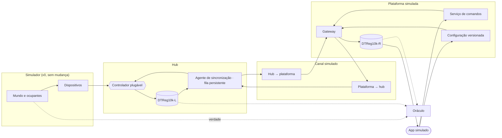
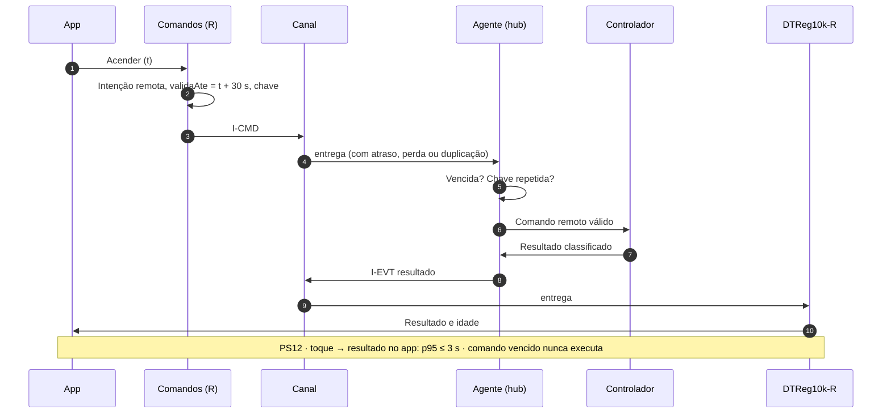

# Plano do ambiente de simulação — v0dt (gêmeo digital integrado)

**Documento:** ambiente-simulacao-v0dt.md
**Versão:** 02 | **Data:** 24/10/2026 (v01, plano, de 24/10/2026)
**Disciplina:** PCS5039 — Engenharia de Software Orientada a IoT (EPUSP)
**Linha de pesquisa:** Laboratório de Digital Twin de Arquitetura de Sistemas de Software (EPUSP) e GLIP USP
**Repositório:** https://github.com/ReginaldoArakaki/PCS5039_ambiente_reg10k_vCl0
**Base:** V1 Business Drivers v02, V2/V3 Requisitos v02 e plano do ambiente v02 (incremento 0, entregue como versão v0).
**Situação:** entregue. Plano aprovado com as propostas DQ-01 a DQ-05 e implementado no repositório (tag `v0dt`). Os ajustes feitos na construção estão marcados com ◆ e listados na §12.4.

---

## Histórico de versões

| Versão | Data | Alterações |
|---|---|---|
| 01 | 24/10/2026 | Plano para aprovação |
| 02 | 24/10/2026 | Entrega: DQ-01 a DQ-05 aprovadas; RN-DT-04 refinada e RN-DT-09 nova; métricas e cenários ajustados na construção; resultados na §12.3 |

---

## Sumário

1. Decisões e nomenclatura de versões
2. Objetivo e posição na trilha
3. Escopo e rastreabilidade com V1–V3
4. Arquitetura da v0dt
5. Regras do gêmeo e da sincronização
6. Canal simulado e app simulado
7. Registro: novas camadas
8. Cenários
9. Métricas e invariantes
10. Página de navegação
11. Exercícios e cronograma
12. Critérios de pronto e documentação da entrega
13. Decisões a confirmar
14. Referências

---

## 1. Decisões e nomenclatura de versões

### 1.1 Decisões que orientam a v0dt

| ID | Decisão | Origem |
|---|---|---|
| DT-01 | O gêmeo digital entra **antes** do segundo cômodo. O mundo físico da v0 não muda: uma sala, uma porta, o morador e o Rex | Responsável pelo projeto, 24/10/2026 |
| DT-02 | O escopo do gêmeo é **espelho e sincronização**: DTReg10k-L no hub, DTReg10k-R na plataforma, canal, comandos remotos, configuração versionada, desconexão e reconexão | Idem (recomendação aceita) |
| DT-03 | O **aprendizado mínimo** (perfil horário de ocupação e sugestão de tempo de apagamento com aceite) fica como exercício **opcional** | Idem |
| DT-04 | A documentação (V2/V3, plano, README, roteiro dos alunos) é atualizada **na entrega da v0dt** | Idem |
| DT-05 | Os 20 cenários da v0 são **regressão**: têm de passar sem nenhuma alteração | Princípio de mudar uma variável por vez |

### 1.2 Nomenclatura de versões (proposta)

O número acompanha o **porte da automação** e o sufixo `dt` indica a presença do gêmeo digital:

| Versão | Porte | Gêmeo | Incremento da trilha |
|---|---|---|---|
| v0 ✓ | 1 cômodo (sala) | — | 0 |
| **v0dt** | 1 cômodo (sala) | Espelho e sincronização | 1 |
| v1dt | 2 cômodos e passagem | Espelha 2 cômodos | 2 |
| v1dt.1 | 2 cômodos, mais pessoas e visitante | Idem | 3 |
| v2dt | Casa A (4 cômodos) | Idem | 4 |
| v3dt | Casa B (7 cômodos) | Com aprendizado completo | 5 |

No repositório, cada entrega recebe uma **tag** com o nome da versão (`v0`, `v0dt`, …). O código continua num único repositório.

---

## 2. Objetivo e posição na trilha

**Objetivo:** introduzir o DTReg10k (A08 da V1) num ambiente cujo mundo físico os alunos já conhecem. Assim, toda diferença observada nas métricas vem do gêmeo e da sincronização. Os alunos passam a ver **três pontos de vista** sobre a mesma sala: o que **acontece** (verdade), o que o **hub acha** (DTReg10k-L) e o que a **plataforma acha** (DTReg10k-R), além do caminho entre eles (canal).

**Conceitos novos:** autoridade por tipo de registro (RN27, RN28), sincronização com atualidade medida (PS11), comando remoto com validade e efeito único (PS01, PS12, RN11), reconexão com o estado atual antes do histórico (RN12), configuração versionada (pendente, aplicada, recusada) e operação local sem plataforma (RNF-CON-01).

---

## 3. Escopo e rastreabilidade com V1–V3

### 3.1 Dentro e fora

| Dentro | Fora (versão indicada) |
|---|---|
| DTReg10k-L no hub: estado da sala, configuração aplicada, fila persistente | Segundo cômodo e passagem (v1dt) |
| DTReg10k-R: projeção do registro recebido, atualidade e divergências | Mais pessoas e visitante (v1dt.1) |
| Canal simulado com latência, perda, duplicação, reordenação e desconexão | Assinatura, suspensão e membros (fora da trilha de simulação) |
| App simulado: consulta, comando remoto, mudança de preferência | Aprendizado completo (v3dt); mínimo como exercício opcional |
| Configuração versionada (T_apagamento como preferência do titular) | Várias casas na mesma plataforma |
| Reconexão ordenada e reconciliação L ↔ R | |

### 3.2 O que da V1–V3 a v0dt realiza

| Artefato | Como aparece |
|---|---|
| A08, A11 | DTReg10k-L e DTReg10k-R; metas de tempo real PS11 (5 s) e PS12 (3 s) |
| RF-SYN-01 a RF-SYN-06 | Publicação L→R, resumo de 30 s, fila persistente, reconexão ordenada, autoridade e distribuição R→L |
| RF-OPR-03, RF-OPR-04, RF-OPR-05 | Comando remoto com validade, classificação do resultado, efeito único |
| RF-OPR-07 | Preferência alterada no app, "pendente de aplicação" até a confirmação do hub |
| RF-ACO-01, RF-ACO-03 | O app mostra idade e atualidade; recebe atualizações por evento |
| RNF-DES-01, RNF-DES-02 | Atualidade do gêmeo p95 ≤ 5 s; comando remoto p95 ≤ 3 s |
| RNF-CON-01, RNF-CON-02, RNF-CON-06, RNF-CON-07 | Casa funciona sem plataforma; fila; reconexão; efeito único |
| RNF-USA-03 | "Desatualizado" e "desconhecido" nunca aparecem como estado atual |
| INV-03, INV-06, INV-07, INV-10, INV-14 | Verificadas pelo oráculo (§9.2) |
| CF04, CF06 da V3 | Reproduzidos integralmente |
| CV04, CV05, CV29 da V1 | Cenários DT03, DT07, DT06 |

---

## 4. Arquitetura da v0dt

### 4.1 Componentes

**Figura 1 — Componentes da v0dt.** O simulador e o controlador da v0 não mudam. Entram o agente de sincronização, o canal, a plataforma e o app.

| Componente | Responsabilidade | Requisitos |
|---|---|---|
| DTReg10k-L | Estado da sala segundo o hub; versão de configuração aplicada; autoridade sobre fatos locais | RN27; RF-SYN-05 |
| Agente de sincronização | Publica evidências, decisões e resultados; resumo a cada 30 s; fila persistente durante desconexão; reconexão com o estado atual antes do histórico; recebe comandos e configuração | RF-SYN-01 a RF-SYN-04, RF-SYN-06 |
| Canal simulado | Atraso, perda, duplicação, reordenação e desconexão, configuráveis por cenário | §6.1 |
| Gateway | Recebe mensagens do hub; descarta duplicadas; roteia comandos e configuração | RF-OPR-05 |
| DTReg10k-R | Projeção do registro recebido; idade de cada atributo; marca "atual", "desatualizado" ou "sem evidência"; registra divergências | RF-SYN-05; RF-ACO-01 |
| Serviço de comandos | Cria intenções remotas com validade de 30 s e chave de idempotência; correlaciona o resultado | RF-OPR-03, RF-OPR-04 |
| Configuração versionada | Guarda a preferência do titular; versão "pendente" até a confirmação do hub | RF-OPR-07; INV-14 |
| App simulado | Ator dos roteiros: consulta, comando remoto, mudança de preferência | §6.2 |

### 4.2 Fluxos principais

**Figura 2 — Comando remoto.** Uma mensagem duplicada no canal tem efeito único. Um comando que chega vencido é recusado e registrado como EXPIRADA.

### 4.3 Mudança mínima no contrato do controlador

A interface `Controlador` da v0 continua a mesma. Os controladores dos alunos da v0 rodam na v0dt sem alteração. Duas novidades chegam como evidências normais:

| Evidência nova | Origem | O que o controlador faz |
|---|---|---|
| `COMANDO_REMOTO` (acao, chave, solicitante) | Agente de sincronização, já validado quanto à validade e à duplicidade | Aplica a precedência: a remota fica abaixo da manual e acima da automática (R10 §7.2) |
| `CONFIGURACAO` (versao, t_apagamento_ms) | Agente, após verificar a assinatura da versão | Passa a usar o novo parâmetro; o agente confirma a versão aplicada |

---

## 5. Regras do gêmeo e da sincronização

| ID | Regra | Origem |
|---|---|---|
| RN-DT-01 | O DTReg10k-L é a autoridade sobre fatos locais (evidências, decisões, resultados). O DTReg10k-R é a autoridade sobre a configuração. Divergências são resolvidas por essa autoridade e registradas | RN27, RN28 |
| RN-DT-02 | O hub publica cada evento com `seq` e um resumo de estado a cada 30 s. Durante a desconexão, guarda tudo na fila persistente | RF-SYN-01 a RF-SYN-03 |
| RN-DT-03 | Na reconexão, o hub envia primeiro o estado atual e depois o histórico em ordem de `seq`. O histórico nunca restabelece a atualidade | RF-SYN-04; RN12 |
| RN-DT-04 ◆ | O DTReg10k-R marca o estado como **atual** (sessão ativa e idade ≤ 60 s, PS06), **desatualizado** ou **sem evidência**. A idade conta da recepção do último estado, no relógio da plataforma. Quando a sessão cai, o R fica desatualizado na hora, e só um estado recebido depois da reconexão o torna atual de novo | RF-ACO-01; RNF-USA-03 |
| RN-DT-05 | Todo comando remoto tem validade de 30 s (PS01) e chave de idempotência. O hub recusa o vencido e o repetido. Sem resultado em 10 s (PS02), o app mostra "desconhecido" | RF-OPR-03 a RF-OPR-05 |
| RN-DT-06 | Com o hub desconectado, o app recebe recusa imediata com o motivo, a última evidência e a idade, e o comando não fica pendente | CF04 |
| RN-DT-07 | Mudança de preferência cria uma nova versão de configuração, "pendente" até o hub confirmá-la; o hub nunca aplica versão menor que a já aplicada | RF-OPR-07; INV-14 |
| RN-DT-08 | Indisponibilidade da plataforma ou do canal não altera a automação local | RNF-CON-01 |
| RN-DT-09 ◆ | Comando remoto aceito cria precedência REMOTA por T_manual (15 min) sobre a automação. É recusado se houver precedência manual ativa; o interruptor sempre prevalece sobre o app | RN07; R10 §7.2 |

### 5.1 Parâmetros novos

| Parâmetro | Valor padrão | Origem |
|---|---|---|
| Resumo de estado | A cada 30 s | RF-SYN-02 |
| Limite de atualidade (PS06) | 60 s | V1 |
| Validade do comando remoto (PS01) | 30 s | V1 |
| Prazo do resultado (PS02) | 10 s | V1 |
| Capacidade da fila do hub | 7 dias de eventos | RNF-CON-02 |
| Espera de reconexão | Exponencial a partir de 1 s, máx. 30 s, com componente aleatório | V2 §5.3 de R11 |

---

## 6. Canal simulado e app simulado

### 6.1 Canal

| Parâmetro | Ideal | Realista | Por cenário |
|---|---|---|---|
| Latência por mensagem | 100 ms | 50–400 ms | Sim |
| Perda | 0 | 1% | Sim |
| Duplicação | 0 | 0,5% | Sim |
| Reordenação | Não | Sim, dentro de 1 s | Sim |
| Desconexão | Só quando o roteiro pede | Só quando o roteiro pede | `CANAL_DESCONECTA` com duração |
| Plataforma fora do ar | Só quando o roteiro pede | Só quando o roteiro pede | `PLATAFORMA_FORA` com duração |

O canal usa entrega **pelo menos uma vez** com confirmação: mensagem sem confirmação é reenviada pelo agente, por isso a duplicação é tratada pela chave de idempotência.

### 6.2 App

Novas ações nos roteiros, com o ator `app`:

| Ação | Parâmetros | Efeito |
|---|---|---|
| `APP_COMANDO` | `acao` (ACENDER ou APAGAR) | Cria intenção remota (RN-DT-05) |
| `APP_PREFERENCIA` | `t_apagamento_ms` | Cria nova versão de configuração (RN-DT-07) |
| `APP_CONSULTA` | — | Registra o que o app mostra naquele instante (estado, idade, atualidade) |

---

## 7. Registro: novas camadas

O registro continua único e somente acréscimo. Entram duas camadas:

| Camada | Quem gera | Exemplos |
|---|---|---|
| `REDE` | Canal simulado | Envio, entrega, perda, duplicação, desconexão, reconexão |
| `PLATAFORMA` | DTReg10k-R, comandos, configuração e app | Estado projetado com idade e atualidade, intenção remota, versão de configuração, consulta do app |

As seis camadas da v0 (VERDADE, PERCEPCAO, DECISAO, ATUACAO, ESTADO, SISTEMA) permanecem com o mesmo formato. O oráculo passa a comparar **três** visões no mesmo instante: verdade × DTReg10k-L (ESTADO) × DTReg10k-R (PLATAFORMA).

---

## 8. Cenários

### 8.1 Regressão

Os 20 cenários da v0 (N01–N06, FP01–FP03, FN01–FN05, F01–F06) rodam com o canal ideal ligado e têm de passar **sem alteração** de roteiro nem de asserções.

### 8.2 Novos cenários do gêmeo

| ID | Cenário | Esperado | Rastreia |
|---|---|---|---|
| DT01 | Comando remoto acende a sala vazia | Resultado no app em ≤ 3 s; efeito observado; R atual | RF-OPR-03; PS12; CF04 |
| DT02 | Comando remoto com o hub desconectado | Recusa imediata com motivo, última evidência e idade; nada fica pendente | RN-DT-06; CF04 |
| DT03 | Rede lenta (35 s de atraso): o comando chega vencido | Hub recusa; resultado EXPIRADA; luz não muda | INV-07; PS01; CV04 |
| DT04 | Canal duplica o comando | Um único efeito; a segunda cópia é registrada como repetida | RN11; RNF-CON-07 |
| DT05 | Desconexão de 10 min com o morador entrando e saindo | Automação local normal; R "desatualizado" assim que a sessão cai ◆; na volta, estado atual antes do histórico, divergência registrada e R atual em ≤ 5 s | RN-DT-03; RF-SYN-04; CF06 |
| DT06 | Preferência T_apagamento = 120 s alterada com o hub offline | Versão "pendente" no app; aplicada e confirmada na reconexão; daí em diante a luz apaga em 120 s | RF-OPR-07; INV-14; CV29 |
| DT07 | Plataforma fora do ar por 5 min | Casa funciona normalmente; fila cresce e esvazia na volta; nenhuma perda | RNF-CON-01; RNF-CON-02; CV05 |
| DT08 | Canal realista (perda de 1%, duplicação e reordenação) por 30 min, com morador e Rex | Atualidade p95 ≤ 5 s; nenhuma divergência além do prazo; nada fica na fila; distribuição em 30 sementes ◆ | RNF-DES-01; PS11 |
| DT09 | Comando remoto de acender durante a precedência manual de apagar | Recusado por precedência; o app mostra o motivo | RN07; R10 §7.2 |
| DT10 | Hub reinicia com a plataforma conectada | R "desatualizado" assim que a sessão cai; após o reinício, lacuna registrada e R atual de novo | RN-I0-08; RN-DT-04 |
| DT11 | Relógio do hub salta −5 min durante a sincronização | R ordena por `seq`; idade calculada pelo tempo de recepção; nenhuma regressão de atualidade | RF-SYN-01; F06 |
| DT12 | Rex sozinho com o morador consultando pelo app fora de casa | App mostra "ocupada" e luz acesa, ambos atuais; nada distingue cachorro de pessoa (RN09, RN34) | RF-ACO-01; RN34 |

**Total:** 20 de regressão e 12 novos, ou seja, 32 cenários.

---

## 9. Métricas e invariantes

### 9.1 Métricas novas

| Métrica | Definição | Limite (modo ideal) |
|---|---|---|
| Atualidade do gêmeo p95 (ms) | Da mudança de estado no hub até o DTReg10k-R refleti-la, com sessão ativa | ≤ 5.000 (PS11) |
| Comando remoto p95 (ms) | Do toque no app até o resultado classificado no app | ≤ 3.000 (PS12) |
| Comandos vencidos executados | Intenções remotas executadas após `validaAte` | 0 |
| Efeitos duplicados | Comutações repetidas para a mesma chave | 0 |
| Reconciliação após reconexão (ms) | Da sessão restabelecida até o R voltar a "atual" | ≤ 5.000 |
| Divergência L × R além do prazo (s) ◆ | Tempo com R "atual" e ocupação ou luz diferentes do L, descontados os 5 s de sincronização (PS11) | 0 |
| Eventos não entregues ◆ | Eventos que ficaram na fila do hub no fim da execução | 0 |
| Fila máxima ◆ | Maior número de eventos na fila do hub (informativo) | — |

◆ A "desatualização honesta" do plano virou a invariante OR-08, que é mais forte: vale em todo instante, não em porcentagem.

### 9.2 Invariantes novas

| ID | Verificação | Base |
|---|---|---|
| OR-07 | Nenhuma intenção remota é executada após `validaAte` | INV-07; PS01 |
| OR-08 | O DTReg10k-R e o app nunca dizem "atual" sem sessão ou com estado de mais de 60 s | RN-DT-04; RNF-USA-03 |
| OR-09 | Evento histórico recebido na reconexão nunca substitui um estado mais recente no R | RN-DT-03; RN12 |
| OR-10 | Versão aplicada no hub ≤ versão vigente no R; toda versão pendente termina aplicada ou recusada após a reconexão | INV-14 |
| OR-11 | Cada chave produz no máximo um efeito, mesmo com duplicação no canal | INV-10; RN11 |
| OR-12 | Com a plataforma ou o canal fora, as decisões locais são idênticas às da mesma execução com tudo conectado | RNF-CON-01 |

A OR-12 é verificada por **execução pareada**: o mesmo roteiro com a mesma semente roda duas vezes, com e sem a falha de rede, e as camadas DECISAO e ATUACAO são comparadas.

---

## 10. Página de navegação

| Aba | Novidade |
|---|---|
| Modelo | Diagramas da v0dt; regras RN-DT; nomenclatura de versões; rastreabilidade com RF-SYN e CF04/CF06 |
| Cenários | Filtro por versão (regressão v0 × novos DT); resultado da execução pareada da OR-12 |
| Animação | Ao lado da planta: **"o que o hub acha"** (DTReg10k-L) e **"o que a plataforma acha"** (DTReg10k-R, com idade e selo atual/desatualizado); indicador de conexão e mensagens em trânsito |
| Painel | Faixas novas na linha do tempo: **Gêmeo remoto** (ocupação e luz segundo o R, hachurado quando desatualizado), **Canal** (conectado, desconectado, perdas, duplicações) e **App** (comandos, preferências, consultas) |

---

## 11. Exercícios e cronograma

### 11.1 Preparação (antes do dia 1)

A referência completa da v0dt no repositório, com tag `v0dt`, regressão da v0 aprovada e página gerada.

### 11.2 Exercícios

| Ex. | Atividade | Técnica | Cenários-alvo |
|---|---|---|---|
| E7 | Ler os modelos da v0dt e explicar, para DT05, o que cada um dos três pontos de vista mostra antes, durante e depois da desconexão | Modelagem de sistemas distribuídos | DT05 |
| E8 | Implementar uma política alternativa de exibição no app (por exemplo, mostrar a "última evidência conhecida" com destaque quando desatualizado) e verificar a OR-08 | Componentização; honestidade da informação | DT05, DT07, DT10 |
| E9 | Criar 2 cenários de rede com o editor (por exemplo, desconexões curtas e repetidas) e escrever as asserções | Testes de sistemas distribuídos | Novos |
| E10 (opcional) | **Aprendizado mínimo:** a partir de 3 semanas simuladas, o gêmeo calcula o perfil horário de ocupação e sugere T_apagamento por faixa de horário; a sugestão só vale após aceite simulado (RN-DT-07); medir o efeito em FN01 e FN02 | Gêmeo comportamental explicável | FN01, FN02, DT06 |

### 11.3 Cronograma (2 dias)

| Dia | Manhã | Tarde | Entregável |
|---|---|---|---|
| 1 — Modelos e componentes | Apresentação da v0dt; três pontos de vista na animação | E7 e início do E8 | Análise do DT05; desenho da política do E8 |
| 2 — Integração e testes | E8 concluído e E9 | Comparação na página; E10 para quem avançar | Política do app aprovada nas invariantes; cenários novos no catálogo |

---

## 12. Critérios de pronto e documentação da entrega

### 12.1 Critérios de pronto

| # | Critério |
|---|---|
| CP-DT-01 | Os 20 cenários da v0 passam sem alteração (regressão) |
| CP-DT-02 | Os 12 cenários DT passam nas asserções de requisito |
| CP-DT-03 | Invariantes OR-01 a OR-12 respeitadas em todas as execuções |
| CP-DT-04 | Determinação: mesma semente, mesmo registro, inclusive com o canal realista |
| CP-DT-05 | Controlador de exemplo da v0 (grupo_exemplo) roda na v0dt sem mudança |
| CP-DT-06 | Schemas atualizados (camadas REDE e PLATAFORMA, ações do app, falhas de rede) e todos os JSON válidos |
| CP-DT-07 | Página com os três pontos de vista, abrindo também no visualizador do app |
| CP-DT-08 | Integração contínua verde e tag `v0dt` no repositório |

### 12.2 Documentação atualizada na entrega (DT-04)

| Documento | Atualização |
|---|---|
| Este plano | Passa de "para aprovação" a "entregue", com os resultados |
| V2/V3 Requisitos | v03 entregue: nova §3.6 com requisitos exercitados, OR-07 a OR-12 ligadas às invariantes V2 e refinamentos RS-01 a RS-06 |
| V1 Business Drivers | Só se surgir regra de negócio nova durante a construção (hoje não há previsão) |
| README e roteiro dos alunos | Comandos, cenários DT, exercícios E7–E10 |
| Página | Abas atualizadas (§10) |

---

### 12.3 Resultados da entrega

| Critério | Resultado |
|---|---|
| CP-DT-01 | Os 20 cenários da v0 passam sem alteração de roteiro nem de asserções |
| CP-DT-02 | Os 12 cenários DT passam em todas as asserções com a referência e com o `grupo_exemplo` |
| CP-DT-03 | OR-01 a OR-12 respeitadas em todas as 64 execuções; a OR-12 é verificada por execução pareada em DT05, DT07, DT08 e nos cenários realistas da v0 |
| CP-DT-04 | Mesma semente, mesmo registro, inclusive com o canal realista |
| CP-DT-05 | O `grupo_exemplo` da v0 roda sem mudança |
| CP-DT-06 | Schemas de sala, roteiro, esperado, evento e métricas atualizados; todos os JSON válidos |
| CP-DT-07 | Página com os três pontos de vista, testada no navegador e em visualizador embutido (iframe com sandbox), sem erros |
| CP-DT-08 | 92 testes passam; catálogo completo em cerca de 40 s |

Medições da referência (simulação, não sistema real):

| Métrica | Canal ideal | Canal realista (DT08, 30 sementes) |
|---|---|---|
| Atualidade do gêmeo p95 | 100 ms | mediana 342 ms; pior caso 3,3 s |
| Comando remoto p95 | 850 ms (DT01, DT04) | — |
| Reconciliação | 100 ms | — |
| Divergência além do prazo | 0 s | 0 s em todas as sementes |
| Comandos vencidos executados, efeitos duplicados, eventos não entregues | 0 | 0 |

### 12.4 Ajustes feitos na construção (◆)

| Ajuste | Motivo |
|---|---|
| RN-DT-04: R desatualizado assim que a sessão cai; só estado novo restabelece a atualidade | Em DT10, um estado de 27 s voltaria a ser "atual" antes de chegar o estado do hub religado |
| RN-DT-04: idade medida pela recepção, no relógio da plataforma | Em DT11, a idade calculada pelo relógio do hub regrediria com o salto |
| RN-DT-09 (nova): precedência REMOTA | O plano dizia "abaixo da manual, acima da automática", mas sem duração nem regra de recusa |
| Divergência com tolerância de 5 s | Divergência durante a propagação é inevitável; o critério verificável é "além do prazo de PS11" |
| DT08 com morador e Rex e distribuição em 30 sementes | Mostra a variação da atualidade com perdas (reenvio de 3 s) |
| Cenários com tempos ajustados (DT05, DT06, DT07) | Para que a divergência e a mudança de T_apagamento fiquem observáveis |

Os achados foram levados à V2/V3 v03 (§3.6, refinamentos RS-01 a RS-06).

## 13. Decisões (aprovadas em 24/10/2026)

Todas as propostas foram aprovadas como estavam.

| ID | Pergunta | Proposta |
|---|---|---|
| DQ-01 | Nomenclatura de versões e tags (§1.2) | Como na tabela da §1.2 |
| DQ-02 | Preferência do titular nesta versão | Só T_apagamento; outras preferências a partir da v1dt |
| DQ-03 | O app precisa de autenticação e papéis? | Não nesta versão: um único titular; membros e revogação ficam fora |
| DQ-04 | Os controladores dos alunos devem tratar `COMANDO_REMOTO`? | Sim, com a precedência da R10 §7.2 (RN-DT-09); a referência herdada já trata. Quem não tratar continua aprovado nas invariantes, mas falha nas asserções de requisito de DT01 e DT04 |
| DQ-05 | O E10 (aprendizado mínimo) entra na avaliação? | Como bônus |

---

## 14. Referências

| ID | Documento |
|---|---|
| R13 | V1 — Business Drivers da Plataforma Reg10k, v02, 24/10/2026 |
| R14 | V2 e V3 — Requisitos funcionais e não funcionais da plataforma Reg10k, v02, 24/10/2026 |
| R15 | Plano do ambiente de simulação — incremento 0, v02, 24/10/2026 |
| — | Repositório ReginaldoArakaki/PCS5039_ambiente_reg10k_vCl0, versão v0 |
