# V2 e V3 — Requisitos funcionais e não funcionais da plataforma Reg10k

**Documento:** V2 e V3 requisitos funcionais e não funcionais plataforma reg10k-v04.md
**Versão:** 04 | **Data:** 24/10/2026 (v01 de 22/10/2026; v02 e v03 de 24/10/2026)
**Referencial:** RM-ODP adaptado [R08]. **V2 Informação** (modelo estático estrutural, invariantes e classificação de dados) e **V3 Computação** (objetos, interfaces e comportamento dinâmico).
**Base:** V1 — Business Drivers da Plataforma Reg10k, v02 [R13], com 8 direcionadores (BD01–BD08), 4 macroprocessos (MP1–MP4) e a governança MT, 34 regras e 49 requisitos de negócio (RNP).
**Situação:** modelagem para validação. Os requisitos derivam das RNP da V1. Metas numéricas são propostas, salvo quando herdadas de decisão aprovada. Nenhum valor é medição.

---

## Histórico de versões

| Versão | Data | Alterações |
|---|---|---|
| 01 | 22/10/2026 | Primeira versão: 59 RF, 41 RNF, modelos estático e dinâmico, checklist |
| 02 | 24/10/2026 | Alinhada à V1 v02. D09 decidida (A09, kit sem fiação): RF-KIT-01, RF-COM-04, RNF-USA-01 e RNF-LEG-04 reescritos, sem a marca de dependência; nova INV-16. D13 decidida: I01 e I02 viram A10 e A11. RN34 em RF-OPR-01 (A12). PS05 com 60 s em RF-OPR-01 e INV-09 (A13). Classe Passagem, enumeração TipoPassagem, RF-COM-05 e INV-15 para o SA vinculado à porta (A14). Contagens: 59 RF, 41 RNF, 42 classes, 16 invariantes, 22 enumerações |
| 03 | 24/10/2026 | Entrega da v0dt do ambiente de simulação [R15]. Nova seção 3.6: requisitos de sincronização, comando remoto e configuração exercitados em 12 cenários; correspondência entre as invariantes OR-07 a OR-12 do oráculo e INV-07, INV-10, INV-14; seis refinamentos (RS-01 a RS-06). Nova pendência PD08 e novo encaminhamento para V4. Requisitos, classes e invariantes sem alteração de contagem |
| 04 | 24/10/2026 | Entrega da v0dta (cômodo espelho) [R16]: refinamento RS-07 na §3.6.3 e referência R16. Sem alteração de requisitos, classes ou invariantes |

---

## Sumário

0. Enquadramento, convenções e premissas
1. Requisitos funcionais e não funcionais
2. Modelagem estática estrutural (V2)
3. Modelagem dinâmica e computacional (V3)
4. Checklist de qualidade da modelagem de requisitos
5. Pendências e encaminhamentos para V4–V5
6. Referências

---

## 0. Enquadramento, convenções e premissas

### 0.1 Papel deste documento na cadeia de visões

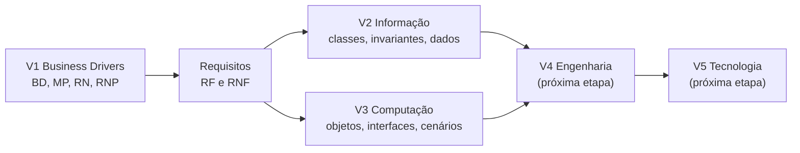

**Figura 1 — Posição deste documento na cadeia RM-ODP.**

Este documento faz a ponte entre o negócio (V1) e a arquitetura de engenharia (V4/V5). Cada RNP da V1 se desdobra em requisitos funcionais (o que o sistema faz) e não funcionais (com que qualidade). Esses requisitos são realizados por classes de informação (V2) e por objetos computacionais em cenários (V3). Nenhuma escolha de tecnologia é feita aqui.

### 0.2 Convenções

| Elemento | Formato | Exemplo |
|---|---|---|
| Requisito funcional | RF-<módulo>-nn | RF-COM-02 |
| Requisito não funcional | RNF-<característica>-nn | RNF-DES-02 |
| Invariante de informação | INV-nn | INV-01 |
| Objeto computacional | OC-nn | OC-05 |
| Interface | I-<sigla> | I-CMD |
| Cenário funcional | CF-nn (realiza CV da V1) | CF04 |
| Prioridade (MoSCoW) | **M** deve; **S** deveria; **C** poderia | M |
| Verificação | **T** teste; **D** demonstração; **I** inspeção; **A** análise | T |
| Marca de origem | **A** aprovado; **F** fonte; **P** proposta; **N** nova nesta versão (sem RNP correspondente) | P |

**Módulos funcionais:** ADE (adesão e assinatura), KIT (kit nominal e logística), COM (comissionamento), OPR (operação da automação), SYN (sincronização do DTReg10k), ACO (acompanhamento), GOV (governança, identidade e auditoria).

**Características não funcionais** (ISO/IEC 25010:2023): DES (eficiência de desempenho), CON (confiabilidade), SEG (segurança), PRI (privacidade e proteção de dados), USA (capacidade de interação, ou usabilidade), EVO (manutenibilidade e flexibilidade), CMP (compatibilidade), LEG (conformidade legal e regulatória).

### 0.3 Decisões e premissas em vigor

| ID | Conteúdo | Situação | Efeito neste documento |
|---|---|---|---|
| A05–A08 | Operador Reg10k; kit DIY; kit de referência; DTReg10k local e remoto em tempo real | Aprovadas na V1 | Base de todo o modelo |
| A09 (D09) | Kit sem fiação: só itens de encaixe ou plugáveis; pontos que exigiriam fiação só com visita técnica | Aprovada em 24/10/2026 | RF-KIT-01, RF-COM-04, RNF-USA-01, RNF-LEG-04 e INV-16 |
| A10 (ex-I01) | A plataforma gerencia a assinatura; pagamento por provedor externo | Aprovada em 24/10/2026 | Módulo ADE |
| A11 (ex-I02) | "Tempo real" = sincronização p95 ≤ 5 s e comando remoto p95 ≤ 3 s | Aprovada em 24/10/2026 | Metas de RNF-DES-01 e RNF-DES-02 |
| A12 | RN34: ocupante é pessoa ou animal de grande porte | Aprovada em 24/10/2026 | RF-OPR-01; métricas de ocupação |
| A13 | PS05: ausência estável = 60 s sem detecção (configurável) | Aprovada em 24/10/2026 | RF-OPR-01; INV-09 |
| A14 | SA vinculado a uma passagem (porta), não a um cômodo | Aprovada em 24/10/2026 | Classe Passagem; RF-COM-05; INV-02 e INV-15 |

Na v01, o símbolo † marcava os requisitos que dependiam de D09. Com a decisão A09, eles foram reescritos e a marca deixou de existir.

---

## 1. Requisitos funcionais e não funcionais

### 1.1 Requisitos funcionais

#### ADE — Adesão e assinatura

| ID | Requisito | Descrição | Origem V1 | Pri. | Verif. |
|---|---|---|---|---|---|
| RF-ADE-01 | Cadastro de conta e residência | Registrar o titular (nome, contato, identificação) e a residência (endereço normalizado, unidade, número de cômodos). Criar credencial de acesso ao app | RNP-MP1-01 | M | T |
| RF-ADE-02 | Aceites versionados | Registrar o aceite de termos de uso e política de privacidade com versão do documento, instante e canal. Sem os aceites obrigatórios, a adesão não é concluída e nada mais é criado | RNP-MP1-01; RNP-MT-07 | M | T |
| RF-ADE-03 | Elegibilidade | Aplicar o questionário (internet, cômodos, tipo de iluminação e de encaixe) contra o catálogo do kit de referência. Resultado: elegível, com configuração-alvo e composição do kit; ou recusado, com motivo e orientação | RNP-MP1-02; RN31 | M | T |
| RF-ADE-04 | Prevenção de duplicidade | Recusar a criação de uma segunda residência ativa com o mesmo endereço normalizado e unidade. O conflito abre caso para IMP | RNP-MP1-03; RN05 | M | T |
| RF-ADE-05 | Criação do DTReg10k-R | Na conclusão da adesão, criar a residência em "Aderida" e o seu DTReg10k-R, com identidade única | RNP-MP1-03 | M | T |
| RF-ADE-06 | Gestão da assinatura | Criar a assinatura em "contratada", obter do provedor a autorização do meio de pagamento (sem cobrança) e gerir os estados contratada, ativa, inadimplente, suspensa e cancelada. Iniciar a cobrança no evento de ativação, proporcional no primeiro ciclo | RNP-MP1-04; RN20, RN29 | M | T |
| RF-ADE-07 | Cancelamento antes da ativação | Encerrar a assinatura sem cobrança e abrir pendência de devolução do kit com responsável. Respeitar o prazo de arrependimento de 7 dias da compra a distância | RNP-MP1-08 | M | T |
| RF-ADE-08 | Suspensão e reativação | Ao suspender ou reativar, registrar o novo estado no DTReg10k-R e propagar o efeito ao hub (funções remotas desabilitadas ou restabelecidas) | RNP-MP3-08; RNP-MT-08; RN19 | M | T |

#### KIT — Kit nominal e logística

| ID | Requisito | Descrição | Origem V1 | Pri. | Verif. |
|---|---|---|---|---|---|
| RF-KIT-01 | Catálogo do kit de referência | Manter os modelos de item (hub, sensor de passagem SA, sensor de presença SP, lâmpada ou módulo plugável) com capacidades declaradas: nível máximo de evidência, forma de instalação (encaixe ou tomada), firmware mínimo e guia de instalação. Nenhum modelo do kit DIY exige intervenção na instalação elétrica fixa (INV-16) | RNP-MP2-07; A07; A09 | M | I |
| RF-KIT-02 | Fila de expedição | Ordenar a expedição por critérios publicados. Exibir ao titular posição e previsão; avisar mudanças e guardar o histórico de previsões | RNP-MP1-06; RN21 | S | T |
| RF-KIT-03 | Alocação de kit nominal | Associar à residência os números de série do hub e de cada item antes da expedição. Recusar série inexistente no cadastro ou já alocada a outra residência | RNP-MP1-05; RN24 | M | T |
| RF-KIT-04 | Integração logística | Receber da transportadora eventos de expedição, entrega e devolução, de forma idempotente, e atualizar o estado do kit | RNP-MP1-07 | M | T |
| RF-KIT-05 | Confirmação de recebimento | Exigir que o titular confirme o recebimento lendo o código do hub. Até lá, manter "entregue, não confirmado" e não abrir comissionamento | RNP-MP1-07 | M | T |
| RF-KIT-06 | Substituição de kit ou item | Substituir item danificado ou ausente: registrar a nova série no kit nominal e marcar a anterior como devolvida | V1 §5.2 (exceções MP1) | S | T |

#### COM — Comissionamento

| ID | Requisito | Descrição | Origem V1 | Pri. | Verif. |
|---|---|---|---|---|---|
| RF-COM-01 | Sessão de comissionamento | Abrir, pausar e retomar a sessão, preservando etapas aprovadas. Uma única sessão ativa por residência | RNP-MP2-09 | M | T |
| RF-COM-02 | Reivindicação do hub | Aceitar a leitura do código do hub somente se o hub pertencer ao kit nominal da residência e o solicitante for titular ou membro com papel de instalação. Recusar com motivo e auditar a tentativa | RNP-MP2-01; RN24 | M | T |
| RF-COM-03 | Provisionamento do hub | Entregar ao hub identidade, credencial e configuração-alvo. Criar o DTReg10k-L e registrar no DTReg10k-R a versão de configuração aplicada antes de qualquer teste | RNP-MP2-02 | M | T |
| RF-COM-04 | Instalação guiada | Conduzir a instalação cômodo a cômodo, só com passos de encaixe ou de tomada, com instruções por modelo de item. Ponto de luz sem soquete ou tomada compatível não gera passo de instalação: a plataforma oferece visita técnica | RNP-MP2-04; RN25; A09 | M | D |
| RF-COM-05 | Vínculo do item | Criar o vínculo com início de vigência somente em sessão aberta: o SA se vincula a uma passagem (porta entre dois cômodos ou para o exterior); os demais itens, a um cômodo. Recusar item fora do kit nominal ou com vínculo vigente em outra residência | RNP-MP2-03; RN05; A14 | M | T |
| RF-COM-06 | Testes guiados | Executar por item os testes aplicáveis (passagem, presença, ausência, acionamento) e registrar o nível de evidência alcançado. Até 3 tentativas; persistindo a falha, caso para SUP | RNP-MP2-05; RN02 | M | T |
| RF-COM-07 | Ensaio de autonomia | Comandar o hub a operar isolado da plataforma por PS14 (10 min), verificar acionamentos locais, reconectar e reconciliar com o DTReg10k-R | RNP-MP2-06; RN04 | M | T |
| RF-COM-08 | Capacidades e preferências iniciais | Exibir por cômodo o que será observado e o que será apenas relatado. Coletar preferências iniciais dentro dos limites da política vigente | RNP-MP2-07 | M | D |
| RF-COM-09 | Ativação | Ativar automaticamente quando todas as etapas do checklist tiverem evidência. Caso contrário, abrir revisão para IMP. A ativação gera o evento que inicia a cobrança | RNP-MP2-08; RN26 | M | T |
| RF-COM-10 | Suporte à sessão | Permitir ao titular delegar a SUP o acompanhamento da sessão, limitado à sessão e a PS15 (4 h). Sem delegação, negar e auditar | RNP-MP2-10; RN15 | M | T |
| RF-COM-11 | Abandono | Detectar sessão sem progresso por PS13 (7 dias) e abrir caso de contato proativo para SUP, mantendo o kit nominal | RNP-MP2-09; RN30 | S | T |

#### OPR — Operação da automação

| ID | Requisito | Descrição | Origem V1 | Pri. | Verif. |
|---|---|---|---|---|---|
| RF-OPR-01 | Decisão local de iluminação | No hub, avaliar presença válida (idade ≤ PS04), precedência [R10 §7.2] e ausência estável (PS05: 60 s sem detecção, configurável) para acender ou apagar. Qualquer ocupante conta, inclusive animal de grande porte (RN34). Presença desconhecida aplica contingência e nunca apaga por silêncio. Nada disso depende da plataforma | RNP-MP3-01; RNP-MP3-05; RN01; RN34; A13 | M | T |
| RF-OPR-02 | Intervenção manual local | Registrar acionamento manual como evidência com precedência temporária por PS03 (15 min) | RNP-MP3-03; RN07 | M | T |
| RF-OPR-03 | Comando remoto | Criar intenção com solicitante, motivo, validade PS01 (30 s) e chave de idempotência. O hub valida validade, autorização e precedência; a recusa volta com motivo | RNP-MP3-02; RN07 | M | T |
| RF-OPR-04 | Classificação do resultado | Classificar cada atuação em recebido, execução relatada, efeito observado, rejeitado, expirado ou desconhecido (sem evidência até PS02, 10 s) | RNP-MP3-04; RN02 | M | T |
| RF-OPR-05 | Efeito único | Garantir um único efeito por chave de idempotência de comando e por identificador de evidência | RNP-MP3-06; RN11 | M | T |
| RF-OPR-06 | Presença incompatível | Detectar localmente presença incompatível, verificar a cada 5 min, conciliar com passagem tardia e só então emitir evento de fronteira para ocorrências | RNP-MP3-10; RN03, RN17 | S | T |
| RF-OPR-07 | Alteração de preferência | Validar a preferência contra os limites da política e marcá-la "pendente de aplicação" até a confirmação do hub | RNP-MP3-09; RN28 | M | T |
| RF-OPR-08 | Efeito da suspensão no hub | Com assinatura suspensa, recusar comandos remotos com motivo e manter automação local e interruptor | RNP-MP3-08; RN19 | M | T |
| RF-OPR-09 | Saúde de hub e itens | Detectar item sem resposta, bateria baixa e falhas; gerar aviso ao titular e evento de fronteira para manutenção | V1 §5.4 (exceções MP3); RNP-MP4-03 | S | T |

#### SYN — Sincronização do DTReg10k

| ID | Requisito | Descrição | Origem V1 | Pri. | Verif. |
|---|---|---|---|---|---|
| RF-SYN-01 | Publicação L→R | Publicar evidências, decisões e resultados com identificador único, sequência local, instante de origem e indicação de relógio confiável | RNP-MT-01 | M | T |
| RF-SYN-02 | Resumo de estado | Publicar resumo de estado da residência a cada 30 s, para que a plataforma meça a atualidade (PS06, 60 s) | RNP-MP4-01; PS06 | M | T |
| RF-SYN-03 | Fila local persistente | Durante desconexão, guardar eventos no hub e reenviá-los em ordem na reconexão | RNP-MP3-07; RN04 | M | T |
| RF-SYN-04 | Reconexão ordenada | Na reconexão, enviar o estado atual antes do histórico; o histórico não restabelece atualidade; comandos vencidos expiram | RNP-MP3-07; RN12 | M | T |
| RF-SYN-05 | Autoridade e divergência | Resolver divergências L↔R pela autoridade do tipo de registro (V1 §6.2) e registrar a divergência e a resolução | RNP-MT-02; RN27, RN28 | M | T |
| RF-SYN-06 | Distribuição R→L | Distribuir configuração, política, permissões e estado de assinatura ao hub e registrar a versão confirmada como aplicada | RNP-MT-04; RNP-MP3-09 | M | T |
| RF-SYN-07 | Reconstrução | Reconstruir o estado do DTReg10k-R a partir dos registros imutáveis | RNP-MT-09; RN12 | S | T |

#### ACO — Acompanhamento

| ID | Requisito | Descrição | Origem V1 | Pri. | Verif. |
|---|---|---|---|---|---|
| RF-ACO-01 | Painel da residência | Exibir estado por cômodo com idade da informação, nível de evidência e conectividade do hub. Estado mais antigo que PS06 aparece como "desatualizado" | RNP-MP4-01 | M | T |
| RF-ACO-02 | Histórico de ações | Exibir causa, solicitante, resultado e substituições por precedência | RNP-MP4-02; RN07 | M | T |
| RF-ACO-03 | Atualização em tempo real | Enviar ao app as mudanças do DTReg10k-R por assinatura de eventos, sem que o app precise consultar repetidamente | RNP-MP4-09 | M | T |
| RF-ACO-04 | Avisos | Enviar avisos (hub offline, item sem resposta, bateria, resultado desconhecido, previsão de entrega) conforme preferências do titular, registrando envio e entrega separadamente | RNP-MP4-03 | M | T |
| RF-ACO-05 | Relatório mensal | Emitir relatório com período, base prevista, cobertura e lacunas; período sem evidência aparece como lacuna, nunca como zero | RNP-MP4-04; RN10 | M | T |
| RF-ACO-06 | Gestão de membros | Convidar membros com papel (consulta, controle, instalação) e revogá-los com efeito imediato na plataforma | RNP-MP4-05; RN32 | M | T |
| RF-ACO-07 | Painel agregado Reg10k | Oferecer a GES funil de incorporação e indicadores IQ com denominador fixo e residências offline incluídas, sem detalhe individual | RNP-MP4-06 | M | T |
| RF-ACO-08 | Checklist em tempo real | Mostrar ao titular o progresso do comissionamento etapa a etapa, com o resultado de cada teste | V1 §5.3 (visibilidade MP2) | S | D |

#### GOV — Governança, identidade e auditoria

| ID | Requisito | Descrição | Origem V1 | Pri. | Verif. |
|---|---|---|---|---|---|
| RF-GOV-01 | Autenticação | Autenticar titulares e membros (segundo fator opcional) e a equipe Reg10k (segundo fator obrigatório) | RNP-MT-10 | M | T |
| RF-GOV-02 | Autorização por residência | Decidir cada consulta e ação por residência, papel, finalidade e vigência. Negar sem revelar se o recurso existe | RNP-MT-10; RNP-MP4-07; RN05, RN15 | M | T |
| RF-GOV-03 | Delegação temporária | Conceder a SUP acesso de detalhe com finalidade e vigência (PS10, 4 h), revogável pelo titular | RNP-MP4-07; PS10 | M | T |
| RF-GOV-04 | Auditoria | Registrar decisões de acesso, inclusive negações, com quem, o quê, quando e motivo | RNP-MT-05 | M | T |
| RF-GOV-05 | Registros imutáveis | Armazenar fatos e decisões apenas por acréscimo; correção gera novo registro que referencia o anterior | RNP-MT-01; RN12 | M | T |
| RF-GOV-06 | Identidades únicas | Manter identidade única de residência, kit, hub e item, e vínculos com vigência | RNP-MT-03 | M | T |
| RF-GOV-07 | Retenção e destinação | Aplicar retenção por classe (V1 §6.3), com eliminação ou agregação automática e prorrogação somente com justificativa de GOV | RNP-MT-06 | M | T |
| RF-GOV-08 | Novo aceite | Quando a política de privacidade mudar, exigir novo aceite para as funções que dependem dela | RNP-MT-07 | M | T |
| RF-GOV-09 | Direitos do titular | Atender acesso, correção, portabilidade e eliminação, com comprovante do que foi mantido e por quê | RNP-MP4-08; RN33 | M | T |
| RF-GOV-10 | Versões de política em lotes | Versionar a política, liberá-la em lotes e permitir reversão | RNP-MT-04; RN23 | S | T |

### 1.2 Requisitos não funcionais

#### DES — Eficiência de desempenho

| ID | Requisito | Descrição e métrica | Meta | Verif. | Origem |
|---|---|---|---|---|---|
| RNF-DES-01 | Sincronização em tempo real | Tempo entre o registro no DTReg10k-L e a disponibilidade no DTReg10k-R, com hub conectado | p95 ≤ 5 s; ≥ 95% dos eventos (IQ18) | T (carga) + medição contínua | PS11; A11 |
| RNF-DES-02 | Comando remoto | Tempo entre o toque no app e a exibição do resultado classificado | p95 ≤ 3 s, sempre dentro da validade PS01 | T (carga) | PS12; A11 |
| RNF-DES-03 | Reação local | Tempo entre a evidência de presença e o comando ao atuador, no hub | p95 ≤ 500 ms | T (bancada) | **N**; BD03 |
| RNF-DES-04 | Pico de adesão | Adesões concluídas sem perda; tempo de resposta de cada etapa | 10.000 adesões em 1 h; p95 ≤ 2 s por etapa | T (carga) | RNP-MP1-09; CL-A |
| RNF-DES-05 | Pico de comissionamento | Sessões simultâneas com teste registrado dentro de PS12 | 1.000 simultâneas (ensaio até 3.000); IQ15 ≥ 99% | T (carga) | RNP-MP2-11; CL-C |
| RNF-DES-06 | Ingestão | Vazão sustentada sem perda | 333 resumos/s + pico de 175 eventos/s + 100 comandos/s, com margem 5× | T (carga) | CL-E; D08 |
| RNF-DES-07 | Acompanhamento | Sessões de app simultâneas recebendo atualizações dentro de RNF-DES-01 | 10.000 sessões | T (carga) | RNP-MP4-09; CL-F |
| RNF-DES-08 | Relatórios em lote | Emissão dos relatórios mensais sem degradar RNF-DES-01 | 10.000 relatórios no prazo PS09 | T (carga) | CL-G |

#### CON — Confiabilidade

| ID | Requisito | Descrição e métrica | Meta | Verif. | Origem |
|---|---|---|---|---|---|
| RNF-CON-01 | Autonomia local | Iluminação automática e interruptor funcionam sem plataforma, por tempo indeterminado | 100% dos cenários de queda; ≥ 99% das ativações com ensaio aprovado (IQ04) | T (ensaio PS14) | BD03; RN04 |
| RNF-CON-02 | Fila local | Capacidade da fila persistente do hub sem perda | ≥ 7 dias de eventos | T (bancada) | R11 §5.2 |
| RNF-CON-03 | Disponibilidade central | Disponibilidade mensal da supervisão, app e API | ≥ 99,9% (≈ 43 min/mês) | A + medição | R11 §5.5 |
| RNF-CON-04 | Disponibilidade no lançamento | Disponibilidade de adesão e comissionamento na janela do lançamento | ≥ 99,9% por semana | A + medição | **N**; BD01 |
| RNF-CON-05 | Recuperação de dados | Perda máxima e tempo de retorno | RPO ≤ 1 min (assinatura, configuração, permissões); RPO ≈ 0 para evidências ainda no hub; RTO ≤ 1 h em perda regional | T (exercício de recuperação) | R11 §5.5 |
| RNF-CON-06 | Reconexão em massa | Hubs reconectando simultaneamente após falha central | 10.000 em 60 s, sem perda e sem executar comando vencido | T (carga) | R11 CV20 |
| RNF-CON-07 | Entrega e efeito | Entrega pelo menos uma vez, com efeito único | 0 efeitos duplicados em ensaio de reenvio | T | RN11 |

#### SEG — Segurança

| ID | Requisito | Descrição e métrica | Meta | Verif. | Origem |
|---|---|---|---|---|---|
| RNF-SEG-01 | Identidade do hub | Credencial individual por hub e autenticação mútua no canal com a plataforma | 100% dos hubs; credencial revogável | T + I | R11 §5.7 |
| RNF-SEG-02 | Isolamento entre residências | Nenhuma consulta ou ação alcança outra residência | 0 vazamentos em teste de intrusão antes do lançamento (IQ10) | T (intrusão) | RNP-MT-10; BD06 |
| RNF-SEG-03 | Revogação efetiva | Tempo para revogação de membro ou delegação valer | ≤ 5 s na plataforma; na próxima sincronização no hub | T | RN32; RNF-DES-01 |
| RNF-SEG-04 | Criptografia | Dados em trânsito e dados pessoais em repouso cifrados | 100% dos canais e repositórios de dados pessoais | I | LGPD; BD06 |
| RNF-SEG-05 | Auditoria íntegra | Registros de auditoria não alteráveis e consultáveis por GOV | Retenção de 12 meses; alteração detectável | I + T | RNP-MT-05 |
| RNF-SEG-06 | Atualizações assinadas | Firmware, configuração e política assinados, liberados em lotes, com retorno automático | 100% das liberações; nenhuma direto a 100% da base | T | RN23 |
| RNF-SEG-07 | Dados de pagamento | Nenhum dado de cartão armazenado; somente token do provedor | 0 ocorrências em inspeção | I | RN29 |

#### PRI — Privacidade e proteção de dados

| ID | Requisito | Descrição e métrica | Meta | Verif. | Origem |
|---|---|---|---|---|---|
| RNF-PRI-01 | Retenção | Eliminação ou agregação no fim do prazo de cada classe | Presença detalhada 30 dias; operação 180 dias; agregados e auditoria 12 meses | T + I | V1 §6.3 |
| RNF-PRI-02 | Minimização por perfil | GES só agregados; OPE sem dados de presença; SUP só com delegação | Conforme matriz de visibilidade da V1 §5.5.1 | T | RNP-MP4-06; RN15 |
| RNF-PRI-03 | Prazo dos direitos do titular | Pedidos atendidos no prazo legal | 100% (IQ19) | A + medição | RNP-MP4-08 |
| RNF-PRI-04 | Avaliação de impacto | Relatório de Impacto à Proteção de Dados concluído | Antes do lançamento | I | V1 §6.4 |

#### USA — Capacidade de interação (usabilidade)

| ID | Requisito | Descrição e métrica | Meta | Verif. | Origem |
|---|---|---|---|---|---|
| RNF-USA-01 | Autoinstalação | Proporção de ativações sem visita técnica e duração do comissionamento | ≥ 90% sem visita (IQ16); mediana ≤ 2 h (IQ17) | T (piloto com usuários) | BD02 |
| RNF-USA-02 | Correção do vínculo | Retrabalho de vínculo até 30 dias após ativação | ≤ 1%; 0 vínculos entre residências (IQ20) | Medição | BD07 |
| RNF-USA-03 | Transparência da incerteza | Todo estado exibido mostra idade e nível de evidência; "desconhecido" nunca aparece como "aceso" | 100% das telas de estado | I + T | BD04; RN02 |
| RNF-USA-04 | Mensagens de recusa | Toda recusa informa motivo e próximo passo em português | 100% das recusas | I | V1 §5 |
| RNF-USA-05 | Acessibilidade | App e web acessíveis | WCAG 2.2 nível AA | I + T | **N**; BD05 |

#### EVO — Manutenibilidade e flexibilidade

| ID | Requisito | Descrição e métrica | Meta | Verif. | Origem |
|---|---|---|---|---|---|
| RNF-EVO-01 | Novos dispositivos | Adicionar tipo de dispositivo por catálogo, sem migrar o modelo do DTReg10k | 0 migrações estruturais para um novo tipo | D | BD08 |
| RNF-EVO-02 | Versões de contrato | Interfaces versionadas; hub aceita versões N e N-1 durante liberações | 100% das interfaces I-* | I | R11 §5.2 |
| RNF-EVO-03 | Escala | Capacidade projetada | 50.000 residências equivalentes (5×), com ensaio | T (carga) | D08 |
| RNF-EVO-04 | Observabilidade | IQ01–IQ20 calculados continuamente; correlação ponta a ponta por identificador de comando e de sessão | Alerta antes do descumprimento de meta | D | V1 §9.3 |

#### CMP — Compatibilidade

| ID | Requisito | Descrição e métrica | Meta | Verif. | Origem |
|---|---|---|---|---|---|
| RNF-CMP-01 | Plataformas de cliente | App em Android e iOS; web nos navegadores atuais | Duas últimas versões principais de cada sistema | T | **N**; D05 |
| RNF-CMP-02 | Falha de sistemas externos | Indisponibilidade de pagamento, transportadora ou canal de aviso não afeta a operação da casa nem a consulta ao app | 0 impactos em MP3 durante falha simulada | T | V1 §11 |

#### LEG — Conformidade legal e regulatória

| ID | Requisito | Descrição | Meta | Verif. | Origem |
|---|---|---|---|---|---|
| RNF-LEG-01 | LGPD | Bases legais, direitos do titular, RIPD, encarregado | Parecer de GOV antes do lançamento | I | BD06 |
| RNF-LEG-02 | Homologação Anatel | Itens com radiofrequência homologados | 100% dos modelos do catálogo | I | R11 §6.1 |
| RNF-LEG-03 | Código de Defesa do Consumidor | Direito de arrependimento em compra a distância (art. 49) | Fluxo RF-ADE-07 disponível | T | RNP-MP1-08 |
| RNF-LEG-04 | Segurança do produto | Itens do kit DIY só de encaixe ou plugáveis, com as certificações compulsórias aplicáveis à categoria de cada item (por exemplo, INMETRO para produtos elétricos de uso doméstico, quando aplicável) | 100% dos modelos do catálogo com certificação verificada | I | RN25; A09 |

### 1.3 Rastreabilidade RNP → requisitos

| RNP (V1) | Requisitos |
|---|---|
| RNP-MP1-01 | RF-ADE-01, RF-ADE-02 |
| RNP-MP1-02 | RF-ADE-03 |
| RNP-MP1-03 | RF-ADE-04, RF-ADE-05 |
| RNP-MP1-04 | RF-ADE-06 |
| RNP-MP1-05 | RF-KIT-03 |
| RNP-MP1-06 | RF-KIT-02 |
| RNP-MP1-07 | RF-KIT-04, RF-KIT-05 |
| RNP-MP1-08 | RF-ADE-07, RNF-LEG-03 |
| RNP-MP1-09 | RNF-DES-04 |
| RNP-MP2-01 | RF-COM-02 |
| RNP-MP2-02 | RF-COM-03 |
| RNP-MP2-03 | RF-COM-05 |
| RNP-MP2-04 | RF-COM-04 |
| RNP-MP2-05 | RF-COM-06 |
| RNP-MP2-06 | RF-COM-07 |
| RNP-MP2-07 | RF-COM-08, RF-KIT-01 |
| RNP-MP2-08 | RF-COM-09 |
| RNP-MP2-09 | RF-COM-01, RF-COM-11 |
| RNP-MP2-10 | RF-COM-10 |
| RNP-MP2-11 | RNF-DES-05 |
| RNP-MP3-01 | RF-OPR-01 |
| RNP-MP3-02 | RF-OPR-03 |
| RNP-MP3-03 | RF-OPR-02 |
| RNP-MP3-04 | RF-OPR-04 |
| RNP-MP3-05 | RF-OPR-01 |
| RNP-MP3-06 | RF-OPR-05 |
| RNP-MP3-07 | RF-SYN-03, RF-SYN-04 |
| RNP-MP3-08 | RF-OPR-08, RF-ADE-08 |
| RNP-MP3-09 | RF-OPR-07, RF-SYN-06 |
| RNP-MP3-10 | RF-OPR-06 |
| RNP-MP4-01 | RF-ACO-01, RF-SYN-02 |
| RNP-MP4-02 | RF-ACO-02 |
| RNP-MP4-03 | RF-ACO-04, RF-OPR-09 |
| RNP-MP4-04 | RF-ACO-05 |
| RNP-MP4-05 | RF-ACO-06 |
| RNP-MP4-06 | RF-ACO-07, RNF-PRI-02 |
| RNP-MP4-07 | RF-GOV-02, RF-GOV-03 |
| RNP-MP4-08 | RF-GOV-09, RNF-PRI-03 |
| RNP-MP4-09 | RF-ACO-03, RNF-DES-07 |
| RNP-MT-01 | RF-SYN-01, RF-GOV-05 |
| RNP-MT-02 | RF-SYN-05 |
| RNP-MT-03 | RF-GOV-06 |
| RNP-MT-04 | RF-SYN-06, RF-GOV-10 |
| RNP-MT-05 | RF-GOV-04, RNF-SEG-05 |
| RNP-MT-06 | RF-GOV-07, RNF-PRI-01 |
| RNP-MT-07 | RF-GOV-08, RF-ADE-02 |
| RNP-MT-08 | RF-ADE-08 |
| RNP-MT-09 | RF-SYN-07 |
| RNP-MT-10 | RF-GOV-01, RF-GOV-02, RNF-SEG-02 |

---

## 2. Modelagem estática estrutural (V2 Informação)

### 2.1 Pacotes do domínio

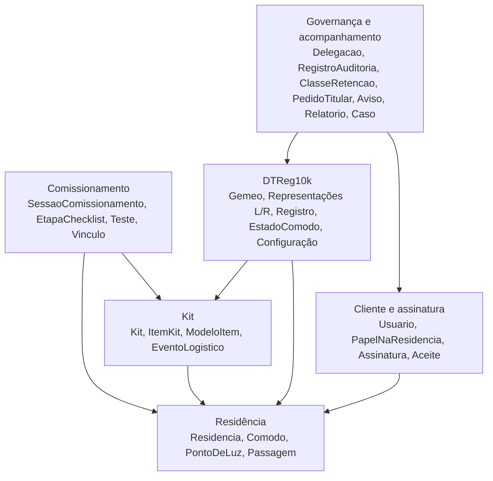

**Figura 2 — Pacotes do domínio e dependências.** A seta indica "depende de".

### 2.2 Diagramas de classes — cliente, residência, kit e comissionamento

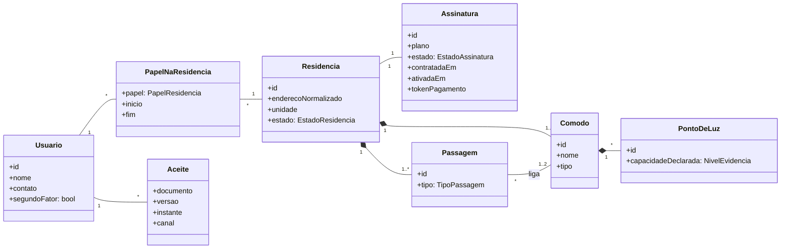

**Figura 3 — Classes de cliente e residência.** A `Passagem` liga dois cômodos (INTERNA) ou um cômodo ao exterior (EXTERNA); é onde fica o SA (A14).

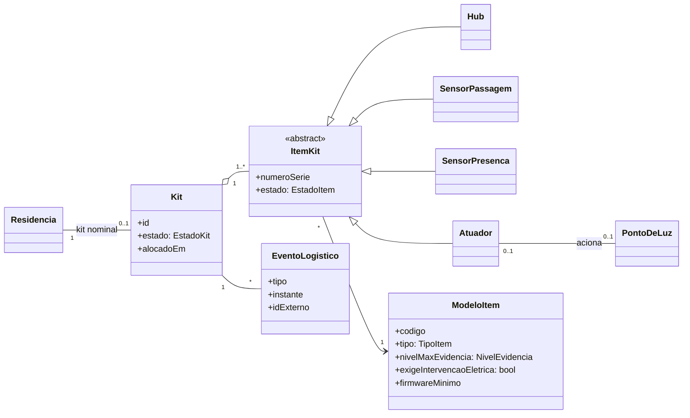

**Figura 4 — Classes do kit.** `Residencia` e `PontoDeLuz` aparecem sem atributos porque estão detalhadas na Figura 3.

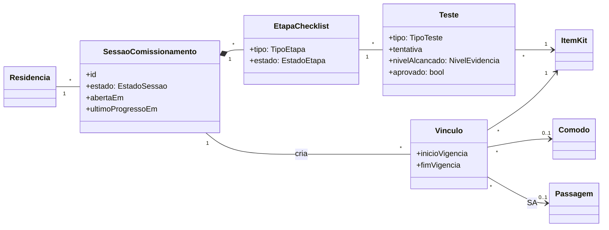

**Figura 5 — Classes de comissionamento.** O vínculo aponta para um cômodo ou, no caso do SA, para uma passagem (INV-15). `Residencia`, `Comodo`, `Passagem` e `ItemKit` aparecem sem atributos porque estão detalhadas nas Figuras 3 e 4.

### 2.3 Diagrama de classes — DTReg10k e operação

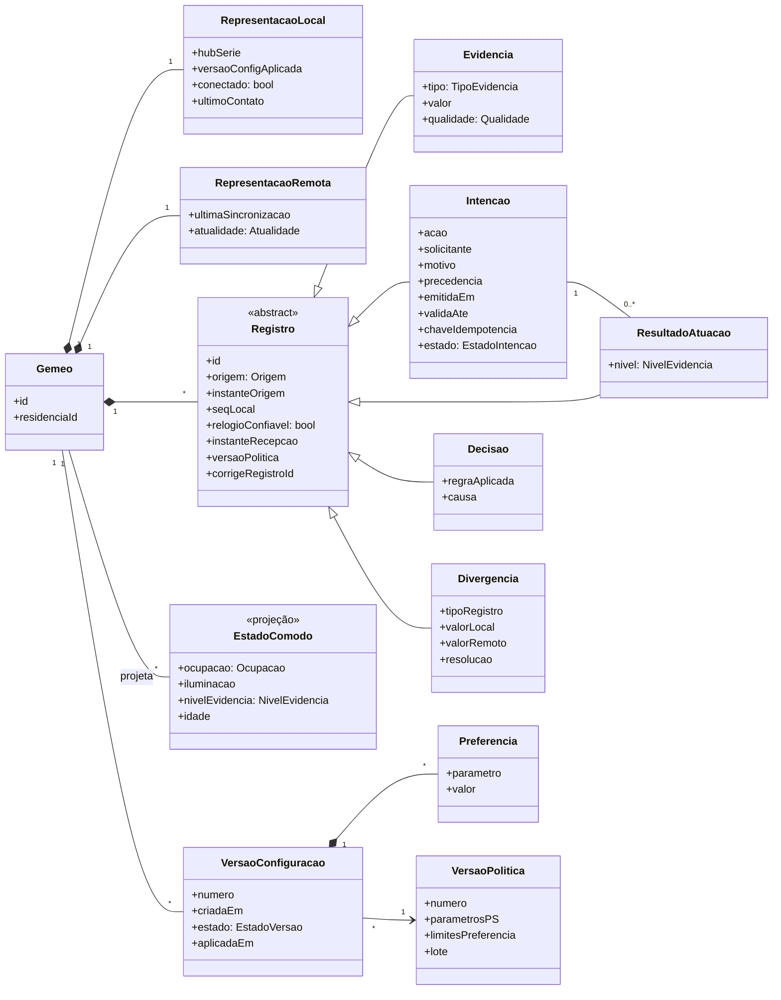

**Figura 6 — Classes do DTReg10k.** `Gemeo` liga-se 1–1 a `Residencia` (Figura 3). `EstadoComodo` é uma projeção recalculável a partir de `Registro` (INV-06).

### 2.4 Diagrama de classes — governança e acompanhamento

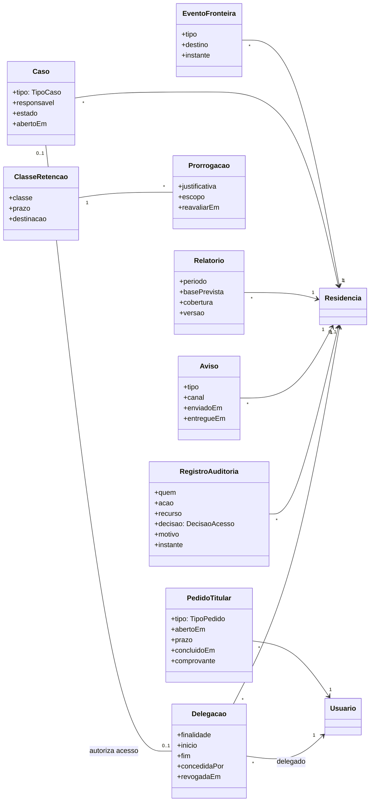

**Figura 7 — Classes de governança e acompanhamento.**

### 2.5 Dicionário de classes

| Classe | Responsabilidade | Atributos-chave | Regras e requisitos |
|---|---|---|---|
| Usuario | Pessoa que usa a plataforma (cliente ou equipe Reg10k) | id, contato, segundoFator | RF-GOV-01 |
| PapelNaResidencia | Papel de um usuário em uma residência, com vigência | papel (TITULAR, MEMBRO_CONSULTA, MEMBRO_CONTROLE, MEMBRO_INSTALACAO) | RN32; INV-11; RF-ACO-06 |
| Assinatura | Contrato de serviço e seus estados | estado, ativadaEm, tokenPagamento | RN19, RN20, RN29; INV-05; RF-ADE-06 |
| Aceite | Evidência de aceite de documento versionado | documento, versao, instante | RF-ADE-02, RF-GOV-08 |
| Residencia | Unidade atendida; raiz de isolamento | enderecoNormalizado, unidade, estado | RN05; INV-13; RF-ADE-04 |
| Comodo / PontoDeLuz | Estrutura física e capacidade declarada por ponto de luz | capacidadeDeclarada | RN02; INV-08 |
| Passagem | Porta entre dois cômodos, ou entre um cômodo e o exterior; onde fica o SA | tipo (INTERNA, EXTERNA), cômodos ligados | A14; INV-15 |
| Kit | Conjunto nominal alocado a uma residência | estado (alocado, expedido, entregue, confirmado, devolvido) | RN24; RF-KIT-03 |
| ItemKit (Hub, SensorPassagem, SensorPresenca, Atuador) | Dispositivo físico identificado por série | numeroSerie, estado | INV-01, INV-02 |
| ModeloItem | Capacidades do kit de referência | nivelMaxEvidencia, exigeIntervencaoEletrica (sempre falso no kit DIY) | RF-KIT-01; RNF-EVO-01; INV-16 |
| EventoLogistico | Fato externo de expedição, entrega ou devolução | idExterno (idempotência) | RF-KIT-04 |
| SessaoComissionamento | Unidade de trabalho do comissionamento DIY | estado, ultimoProgressoEm | RF-COM-01, RF-COM-11; PS13 |
| EtapaChecklist / Teste | Evidência de cada etapa e teste | nivelAlcancado, tentativa | RN26; INV-04; RF-COM-06 |
| Vinculo | Item ↔ cômodo (ou SA ↔ passagem), com vigência | inicioVigencia, fimVigencia | RN05; INV-01, INV-02, INV-15 |
| Gemeo | DTReg10k da residência, com duas representações | — | A08; INV-03 |
| RepresentacaoLocal / Remota | Estado de cada representação e da sincronização | versaoConfigAplicada, atualidade | RN27; INV-14 |
| Registro (abstrato) | Fato imutável com origem e ordem | origem, seqLocal, relogioConfiavel | RN12; INV-06 |
| Evidencia, Intencao, ResultadoAtuacao, Decisao, Divergencia | Tipos de registro | validaAte, chaveIdempotencia, nivel | RN02, RN07, RN11, RN28; INV-07, INV-10 |
| EstadoComodo | Projeção para consulta: ocupação, iluminação, nível, idade | idade, nivelEvidencia | RNF-USA-03; INV-09 |
| VersaoConfiguracao / Preferencia / VersaoPolitica | Configuração-alvo versionada e seus limites | estado (pendente, aplicada, recusada) | RN23, RN27, RN28 |
| Delegacao | Acesso temporário com finalidade | fim, revogadaEm | RN15; INV-12 |
| RegistroAuditoria | Decisão de acesso, inclusive negação | decisao, motivo | RF-GOV-04; RNF-SEG-05 |
| ClasseRetencao / Prorrogacao | Prazo e destinação por classe | prazo, reavaliarEm | RF-GOV-07; RNF-PRI-01 |
| PedidoTitular | Pedido de direito do titular | tipo, prazo, comprovante | RN33; RF-GOV-09 |
| Aviso / Relatorio | Comunicação ao usuário | enviadoEm, entregueEm, cobertura | RN10; RF-ACO-04, RF-ACO-05 |
| Caso / EventoFronteira | Trabalho humano ou saída para processo externo | responsavel, destino | V1 §11 |

### 2.6 Enumerações

| Enumeração | Valores |
|---|---|
| EstadoResidencia | ADERIDA, RECUSADA, AGUARDANDO_KIT, KIT_EM_TRANSITO, KIT_ENTREGUE, EM_COMISSIONAMENTO, PAUSADA, EM_REVISAO, ATIVA, ATIVA_DEGRADADA, SUSPENSA, CANCELADA |
| EstadoAssinatura | CONTRATADA, ATIVA, INADIMPLENTE, SUSPENSA, CANCELADA |
| EstadoSessao | ABERTA, PAUSADA, EM_REVISAO, CONCLUIDA, ABANDONADA, CANCELADA |
| NivelEvidencia (ordenado) | SEM_EVIDENCIA < ENVIADO < RECEBIDO < EXECUCAO_RELATADA < EFEITO_OBSERVADO |
| EstadoIntencao | SOLICITADA, REJEITADA, ENVIADA, EXPIRADA, RECEBIDA, EXECUCAO_RELATADA, EFEITO_OBSERVADO, DESCONHECIDA |
| Ocupacao | OCUPADO, VAZIO, DESCONHECIDA |
| Origem | LOCAL, REMOTA |
| Atualidade | ATUAL, DESATUALIZADO, SEM_EVIDENCIA |
| EstadoVersao | PENDENTE, APLICADA, RECUSADA |
| TipoTeste | PASSAGEM, PRESENCA, AUSENCIA, ACIONAMENTO, AUTONOMIA |
| TipoCaso | REVISAO_ATIVACAO, SUPORTE, ABANDONO, DUPLICIDADE, LOGISTICA |
| DecisaoAcesso | PERMITIDO, NEGADO |
| TipoPassagem | INTERNA, EXTERNA |
| PapelResidencia | TITULAR, MEMBRO_CONSULTA, MEMBRO_CONTROLE, MEMBRO_INSTALACAO |
| EstadoKit | ALOCADO, EXPEDIDO, ENTREGUE, CONFIRMADO, EM_DEVOLUCAO, DEVOLVIDO |
| EstadoItem | EM_ESTOQUE, ALOCADO, VIGENTE, SUBSTITUIDO, DEVOLVIDO |
| TipoItem | HUB, SENSOR_PASSAGEM, SENSOR_PRESENCA, ATUADOR |
| TipoEtapa | REIVINDICACAO, PROVISIONAMENTO, VINCULO, TESTE, ENSAIO_AUTONOMIA, PREFERENCIAS |
| EstadoEtapa | PENDENTE, EM_EXECUCAO, COM_EVIDENCIA, FALHOU |
| TipoEvidencia | PASSAGEM, PRESENCA, AUSENCIA, ACIONAMENTO_MANUAL, RESULTADO_ATUACAO, SAUDE |
| Qualidade | VALIDA, DEGRADADA, SUSPEITA |
| TipoPedido | ACESSO, CORRECAO, PORTABILIDADE, ELIMINACAO |

### 2.7 Invariantes (esquema invariante)

Expressas em notação próxima de OCL.

| ID | Invariante | Regra |
|---|---|---|
| INV-01 | `context ItemKit inv: vinculos->select(fimVigencia = null)->size() <= 1` | RN05 |
| INV-02 | `context Vinculo inv: item.kit.residencia = (if passagem <> null then passagem.residencia else comodo.residencia endif)` | RN24 |
| INV-03 | `context Residencia inv: gemeo->size() = 1 and kit.itens->select(oclIsKindOf(Hub) and estado = VIGENTE)->size() <= 1` | A08; RN05 |
| INV-04 | `context Residencia inv: estado = ATIVA implies sessoes->exists(s | s.estado = CONCLUIDA and (s.etapas->forAll(e | e.estado = COM_EVIDENCIA) or s.casoRevisao.aceite = IMP))` | RN26 |
| INV-05 | `context Assinatura inv: estado = ATIVA implies residencia.ativadaEm <> null` | RN20 |
| INV-06 | `context Registro inv: imutável após criação; correção somente por novo Registro com corrigeRegistroId` | RN12 |
| INV-07 | `context Intencao inv: estado in {RECEBIDA, EXECUCAO_RELATADA, EFEITO_OBSERVADO} implies recebidaEm <= validaAte` | PS01; RN04 |
| INV-08 | `context ResultadoAtuacao inv: nivel <= pontoDeLuz.capacidadeDeclarada` | RN02 |
| INV-09 | `context EstadoComodo inv: ocupacao = VAZIO implies (agora - ultimaDeteccao >= T_apagamento) and spSaudavel` (T_apagamento padrão 60 s) | RN01; PS05 (A13) |
| INV-10 | `context Gemeo inv: registros->select(oclIsKindOf(Intencao))->isUnique(chaveIdempotencia)` | RN11 |
| INV-11 | `context Residencia inv: papeis->select(papel = TITULAR and fim = null)->size() = 1` (exceto ADERIDA antes do aceite) | RN32 |
| INV-12 | `context Delegacao inv: fim <= inicio + 4h` | PS10, PS15 |
| INV-13 | `context Residencia inv: Residencia.allInstances()->select(estado <> CANCELADA)->isUnique(enderecoNormalizado + unidade)` | RN05 |
| INV-14 | `context Gemeo inv: representacaoLocal.versaoConfigAplicada <= versaoVigenteRemota` | RN27 |
| INV-15 | `context Vinculo inv: if item.oclIsKindOf(SensorPassagem) then passagem <> null and comodo = null else comodo <> null and passagem = null endif` | A14 |
| INV-16 | `context Kit inv: itens->forAll(i | not i.modelo.exigeIntervencaoEletrica)` | A09; RN25 |

### 2.8 Classificação dos dados

| Classe de dado | Classes do modelo | Classificação | Retenção | Acesso |
|---|---|---|---|---|
| Identificação e contrato | Usuario, Residencia, Assinatura, Aceite | Pessoal | Vigência + 180 dias ou prazo legal | TIT; Reg10k por finalidade |
| Pagamento | Assinatura.tokenPagamento | Pessoal (sem dado de cartão) | Prazo legal | COM |
| Comportamental | Evidencia (presença), EstadoComodo | **Pessoal sensível ao contexto** (revela rotina) | Detalhe 30 dias | TIT, MEM; SUP com delegação |
| Operacional | Intencao, Decisao, ResultadoAtuacao, Sessao, Teste, Vinculo | Pessoal | 180 dias ou vigência + 180 dias | TIT; SUP com delegação |
| Técnico | ItemKit, ModeloItem, saúde do hub | Pseudonimizável | Vigência + 180 dias | OPE |
| Governança | RegistroAuditoria, PedidoTitular, Delegacao | Pessoal | 12 meses ou prazo legal | GOV |

---

## 3. Modelagem dinâmica e computacional (V3)

### 3.1 Objetos computacionais

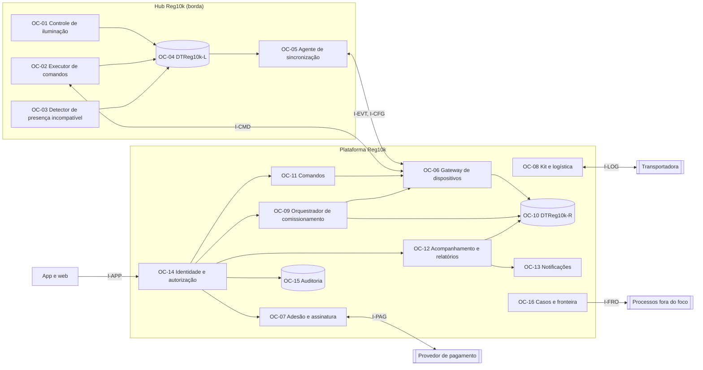

**Figura 8 — Objetos computacionais e interfaces.** Bordas duplas indicam sistemas externos ou fora do foco.

| Código | Objeto | Responsabilidade | Realiza |
|---|---|---|---|
| OC-01 | Controle de iluminação (hub) | Decisão local, precedência, contingência | RF-OPR-01, RF-OPR-02 |
| OC-02 | Executor de comandos (hub) | Validar validade, autorização, precedência e idempotência; classificar resultado | RF-OPR-03, RF-OPR-04, RF-OPR-05, RF-OPR-08 |
| OC-03 | Detector de presença incompatível (hub) | Verificação a cada 5 min e conciliação | RF-OPR-06 |
| OC-04 | DTReg10k-L | Registros locais e configuração aplicada | RF-SYN-01, RF-SYN-05 |
| OC-05 | Agente de sincronização (hub) | Publicação, resumo de 30 s, fila persistente, reconexão ordenada | RF-SYN-01 a RF-SYN-04, RF-SYN-06 |
| OC-06 | Gateway de dispositivos | Autenticação mútua, roteamento por residência, controle de admissão | RNF-SEG-01, RNF-CON-06 |
| OC-07 | Adesão e assinatura | Conta, aceites, elegibilidade, assinatura | RF-ADE-01 a RF-ADE-08 |
| OC-08 | Kit e logística | Catálogo, fila, alocação nominal, eventos da transportadora | RF-KIT-01 a RF-KIT-06 |
| OC-09 | Orquestrador de comissionamento | Sessão, reivindicação, provisionamento, vínculos, testes, ensaio, ativação | RF-COM-01 a RF-COM-11 |
| OC-10 | DTReg10k-R | Registros consolidados, projeções, versões, divergências, reconstrução | RF-SYN-05 a RF-SYN-07, RF-OPR-07, RF-GOV-05, RF-GOV-06 |
| OC-11 | Comandos | Criar intenções, correlacionar resultados | RF-OPR-03, RF-OPR-04 |
| OC-12 | Acompanhamento e relatórios | Painéis, histórico, tempo real, relatórios, painel agregado | RF-ACO-01 a RF-ACO-03, RF-ACO-05, RF-ACO-07, RF-ACO-08 |
| OC-13 | Notificações | Avisos multicanal com envio e entrega | RF-ACO-04 |
| OC-14 | Identidade e autorização | Autenticação, papéis, membros, delegações, decisões de acesso | RF-GOV-01 a RF-GOV-03, RF-ACO-06 |
| OC-15 | Auditoria | Registro íntegro de acessos e decisões | RF-GOV-04 |
| OC-16 | Casos e fronteira | Casos para IMP e SUP, retenção, direitos do titular, eventos para processos externos | RF-GOV-07 a RF-GOV-10, RF-COM-11, RF-OPR-09 |

### 3.2 Interfaces

| Interface | Entre | Conteúdo | Aspectos não funcionais do contrato |
|---|---|---|---|
| I-EVT | Hub → plataforma | Evidências, decisões, resultados, resumo de 30 s | Identificador único, seqLocal, relogioConfiavel; entrega pelo menos uma vez (RNF-CON-07); p95 ≤ 5 s (RNF-DES-01); versão N/N-1 (RNF-EVO-02) |
| I-CMD | Plataforma → hub | Intenção com validaAte e chave de idempotência; resposta com nível | Expiração no transporte e no hub (INV-07); p95 ≤ 3 s (RNF-DES-02) |
| I-CFG | Plataforma → hub | Configuração, política, permissões, estado de assinatura; confirmação de versão | Assinatura digital (RNF-SEG-06); versão monotônica (INV-14) |
| I-COM | App → plataforma | Sessão, reivindicação, vínculo, testes, ensaio | Autorização por papel de instalação (RF-COM-02); 1.000 sessões (RNF-DES-05) |
| I-APP | App e web → plataforma | Consultas, preferências, membros, pedidos do titular, assinatura de eventos | Autorização por residência (RNF-SEG-02); 10.000 sessões (RNF-DES-07); acessibilidade (RNF-USA-05) |
| I-PAG | Plataforma ↔ provedor | Autorização, cobrança, estado, contestação | Token sem dado de cartão (RNF-SEG-07); idempotência; falha não afeta MP3 (RNF-CMP-02) |
| I-LOG | Transportadora → plataforma | Expedição, entrega, devolução | Idempotência por idExterno; falha não afeta MP3 (RNF-CMP-02) |
| I-NOT | Plataforma → canais | Avisos | Envio separado de entrega (RF-ACO-04) |
| I-FRO | Plataforma → processos externos | Eventos de fronteira (ocorrências, manutenção, visita, encerramento) | Entrega garantida com confirmação de aceite pelo destino |

### 3.3 Cenários funcionais

Cada cenário mostra o fluxo principal, as alternativas e, em notas «RNF», os requisitos não funcionais que restringem o trecho.

#### CF01 — Adesão no pico do lançamento (realiza CV25, CV35)

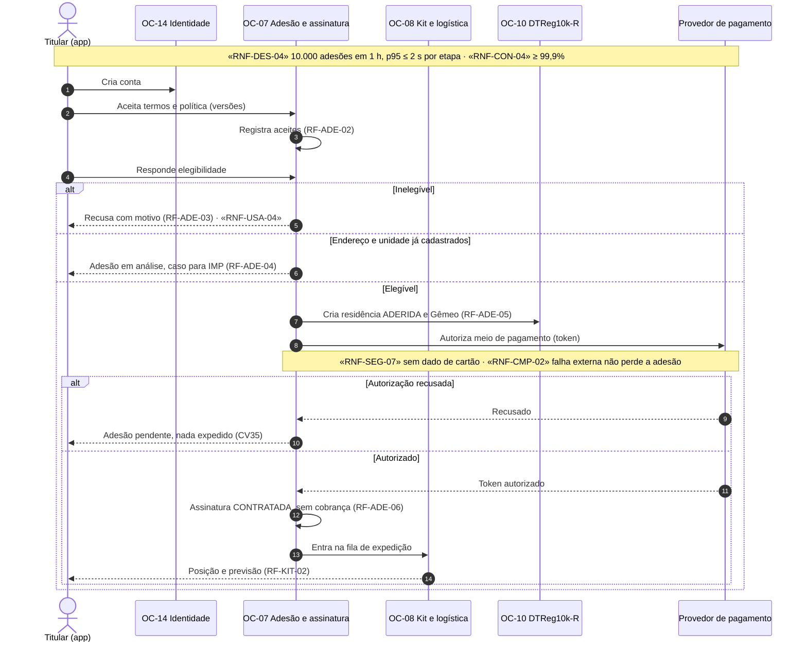

**Figura 9 — CF01.**

#### CF02 — Reivindicação do hub e provisionamento (realiza CV01, CV33)

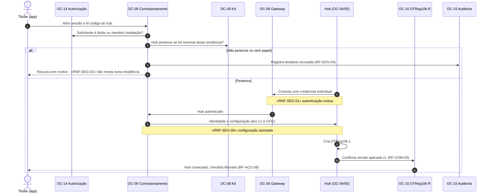

**Figura 10 — CF02.**

#### CF03 — Vínculo, testes, ensaio de autonomia e ativação (realiza CV14, CV27, CV28, CV32)

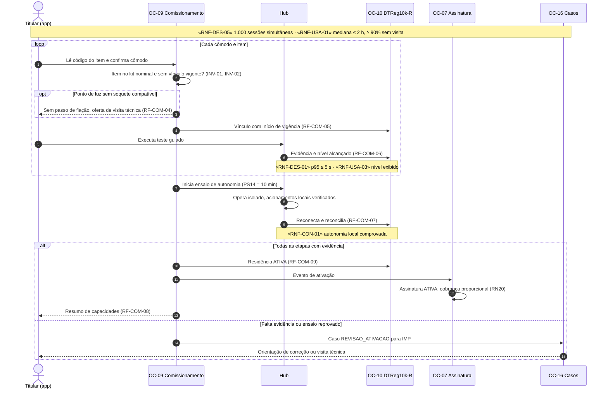

**Figura 11 — CF03.**

#### CF04 — Comando remoto pelo app (realiza CV04, CV05, CV08)

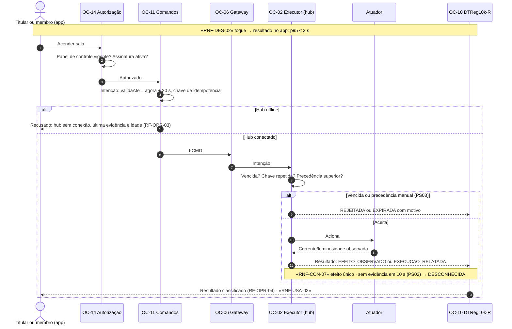

**Figura 12 — CF04.**

#### CF05 — Decisão local com presença desconhecida (realiza CV02, CV03, CV15)

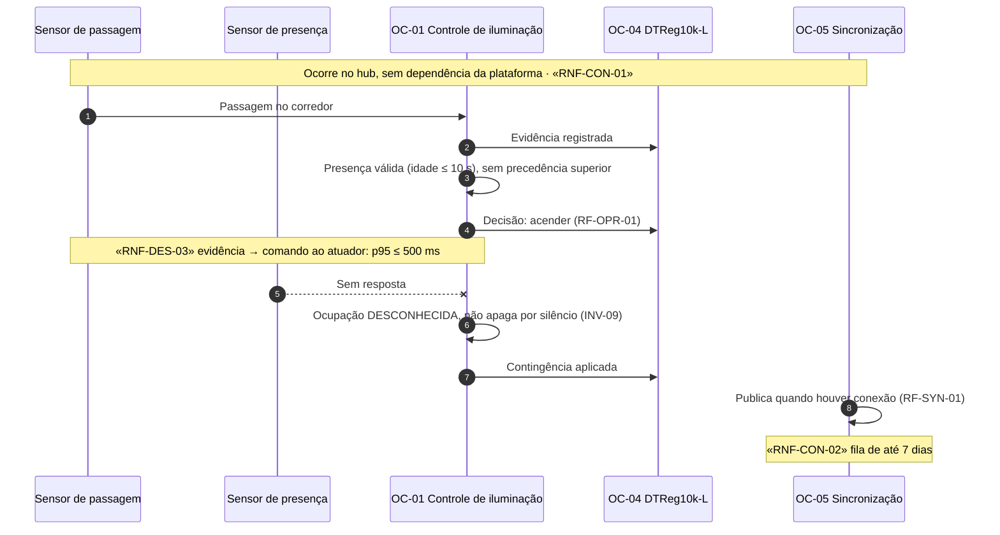

**Figura 13 — CF05.**

#### CF06 — Reconexão e reconciliação com preferência pendente (realiza CV05, CV29)

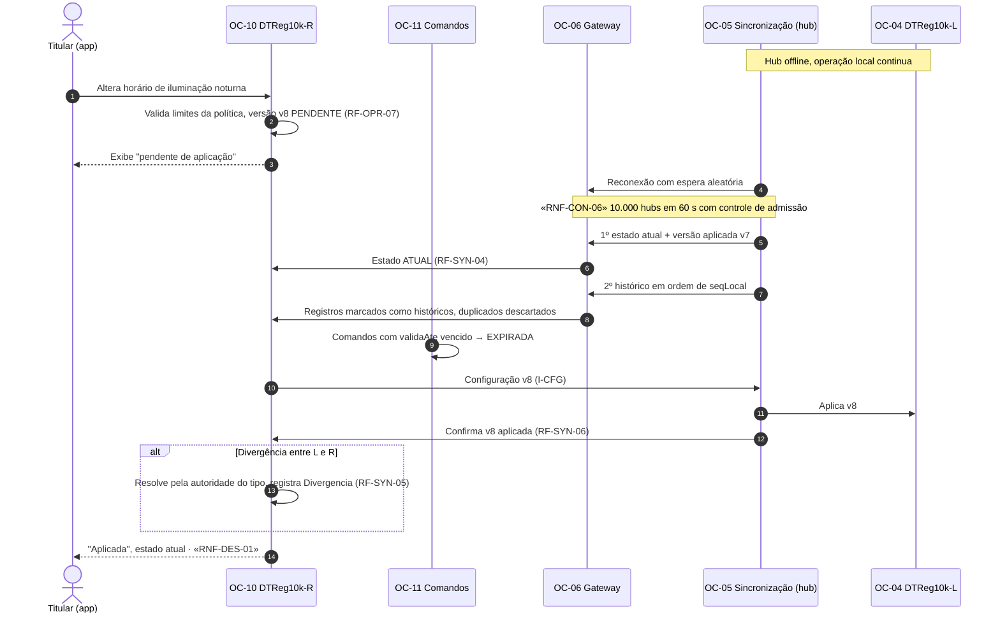

**Figura 14 — CF06.**

#### CF07 — Revogação de membro e consulta negada (realiza CV09, CV30)

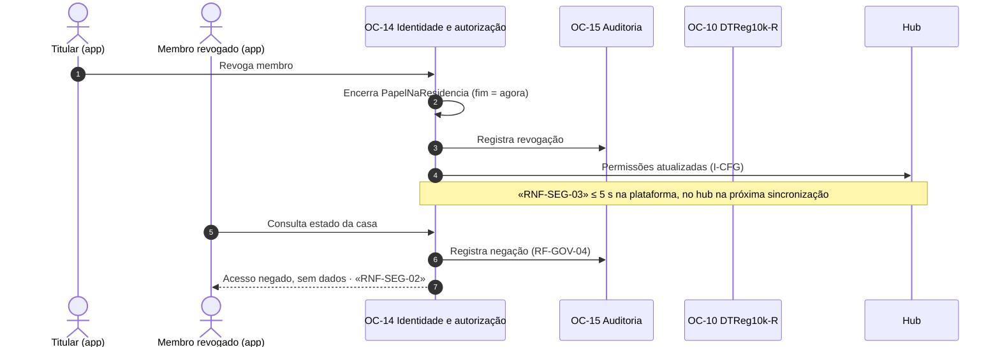

**Figura 15 — CF07.**

#### CF08 — Suspensão e reativação da assinatura (realiza CV22)

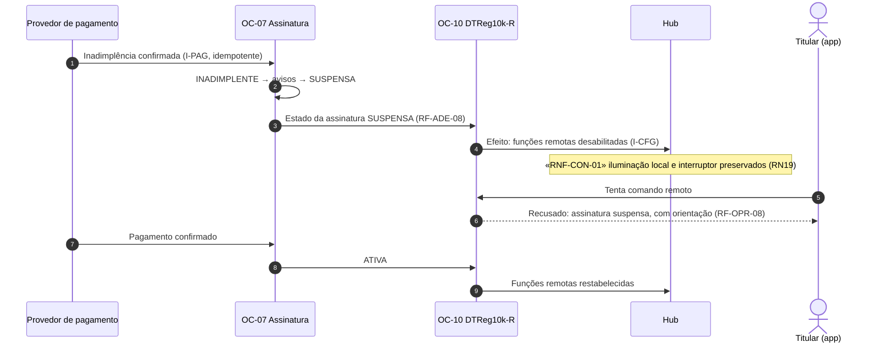

**Figura 16 — CF08.**

#### CF09 e CF10 — Cenários descritos em tabela

| Cenário | Gatilho | Fluxo principal | Alternativas | Requisitos | RNF destacados |
|---|---|---|---|---|---|
| CF09 Pedido de eliminação de dados (CV34) | Titular solicita eliminação no app | OC-14 autentica → OC-16 abre PedidoTitular com prazo → identifica dados por classe → elimina o que não tem retenção obrigatória → emite comprovante com o que foi mantido e por quê → auditoria | Assinatura ativa: eliminação implica encerramento, com confirmação explícita | RF-GOV-09, RF-GOV-07, RF-GOV-04 | RNF-PRI-03 (prazo legal), RNF-PRI-01, RNF-SEG-05 |
| CF10 Relatório mensal (CV13) | Fechamento do mês | OC-12 fixa período e base prevista → calcula cobertura por residência → marca lacunas → publica versão → OC-13 avisa o titular | Residência sem evidência no período: relatório parcial identificado, sem zeros | RF-ACO-05, RF-ACO-04 | RNF-DES-08 (lote sem degradar sincronização), RNF-PRI-02 |

### 3.4 Máquinas de estados

#### Intenção (comando remoto)

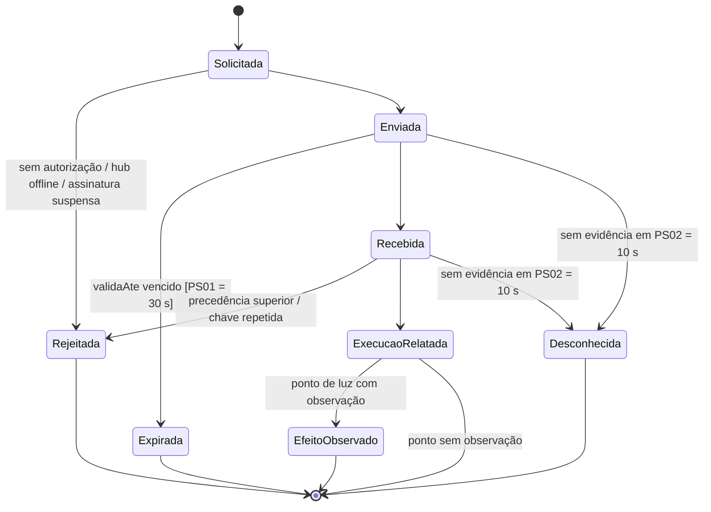

**Figura 17 — Estados da Intenção.** Restrições não funcionais: RNF-DES-02 (p95 ≤ 3 s até o estado final), RNF-CON-07 (efeito único), INV-07.

#### Sessão de comissionamento

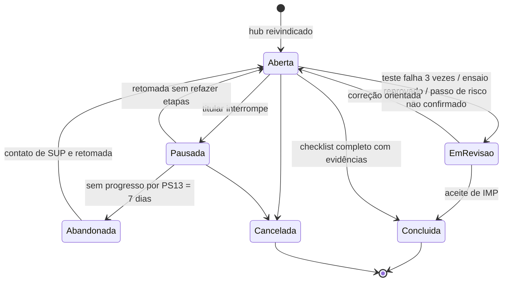

**Figura 18 — Estados da sessão de comissionamento.** Restrições: RNF-USA-01, RNF-DES-05, INV-04.

#### Assinatura

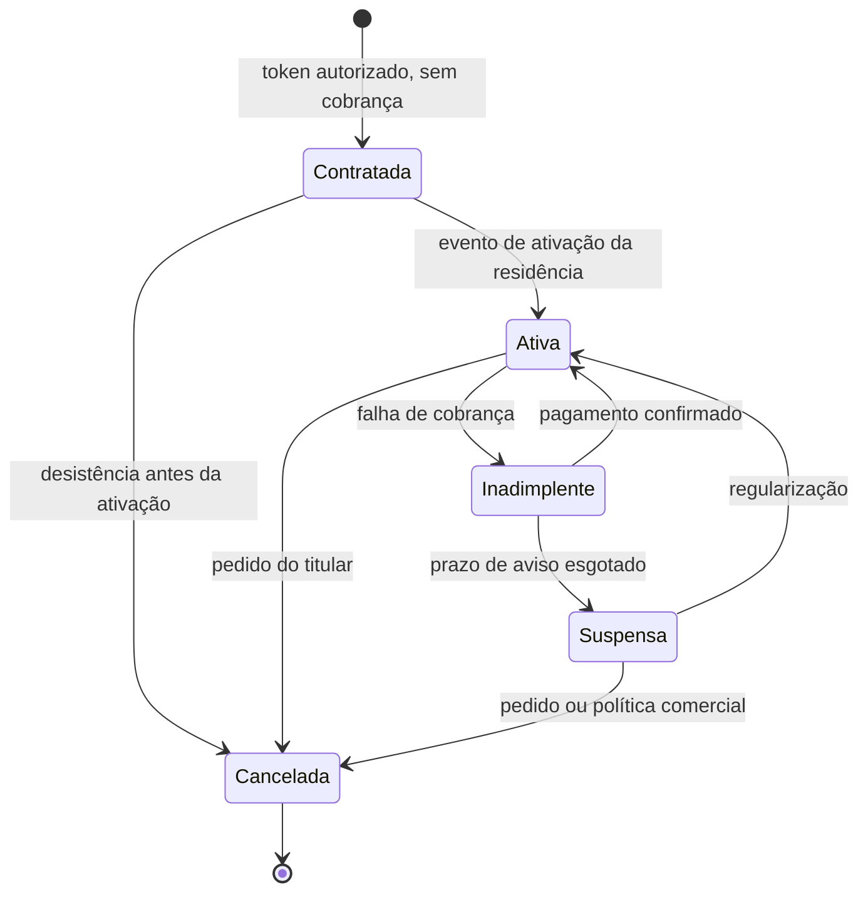

**Figura 19 — Estados da assinatura.** Restrições: INV-05, RNF-SEG-07, RNF-CMP-02. Em `Suspensa`, vale RNF-CON-01.

#### Versão de configuração

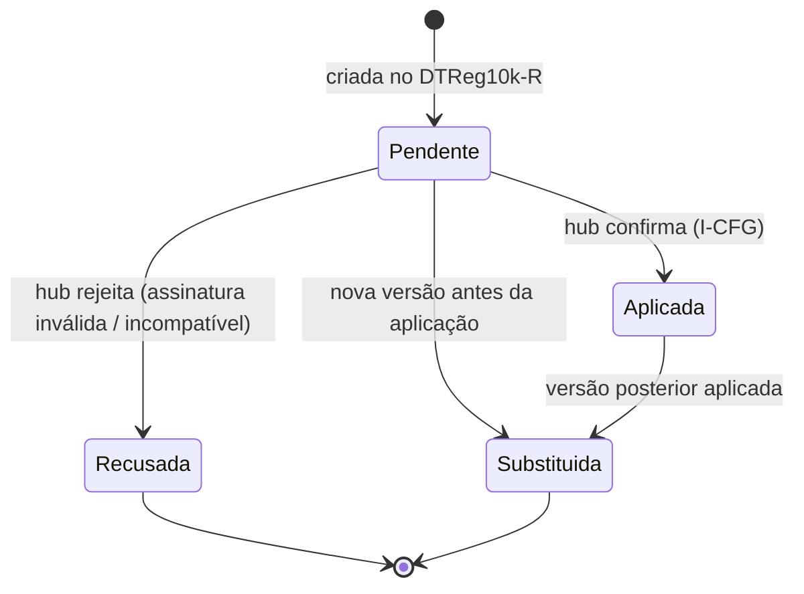

**Figura 20 — Estados da versão de configuração.** Restrições: INV-14, RNF-SEG-06, RNF-EVO-02.

### 3.5 Matriz cenário × requisitos não funcionais

| Cenário | DES | CON | SEG | PRI | USA | EVO | CMP |
|---|---|---|---|---|---|---|---|
| CF01 Adesão | 04 | 04 | 07 | — | 04 | — | 02 |
| CF02 Reivindicação | — | — | 01, 02, 06 | — | 04 | 02 | — |
| CF03 Comissionamento | 01, 05 | 01 | — | — | 01, 02, 03 | — | — |
| CF04 Comando remoto | 02 | 07 | 02 | — | 03 | — | — |
| CF05 Decisão local | 03 | 01, 02 | — | — | — | — | — |
| CF06 Reconexão | 01 | 05, 06, 07 | 06 | — | 03 | 02 | — |
| CF07 Revogação | — | — | 02, 03, 05 | 02 | — | — | — |
| CF08 Suspensão | — | 01 | 07 | — | 04 | — | 02 |
| CF09 Eliminação | — | — | 05 | 01, 03 | — | — | — |
| CF10 Relatório | 08 | — | — | 02 | 03 | 04 | — |

Os números referem-se ao sufixo do RNF (por exemplo, DES 04 = RNF-DES-04).

### 3.6 Validação na simulação v0dt

A v0dt do ambiente de simulação da disciplina PCS5039 (repositório ReginaldoArakaki/PCS5039_ambiente_reg10k_vCl0, tag `v0dt`) realiza, para uma sala com um morador e um cachorro de grande porte, os objetos OC-02, OC-04, OC-05, OC-10 e OC-11 e as interfaces I-EVT, I-CMD e I-CFG. Nenhum valor desta seção é medição de sistema real: são resultados de simulação determinística (semente 42, mais 30 sementes no canal realista) que verificam se o modelo é consistente e executável [R15].

#### 3.6.1 Requisitos exercitados

| Requisito | Como a v0dt o realiza | Cenários | Resultado (referência) |
|---|---|---|---|
| RF-SYN-01, RF-SYN-02 | O agente de sincronização publica cada evento com número de sequência e um resumo a cada 30 s | DT08, DT11 | Atualidade p95 de 100 ms no canal ideal; 342 ms de mediana e 3,3 s no pior caso entre 30 sementes no canal realista |
| RF-SYN-03, RNF-CON-02 | Fila persistente no hub durante a queda; sobrevive ao reinício | DT05, DT07, DT10 | Fila máxima de 15 eventos; 0 evento não entregue |
| RF-SYN-04, RNF-CON-06 | Espera exponencial de 1 s a 30 s; estado atual antes do histórico | DT05, DT07, DT10 | Reconciliação em 100 ms após a sessão voltar |
| RF-SYN-05 | Divergência registrada e resolvida pela autoridade do hub (RN27) | DT05 | 1 divergência (ocupação) registrada e resolvida |
| RF-SYN-06, RF-OPR-07, INV-14 | Versão de configuração pendente até a confirmação do hub; distribuída na reconexão | DT06 | Versão 2 aplicada 1 s após a reconexão; a luz passa a apagar em 120 s |
| RF-OPR-03, RNF-DES-02 | Comando remoto com validade de 30 s, chave e recusa com motivo | DT01, DT02, DT09 | 850 ms do toque ao resultado; recusa imediata com o hub desconectado |
| RF-OPR-04 | Classificação: efeito observado, rejeitada, expirada, desconhecido (PS02) | DT01, DT03, DT09 | Todos os níveis exercitados |
| RF-OPR-05, RNF-CON-07, INV-10 | Chave de idempotência no hub; número de sequência na plataforma | DT04, DT08 | 0 efeito duplicado |
| INV-07 | Comando que chega vencido é recusado no hub | DT03 | 0 comando vencido executado |
| RF-ACO-01, RNF-USA-03 | O app mostra idade e o selo atual ou desatualizado | DT02, DT10, DT12 | O app nunca mostra "atual" sem sessão ou com mais de 60 s |
| RNF-CON-01 | A casa funciona sem a plataforma | DT05, DT07 | Decisões locais idênticas às da execução sem a falha de rede |

#### 3.6.2 Invariantes do oráculo e invariantes V2

| Oráculo | Verificação | Invariante ou requisito V2/V3 |
|---|---|---|
| OR-07 | Nenhuma intenção remota aceita ou executada depois de validaAte | INV-07 |
| OR-08 | O DTReg10k-R e o app nunca dizem "atual" sem sessão ou com estado de mais de 60 s | RNF-USA-03; PS06 |
| OR-09 | Estado aplicado no DTReg10k-R só avança; histórico não substitui estado mais recente | RN12; INV-06 |
| OR-10 | Versão aplicada no hub ≤ versão vigente; pendente termina resolvida | INV-14 |
| OR-11 | Cada comando remoto produz no máximo uma intenção | INV-10 |
| OR-12 | Com a rede ou a plataforma fora, as decisões locais são idênticas (execução pareada) | RNF-CON-01 |

#### 3.6.3 Refinamentos que a simulação trouxe

| ID | Achado | Efeito no modelo | Marca |
|---|---|---|---|
| RS-01 | A idade no DTReg10k-R precisa ser medida pela recepção, no relógio da plataforma: com o relógio do hub saltando (DT11), a idade calculada pela origem regride | RF-ACO-01 e RepresentacaoRemota.atualidade: idade = agora − recepção do último estado | N |
| RS-02 | Depois de uma queda de sessão, um estado ainda "jovem" (menos de 60 s) não pode voltar a ser "atual" antes de chegar o estado novo do hub (DT10) | RF-SYN-04: a atualidade só é restabelecida por um estado recebido depois da reconexão | N |
| RS-03 | A queda da sessão marca o DTReg10k-R como desatualizado na hora, sem esperar os 60 s de PS06 | RNF-USA-03: "desatualizado" quando a sessão cai ou a idade passa de PS06 | N |
| RS-04 | O comando remoto precisa de lugar explícito na precedência [R10 §7.2]: abaixo da intervenção manual e acima da rotina de ocupação, por PS03 (15 min) | RF-OPR-03; proposta de regra para a V1 (RN-DT-09 na simulação) | P |
| RS-05 | Com 1% de perda, a atualidade p95 depende do temporizador de reenvio (3 s na simulação): em 2 de 30 sementes ficou perto de 3,3 s | Encaminhamento para V4: reenvio menor que PS11 menos a latência do canal | P |
| RS-06 | A divergência L × R é inevitável durante a propagação; o critério verificável é "nenhuma divergência além do prazo de sincronização (PS11)" | Critério de aceite de RNF-DES-01 | N |
| RS-07 | O espelho visual (v0dta) mostrou que, mesmo com o canal realista, a diferença entre a casa real e o que o titular vê vem quase toda da percepção local (sensores, controlador, T_apagamento), e só décimos de segundo da sincronização | RepresentacaoRemota ganha uma visão derivada, o "cômodo espelho", com a fidelidade em quatro classes (fiel, percepção, sincronização, não afirma); a incerteza declarada (RN01) conta como "não afirma", nunca como erro | N |

---

## 4. Checklist de qualidade da modelagem de requisitos

Critérios baseados na ISO/IEC/IEEE 29148:2018 (qualidade de requisitos individuais e do conjunto) e na coerência entre visões RM-ODP. Resultado: **Atende**, **Parcial** ou **Pendente**. As contagens foram conferidas por script sobre este arquivo.

### 4.1 Requisitos individuais

| # | Critério | Resultado | Evidência e observação |
|---|---|---|---|
| Q01 | **Necessário:** todo requisito tem origem na V1 ou é marcado como novo | Atende | 59 RF e 41 RNF com origem; 4 RNF novos marcados **N** (RNF-DES-03, RNF-CON-04, RNF-USA-05, RNF-CMP-01), a aceitar (PD05) |
| Q02 | **Singular:** cada requisito expressa uma capacidade | Parcial | RF-ADE-06 e RF-COM-09 agregam estados ou efeitos encadeados; manter, mas testar por subcritério |
| Q03 | **Inequívoco:** termos definidos no glossário da V1 ou nas enumerações | Atende | Níveis de evidência, estados e papéis enumerados (§2.6) |
| Q04 | **Verificável:** método de verificação indicado | Atende | Todos os RF e RNF têm T, D, I ou A |
| Q05 | **Mensurável (RNF):** métrica e meta numérica ou critério objetivo | Parcial | RNF-DES-08 depende de PS09 sem valor. RNF-LEG-04 deixou de depender de D09 (A09) |
| Q06 | **Viável:** metas compatíveis com a arquitetura de referência (R11) | Atende | Volumes de §1.2 são os da V1 e de R11 §3.5, com margem 5× |
| Q07 | **Livre de solução:** sem escolha de tecnologia | Atende | Protocolos, produtos e fornecedores ficam para V5 |
| Q08 | **Priorizado:** MoSCoW atribuído | Atende | 51 M e 8 S entre os RF; RNF tratados como condição de lançamento |

### 4.2 Conjunto de requisitos

| # | Critério | Resultado | Evidência e observação |
|---|---|---|---|
| Q09 | **Completo em relação à V1:** toda RNP tem requisito | Atende | 49 de 49 RNP rastreadas (§1.3) |
| Q10 | **Consistente:** sem metas conflitantes | Atende | RNF-DES-02 (3 s) é menor que PS01 (30 s); RNF-SEG-03 depende de RNF-DES-01, coerente |
| Q11 | **Cobertura de qualidade:** todas as características ISO 25010 relevantes consideradas | Atende | DES, CON, SEG, PRI, USA, EVO, CMP, LEG; portabilidade tratada em CMP |
| Q12 | **Decisões não confirmadas sinalizadas** | Atende | D09 e D13 decididas (A09–A11); nenhuma decisão aberta afeta os requisitos desta versão |
| Q13 | **Validado por partes interessadas** | Pendente | Sem aceite de SER, IMP, OPE e GOV |

### 4.3 Modelo estático (V2)

| # | Critério | Resultado | Evidência e observação |
|---|---|---|---|
| Q14 | Toda entidade citada nos RF tem classe correspondente | Atende | 42 classes em cinco diagramas e dicionário (§2.5), incluindo Passagem (A14) |
| Q15 | Multiplicidades explícitas nas associações | Atende | Todas as associações dos diagramas de classe têm multiplicidade |
| Q16 | Regras estruturais da V1 expressas como invariantes | Atende | 16 invariantes, cada uma com regra de origem (§2.7) |
| Q17 | Estados de negócio representados por enumerações e máquinas de estados | Atende | 22 enumerações, todas as usadas nos diagramas; 4 máquinas de estados em §3.4 e o ciclo da residência na V1 |
| Q18 | Dados pessoais classificados com retenção e acesso | Atende | §2.8 |
| Q19 | Separação entre fato (imutável) e projeção (derivada) | Atende | `Registro` imutável; `EstadoComodo` como projeção (INV-06) |

### 4.4 Modelo dinâmico (V3)

| # | Critério | Resultado | Evidência e observação |
|---|---|---|---|
| Q20 | Todo RF é realizado por um objeto computacional | Atende | Tabela de §3.1 cobre os 59 RF |
| Q21 | Todo cenário de aceitação relevante da V1 tem cenário funcional | Parcial | 20 dos 23 CV da V1 realizados por CF01–CF10. CV17 (aviso não entregue), CV26 (abandono) e CV31 (painel agregado) têm requisitos (RF-ACO-04, RF-COM-11, RF-ACO-07) e máquina de estados, mas não cenário próprio |
| Q22 | Fluxos alternativos e de exceção modelados | Atende | Blocos `alt` e `opt` em CF01–CF08 |
| Q23 | RNF destacados nos modelos onde restringem o comportamento | Atende | Notas «RNF» nos diagramas e matriz §3.5: 30 dos 41 RNF aparecem nos modelos. Os 11 restantes (RNF-DES-06, RNF-CON-03, RNF-SEG-04, RNF-PRI-04, RNF-EVO-01, RNF-EVO-03, RNF-CMP-01, RNF-LEG-01 a 04) restringem capacidade, plataforma ou conformidade, e não um comportamento de cenário; são verificados por ensaio de carga ou inspeção |
| Q24 | Interfaces com aspectos não funcionais de contrato | Atende | §3.2 |
| Q25 | Temporizações das políticas (PS01, PS02, PS03, PS13, PS14) visíveis nas transições | Atende | Figuras 17 e 18 e cenários CF03–CF05 |

### 4.5 Coerência entre visões

| # | Critério | Resultado | Evidência e observação |
|---|---|---|---|
| Q26 | V1 → requisitos: rastreabilidade bidirecional | Atende | §1.3 (RNP → requisito) e coluna "Origem" (requisito → RNP). 57 dos 59 RF derivam de RNP; RF-KIT-06 e RF-ACO-08 derivam das exceções e da visibilidade dos processos (V1 §§5.2 e 5.3) |
| Q27 | Requisitos → V2/V3: cada requisito ligado a classe ou objeto | Atende | Dicionário (§2.5) e objetos (§3.1) |
| Q28 | Encaminhamentos para V4/V5 registrados | Atende | §5.2 |

### 4.6 Síntese do checklist

| Resultado | Quantidade | Itens |
|---|---|---|
| Atende | 24 | Q01, Q03, Q04, Q06–Q12, Q14–Q20, Q22–Q28 |
| Parcial | 3 | Q02, Q05, Q21 |
| Pendente | 1 | Q13 |

**Leitura:** a modelagem está completa em relação à V1 e internamente coerente. Os pontos parciais são de refinamento (dividir dois requisitos compostos, fixar PS09, acrescentar três cenários). O único pendente é a validação com as partes interessadas, que não depende de mais modelagem.

---

## 5. Pendências e encaminhamentos

### 5.1 Pendências desta modelagem

| ID | Pendência | Efeito | Responsável |
|---|---|---|---|
| PD01 | D09: composição do kit DIY e segurança elétrica | **Resolvida em 24/10/2026 (A09)** | — |
| PD02 | D13: confirmar I01 (assinatura gerida) e I02 (tempo real) | **Resolvida em 24/10/2026 (A10, A11)** | — |
| PD03 | Valor de PS09 (prazo do relatório mensal) | RNF-DES-08 | SER |
| PD04 | Prazos legais de retenção por classe | RNF-PRI-01; ClasseRetencao | GOV |
| PD05 | Aceite dos RNF novos (RNF-DES-03, RNF-CON-04, RNF-USA-05, RNF-CMP-01) | Ainda não existem na V1 | SER |
| PD06 | Cenários para CV17, CV26 e CV31 | Q21 parcial | Arquiteto |
| PD07 | Validação com partes interessadas | Q13 pendente | Responsável pelo projeto |
| PD08 | Levar à V1 a precedência do comando remoto (RS-04) e os critérios RS-01 a RS-03 e RS-06 | RF-OPR-03, RF-ACO-01, RF-SYN-04, RNF-USA-03, RNF-DES-01 | Responsável pelo projeto |

### 5.2 Encaminhamentos para V4 e V5

| Para | Item | Origem |
|---|---|---|
| V4 Engenharia | Distribuição de OC-01 a OC-05 no hub e de OC-06 a OC-16 na plataforma; canais com entrega pelo menos uma vez | §3.1; RNF-CON-07 |
| V4 Engenharia | Dimensionamento para RNF-DES-04 a RNF-DES-07 e RNF-CON-06, com ensaio 5× | §1.2 |
| V4 Engenharia | Replicação e recuperação para RNF-CON-03 e RNF-CON-05 | §1.2 |
| V4 Engenharia | Temporizador de reenvio compatível com PS11 sob perda de mensagens | RS-05; §3.6 |
| V4 Engenharia | Segregação por residência na persistência e chaves de cifragem | RNF-SEG-02, RNF-SEG-04 |
| V5 Tecnologia | Protocolo hub–plataforma com expiração de mensagem e sessão persistente | I-EVT, I-CMD |
| V5 Tecnologia | Mecanismo de registro imutável e reconstrução de projeções | RF-GOV-05, RF-SYN-07 |
| V5 Tecnologia | Elemento seguro no hub para credencial individual; assinatura de firmware | RNF-SEG-01, RNF-SEG-06 |
| V5 Tecnologia | Provedor de pagamento, canais de aviso e plataforma de app conforme RNF-CMP-01 | I-PAG, I-NOT |

---

## 6. Referências

| ID | Documento |
|---|---|
| R08 | Arakaki e Castro, [Labour 2030](https://www.cnmf.pt/xms/files/03_Comunicacao/2022/LawAcademy_Labour2030_2022.pdf#page=165), pp. físicas 165–167 — RM-ODP adaptado |
| R10 | Modelo de negócio da plataforma de casas, v01, 16/10/2026 |
| R11 | Arquitetura nas cinco visões, v02, 18/10/2026 |
| R13 | V1 — Business Drivers da Plataforma Reg10k, v02, 24/10/2026 |
| R15 | Plano do ambiente de simulação — v0dt (gêmeo digital integrado), entregue em 24/10/2026; repositório ReginaldoArakaki/PCS5039_ambiente_reg10k_vCl0, tag v0dt |
| R16 | Plano de ajuste do ambiente de simulação — v0dta (cômodo espelho), entregue em 24/10/2026; tag v0dta |
| — | ISO/IEC/IEEE 29148:2018 — Requirements engineering |
| — | ISO/IEC 25010:2023 — Product quality model |
| — | ITU-T X.901–X.904 / ISO/IEC 10746 — RM-ODP |
| — | W3C WCAG 2.2 |
| — | Lei 13.709/2018 (LGPD); Código de Defesa do Consumidor, art. 49 |
